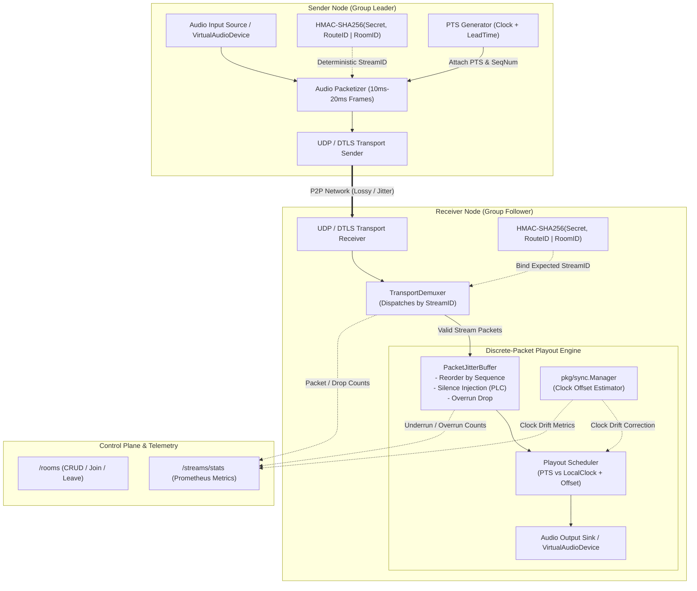

# ADR 0001: Deterministic Session Demultiplexing, Discrete-Packet Jitter Buffering, Virtual Audio Testbed, and Synchronized Group Streaming

* **Status:** Accepted
* **Deciders:** Core Systems Architecture Team, Real-Time Audio Infrastructure Engineering
* **Date:** 2026-09-25

## Context and Problem Statement

A rigorous code audit of the P2P Audio Router revealed critical architectural flaws that prevented multi-node network streaming, caused 100% remote audio packet rejection, and obscured pipeline regressions behind incomplete testing stubs:

1. **Random StreamID Generation and Ingress Filtering**:
   - Stream identifiers were generated randomly per node instance via runtime UUIDs. Receivers enforced strict local stream ID matching (`hdr.StreamID != s.streamID`), dropping all ingress packets transmitted by remote peers.
   - Ingress packet handlers discarded incoming packets if the sender IP was not already registered in the node's outbound routing table, breaking asymmetric or mesh routing topologies.
2. **JitterBuffer Granularity Mismatch**:
   - The jitter buffer configured `frameSize` to 2 bytes (`channels * 2`), assuming single PCM sample frames.
   - Network audio packets transmitted over UDP/DTLS deliver discrete time blocks of several hundred bytes (e.g., 960 to 1920 bytes for 10ms–20ms chunks of 48kHz stereo 16-bit PCM). As a result, `JitterBuffer.Push` rejected every incoming network packet due to size mismatches.
3. **Lack of End-to-End Pipeline Verification**:
   - The audio device emulator input driver (`emulatorInput.Write()`) was a no-op stub. Custom audio waveforms could not be injected into the transmission pipeline.
   - Integration tests only exercised in-memory loopback paths or isolated socket writes without testing packet decoding, jitter buffering, or playout verification.
4. **Unimplemented Group Streaming**:
   - `GroupStreamer` was an empty stub lacking packet distribution, presentation scheduling, and multi-node synchronization.
5. **Control Plane and Observability Gaps**:
   - The management plane lacked room lifecycle management endpoints (`/rooms`) and stream diagnostic telemetry (`/streams/stats`).

## Decision Drivers

* **Zero-Drop Ingress Routing**: Decouple ingress packet routing from ephemeral node state and symmetric outbound route tables.
* **Acoustic Continuity and Jitter Smoothing**: Buffer packetized audio blocks matching network transmission sizes rather than isolated samples, smoothing packet arrival variance over lossy networks.
* **Deterministic E2E Verification**: Enable headless CI/CD systems to inject synthetic audio, transmit it over real network transports (UDP/DTLS), and mathematically verify received playout.
* **Clock-Synchronized Playout**: Facilitate multi-device playback synchronization to eliminate acoustic echo and phase drift across local peer groups.
* **Production Observability**: Expose real-time packet loss, underrun, overrun, and room status metrics.

## Considered Options

* **Option 1**: Dynamic In-Band Signaling Handshake (Stateful SDP exchange and dynamic sample-level jitter buffer resizing).
* **Option 2**: Deterministic Key Derivation, Decoupled Transport Demultiplexing, Discrete-Packet Jitter Buffering, Presentation Timestamp (PTS) Synchronization, and Virtual Loopback Testbeds.
* **Option 3**: Transition to Centralized Media Relay Architecture (WebRTC Selective Forwarding Unit / SFU).

## Decision Outcome

Chosen Option: **Option 2**, because it preserves the low-latency, decentralized peer-to-peer architecture while eliminating signaling overhead, resolves foundational transport mismatches, and introduces a verifiable testing framework.

### Decision Specifications

1. **Deterministic Session ID Derivation**:
   - Session identifiers are calculated using HMAC-SHA256 over the route and room context:
     $$\text{StreamID} = \text{HMAC-SHA256}(\text{RouteSecret}, \text{RouteID} \parallel \text{RoomID})[:16]$$
   - Senders and receivers sharing the route secret compute identical StreamIDs independently, removing the requirement for stateful signaling handshakes prior to transmission.

2. **Transport Demultiplexer (`TransportDemuxer`)**:
   - Decouples incoming packet dispatching from outbound target registries.
   - Inspects the packet header `StreamID` and dispatches payloads to registered local stream channels and jitter buffers regardless of the sender's outbound presence.

3. **Discrete-Packet Jitter Buffer (`PacketJitterBuffer`)**:
   - Operates on discrete packet durations (10ms–20ms blocks) rather than sample frames.
   - Reorders out-of-order packets via 32-bit sequence numbers.
   - **Packet Loss Concealment (PLC)**: Injects zero-amplitude silence buffers upon consumer underrun.
   - **Overrun Mitigation**: Drops packets arriving older than the configured jitter window depth.

4. **Virtual Audio Device Testbed (`VirtualAudioDevice`)**:
   - Implements thread-safe mock hardware primitives: `InjectPush(pcmData)` for synthetic input injection and `CapturedBytes()` for output verification.
   - Enables headless automated assertions (bit-exact comparison and normalized cross-correlation) over UDP and DTLS network transports.

5. **Synchronized Group Audio Streaming (`SynchronizedGroupStreamer`)**:
   - The room leader stamps packets with a presentation timestamp (PTS) set to $T_{\text{current}} + T_{\text{lead}}$.
   - Follower nodes read clock offset estimates provided by `pkg/sync.Manager` and dynamically schedule playout relative to local clock domains to achieve synchronized playback.

6. **Control Plane & Diagnostic Telemetry**:
   - Introduces REST endpoints:
     - `POST /rooms`, `GET /rooms`, `POST /rooms/{id}/join`, `POST /rooms/{id}/leave`
     - `GET /streams/stats` exposing Prometheus metrics (`packets_received_total`, `packets_dropped_sequence_total`, `jitter_buffer_underruns_total`, `jitter_buffer_overruns_total`, `clock_drift_nanoseconds`).

---

## Consequences

### Positive Consequences

* **Complete Resolution of Packet Drop Failures**: Eliminates the 100% remote packet rejection bug caused by mismatched random StreamIDs and outbound filter restrictions.
* **Elimination of Buffer Ingestion Rejections**: Discrete-packet buffering natively ingests multi-hundred-byte network frames without size check errors.
* **Automated Regression Prevention**: Virtual audio devices allow continuous integration testing of real network streams without physical audio hardware.
* **Sub-Millisecond Multi-Device Alignment**: Phase-locked group playback eliminates acoustic delay artifacts across co-located peers.
* **Runtime Diagnostic Visibility**: Operators can inspect network jitter, underruns, and clock offsets via standard Prometheus monitoring tools.

### Negative Consequences

* **Shared Secret Pre-Configuration**: Peers must possess a shared `RouteSecret` and matching `RouteID`/`RoomID` prior to stream initialization.
* **Uniform Packet Duration Constraint**: Senders must adhere to a fixed packetization interval (e.g., 20ms); changing packet sizing requires jitter buffer reconfiguration.
* **Increased Memory Footprint**: Allocating discrete packet slots across concurrent streams increases memory consumption compared to primitive scalar ring buffers.
* **Packet Loss Sensitivity on Uncompressed PCM**: In high-loss environments exceeding jitter buffer depths, uncompressed PCM audio relies strictly on silence concealment (PLC), resulting in audible dropouts without Forward Error Correction (FEC).

---

## Visual Architecture

