# ADR 0002: Daemon Room Orchestration with Deterministic Multi-Node Audio Streaming and Ingress Format Agility

* **Status:** Accepted
* **Deciders:** Core Systems Architecture Team, Real-Time Audio Infrastructure Engineering
* **Date:** 2026-09-25

## Context and Problem Statement

Following the stabilization of deterministic session demultiplexing and discrete-packet jitter buffering (ADR 0001), real-world deployment across heterogeneous edge nodes revealed two major architectural gaps blocking production readiness:

1. **Lack of Daemon-Level Group Room Orchestration (Path A)**:
   - The daemon client (`cmd/client/main.go`) lacked integration with the HTTP control plane's `RoomManager` interface (`api.RoomManager`). Room lifecycle management (`/rooms`, `/rooms/{id}/join`, `/rooms/{id}/leave`) operated on mock stubs during tests but had no concrete daemon implementation.
   - Nodes lacked automated binding between network rooms and physical/virtual audio input/output hardware via an abstracted device provider (`DeviceProvider`).
   - Group audio streaming required dynamic role transitions (room leader vs. follower) with deterministic failover when a leader disconnects, avoiding external coordination clusters (such as Raft, Paxos, or ZooKeeper) that introduce unacceptable operational complexity for edge P2P mesh deployments.

2. **Ingress Format Rigidity and Audio Sample-Rate Mismatch (Path D)**:
   - Heterogeneous peer devices capture audio at different native hardware specifications: standard desktop and studio gear defaults to 48,000 Hz stereo, whereas consumer USB headsets, legacy audio interfaces, and CD-standard sources capture at 44,100 Hz, 16,000 Hz, or 8,000 Hz, in either mono (1 channel) or stereo (2 channels).
   - The wire protocol (`transport.PacketHeader`) accurately advertises sender audio parameters (`SampleRate uint32`, `Channels uint8`). However, the receiver's `JitterBuffer` requires a fixed `frameSize` matched to the local hardware output sink.
   - Injecting raw packets with mismatched sample rates or channel counts directly into the jitter buffer caused immediate packet rejection or fatal buffer corruption, accompanied by severe acoustic artifacts (pitch shifts, time stretching, channel interleaving corruption).
   - Resampling in the downstream audio playout loop violated real-time audio constraints by introducing variable CPU cycles, lock contention, and garbage collection pressure on the time-critical playout deadline.

## Decision Drivers

* **Zero-Configuration Daemon Integration**: Expose room management directly through daemon CLI parameters (`-room-id`, `-room-name`, `-room-auto-join`) and HTTP REST APIs, abstracting audio hardware acquisition through a unified device provider.
* **Autonomous & Resilient Leadership**: Enable decentralized, deterministic leader election and failover across mesh peers without external consensus dependencies or split-brain risk.
* **Universal Audio Ingress Interoperability**: Ingest audio streams of arbitrary sample rates (e.g., 44.1 kHz, 48 kHz, 16 kHz) and channel counts (mono vs. stereo) without requiring prior sender-receiver format negotiation.
* **Playout Path Isolation & Real-Time Predictability**: Keep the jitter buffer and real-time audio output callback completely free of dynamic resampling math, allocations, and format branching.
* **Zero-Allocation Hot Path**: Perform channel mapping and rate conversion with pre-allocated scratch buffers per peer session to ensure zero heap allocations during steady-state packet processing.
* **Acoustic Continuity**: Preserve fractional phase across network packet boundaries during resampling to eliminate audio clicks, pops, and phase discontinuities.
* **Automated End-to-End Verifiability**: Provide programmatic multi-node test suites validating automated leader failover and heterogeneous rate conversion over actual UDP network transports.

## Considered Options

* **Option 1: Sender-Side Pre-Negotiation & Strict Rejection (Uniform Global Format Enforcement)**
  - Require all peers to negotiate a common format (e.g., via SDP offer/answer) before transmission, forcing senders to match receiver specs, or reject any packet not matching the local sink format.
  - *Drawbacks*: Requires complex multi-party signaling before audio can flow; impossible in multicast/broadcast rooms with multiple receivers possessing differing output hardware without forcing senders to encode multiple separate streams.

* **Option 2: Playout-Time Dynamic Resampling inside JitterBuffer Playout Loop**
  - Store heterogeneous packets directly in the jitter buffer and perform channel conversion and resampling on the fly when the audio hardware pulls PCM frames from `JitterBuffer.PopNonBlock()`.
  - *Drawbacks*: Destabilizes the jitter buffer depth calculation because packet durations vary; places high-complexity DSP calculations in the time-critical playout callback, causing deadline misses, audio underruns, and severe lock contention.

* **Option 3: Ingress Pipeline Normalization (`IngressAdapter`) with Pre-Allocated Scratch Buffers & Daemon `DefaultRoomManager` Orchestration**
  - Implement a concrete `DefaultRoomManager` in `pkg/group` that coordinates room membership, device provider binding, and deterministic lowest-PeerID leader failover.
  - Insert an `IngressAdapter` immediately after packet receipt/demultiplexing and prior to `JitterBuffer.Push`, transforming any incoming packet into the local output sink's canonical format (e.g., 48 kHz 16-bit stereo) using zero-allocation linear interpolation with fractional phase memory.
  - *Drawbacks*: Requires pre-allocating small scratch buffers (~16 KB) per active peer session; linear interpolation introduces minor high-frequency attenuation compared to multi-tap polyphase sinc filters.

## Decision Outcome

Chosen Option: **Option 3**, because it preserves real-time playout determinism, decouples senders from receiver hardware constraints, ensures zero heap allocations on the audio hot-path, and provides a fully autonomous room management control plane.

---

### Decision Specifications

#### 1. Concrete Room Orchestration (`pkg/group.DefaultRoomManager`)

The `DefaultRoomManager` coordinates room lifecycle, peer membership discovery, leader election, and audio streamer binding:

* **Control Plane API Integration**: Implements the `api.RoomManager` interface (`ListRooms`, `CreateRoom`, `JoinRoom`, `LeaveRoom`), registering endpoints with `api.NewServer`.
* **Hardware Device Abstraction (`DeviceProvider`)**:
  - Encapsulates physical and virtual audio hardware acquisition:
    ```go
    type DeviceProvider interface {
        GetInputDevice(name string) (audio.AudioStream, error)
        GetOutputDevice(name string) (audio.AudioStream, error)
    }
    ```
  - Automatically binds capture devices when elected leader and playback sinks when operating as a follower.
* **Deterministic Leader Election & Dynamic Failover**:
  - Leverages the convergent discovery table: the active member with the lexicographically lowest `PeerID` is elected room leader.
  - Periodic heartbeats (2-second intervals) refresh peer lease timestamps (`LastSeen`).
  - When the room leader ceases heartbeats exceeding the timeout threshold ($T_{\text{timeout}} = 3 \times T_{\text{heartbeat}} = 6\text{s}$), peers evict the leader and re-run election deterministically.
  - The newly elected leader automatically transitions its local streamer pipeline from follower playback to leader capture/broadcast mode without manual intervention.

#### 2. Ingress Format Agility Pipeline (`pkg/streamer.IngressAdapter`)

The `IngressAdapter` sits between the network demultiplexer (`TransportDemuxer`) and the `JitterBuffer`:

```
UDP Socket -> TransportDemuxer -> IngressAdapter -> JitterBuffer -> Playout Scheduler -> Audio Sink
```

* **Header Inspection**: Reads `hdr.SampleRate` and `hdr.Channels` from the prepended `transport.PacketHeader` (RFC wire layout).
* **Channel Remapping**:
  - **Mono to Stereo ($1 \to 2$)**: Duplicates the mono 16-bit PCM sample to both Left and Right channels:
    $$L[n] = S_{\text{mono}}[n], \quad R[n] = S_{\text{mono}}[n]$$
  - **Stereo to Mono ($2 \to 1$)**: Averages Left and Right channels with arithmetic overflow avoidance:
    $$S_{\text{mono}}[n] = \left\lfloor \frac{L[n] + R[n]}{2} \right\rfloor$$
  - **Passthrough ($C_{\text{in}} == C_{\text{out}}$)**: Direct memory transfer without channel modification.
* **Linear Resampling with Fractional Phase Carry-Over**:
  - Given source rate $F_{\text{in}}$ and target rate $F_{\text{out}}$, the step ratio is:
    $$\Delta = \frac{F_{\text{in}}}{F_{\text{out}}}$$
  - Playout sample at target index $m$ is interpolated from source samples at integer floor $k = \lfloor \phi \rfloor$ and fractional offset $\alpha = \phi - k$:
    $$S_{\text{out}}[m] = (1 - \alpha) \cdot S_{\text{in}}[k] + \alpha \cdot S_{\text{in}}[k + 1]$$
  - **Inter-Packet Phase Memory**: The fractional phase $\phi_{\text{rem}} = \phi - \lfloor \phi \rfloor$ is preserved across packet boundaries. The last sample of packet $N$ serves as $S_{\text{in}}[0]$ for packet $N+1$, completely eliminating boundary boundary-click distortion and sample drift.
* **Zero-Allocation Memory Architecture**:
  - Each `IngressAdapter` pre-allocates static intermediate and output scratch buffers sized for the maximum anticipated packet duration (up to 40ms of 192 kHz stereo audio, $\approx 16\text{ KB}$).
  - Ingress conversions operate entirely in-place or across pre-allocated buffers; zero allocations occur during steady-state processing.

#### 3. Daemon CLI and Graceful Teardown (`cmd/client/main.go`)

* **Configuration & Flags**: Introduces `-room-id`, `-room-name`, and `-auto-join` CLI options.
* **Lifecycle Coordination**:
  - Wires `DefaultRoomManager` into `api.NewServer` alongside existing route streamers.
  - Registers OS signal listeners (`SIGINT`, `SIGTERM`).
  - Upon shutdown signal, executes coordinated teardown: closes active rooms via `LeaveRoom()`, unregisters discovery presence, closes audio devices, and shuts down network transports cleanly.

#### 4. End-to-End Automated Verification Suites

* **Multi-Node Room Failover E2E (`pkg/group/room_e2e_test.go`)**:
  - Boots 3 virtual nodes sharing discovery over UDP loopback.
  - Verifies Node 0 (lowest PeerID) assumes leadership and initiates group transmission.
  - Abruptly terminates Node 0; validates Node 1 detects timeout, assumes leadership within 6 seconds, and resumes streaming to Node 2 without deadlocks.
* **Format-Agile Audio E2E (`pkg/streamer/format_agile_e2e_test.go`)**:
  - Injects synthetic 44.1 kHz mono sinusoidal PCM into a sender pipeline.
  - Transmits over UDP transport with wire headers declaring 44.1 kHz, 1 channel.
  - Receiver configured for 48.0 kHz stereo receives, adapts, buffers, and plays out into a `VirtualAudioDevice`.
  - Asserts packet acceptance rate is 100%, output format matches 48.0 kHz stereo, and total harmonic distortion/cross-correlation confirms signal integrity.

---

## Consequences

### Positive Consequences

* **Universal Mesh Interoperability**: Any node running any audio hardware (44.1 kHz, 48 kHz, mono, stereo) can participate in group sessions without format negotiation or stream rejection.
* **Deterministic Playout Guarantees**: The real-time playout loop only consumes pre-standardized, uniform frames from `JitterBuffer`, maintaining constant execution time and zero allocations.
* **Autonomous Self-Healing Topology**: Deterministic lowest-PeerID leadership requires no centralized coordinators (etcd, Raft, Consul), providing high fault tolerance in P2P edge networks.
* **Zero Steady-State GC Overhead**: Fixed pre-allocated scratch buffers prevent Go runtime garbage collector pauses from inducing audio underruns.
* **Complete Management Plane**: Full daemon integration exposes unified room control via CLI parameters and REST APIs.

### Negative Consequences

* **Linear Interpolation Frequency Attenuation**: High-frequency spectral roll-off occurs near the Nyquist frequency compared to sinc-based polyphase filter banks. (Evaluated as acceptable: Voice and real-time collaboration codecs prioritize sub-millisecond conversion latency over high-order spectral purity).
* **Static Memory Consumption**: Pre-allocating ingress buffers incurs ~16 KB of pinned heap per active incoming stream session.
* **Phase Carry-Over Reset on Packet Loss**: In the event of dropped network packets, the fractional phase anchor resets, introducing an unavoidable micro-phase step across dropped frame boundaries until sequence resumption.

---

## Visual Architecture

```mermaid
flowchart TB
    subgraph SenderNode ["Sender Node (Arbitrary Format: 44.1 kHz Mono)"]
        AudioIn["Audio Input Device / Hardware Capture\n(44.1 kHz, 1 Channel, 16-bit PCM)"]
        HdrBuilder["PacketHeader Builder\n- SampleRate: 44100\n- Channels: 1\n- StreamID: HMAC(RoomID)\n- Seq & PTS"]
        TransportOut["UDP Transport Socket"]

        AudioIn --> HdrBuilder
        HdrBuilder --> TransportOut
    end

    TransportOut ==>|"P2P UDP / DTLS Network"| TransportIn

    subgraph ReceiverNode ["Receiver Node (Target Format: 48.0 kHz Stereo)"]
        TransportIn["UDP Transport Socket"]
        Demux["TransportDemuxer\n(Demux by StreamID)"]

        subgraph FormatAgilityPipeline ["Ingress Format Agility (Zero Allocation)"]
            PktUnmarshal["Header Unmarshal\n(Extract 44.1kHz, Mono)"]
            ChanMapper["Channel Remapper\n(Mono -> Stereo Duplication)"]
            Resampler["Linear Resampler with Phase Memory\n- Step: 44.1 / 48.0\n- Fractional Phase Carry-Over\n- Pre-allocated Scratch Buffer (~16KB)"]

            PktUnmarshal --> ChanMapper
            ChanMapper --> Resampler
        end

        subgraph PlayoutEngine ["Real-Time Playout Engine (Deterministic)"]
            JB["JitterBuffer\n(Uniform 48kHz Stereo Frames)"]
            Scheduler["Playout Scheduler\n(PTS vs Clock Offset)"]
            AudioOut["Audio Output Sink / Hardware\n(48.0 kHz, 2 Channels, 16-bit PCM)"]

            JB --> Scheduler
            Scheduler --> AudioOut
        end

        TransportIn --> Demux
        Demux --> PktUnmarshal
        Resampler -->|"Standardized 48kHz Stereo Packet"| JB
    end

    subgraph ControlAndOrchestration ["Control Plane & Room Orchestration"]
        CLI["CLI Flags\n(-room-id, -room-name)"]
        APIServer["REST API (/rooms)\nDefaultRoomManager"]
        DevProvider["DeviceProvider\n(Auto Audio Binding)"]
        LeaderElection["Deterministic Leader Election\n(Lowest PeerID + Heartbeat TTL)"]

        CLI --> APIServer
        APIServer --> LeaderElection
        LeaderElection --> DevProvider
        DevProvider -.->|"Bind Capture / Sink"| AudioIn
        DevProvider -.->|"Bind Playout Sink"| AudioOut
    end
```


