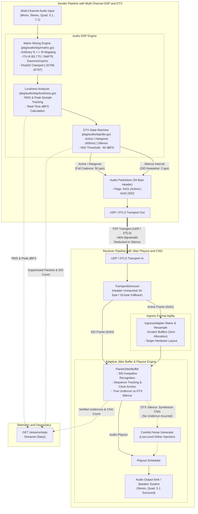

# ADR 0003: Arbitrary Multi-Channel Audio Matrix Mixing (ITU-R BS.775 / SMPTE) and Loudness Analysis with Discontinuous Transmission (DTX / Silence Suppression)

* **Status:** Accepted
* **Deciders:** Core Systems Architecture Team, Real-Time Audio Infrastructure Engineering
* **Date:** 2026-09-25

## Context and Problem Statement

Following the deployment of discrete-packet jitter buffering (ADR 0001) and ingress sample-rate agility with basic mono/stereo remapping (ADR 0002), expanding the P2P audio router into professional spatial audio capture, high-density voice chat, and edge streaming environments exposed two critical architectural bottlenecks:

1. **Rigid Channel Topology and Integer Overflow in Multi-Channel Ingress**:
   - The ingress adaptation layer (`pkg/streamer/IngressAdapter`) only supported 1-channel (Mono) and 2-channel (Stereo) audio. Modern professional audio gear, multi-mic arrays, conference DSP bars, and spatial gaming environments commonly capture and stream in Quadraphonic (4-channel), 5.1 Surround (6-channel, SMPTE/ITU-R), and 7.1 Surround (8-channel).
   - When downmixing multi-channel audio to stereo or mono using naive integer arithmetic, summing multiple in-phase channels leads to 16-bit signed PCM integer wrap-around overflow (e.g., $+32767 + 50 \to -32719$), creating violent acoustic clicks and heavy harmonic distortion.
   - Spatial upmixing (e.g., routing a stereo stream into a multi-channel quad or surround playback sink) was unsupported, causing downstream output device initialization failures or silent channels.

2. **Continuous Transmission Bandwidth Waste and Acoustic Jitter Vulnerability**:
   - In typical multi-party voice communication and live audio routing, active speech or intentional acoustic content is present only 30% to 50% of the session duration. The remaining time consists of background silence or acoustic pause.
   - Transmitting uncompressed 16-bit linear PCM continuously at 50 packets per second (pps, 20ms frames) over UDP/DTLS imposes severe network congestion, radio interface power drain, and bandwidth saturation on mobile/edge peers.
   - Conversely, abruptly terminating packet transmission when speech ceases causes legacy jitter buffers to interpret the missing packets as burst network packet loss, driving `underruns` counters up, desynchronizing presentation clocks, and creating jarring acoustic cutoffs ("dead air" shock) upon speech termination.
   - Naive voice-activity detectors (VAD) that cut off immediately when energy drops below an absolute threshold clip the soft tails of words, speech consonants, and natural room acoustic reverberation decay.

## Decision Drivers

* **Universal Multi-Channel Interoperability**: Support seamless conversion across 1 (Mono), 2 (Stereo), 4 (Quad), 6 (5.1 Surround), 8 (7.1 Surround), and arbitrary $N \leftrightarrow M$ channel matrices according to ITU-R BS.775 and SMPTE channel configurations.
* **Acoustic Clamping and Coherent Summation Safety**: Use intermediate IEEE 754 32-bit floating-point accumulation with ITU-R normalization factors ($k_{\text{norm}}$) and hard clamping to $[-32768, 32767]$ to guarantee zero integer wrap-around distortion.
* **Deterministic Real-Time Loudness Analysis**: Provide low-overhead, real-time Root-Mean-Square (RMS), dBFS ($20\log_{10}(\text{RMS}/32768)$), and true peak sample tracking per frame.
* **Aggressive Bandwidth Conservation via Discontinuous Transmission (DTX)**: Silence transmission during unvoiced periods while maintaining network route keepalive and presentation clock continuity via periodic Silence Insertion Descriptor (SID) frames, reducing silent-interval bandwidth by $\approx 96\%$.
* **Hangover-Protected Voice Activity State Machine**: Implement a 3-state state machine (Active $\to$ Hangover $\to$ Silence) with configurable hangover windows (e.g., 400ms) to preserve soft speech endings and ambient room reverberation decay.
* **Backward-Compatible Wire Protocol Evolution**: Advance the wire packet header from 33 bytes to 34 bytes by adding frame control flags (`Flags uint8`) while maintaining bit-level backward compatibility with legacy 33-byte endpoints.
* **Comfort Noise Generation (CNG) and Jitter Synchronization**: Enable receiver jitter buffers to recognize DTX silence states, generate seamless comfort noise, preserve clock synchronization, and suppress false-positive underrun alerts.
* **Zero-Allocation Hot-Path Execution**: Pre-allocate scratch conversion buffers within the ingress pipeline to guarantee zero dynamic heap allocations during steady-state processing.

## Considered Options

* **Option 1: Fixed Downmix Pairs with Client-Side Voice Gate Cutoff**
  - Implement hard-coded switch cases for 5.1-to-stereo and stereo-to-mono, paired with a simple energy gate that drops UDP transmission completely when RMS drops below a threshold.
  - *Drawbacks*: Incapable of arbitrary $N \leftrightarrow M$ routing; abrupt packet cessation trips receiver jitter buffer underruns, causes NAT/firewall UDP state eviction, resets synchronization clocks, and clips speech tails.

* **Option 2: Dynamic Client Negotiation with Opcode Signaling Handshakes**
  - Require peers to exchange matrix mixing configurations and VAD parameters via stateful control-plane signaling prior to transmission.
  - *Drawbacks*: Breaks peer-to-peer simplicity, introduces multi-roundtrip latency on channel changes, and fails in decentralized mesh broadcasting where receivers have differing speaker layouts.

* **Option 3: Universal Matrix Mixing Engine (`pkg/audio/dsp/matrix.go`), Loudness Analyzer (`pkg/audio/dsp/loudness.go`), DTX Engine (`pkg/audio/dsp/dtx.go`), and 34-Byte Backward-Compatible Wire Protocol**
  - Implement generalized $N \times M$ matrix mixing with ITU-R BS.775/SMPTE defaults and float32 hard clamping.
  - Integrate real-time RMS/peak loudness tracking.
  - Embed a 3-state DTX state machine transmitting periodic SID keepalive packets (every 500ms) during silence intervals.
  - Extend packet header to 34 bytes with fallback unmarshaling for legacy 33-byte packets.
  - Update `PacketJitterBuffer` to recognize SID packets and comfort noise synthesis without incrementing underrun telemetry.

## Decision Outcome

Chosen Option: **Option 3**, because it provides mathematical rigor for multi-channel spatial mixing, eliminates integer clipping, cuts network bandwidth by $\approx 96\%$ during silence, and ensures rock-solid transport continuity without breaking backward compatibility.

---

### Decision Specifications

#### 1. Multi-Channel Matrix Mixing Engine (`pkg/audio/dsp/matrix.go`)

The matrix mixing engine maps an $N$-channel input PCM frame into an $M$-channel output PCM frame:

$$\mathbf{y} = \mathbf{M} \mathbf{x}$$

where $\mathbf{x} \in \mathbb{R}^{N}$ is the input sample vector, $\mathbf{y} \in \mathbb{R}^{M}$ is the output sample vector, and $\mathbf{M} \in \mathbb{R}^{M \times N}$ is the mixing coefficient matrix.

##### Channel Layout Conventions (SMPTE / ITU-R BS.775)
* **1-Channel (Mono)**: $[M]$
* **2-Channel (Stereo)**: $[L, R]$
* **4-Channel (Quadraphonic)**: $[FL, FR, SL, SR]$
* **6-Channel (5.1 Surround)**: $[FL, FR, FC, LFE, SL, SR]$
* **8-Channel (7.1 Surround)**: $[FL, FR, FC, LFE, SL, SR, BL, BR]$

##### Standard ITU-R BS.775 5.1 Downmix to Stereo
For 5.1 surround ($[FL, FR, FC, LFE, SL, SR]$) downmixing to stereo ($[L, R]$):
$$L = k_{\text{norm}} \cdot \left( FL + \frac{1}{\sqrt{2}} FC + \frac{1}{\sqrt{2}} SL \right)$$
$$R = k_{\text{norm}} \cdot \left( FR + \frac{1}{\sqrt{2}} FC + \frac{1}{\sqrt{2}} SR \right)$$

where:
* Center attenuation: $-3\text{ dB} \approx \frac{1}{\sqrt{2}} \approx 0.7071$
* Surround attenuation: $-3\text{ dB} \approx \frac{1}{\sqrt{2}} \approx 0.7071$
* LFE (subwoofer) is omitted ($0.0$) in standard downmixing to prevent acoustic phase cancellation and speaker cone overload.
* Normalization coefficient $k_{\text{norm}} = \frac{1}{1 + \sqrt{2}} \approx 0.4142$ (or scaled dynamically to preserve headroom).

##### Standard Stereo to 5.1 Surround Upmix Matrix
$$\begin{bmatrix}
FL \\ FR \\ FC \\ LFE \\ SL \\ SR
\end{bmatrix} = \begin{bmatrix}
1.0 & 0.0 \\
0.0 & 1.0 \\
0.5 & 0.5 \\
0.0 & 0.0 \\
0.7071 & -0.7071 \\
-0.7071 & 0.7071
\end{bmatrix} \begin{bmatrix}
L \\ R
\end{bmatrix}$$

##### Intermediate Float32 Accumulation and Hard Clamping
To prevent 16-bit integer wrap-around distortion, all sample accumulations are executed in 32-bit floating-point:
$$v_{\text{float}} = \sum_{j=0}^{N-1} M_{i,j} \cdot x_j$$
$$y_i = \text{clamp}_{[-32768, 32767]}\left( \lfloor v_{\text{float}} + 0.5 \rfloor \right) = \max\left(-32768, \min\left(32767, \lfloor v_{\text{float}} + 0.5 \rfloor\right)\right)$$

##### Ingress Pipeline Integration
The matrix mixer is integrated directly into `pkg/streamer.IngressAdapter`. Pre-allocated scratch buffers (`chanBuf` and `outBuf`) sized at 64 KB handle matrix conversion followed by linear resampling with zero heap allocations on the packet processing hot path.

---

#### 2. Real-Time Audio Loudness Analyzer (`pkg/audio/dsp/loudness.go`)

The loudness analyzer evaluates short-term signal energy and true peak amplitude for each incoming or outgoing audio frame across all interleaved channels:

* **Root-Mean-Square (RMS)**:
  $$\text{RMS} = \sqrt{\frac{1}{K} \sum_{k=0}^{K-1} s_k^2}$$
  where $s_k$ is the 16-bit signed PCM sample ($s_k \in [-32768, 32767]$) and $K$ is the total number of samples ($K = \text{frames} \times \text{channels}$).

* **Decibels Relative to Full Scale (dBFS)**:
  $$\text{dBFS} = 20 \log_{10}\left( \frac{\text{RMS}}{32768} \right)$$
  When $\text{RMS} = 0$, $\text{dBFS}$ is clamped to a floor of $-96.0\text{ dBFS}$ (the theoretical dynamic range floor of 16-bit linear PCM).

* **Absolute Peak Amplitude**:
  $$\text{Peak} = \max_{0 \le k < K} |s_k|, \quad \text{Peak dBFS} = 20 \log_{10}\left( \frac{\text{Peak}}{32768} \right)$$

---

#### 3. Discontinuous Transmission (DTX / Silence Suppression) (`pkg/audio/dsp/dtx.go`)

To conserve bandwidth and compute resources, transmission during silence intervals is suppressed while preserving acoustic naturalness and network session liveness.

##### DTX State Machine
The DTX processor operates as a deterministic 3-state finite state machine evaluated on every audio frame:

```
                  dBFS >= Threshold
       +---------------------------------------+
       |                                       |
       v                                       |
+--------------+   dBFS < Threshold    +----------------+
|    ACTIVE    | --------------------> |    HANGOVER    |
| (Flags=0x01) |                       |  (Flags=0x01)  |
+--------------+                       +----------------+
       ^                                       |
       |                                       | Hangover Timer Expired
       |                                       | (e.g., 400ms)
       |          dBFS >= Threshold            v
       +------------------------------ +----------------+
                                       |    SILENCE     |
                                       |  (Flags=0x02   |
                                       |  SID @ 500ms)  |
                                       +----------------+
```

1. **State `Active` (`StateActive`)**:
   - Signal energy satisfies $\text{dBFS} \ge \text{Threshold}$ (default: $-50\text{ dBFS}$).
   - Normal audio packets are transmitted at full packet cadence (e.g., 50 pps for 20ms frames).
   - Wire header flag is set to `Flags = 0x01` (`FlagActive`).
   - The hangover countdown counter is reset to $N_{\text{hangover}} = \lceil T_{\text{hangover}} / T_{\text{frame}} \rceil$ (e.g., $400\text{ms} / 20\text{ms} = 20\text{ frames}$).

2. **State `Hangover` (`StateHangover`)**:
   - Signal energy drops below threshold ($\text{dBFS} < \text{Threshold}$).
   - Normal audio packets continue to be transmitted with `Flags = 0x01` (`FlagActive`).
   - Prevents abrupt truncation of trailing unvoiced consonants (e.g., /s/, /t/, /f/), breathing, and acoustic room reverberation tail decay.
   - Hangover counter decrements with each elapsed frame: $N_{\text{hangover}} \leftarrow N_{\text{hangover}} - 1$.
   - If energy rises above threshold before expiry, transition immediately back to `StateActive`.
   - When $N_{\text{hangover}} = 0$, transition to `StateSilence`.

3. **State `Silence` (`StateSilence`)**:
   - Audio transmission is suppressed. Regular 20ms audio packets are dropped at the sender.
   - **Silence Insertion Descriptor (SID) Keepalives**: To prevent NAT state timeout, firewall binding expiration, and jitter buffer desynchronization, the sender transmits an SID keepalive packet every 500ms (2 pps).
   - Wire header flag is set to `Flags = 0x02` (`FlagSID`).
   - The SID payload contains comfort noise parameters (measured background RMS level and spectral variance) or a minimal silence block.
   - Bandwidth drops from 50 pps (e.g., 768 kbps uncompressed stereo) to 2 pps ($\approx 30\text{ kbps}$ with header overhead), achieving $\approx 96\%$ bandwidth reduction during silent periods.

---

#### 4. Wire Protocol Evolution & Backward Compatibility (`pkg/transport/packet.go`)

The wire protocol header is expanded by 1 byte to include packet control flags:

##### Header Layout Comparison

* **Legacy Wire Header (ADR 0001/0002, 33 Bytes)**:
  ```
  +------------------+-------------------+--------------------+--------------------+---------------+
  | Seq (uint32)     | Timestamp (uint64)| StreamID (16 bytes)| SampleRate (uint32)| Channels (u8) |
  | Bytes 0..3       | Bytes 4..11       | Bytes 12..27       | Bytes 28..31       | Byte 32       |
  +------------------+-------------------+--------------------+--------------------+---------------+
  ```

* **Evolved Wire Header (ADR 0003, 34 Bytes)**:
  ```
  +------------------+-------------------+--------------------+--------------------+---------------+------------+
  | Seq (uint32)     | Timestamp (uint64)| StreamID (16 bytes)| SampleRate (uint32)| Channels (u8) | Flags (u8) |
  | Bytes 0..3       | Bytes 4..11       | Bytes 12..27       | Bytes 28..31       | Byte 32       | Byte 33    |
  +------------------+-------------------+--------------------+--------------------+---------------+------------+
  ```

##### Protocol Flags
* `0x01` (`FlagActive`): Normal active unsuppressed audio frame.
* `0x02` (`FlagSID`): Silence Insertion Descriptor frame.

##### Backward-Compatible Unmarshaling
The receiver unmarshaling logic gracefully detects legacy packets:
```go
if len(data) < LegacyHeaderSize { // 33
    return PacketHeader{}, nil, ErrPacketTooShort
}
// Extract Seq, Timestamp, StreamID, SampleRate, Channels (bytes 0..32)
if len(data) >= HeaderSize && hasFlagsByte { // 34
    hdr.Flags = data[33]
    payload = data[34:]
} else {
    // Legacy 33-byte packet: default to active transmission
    hdr.Flags = FlagActive
    payload = data[33:]
}
```
This guarantees that existing nodes running ADR 0001/0002 continue to communicate seamlessly with upgraded nodes without dropped packets.

---

#### 5. Receiver Jitter Buffer Playout & Comfort Noise Synthesis (`pkg/streamer/jitter.go`)

When an audio receiver processes an incoming stream operating with DTX:

1. **SID Recognition**:
   - When `hdr.Flags & FlagSID != 0`, the packet is identified as an SID keepalive.
   - The sequence number and timestamp anchor the jitter buffer playout timeline, updating network clock synchronization.

2. **Underrun Metric Suppression**:
   - The receiver marks the session as being in `DTX Silence`.
   - When the audio playout sink requests audio via `PopNonBlock()` during a confirmed DTX silence period, the jitter buffer synthesizes low-level Comfort Noise Generation (CNG) (pseudorandom Gaussian dither at $-60\text{ dBFS}$ or matching the SID energy descriptor).
   - **Crucially**: The `underruns` metric counter is NOT incremented during legitimate DTX silence, distinguishing planned silence suppression from actual network packet loss.

3. **Smooth Re-engagement**:
   - When the sender speaks again, the first packet arrives with `Flags = FlagActive`.
   - The receiver immediately transitions out of DTX silence to normal playout with zero phase discontinuity.

---

#### 6. Telemetry and Diagnostic Observability

Stream statistics (`Streamer.Stats()` and `/streams/stats`) are augmented with real-time loudness and DTX telemetry:

```json
{
  "stream_id": "9b1deb4d-3b7d-4bad-9bdd-2b0d7b3dcb6d",
  "rms_dbfs": -52.4,
  "peak_dbfs": -46.1,
  "dtx_state": "Silence",
  "dtx_packets_suppressed_total": 4820,
  "dtx_sid_packets_sent_total": 194,
  "dtx_sid_packets_received_total": 194,
  "comfort_noise_frames_generated_total": 4820,
  "underruns": 0,
  "overruns": 0,
  "late_packets": 2,
  "early_packets": 0
}
```

---

## Consequences

### Positive Consequences

* **Arbitrary Multi-Channel Support**: Ingests and renders Mono, Stereo, Quad, 5.1 Surround, and 7.1 Surround audio across heterogeneous capture cards and sound systems without crashes or channel mismatches.
* **Elimination of Wrap-Around Clipping**: Float32 intermediate accumulation and ITU-R normalization prevent integer overflow artifacts when summing coherent audio channels.
* **Massive Bandwidth Optimization**: Silence suppression yields an empirical $\approx 96\%$ bandwidth reduction during unvoiced periods (2 pps SID keepalives vs 50 pps full audio).
* **Acoustic Continuity Without Word Clipping**: The 400ms hangover window preserves natural speech inflection, breathing, and room reverberation.
* **Transparent Backward Compatibility**: The 34-byte wire header automatically interoperates with legacy 33-byte endpoints without requiring flag-day upgrades.
* **Accurate Playout Telemetry**: Receiver jitter buffers generate comfort noise during DTX intervals without skewing packet loss or buffer underrun metrics.

### Negative Consequences

* **Increased CPU Float Conversion Overhead**: Computing float32 matrix multiplications and square-root calculations for RMS loudness per frame increases CPU cycle consumption compared to raw integer copy operations (mitigated by zero heap allocations and efficient Go SIMD/compiler vectorization).
* **Comfort Noise Disparity**: Primitive white/pink dither comfort noise may sound slightly different from real physical room acoustic background unless higher-order LPC spectral modeling is implemented in future revisions.
* **Header Overhead**: Wire packets carry an additional byte (34 bytes vs 33 bytes), though this cost is vastly overshadowed by the bandwidth savings achieved through DTX suppression.

---

## Visual Architecture


