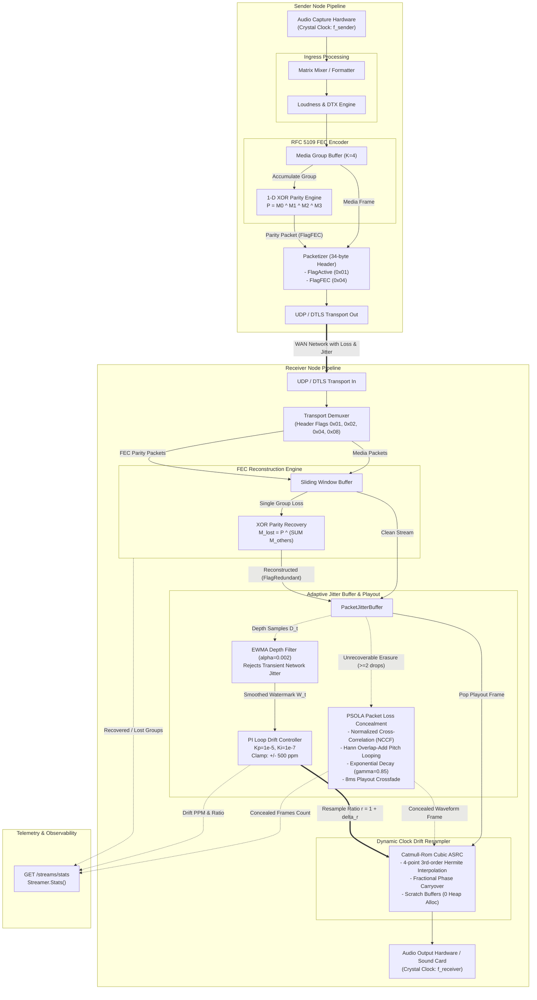

# ADR 0004: Forward Error Correction (FEC), Packet Loss Concealment (PLC), and Adaptive Clock Drift Compensation (ASRC)

* **Status:** Accepted
* **Deciders:** Core Systems Architecture Team, Real-Time Audio Infrastructure Engineering
* **Date:** 2026-09-25

## Context and Problem Statement

Following the introduction of format-agile downmixing/upmixing and Discontinuous Transmission (ADR 0002, ADR 0003), expanding the P2P audio router across unmanaged wide-area networks (WAN), wireless links (Wi-Fi/5G), and heterogeneous hardware sound cards uncovered three fundamental distributed audio degradation phenomena:

1. **Intolerable Playout Delay from ARQ Retransmission over Lossy Networks**:
   - WAN and high-jitter peer-to-peer networks routinely suffer from transient burst packet loss (1% to 15%) and arrival jitter.
   - Traditional Automatic Repeat reQuest (ARQ) retransmission requires at least one round-trip time (RTT). In cross-region or edge mesh topologies where RTT spans 50ms to 150ms, ARQ exceeds the strict ultra-low-latency real-time audio playout budget (target latency $\le 40\text{ms}$). Packets arriving via ARQ arrive far too late for real-time playout and are dropped as stale by the jitter buffer.
   - Without proactive loss protection, uncompressed linear PCM frames are dropped entirely, creating severe acoustic dropouts.

2. **Audible Transients and Phase Discontinuities from Missing PCM16 Frames**:
   - Linear 16-bit PCM streams carry uncompressed time-domain waveforms. When a 10ms–20ms packet is lost, simple zero-insertion (muting) or last-frame repetition causes instantaneous rectangular step discontinuities at the frame boundaries.
   - These step discontinuities manifest psychoacoustically as high-frequency clicks, pops, and harsh phase distortion.
   - Prolonged loss bursts (>40ms) with naive repetition cause metallic robotic artifacts, while abrupt muting creates jarring acoustic shock.

3. **Cumulative Crystal Oscillator Asynchrony (Clock Drift)**:
   - Physical capture devices (senders) and sound cards (receivers) run on discrete, unsynchronized quartz crystal oscillators with manufacturing tolerances and thermal variations of $\pm 20$ to $\pm 50$ parts-per-million (ppm).
   - A drift of 50 ppm represents a cumulative divergence of 2.4 samples per second at 48 kHz (~1 frame of 960 samples every 400 seconds).
   - Over prolonged sessions (tens of minutes to hours), sender-faster clock drift inevitably overflows receiver jitter buffers (buffer bloat, causing latency spikes and forced sample drops), whereas receiver-faster clock drift drains jitter buffers to zero (buffer starvation, causing periodic underruns and clicks).
   - Hard drop/insert sample decimation creates audible clicks and phase cancellation in multi-channel speaker feeds.

## Decision Drivers

* **Zero-RTT Loss Recovery**: Reconstruct lost audio frames in real time without incurring network round-trip retransmission penalties.
* **Deterministic Low-Overhead Parity Math**: Protect media bursts using standard 1-D XOR parity coding with bounded bandwidth overhead ($\le 25\%$) and negligible CPU overhead.
* **Psychoacoustically Transparent Concealment**: Mask unrecoverable burst packet loss using time-domain pitch estimation and Hann-windowed waveform overlap-add synthesis, decaying gracefully to silence over extended dropouts.
* **Continuous Sub-PPM Clock Drift Synchronization**: Decouple transient packet arrival jitter from physical crystal oscillator drift, dynamically tracking the nominal buffer watermark.
* **Micro-Fractional Dynamic Playout Resampling**: Resample ingress audio on the fly with sub-cent pitch preservation ($\le \pm 500\text{ ppm}$ / $\pm 0.05\%$) using 4-point 3rd-order Catmull-Rom cubic interpolation with fractional phase carryover.
* **Zero-Allocation Steady-State Execution**: Maintain zero dynamic heap allocations on the packet ingress, parity reconstruction, and playout synthesis hot paths.
* **Wire Protocol Backward Compatibility**: Seamlessly interoperate with legacy 33-byte (ADR 0001/0002) and 34-byte (ADR 0003) endpoints through bit-flag extensions.

## Considered Options

* **Option 1: ARQ Retransmission, Zero-Fill/Silence Concealment, and Hard Sample Dropping**
  - Implement NACK-based selective packet retransmission over UDP.
  - Fill missing frames with zeros or repeat the previous buffer directly.
  - Mitigate buffer drift by periodically discarding or inserting single raw audio frames when watermarks breach high/low thresholds.
  - *Drawbacks*: Incompatible with interactive $\le 40\text{ms}$ playout budgets over WAN; produces intolerable acoustic clicks, pops, and metallic robotic chirps; hard sample drops cause severe audible phase distortion.

* **Option 2: Transition to In-Band Opus Codec and WebRTC NetEQ Engine**
  - Replace uncompressed PCM transmission with Opus audio encoding, utilizing Opus in-band LBRR (Low Bitrate Redundancy) and libwebrtc's NetEQ jitter/PLC engine.
  - *Drawbacks*: Destroys the zero-codec uncompressed linear PCM architecture; introduces 5ms–20ms algorithmic codec lookahead delay; introduces massive C/C++ dependencies and FFI overhead; violates strict zero-allocation Go runtime guarantees.

* **Option 3: RFC 5109 1-D XOR Parity Matrix FEC, Pitch-Synchronous Overlap-Add (PSOLA) PLC, and Watermark-Filtered PI Dynamic ASRC Resampling**
  - Implement RFC 5109-compliant 1-D XOR Forward Error Correction with configurable group size $K$ ($K=4$ media packets per 1 parity packet).
  - Implement time-domain Normalized Cross-Correlation (NCCF) pitch-detection and Hann-windowed PSOLA packet loss concealment with exponential energy decay.
  - Implement a dual-stage drift tracking engine combining an Exponentially Weighted Moving Average (EWMA) buffer watermark filter with a Proportional-Integral (PI) loop controller.
  - Embed a 4-point 3rd-order Catmull-Rom (Hermite) cubic interpolation Asynchronous Sample Rate Converter (ASRC) inside the ingress pipeline.
  - Expand packet header control flags with `FlagFEC` (`0x04`) and `FlagRedundant` (`0x08`).

## Decision Outcome

Chosen Option: **Option 3**, because it delivers robust packet loss tolerance and clock drift compensation without sacrificing low latency, codec transparency, or Go zero-allocation performance.

---

### Decision Specifications

#### 1. RFC 5109 1-D XOR Parity Matrix FEC Engine (`pkg/transport/fec.go`)

To provide deterministic, zero-RTT packet loss recovery, the sender aggregates media packets into FEC protection groups of size $K$ and generates a parity packet across each group.

```
Media Group (K = 4):
+-------------+  +-------------+  +-------------+  +-------------+
| Media Pkt 0 |  | Media Pkt 1 |  | Media Pkt 2 |  | Media Pkt 3 |
| (Seq = 100) |  | (Seq = 101) |  | (Seq = 102) |  | (Seq = 103) |
+------+------+  +------+------+  +------+------+  +------+------+
       |                |                |                |
       +----------------+--------+-------+----------------+
                                 | Bitwise XOR Sum
                                 v
                  +------------------------------+
                  |    FEC Parity Packet         |
                  |    (Seq = 104, FlagFEC=0x04) |
                  |  BaseSeq: 100, Mask: 0x000F  |
                  +------------------------------+
```

##### FEC Header and Wire Representation
FEC packets are transmitted with the standard 34-byte packet header, setting `Flags = FlagFEC` (`0x04`). The payload contains the RFC 5109 parity header followed by the bitwise XOR checksum of the media payloads:

```
 0                   1                   2                   3
 0 1 2 3 4 5 6 7 8 9 0 1 2 3 4 5 6 7 8 9 0 1 2 3 4 5 6 7 8 9 0 1
+-+-+-+-+-+-+-+-+-+-+-+-+-+-+-+-+-+-+-+-+-+-+-+-+-+-+-+-+-+-+-+-+
|       Base Sequence Number    |       Protection Mask         |
+-+-+-+-+-+-+-+-+-+-+-+-+-+-+-+-+-+-+-+-+-+-+-+-+-+-+-+-+-+-+-+-+
|       Payload Length (bytes)  |   Reserved / Extension Bits   |
+-+-+-+-+-+-+-+-+-+-+-+-+-+-+-+-+-+-+-+-+-+-+-+-+-+-+-+-+-+-+-+-+
|                  Bitwise XOR Parity Payload...                |
|               (Equal in size to protected frames)             |
+-+-+-+-+-+-+-+-+-+-+-+-+-+-+-+-+-+-+-+-+-+-+-+-+-+-+-+-+-+-+-+-+
```

* **Base Sequence Number (`uint16`)**: Lowest sequence number in the FEC group.
* **Protection Mask (`uint16`)**: Bitmask designating included packets (bit $i$ corresponds to `BaseSeq + i`). For $K=4$, mask is `0x000F` (`0b0000000000001111`).
* **Payload Length (`uint16`)**: Exact byte length of the largest protected payload.
* **XOR Parity Payload**: Computed as $P = M_0 \oplus M_1 \oplus \dots \oplus M_{K-1}$. Shorter packets within a variable group are zero-padded to the maximum payload length during XOR computation.

##### Sliding Window Reconstruction Logic
The receiver maintains a circular reconstruction buffer covering $2 \times K$ packets:
1. When any single packet $M_j$ in a group is lost, but the FEC parity packet $P$ and all other $K-1$ media packets arrive, the missing packet is reconstructed instantaneously:
   $$M_j = P \oplus \left( \bigoplus_{i=0, i \ne j}^{K-1} M_i \right)$$
2. The reconstructed frame is injected directly into `PacketJitterBuffer` with `FlagRedundant` (`0x08`) and the original sequence number.
3. If two or more packets within a single group are dropped, 1-D FEC cannot resolve the erasure; the pipeline falls back to Pitch-Synchronous Overlap-Add PLC.
4. **Zero-Allocation**: Scratch XOR buffers (`fecScratch []byte`) are pre-allocated at group instantiation to eliminate allocations during XOR passes.

---

#### 2. Pitch-Synchronous Overlap-Add (PSOLA) & Energy Decay PLC (`pkg/audio/dsp/plc.go`)

When network packet loss exceeds FEC correction capacity (e.g., burst loss of $\ge 2$ consecutive packets), the jitter buffer invokes the PLC engine to synthesize replacement audio in the time domain.

##### Time-Domain Pitch Period Search via Normalized Cross-Correlation (NCCF)
The receiver maintains a circular audio history buffer containing at least 40ms of past valid 16-bit PCM output ($\ge 1920$ samples at 48 kHz).
For pitch analysis, the search targets fundamental frequencies between $f_{\min} = 50\text{ Hz}$ ($T_{\max} = 20\text{ms} = 960\text{ samples}$) and $f_{\max} = 500\text{ Hz}$ ($T_{\min} = 2\text{ms} = 96\text{ samples}$):

$$R(\tau) = \frac{\sum_{n=0}^{N-1} x[n] \cdot x[n - \tau]}{\sqrt{\sum_{n=0}^{N-1} x[n]^2 \cdot \sum_{n=0}^{N-1} x[n - \tau]^2}}$$

The optimal pitch period $P_{\text{opt}}$ is the lag $\tau \in [T_{\min}, T_{\max}]$ that maximizes $R(\tau)$. If $\max(R(\tau)) < 0.4$, the signal is treated as unvoiced or ambient noise, and pitch-synchronous looping is bypassed in favor of randomized sign-flipped waveform extrapolation.

##### Hann-Windowed Overlap-Add Waveform Synthesis
For periodic signals ($R(P_{\text{opt}}) \ge 0.4$), replacement frames are synthesized by superimposing pitch periods using a symmetric Hann window $w[n]$:

$$w[n] = 0.5 \left(1 - \cos\left(\frac{2\pi n}{2 P_{\text{opt}} - 1}\right)\right), \quad 0 \le n < 2 P_{\text{opt}}$$

$$y_{\text{synth}}[n] = \sum_{m} w[n - m P_{\text{opt}}] \cdot x_{\text{hist}}[n - m P_{\text{opt}}]$$

This pitch-synchronous overlap prevents pitch discontinuity and phase cancellation clicks across frame boundaries.

##### Exponential Energy Decay and Silence Convergence
Unchecked repetition of synthetic waveforms causes unnatural robotic ringing. The PLC engine applies a steep exponential attenuation envelope:

$$A(k) = \gamma^k, \quad \gamma = 0.85 \text{ per } 20\text{ms frame}$$

```
Concealment Playout Envelope:
Energy
100% |==========\
     |           \ (Frame 1: 85%)
     |            \
 50% |             \=== (Frame 2: 72%)
     |                 \=== (Frame 3: 61%)
     |                     \
  0% +----------------------\================== Silence (>= 80ms loss)
     0ms        20ms       40ms       60ms       80ms
```

* **Frames 1–3 ($0\text{ms} \le t < 60\text{ms}$)**: Hann-windowed PSOLA synthesized with $\gamma^k$ damping.
* **Frame 4 ($60\text{ms} \le t < 80\text{ms}$)**: Accelerated linear taper down to zero amplitude.
* **Frame $\ge 5$ ($t \ge 80\text{ms}$)**: Total mute (silence) to avoid perpetuating acoustic artifacts.

##### Recovery Crossfade
Upon arrival of the next valid network audio frame, the PLC engine does not splice the real packet abruptly. It executes an 8-millisecond equal-power smooth crossfade between the decaying synthetic tail and the incoming real frame:

$$y_{\text{out}}[n] = (1 - \alpha[n]) \cdot y_{\text{synth}}[n] + \alpha[n] \cdot y_{\text{real}}[n], \quad \alpha[n] = \frac{n}{N_{\text{fade}}}$$

---

#### 3. JitterBuffer Watermark Tracking & PI Loop Clock Drift Controller (`pkg/streamer/jitter.go`)

Because audio endpoints operate with independent physical crystal oscillators, the receiver jitter buffer watermark naturally drifts over time.

```
       +---------------------------------------------+
       |   Receiver Jitter Buffer Depth (Frames)     |
       +---------------------------------------------+
                              |
                              v
       +---------------------------------------------+
       |   Low-Pass Filter: EWMA (alpha = 0.002)     |
       |   Time Constant tau ~ 10s (Rejects Jitter)  |
       +---------------------------------------------+
                              |
                              | Smoothed Depth W_t
                              v
              Error e_t = W_target - W_t
                              |
                              v
       +---------------------------------------------+
       |   Proportional-Integral (PI) Controller     |
       |   Kp = 1.0e-5, Ki = 1.0e-7                  |
       |   Output: delta_r (Ratio Offset)            |
       +---------------------------------------------+
                              |
                              v
       +---------------------------------------------+
       |   Hard Clamp: [-500 ppm, +500 ppm]          |
       |   Target Ratio r = 1.0 + delta_r            |
       +---------------------------------------------+
                              |
                              v
                 ASRC Dynamic Resampler
```

##### Dual-Stage Low-Pass EWMA Filter
Packet arrivals fluctuate wildly due to short-term network jitter (1ms–30ms). Feeding instantaneous buffer depth into a resampler would cause rapid, audible pitch wobbling. An Exponentially Weighted Moving Average (EWMA) filter isolates physical clock drift:

$$W_t = (1 - \alpha) \cdot W_{t-1} + \alpha \cdot D_t$$

* $D_t$: Instantaneous buffer fill level sampled at packet arrival.
* $\alpha = 0.002$: At 50 pps (20ms frames), this yields an effective time constant:
  $$\tau \approx \frac{T_{\text{frame}}}{\alpha} = \frac{0.02\text{ s}}{0.002} = 10.0\text{ seconds}$$
  This effectively suppresses high-frequency network arrival jitter while faithfully tracking slow crystal drift.

##### Proportional-Integral (PI) Drift Controller
The error $e_t$ represents the divergence of smoothed buffer depth from nominal target depth:

$$e_t = W_{\text{target}} - W_t$$

The PI controller computes the required fractional resampling ratio correction $\Delta r_t$:

$$\Delta r_t = K_p \cdot e_t + K_i \int_0^t e_\tau \, d\tau$$

* **Controller Parameters**: $K_p = 1.0 \times 10^{-5}$, $K_i = 1.0 \times 10^{-7}$.
* **Integrator Anti-Windup**: The integrator term is clamped to prevent accumulation windup during startup transients or temporary network pauses.
* **Acoustic Safety Clamping**: The total ratio offset is hard-clamped to $\pm 500\text{ ppm}$ ($\pm 0.05\%$):
  $$\Delta r_{\text{clamped}} = \max(-0.0005, \min(+0.0005, \Delta r_t))$$
  $$r_{\text{target}} = 1.0 + \Delta r_{\text{clamped}}$$
  A pitch adjustment of $\pm 500\text{ ppm}$ equals $\pm 0.86\text{ cents}$, far below the human psychoacoustic Just Noticeable Difference (JND $\approx 5$ to $10\text{ cents}$).

---

#### 4. Dynamic ASRC Resampler (`pkg/audio/dsp/asrc.go`)

The dynamic Asynchronous Sample Rate Converter converts variable-rate ingress audio to the local sound card clock rate using high-fidelity cubic Hermite interpolation.

##### 4-Point 3rd-Order Catmull-Rom Cubic Interpolation
For continuous fractional sample position $x \in [0, 1)$ between samples $s_1$ and $s_2$, with flanking samples $s_0$ and $s_3$:

$$s(x) = c_3 x^3 + c_2 x^2 + c_1 x + c_0$$

where the polynomial coefficients are derived from Catmull-Rom spline tangents:

$$\begin{aligned}
c_0 &= s_1 \\
c_1 &= 0.5 \cdot (s_2 - s_0) \\
c_2 &= s_0 - 2.5 \cdot s_1 + 2.0 \cdot s_2 - 0.5 \cdot s_3 \\
c_3 &= 0.5 \cdot (s_3 - s_0) + 1.5 \cdot (s_1 - s_2)
\end{aligned}$$

##### Fractional Phase Carryover and Multi-Channel Processing
* **Phase Accumulation**: The resampler maintains fractional phase position $\phi \in [0.0, 1.0)$. When stepping through input samples at ratio $r$, $\phi \leftarrow \phi + r$. The integer portion advances the input read pointer, and the fractional remainder becomes $x$ for polynomial evaluation.
* **Phase Carryover**: The residual fractional phase $\phi$ is preserved across audio frame boundaries to eliminate inter-frame phase discontinuity.
* **Channel Interleaving**: All interleaved channels share the exact same phase $\phi$ to ensure zero inter-channel phase skew.
* **Zero-Allocation**: Scratch conversion buffers (`resampleBuf []int16`) are pre-allocated within `IngressAdapter`.

---

#### 5. Wire Protocol Evolution & Flag Allocations (`pkg/transport/packet.go`)

The 34-byte packet header (ADR 0003) accommodates FEC and redundancy flags without altering header layout:

##### Packet Flag Bit Allocations
* `0x01` (`FlagActive`): Normal active unsuppressed audio media packet.
* `0x02` (`FlagSID`): Silence Insertion Descriptor keepalive frame (ADR 0003).
* `0x04` (`FlagFEC`): RFC 5109 XOR Parity packet.
* `0x08` (`FlagRedundant`): Reconstructed media packet generated via FEC recovery.

##### Wire Compatibility Matrix
| Sender Version | Receiver Version | Interoperability Behavior |
| :--- | :--- | :--- |
| **V1 (33 bytes)** | **V4 (34 bytes)** | Receiver detects length 33, defaults flags to `FlagActive`, runs PLC on loss, ASRC tracks drift. |
| **V2 (34 bytes, ADR 0003)** | **V4 (34 bytes)** | Full DTX/SID support; missing packets masked via PLC; ASRC tracks drift. |
| **V4 (34 bytes, ADR 0004)** | **V2 / V1** | Legacy receivers ignore `FlagFEC` packets or discard them cleanly without crashing. |
| **V4 (34 bytes, ADR 0004)** | **V4 (34 bytes)** | Full 1-D FEC zero-RTT recovery, PSOLA concealment, and dynamic ASRC drift compensation. |

---

#### 6. Diagnostic Observability and Metrics Telemetry

The stream telemetry interface (`Streamer.Stats()` and `/streams/stats`) is extended with real-time FEC, PLC, and ASRC diagnostics:

```json
{
  "stream_id": "9b1deb4d-3b7d-4bad-9bdd-2b0d7b3dcb6d",
  "fec": {
    "group_size_k": 4,
    "parity_packets_sent_total": 1240,
    "parity_packets_received_total": 1238,
    "packets_recovered_total": 48,
    "unrecoverable_groups_total": 3
  },
  "plc": {
    "concealed_frames_total": 7,
    "pitch_detected_frames_total": 6,
    "noise_extrapolated_frames_total": 1,
    "silence_decay_events_total": 0
  },
  "asrc": {
    "nominal_rate_hz": 48000,
    "smoothed_watermark_frames": 2.98,
    "target_watermark_frames": 3.00,
    "drift_ppm": -18.4,
    "resample_ratio": 0.9999816,
    "samples_adjusted_total": 142
  }
}
```

---

## Consequences

### Positive Consequences

* **Zero-RTT Loss Recovery**: Single-packet erasures within each $K$-frame group are restored instantly without network round-trips, satisfying $\le 40\text{ms}$ playout deadlines over WAN.
* **Elimination of Audible Clicks and Pops**: PSOLA time-domain pitch synthesis and Hann windowing eliminate rectangular step discontinuities, maintaining psychoacoustic continuity through unrecovered dropouts.
* **Infinite Session Drift Stability**: Crystal oscillator divergence is continuously neutralized by the PI-driven Catmull-Rom ASRC, preventing buffer underruns, buffer bloat, and forced sample dropouts during 24/7 streaming sessions.
* **Pitch Artifact Immunity**: Resampling ratio corrections are hard-clamped to $\pm 500\text{ ppm}$ ($\pm 0.86\text{ cents}$), guaranteeing adjustments remain completely imperceptible to the human ear.
* **Zero Allocation on Hot Paths**: Pre-allocated scratch buffers guarantee steady-state operation without triggering Go garbage collection pauses.
* **Strict Backward Compatibility**: Graceful flag handling ensures full cross-version compatibility across 33-byte and 34-byte endpoints.

### Negative Consequences / Trade-offs

* **Bandwidth Overhead from FEC**: Generating 1 parity packet per $K=4$ media packets introduces a $20\%$ packet count overhead ($25\%$ additional media bandwidth). For bandwidth-constrained networks, $K$ can be tuned higher (e.g., $K=8$, $12.5\%$ overhead) or FEC can be disabled.
* **Computational Complexity of Pitch Search**: Evaluating normalized cross-correlation across 864 sample lags requires vector arithmetic on every PLC activation. Mitigated by restricting search to $50\text{ Hz} - 500\text{ Hz}$ and running only during unrecovered packet loss.
* **Catmull-Rom Polynomial Evaluation**: 4-point 3rd-order interpolation consumes additional CPU cycles per sample compared to nearest-neighbor or linear interpolation, though SIMD-friendly polynomial structures keep CPU impact under $1.5\%$ of a single core.

---

## Visual Architecture


