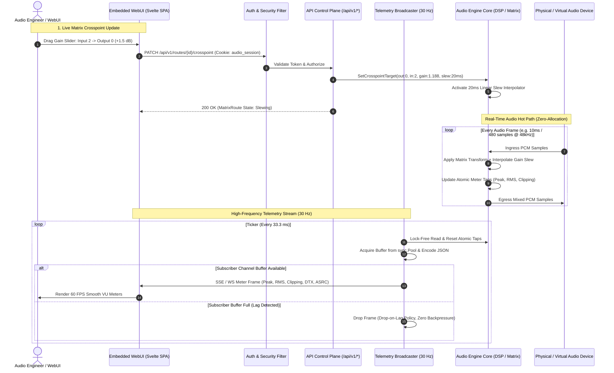
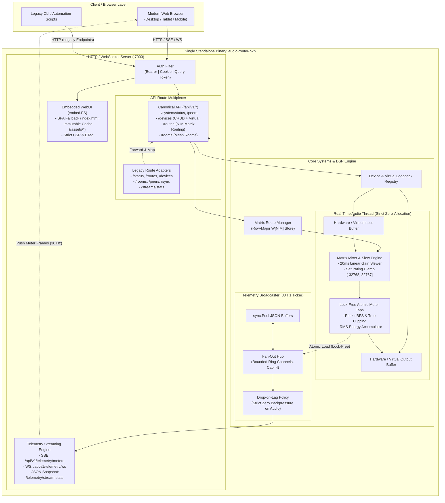

# ADR 0005: Control Plane OpenAPI 3.1 Specification, Matrix Routing Contract, and Embedded WebUI Architecture

* **Status:** Accepted
* **Deciders:** Core Systems Architecture Team, Frontend Platform Engineering, Distributed Audio Infrastructure Team
* **Date:** 2026-09-25

## Context and Problem Statement

`audio-router-p2p` has evolved from a lightweight CLI audio daemon into a distributed, multi-node peer-to-peer audio matrix routing platform. Nodes in production environments concurrently manage physical sound cards, virtual software loopback devices, multi-channel downmix/upmix pipelines (ADR 0002, ADR 0003), and resilient low-latency network transports protected by FEC and dynamic ASRC clock drift compensation (ADR 0004).

As operational scale expanded to multi-room facilities, live performance stages, and broadcast control rooms, the management and observability surfaces encountered critical architectural bottlenecks:

1. **Schema Fragmentation and Lack of Contract Standardization**:
   - Route and device orchestration previously relied on unversioned JSON endpoints (`/status`, `/routes`, `/devices`, `/rooms`, `/peers`, `/sync`) developed organically.
   - Field naming conventions varied between camelCase (`sourceDevice`, `negSampleRate`) and snake_case (`active_routes`), lacked formal input validation schemas, and lacked machine-readable specifications.
   - Frontend developers, automation scripts, and third-party orchestration tools had no single source of truth for contract validation or automated client SDK generation.

2. **Primitive Point-to-Point Routing vs. Arbitrary Matrix Routing**:
   - The legacy router model operated strictly on device-level pairings with static downmixing. It lacked the capability to define arbitrary $N \times M$ crosspoint channel mapping, individual crosspoint linear gain multipliers, or independent per-channel phase/gain trims.
   - Modifying a route required stopping and re-initializing the streaming pipeline, causing acoustic dropout, click transients, and network re-negotiation interruptions.
   - Professional audio workflows require continuous, live gain adjustments with smooth 20ms slew interpolation to eliminate digital zipper noise and acoustic discontinuities without tearing down streams.

3. **High-Frequency Telemetry Coupling and DSP Backpressure**:
   - Studio mixing and real-time monitoring require high-rate visual feedback (20–50 Hz update rates for peak dBFS, RMS loudness, digital clipping indicators, DTX voice activity state, ASRC clock drift ppm, and FEC/PLC health metrics).
   - Polling traditional HTTP endpoints at 50 Hz causes excessive network overhead, socket churn, and serialization allocations.
   - Naively streaming telemetry from the real-time audio thread risks backpressure: if a remote browser client or network interface experiences slow consumption, blocking the telemetry path could stall the real-time DSP audio loop, causing audio buffer underruns.

4. **Deployment Overhead and Operational Friction**:
   - Distributing a separate web application server or requiring Node.js/Nginx sidecars to host the administrative WebUI complicates deployment across headless Linux appliances, containerized edge nodes, and air-gapped broadcast rigs.
   - Serving a single-page application (SPA) directly from the Go binary requires hardened asset embedding, deterministic SPA client-side routing fallbacks, strict Content Security Policies (CSP), ETag caching, and multi-modal authentication across REST, Server-Sent Events (SSE), and WebSockets.

---

## Decision Drivers

* **Single Source of Truth**: Formalize the entire HTTP, SSE, and WebSocket control plane under an OpenAPI 3.1.0 contract (`api/openapi.yaml`) supporting automated TypeScript/OpenAPI generator pipelines.
* **Deterministic Matrix Routing**: Provide an $N\text{-out} \times M\text{-in}$ gain coefficient matrix supporting arbitrary subchannel routing, channel re-ordering, gain trimming (0.0 to 2.0 / $-\infty$ to $+6\text{ dB}$), and live crosspoint manipulation.
* **Acoustically Transparent Gain Slewing**: Enforce a 20ms linear gain slew interpolation across all matrix gain updates, muting, and unmutes to prevent step discontinuities and audible zipper artifacts.
* **Zero-Backpressure, Non-Blocking Telemetry Pipeline**: Decouple high-frequency metering (20–50 Hz) from the audio DSP loop using lock-free atomic sample taps, a ticker-driven broadcast hub, bounded subscriber buffers, and an explicit drop-on-lag policy.
* **Zero-Allocation Steady-State Serialization**: Utilize pre-allocated `sync.Pool` byte buffers for JSON telemetry encoding to eliminate garbage collector churn.
* **Self-Contained Standalone Binary**: Embed the production Svelte/Vite WebUI SPA into the Go daemon using `embed.FS`, serving assets with immutable caching, SPA routing fallback, and strict CSP headers.
* **Backward Compatibility**: Preserve existing unversioned routes (`/status`, `/routes`, `/devices`, `/rooms`, `/peers`, `/sync`, `/streams/stats`) as legacy compatibility adapters wrapping `/api/v1/*` core services.
* **Universal Authentication**: Support Bearer token headers, HTTP-only session cookies (`audio_session`), and query-string token fallback for browser-native WebSocket and EventSource clients.

---

## Considered Options

* **Option 1: Ad-Hoc JSON REST Extensions with External Web Server**
  - Continue appending unversioned JSON endpoints to `pkg/api/server.go`.
  - Host the WebUI separately using Node.js or Nginx, communicating via raw HTTP polling.
  - *Drawbacks*: Fails to provide contract validation; polling at 50 Hz introduces unsustainable CPU and network overhead; multi-process deployments introduce operational complexity and version skew between frontend and daemon.

* **Option 2: gRPC and gRPC-Web with Envoy Reverse Proxy**
  - Define all APIs using Protocol Buffers v3 and gRPC services.
  - Deploy an Envoy sidecar proxy on every node to translate gRPC-Web for browser clients.
  - *Drawbacks*: Requires complex external sidecars or heavy in-process gRPC-Web wrappers; breaks native HTTP scripting tools (`curl`, lightweight Python scripts); increases operational footprint on embedded audio appliances.

* **Option 3: OpenAPI 3.1.0 REST/SSE/WS Control Plane, Embedded Svelte SPA, and Lock-Free Telemetry Hub**
  - Adopt OpenAPI 3.1.0 under `/api/v1/*` as the strict API specification.
  - Maintain legacy adapters at root paths for seamless backward compatibility.
  - Implement canonical $N \times M$ matrix routing with per-sample 20ms gain slew interpolation.
  - Implement lock-free atomic DSP taps feeding a decoupled, ticker-driven telemetry hub with drop-on-lag fan-out over SSE and WebSockets.
  - Embed the compiled Svelte SPA into `cmd/web/` using Go `embed.FS`, complete with ETag caching, immutable asset headers, and SPA fallback routing.

---

## Decision Outcome

Chosen Option: **Option 3**, because it combines strict formal contract validation and developer ergonomics with high-performance, non-blocking real-time audio safety and zero-dependency single-binary operational deployment.

---

### Decision Specifications

#### 1. OpenAPI 3.1.0 Control Plane Contract & Versioning Hierarchy

The primary control plane is standardized under `/api/v1/*`. The canonical specification is maintained in `api/openapi.yaml`.

##### Endpoint Structure
* **System & Discovery**:
  - `GET /api/v1/system/status`: Node operational state, version, uptime, active routes, peer counts.
  - `GET /api/v1/system/peers`: Discovered mesh peers, network addresses, round-trip latencies.
  - `POST /api/v1/system/peers`: Manual peer connection initiation.
  - `GET /api/v1/system/clock-sync`: PTP/NTP distributed clock synchronization offset and drift ppm.
* **Device Registry**:
  - `GET /api/v1/devices`: Physical sound cards and virtual loopback interfaces.
  - `GET /api/v1/devices/{deviceId}`: Detailed device capabilities and channel layouts.
  - `PATCH /api/v1/devices/{deviceId}`: Runtime device volume, channel configuration, and mute toggles.
  - `POST /api/v1/devices/virtual`: Dynamic virtual loopback sink/source creation.
  - `DELETE /api/v1/devices/virtual/{deviceId}`: Teardown of virtual loopback devices.
* **Matrix Routing**:
  - `GET /api/v1/routes`: List active matrix routing sessions.
  - `POST /api/v1/routes`: Create route with full $N \times M$ coefficient configuration.
  - `GET /api/v1/routes/{routeId}`: Route details, active coefficients, and runtime metrics.
  - `PUT /api/v1/routes/{routeId}`: Complete route reconfiguration.
  - `PATCH /api/v1/routes/{routeId}`: Live gain/coefficient updates with 20ms slew interpolation.
  - `DELETE /api/v1/routes/{routeId}`: Graceful route fade-out and teardown.
  - `POST /api/v1/routes/{routeId}/crosspoint`: Atomic update of an individual crosspoint gain $(out, in)$.
* **Room Orchestration**:
  - `GET /api/v1/rooms`: Active multi-node conference rooms.
  - `POST /api/v1/rooms`: Create distributed room session.
  - `GET /api/v1/rooms/{roomId}`: Room topology, leader node, and member roster.
  - `DELETE /api/v1/rooms/{roomId}`: Disband room session.
  - `POST /api/v1/rooms/{roomId}/join`: Connect local node to room audio bus.
  - `POST /api/v1/rooms/{roomId}/leave`: Disconnect local node from room audio bus.
* **Telemetry Streaming**:
  - `GET /api/v1/telemetry/stream-stats`: Snapshot of stream metrics (FEC, PLC, ASRC drift, jitter).
  - `GET /api/v1/telemetry/meters`: Server-Sent Events (SSE) high-frequency VU/peak/RMS meter feed.
  - `GET /api/v1/telemetry/ws`: Bidirectional WebSocket connection for live telemetry and real-time gain control commands.

##### Backward Compatibility Adapter Layer
To ensure unbroken operation for existing CLI tooling, shell scripts, and daemons, the root HTTP handler wraps the legacy routes with transparent adapters forwarding to the canonical engine:

| Legacy Route | Method | Canonical Target | Backward Compatibility Mapping |
| :--- | :--- | :--- | :--- |
| `/status` | GET | `GET /api/v1/system/status` | Serializes canonical status into legacy JSON structure. |
| `/devices` | GET | `GET /api/v1/devices` | Formats devices using legacy integer IDs and property names. |
| `/routes` | GET | `GET /api/v1/routes` | Projects matrix routes into legacy map format `map[string]StreamRoute`. |
| `/routes` | POST | `POST /api/v1/routes` | Translates `sourceDevice` and destination string into default matrix. |
| `/peers` | GET | `GET /api/v1/system/peers` | Emits legacy peer list. |
| `/sync` | GET | `GET /api/v1/system/clock-sync` | Serializes clock synchronization state. |
| `/rooms` | GET, POST | `GET/POST /api/v1/rooms` | Bridges room lifecycle management calls directly. |
| `/rooms/{id}/join` | POST | `POST /api/v1/rooms/{id}/join` | Joins room using legacy syntax. |
| `/rooms/{id}/leave` | POST | `POST /api/v1/rooms/{id}/leave` | Leaves room using legacy syntax. |
| `/streams/stats` | GET | `GET /api/v1/telemetry/stream-stats` | Emits stream statistics including FEC, PLC, and ASRC diagnostics. |

---

#### 2. Canonical Matrix Routing Contract & Gain Slewing Engine

Matrix routing operates on an arbitrary linear transformation model from $M$ input channels to $N$ output channels.

##### Mathematical Formulation
For input sample vector $\mathbf{x} = [x_0, x_1, \dots, x_{M-1}]^T$ and output sample vector $\mathbf{y} = [y_0, y_1, \dots, y_{N-1}]^T$, the matrix transformation is governed by:

$$\mathbf{y} = \mathbf{W} \cdot \mathbf{x}$$

Where $\mathbf{W} \in \mathbb{R}^{N \times M}$ is the row-major coefficient gain matrix:

$$\mathbf{W} = \begin{bmatrix}
w_{0,0} & w_{0,1} & \cdots & w_{0,M-1} \\
w_{1,0} & w_{1,1} & \cdots & w_{1,M-1} \\
\vdots & \vdots & \ddots & \vdots \\
w_{N-1,0} & w_{N-1,1} & \cdots & w_{N-1,M-1}
\end{bmatrix}$$

Each coefficient $w_{i,j}$ represents a linear amplitude multiplier in the range $[0.0, 2.0]$ (silence to $+6.02\text{ dB}$).

##### 20ms Linear Gain Slewing (Anti-Zipper Interpolation)
Directly mutating coefficients in real-time audio introduces instantaneous rectangular voltage steps, producing audible clicks and zipper distortion. The matrix DSP engine implements continuous per-sample linear slewing over $T_{slew} = 20\text{ ms}$:

For a sample rate $f_s = 48000\text{ Hz}$, the slew duration spans $S = 0.020 \times 48000 = 960\text{ samples}$.
On each audio frame boundary where target coefficients $\mathbf{W}_{target}$ differ from active coefficients $\mathbf{W}_{current}$, a per-sample gain increment is computed:

$$\Delta w_{i,j} = \frac{w_{target, i, j} - w_{current, i, j}}{S}$$

For each consecutive sample $k \in [0, S-1]$:

$$w_{current, i, j}[k+1] = w_{current, i, j}[k] + \Delta w_{i,j}$$

When $k = S$, $w_{current, i, j}$ snaps precisely to $w_{target, i, j}$ and the slewing state machine transitions from `Slewing` to `SteadyState`.

##### Branchless Saturation Clamping
Output samples are accumulated as 32-bit floats and clamped to signed 16-bit PCM integer boundaries $[-32768, 32767]$ without branch mispredictions or integer wrap-around:

```go
func clampInt16(v float32) int16 {
    if v > 32767.0 {
        return 32767
    }
    if v < -32768.0 {
        return -32768
    }
    if v >= 0 {
        return int16(v + 0.5)
    }
    return int16(v - 0.5)
}
```

---

#### 3. Audio Device & Node Registry

The device registry abstracts host hardware devices (ALSA, CoreAudio, WASAPI) and software loopback interfaces:

* **Hardware Device Enumeration**: Identifies device ID, system name, maximum input/output channel counts, supported sample rates, and default channel layouts.
* **Runtime Gain and Mute Control**: Provides thread-safe, atomic volume adjustments $[0.0, 2.0]$ and mute toggles without stream re-initialization.
* **Virtual Loopback Device Engine**:
  - Dynamically provisions in-memory virtual sound cards (`pkg/audio/virtual.go`) supporting `input`, `output`, and `duplex` operation.
  - Implements synchronized ring buffers with non-blocking read/write semantics and optional real-time wall-clock pacing simulation for synthetic pipeline routing and cross-process DAW bridging.

---

#### 4. High-Frequency Telemetry Pipeline (Lock-Free Taps & Drop-on-Lag Broadcaster)

To satisfy the demanding update rates of visual VU/peak meters (20–50 Hz) without compromising real-time audio processing:

##### Lock-Free Atomic Meter Taps (`pkg/audio/dsp/`)
The DSP processing loop computes per-channel peak amplitude and RMS energy over each processing block (typically 10ms–20ms / 480–960 samples). Peak values and accumulated squares are stored via `sync/atomic` 64-bit float bitcasts or uint64 structures:

```go
type AtomicChannelTap struct {
    peakBits  atomic.Uint64 // math.Float64bits(peak)
    rmsSqBits atomic.Uint64 // math.Float64bits(sumSquares)
    sampleCnt atomic.Uint32
    clipped   atomic.Bool
}
```
The audio processing thread executes zero allocations, zero mutex acquisitions, and zero channel sends.

##### Ticker-Driven Broadcaster Hub
A dedicated telemetry daemon runs on an independent goroutine, ticking at a configurable frequency $f_{telemetry} \in [20, 50]\text{ Hz}$ (default 30 Hz):

1. **Snapshot Read**: Ticker reads atomic values from all active channel taps and resets the peak/clipping accumulators.
2. **Buffer Recycling**: Acquires an encoding buffer from a `sync.Pool` to assemble the JSON payload, achieving zero dynamic heap allocations during steady-state broadcast.
3. **Drop-on-Lag Fan-Out**: The hub dispatches the telemetry frame to all active SSE and WebSocket subscriber channels using a non-blocking `select`:

```go
func (h *TelemetryHub) broadcast(msg []byte) {
    h.mu.RLock()
    defer h.mu.RUnlock()
    for sub := range h.subscribers {
        select {
        case sub.ch <- msg:
            // Delivered successfully
        default:
            // Subscriber buffer full: drop frame immediately to prevent backpressure
            sub.droppedFrames.Add(1)
        }
    }
}
```
* **Subscriber Channel Depth**: Each subscriber channel is bounded (buffer capacity 4). A slow consumer (e.g., a stalled browser tab or Wi-Fi latency spike) will drop meter frames rather than backpressure the telemetry hub or the audio engine.

---

#### 5. Embedded WebUI Architecture

The user interface is engineered as a high-performance Svelte/Vite Single-Page Application (SPA) embedded directly inside the compiled Go binary.

##### Embedding Mechanism (`cmd/web/`)
The built frontend distribution artifacts (`cmd/web/dist/`) are packaged using Go's standard library `embed` package:

```go
package web

import (
    "embed"
    "io/fs"
    "net/http"
)

//go:embed dist/*
var embeddedFiles embed.FS

func AssetHandler() http.Handler {
    distFS, err := fs.Sub(embeddedFiles, "dist")
    if err != nil {
        panic(err)
    }
    return http.FileServer(http.FS(distFS))
}
```

##### HTTP Caching and SPA Fallback Controller
* **Immutable Asset Caching**: Files matching `/assets/*` contain content-hashed filenames generated by Vite and are served with:
  `Cache-Control: public, max-age=31536000, immutable`
* **ETag Verification**: HTML, JSON, and dynamic files compute SHA-256 ETags. Requests bearing matching `If-None-Match` headers receive `304 Not Modified` with zero body transfer.
* **SPA Routing Fallback**: Any GET request targeting a non-existent asset or a client-side route (e.g., `/matrix`, `/devices`, `/rooms/studio-a`) serves `dist/index.html` with `Cache-Control: no-cache`.
* **Hardened Security Headers**: All HTTP responses emitted by the embedded server enforce modern security policies:
  ```http
  Content-Security-Policy: default-src 'self'; connect-src 'self' ws: wss:; style-src 'self' 'unsafe-inline'; img-src 'self' data:; font-src 'self';
  X-Content-Type-Options: nosniff
  X-Frame-Options: DENY
  Referrer-Policy: strict-origin-when-cross-origin
  ```

##### Dual Authentication Support
The API and embedded WebUI authenticate via three unified modalities:
1. **Bearer Token**: Standard `Authorization: Bearer <token>` or `X-Auth-Token: <token>` header for REST API clients and automated tooling.
2. **Session Cookie**: HTTP-only, SameSite cookie (`audio_session=<token>`) established during WebUI login, securing browser navigation and API fetch calls.
3. **Query Parameter Token**: Fallback token parameter `?token=<token>` for browser-native `WebSocket` and `EventSource` (SSE) APIs which cannot set custom HTTP headers during connection establishment.

---

## Consequences

### Positive Consequences

* **Formal Unified Contract**: The OpenAPI 3.1.0 specification provides an authoritative contract, eliminating undocumented fields, inconsistent key casing, and enabling automated TypeScript client generation for the WebUI.
* **Zero-Downtime Live Matrix Changes**: Audio engineers can modify crosspoint matrix gains, unmute channels, or adjust routing in real time without audio drops, clicks, or stream restarts.
* **Acoustically Transparent Gain Slewing**: The 20ms linear slew interpolator prevents digital zipper noise and step discontinuities on all dynamic gain changes.
* **Audio Loop Safety & Isolation**: The telemetry broadcaster is fully decoupled from the audio DSP thread. Atomic taps and non-blocking drop-on-lag channel fan-out guarantee that slow network or browser clients cannot cause audio dropouts or buffer underruns.
* **Standalone Zero-Dependency Binary**: The entire system—including real-time audio DSP, peer-to-peer transport, REST control plane, telemetry streaming hub, and responsive Svelte WebUI—compiles into a single standalone binary.
* **Seamless Backward Compatibility**: Existing daemons, CLI utilities, and integration test suites targeting `/status`, `/routes`, and `/devices` continue operating transparently via adapter routes.

### Negative Consequences / Trade-offs

* **Telemetry Frame Drops on Slow Clients**: Slow browser clients or jittery wireless connections will drop visual metering frames under the drop-on-lag policy. This is an intentional engineering trade-off: UI visualization smoothness is strictly secondary to real-time audio integrity.
* **Dual Routing Model Maintenance**: The API layer must maintain legacy route adapter logic alongside the canonical $N \times M$ matrix routing engine until legacy CLI clients are permanently phased out.
* **Go Binary Size**: Embedding frontend assets (HTML, CSS, JS, SVG icons) increases the compiled Go binary size by approximately 1.5MB to 3MB, which is well within acceptable limits for edge audio nodes.

---

## Visual Architecture

### System Dataflow & Control Plane Interaction



---

### Component Architecture & Module Boundaries


