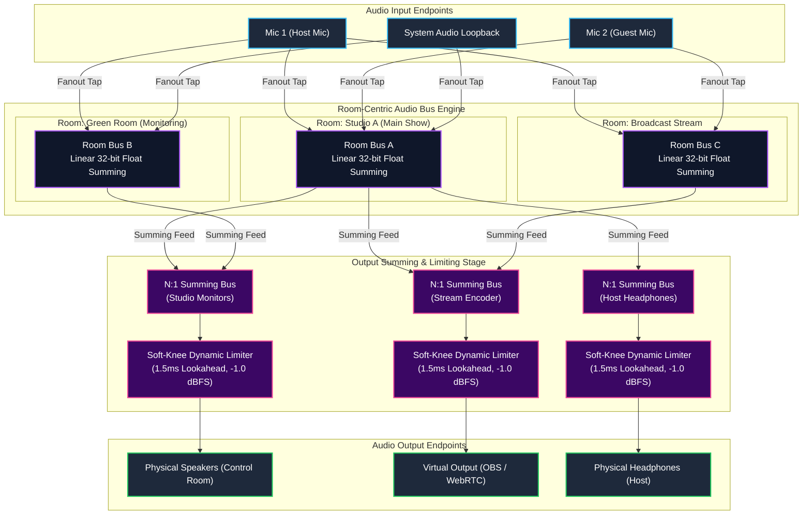
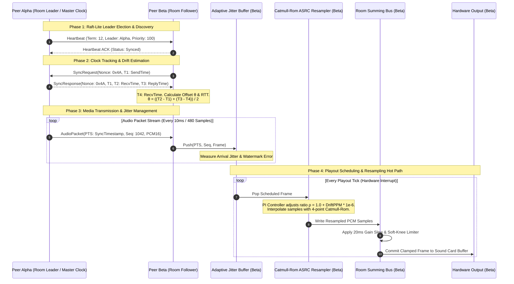
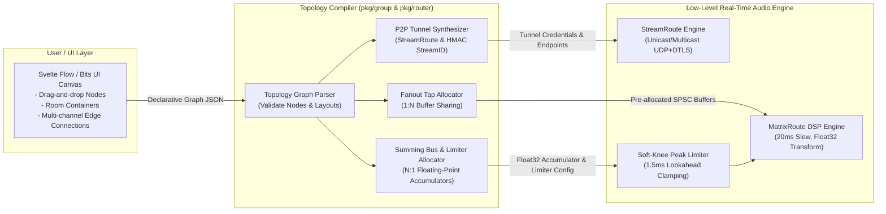

# ADR 0006: Room-Centric Distributed Audio Bus Engine and Node-Graph Topology

* **Status:** Accepted
* **Deciders:** Core Systems Architecture Team, Real-Time Audio Infrastructure Engineering, Frontend Platform Engineering
* **Date:** 2026-09-26

---

## Context and Problem Statement

The `audio-router-p2p` system historically relied on point-to-point (P2P) crossbar routing matrices (ADR 0005) and discrete device-to-device streaming pipelines (ADR 0001, ADR 0002). In that model, audio operators explicitly established pairwise routes linking a physical/virtual input channel on a source node to a physical/virtual output channel on a destination node.

While this crosspoint matrix architecture met the needs of basic point-to-point audio bridging, expanding operations into multi-room studio facilities, broadcast control networks, collaborative stages, and distributed edge installations exposed severe usability, scalability, and architectural limitations:

1. **Cognitive Overhead and $O(N \times M)$ Crossbar Patching Explosion**:
   - In facilities with dozens of distributed capture and playout endpoints, establishing multi-participant routing required configuring every input-to-output crosspoint manually.
   - For $N$ inputs and $M$ outputs, managing individual crosspoint gains and muting states created an unsustainable operational burden, commonly causing configuration errors, unintended feedback loops, and "decision amnesia" during live events.

2. **Inability to Support Dynamic 1:N Fanout and N:1 Summing Naturally**:
   - Live production workflows routinely require a single microphone, master console feed, or talkback channel to broadcast simultaneously across multiple acoustic zones (e.g., Studio Floor, Green Room, Broadcast Feed, and Director Comms). Point-to-point routing required duplicating individual routes across every destination.
   - Conversely, shared listening zones (such as Control Room Monitors or Stage In-Ear Monitors) must concurrently aggregate feeds originating from multiple independent zones. Without an intermediate mixing bus abstraction, patching multiple inputs to the same hardware output resulted in route contention, conflicting sample rates, or uncontrolled digital clipping.

3. **Lack of Headroom Limiting in Arbitrary Summing**:
   - Linear PCM summing ($y[n] = \sum x_i[n]$) across unsynchronized input streams inevitably leads to digital full-scale integer clipping ($> 0\text{ dBFS}$) when multiple high-amplitude audio sources overlap.
   - Without an integrated soft-knee dynamic headroom limiter on shared summing buses, summing signals exceeded the 16-bit integer boundaries ($[-32768, 32767]$), resulting in catastrophic square-wave distortion and loudspeaker damage.

4. **Distributed Synchronization Fragility Across Heterogeneous Peers**:
   - Synchronizing audio playout across disparate physical locations over unmanaged IP networks introduces clock drift (crystal oscillator mismatch $\pm 50\text{ ppm}$), network jitter (1ms to 50ms), and peer leadership ambiguity.
   - Without a deterministic consensus protocol to coordinate room state, clock master designation, and jitter buffer watermarks, distributed peers suffered from desynchronized playout and acoustic echo.

5. **Disconnection Between Control Plane and Visual Node-Graph Mental Models**:
   - Modern audio operators and spatial engineers conceptualize studio routing as physical or virtual "Rooms" or "Buses" acting as acoustic containers. A flat crossbar table failed to map cleanly to node-graph canvas interfaces (e.g., Svelte Flow / Bits UI), preventing intuitive drag-and-drop orchestration.

---

## Decision Drivers

* **Room-as-a-Bus Abstraction**: Treat each Room as an autonomous, virtual audio mixing bus. Any input assigned to a Room automatically mixes to all outputs assigned to that Room.
* **1:N Fanout and N:1 Summing**: Enable any Input device to be routed to multiple Rooms simultaneously (1:N fanout), and enable any Output device to aggregate audio from multiple Rooms concurrently (N:1 summing).
* **Transparent Topology Compilation**: Compile high-level Room-to-Device graph topologies deterministically down to underlying low-level `StreamRoute` (ADR 0001) and `MatrixRoute` (ADR 0005) pipelines without manual crosspoint wiring.
* **Acoustically Transparent Dynamic Control**: Enforce 20ms anti-zipper linear gain slewing on all fader changes, mute/unmute actions, and dynamic topology mutations.
* **Dynamic Headroom Management**: Implement an ultra-fast, zero-allocation soft-knee lookahead limiter on all N:1 output summing buses to prevent digital clipping while preserving transient punch.
* **Real-Time Safety and Zero Allocation**: Enforce zero heap allocations, lock-free ringbuffers, and branchless float32 DSP arithmetic on steady-state audio hot paths.
* **Distributed Peer Synchronization**: Coordinate distributed multi-peer rooms using Raft-lite deterministic leader consensus, PTP/NTP-style clock offset estimation, ASRC Catmull-Rom clock drift compensation (ADR 0004), and adaptive jitter buffer watermark steering.
* **Node-Graph Ergonomics**: Provide an API schema and state lifecycle that natively maps to visual canvas representations (Svelte Flow / Bits UI nodes, ports, and container edges).

---

## Considered Options

* **Option 1: Direct Point-to-Point Crossbar Patching Matrix with Manual Peer Links**
  - Continue using the flat $N \times M$ matrix crossbar introduced in ADR 0005. Operators manually calculate and set coefficients for every input/output pair across distributed nodes.
  - *Drawbacks*: Exponential configuration complexity; no concept of shared acoustic spaces; manual gain calculations required to prevent clipping when summing; completely unintuitive for multi-operator broadcast environments.

* **Option 2: Centralized Audio Mixing Server / SFU (Selective Forwarding Unit / MCU)**
  - Route all ingress audio streams from edge nodes to a single centralized high-performance mixing server (MCU). The central server mixes all feeds per room and re-encodes unicast/multicast streams back to listeners.
  - *Drawbacks*: Introduces a single point of failure (SPOF); incurs double-hop network latency (violating interactive $\le 40\text{ms}$ playout budgets); massive central bandwidth costs; violates the core serverless peer-to-peer design tenets of `audio-router-p2p`.

* **Option 3: Room-as-a-Bus Distributed Graph Engine with Local Topology Compilation, Soft-Knee Summing Limiters, and Raft-Lite Peer Consensus**
  - Model Rooms as first-class audio summing buses in the domain layer.
  - Inputs fan out to multiple room buses (1:N) via lock-free ringbuffer taps.
  - Outputs sum from multiple room buses (N:1) via a dedicated summing stage equipped with a soft-knee dynamic peak limiter.
  - Within each Room, the engine automatically compiles an $N \times M$ routing topology down to real-time `MatrixRoute` and network `StreamRoute` instances.
  - Distributed multi-peer rooms maintain topology state and clock master designation via a lightweight Raft-lite deterministic leader consensus protocol, driving NTP/PTP offset tracking and Catmull-Rom ASRC drift compensation.
  - Expose graph topology models tailored for Svelte Flow and Bits UI frontends.

---

## Decision Outcome

Chosen Option: **Option 3**, because it provides the optimal balance of user experience simplification, distributed fault tolerance, decentralized low-latency mixing, and rigorous real-time audio safety.

---

### Decision Specifications

#### 1. Room-as-a-Bus Data Model & Graph Architecture

The routing domain is restructured around three core primitives: `InputEndpoint`, `RoomBus`, and `OutputEndpoint`.

```
                    +---------------------------------------+
                    |           Input Endpoint              |
                    | (Capture SoundCard / Network Ingress) |
                    +---+-------------------------------+---+
                        | (1:N Fanout Tap)              |
                        v                               v
             +--------------------+          +--------------------+
             |    Room Bus A      |          |    Room Bus B      |
             | (Virtual Submix)   |          | (Virtual Submix)   |
             +----------+---------+          +----------+---------+
                        |                               |
                        +---------------+---------------+
                                        | (N:1 Summing)
                                        v
                    +---------------------------------------+
                    |       Soft-Knee Headroom Limiter      |
                    +-------------------+-------------------+
                                        |
                                        v
                    +---------------------------------------+
                    |          Output Endpoint              |
                    |  (Playout DAC / Network Egress)       |
                    +---------------------------------------+
```

##### Graph Compilation Pipeline
The Room Engine continuously compiles the declared room associations into low-level execution pipelines:
1. **Intra-Room Matrix Generation**: For each room, an internal mixing matrix is compiled where all assigned inputs connect to all assigned outputs with default unity gain ($1.0$) modified by individual input/output trim gains.
2. **1:N Fanout De-duplication**: When an input device is assigned to $K$ distinct rooms, the engine compiles a single physical capture reader that fans out PCM frames into $K$ independent lock-free Single-Producer Single-Consumer (SPSC) ringbuffers.
3. **N:1 Summing Bus Formulation**: When an output device receives feeds from $J$ distinct rooms, the engine allocates an intermediate 32-bit floating-point accumulator bus that sums the $J$ room signals prior to limiter processing and 16-bit integer quantization.
4. **Network Stream Bridging**: When a Room spans multiple network peers, the compiler synthesizes the requisite `StreamRoute` tunnels, assigning deterministic HMAC stream identifiers derived from `RoomID`.

---

#### 2. Real-Time Audio DSP Engine: Lock-Free Buffers & Anti-Zipper Slewing

The real-time audio engine operates under strict zero-allocation, lock-free constraints:

```
[Physical Capture / Ingress]
            │
            ▼
┌───────────────────────────┐
│ Lock-Free SPSC Ringbuffer │
└───────────┬───────────────┘
            │
            ▼
┌───────────────────────────────────────────────────────────┐
│ 20ms Linear Anti-Zipper Gain Slew Interpolator             │
│   g[n] = g_current + (g_target - g_current) * (n / SlewLen)│
└───────────┬───────────────────────────────────────────────┘
            │
            ▼
┌───────────────────────────────────────────────────────────┐
│ Branchless 32-bit Float Matrix Multiplier & Accumulator   │
└───────────┬───────────────────────────────────────────────┘
            │
            ▼
┌───────────────────────────────────────────────────────────┐
│ Soft-Knee Dynamic Headroom Limiter & Clamping Stage       │
└───────────┬───────────────────────────────────────────────┘
            │
            ▼
┌───────────────────────────┐
│ Lock-Free Playout Buffer  │
└───────────────────────────┘
```

##### 20ms Anti-Zipper Gain Slewing
To prevent audible step discontinuities, clicks, and zipper noise during volume adjustments, mute toggles, or topology reconfiguration, all gain coefficient updates are interpolated across a sliding 20ms window:

$$\text{SlewSamples} = \left\lfloor \frac{\text{SampleRate} \times 20}{1000} \right\rfloor \quad (\text{e.g., } 960 \text{ samples at } 48\text{ kHz})$$

For sample $n \in [0, \text{SlewSamples})$:

$$g[n] = g_{\text{current}} + (g_{\text{target}} - g_{\text{current}}) \cdot \left(\frac{n}{\text{SlewSamples}}\right)$$

Once $n \ge \text{SlewSamples}$, $g_{\text{current}}$ snaps to $g_{\text{target}}$ and interpolation terminates.

##### Zero-Allocation Hot Path Execution
* Audio frames are processed in chunks of 480 samples (10ms at 48 kHz).
* All intermediate mixing buffers (`inScratch`, `mixAccumulator`, `limiterLookahead`) are pre-allocated upon room initialization and pinned in memory.
* SPSC ringbuffers utilize cache-line-padded atomic indices (`atomic.Uint64`) to prevent false sharing across CPU cores.

---

#### 3. N:1 Output Summing Bus & Soft-Knee Headroom Limiter

When multiple rooms feed a shared output device, signals are summed in linear 32-bit floating-point space:

$$x_{\text{sum}}[n] = \sum_{r=1}^{J} x_{r}[n]$$

To prevent digital clipping while avoiding harsh square-wave clipping, the summing bus feeds an automated soft-knee peak limiter prior to conversion to 16-bit signed PCM.

##### Limiter Mathematical Specification
Let $T = -1.0\text{ dBFS}$ be the compression threshold, $W = 3.0\text{ dB}$ be the transition knee width, and $L_{\text{target}} = 0.0\text{ dBFS}$ be the absolute brickwall ceiling:

$$\text{GainReduction}(x_{\text{dB}}) = \begin{cases} 
0 & \text{for } x_{\text{dB}} \le T - \frac{W}{2} \\
\frac{(x_{\text{dB}} - T + W/2)^2}{2W} & \text{for } \left|x_{\text{dB}} - T\right| \le \frac{W}{2} \\
x_{\text{dB}} - T & \text{for } x_{\text{dB}} > T + \frac{W}{2}
\end{cases}$$

* **Attack Time**: 1.5ms lookahead buffer to catch instantaneous transients.
* **Release Time**: 50ms exponential release curve to eliminate low-frequency pumping artifacts.
* **Output Clamping**: Branchless integer clamping enforces boundaries $[-32768, 32767]$:

$$\text{clampInt16}(v) = \max(-32768, \min(32767, \lfloor v + 0.5 \rfloor))$$

---

#### 4. Distributed Multi-Peer Room Synchronization Architecture

Distributed rooms span across multiple physical peer nodes communicating via UDP/DTLS mesh tunnels.

```
       [Peer Node Alpha (Clock Master)]
          │ (Elected Leader via Raft-Lite)
          ├─────────────────────────────────────────────┐
          │ PTP/NTP Clock Sync (SyncAddr: UDP 9998)     │ Media Stream (StreamAddr: UDP 9999)
          ▼                                             ▼
[Peer Node Beta (Follower)]                   [Peer Node Gamma (Follower)]
  - Offset Tracking: Δt Beta                    - Offset Tracking: Δt Gamma
  - Catmull-Rom ASRC Resampler                  - Catmull-Rom ASRC Resampler
  - Watermark PI Controller                     - Watermark PI Controller
```

##### Raft-Lite Leader Consensus
1. **Deterministic Master Designation**: Each distributed Room maintains an active leader responsible for acting as the master clock and coordinating participant membership.
2. **Election Protocol**: Nodes broadcast heartbeat announcements containing `(Term, LeaderID, Priority, NodeID)`. If the current leader experiences a timeout ($> 300\text{ms}$ without heartbeat), the peer with the lowest lexicographical `NodeID` and highest uptime transitions to Candidate and establishes leadership.
3. **Topology State Replication**: Room membership changes (assigning an input/output) are committed as Raft log entries and acknowledged by a majority quorum before local audio topology recompilation triggers.

##### Clock Synchronization & ASRC Resampling Pipeline
* **High-Precision Clock Tracking**: Peers continuously execute four-timestamp round-trip measurements ($T_1, T_2, T_3, T_4$) against the Room Master to estimate clock offset $\theta$ and network RTT:

$$\theta = \frac{(T_2 - T_1) + (T_3 - T_4)}{2}, \quad \text{RTT} = (T_4 - T_1) - (T_3 - T_2)$$

* **Adaptive Jitter Buffer Watermark**: The receiver dynamically adjusts its nominal jitter buffer watermark target ($W_{\text{target}} = \text{RTT}/2 + 3\sigma_{\text{jitter}}$).
* **Catmull-Rom Dynamic ASRC**: When physical clock drift diverges ($\pm 50\text{ ppm}$), a Proportional-Integral (PI) loop drives the 4-point 3rd-order Catmull-Rom resampler (ADR 0004) to subtly speed up or slow down sample playback without introducing audible pitch shifts.

---

#### 5. Visual Node-Graph Canvas Integration (Svelte Flow / Bits UI)

To bridge the backend audio engine with user-facing management, the domain schema natively maps to node-graph canvas primitives:

1. **Node Archetypes**:
   - `DeviceNode`: Represents a physical/virtual sound card. Contains output ports (Capture channels) or input ports (Playout channels).
   - `RoomBusNode`: Represents a Room. Acts as a visual container and grouping hub with dynamic multi-channel ingress and egress buses.
   - `PeerNode`: Represents a remote physical peer participating in a distributed room.
2. **Edge Connections**:
   - `FanoutEdge`: Visualizes 1:N connections from an Input device port into multiple Room buses. Displays real-time signal activity colors.
   - `SummingEdge`: Visualizes N:1 connections from multiple Room buses into an Output device port. Indicates headroom limiter gain reduction via dynamic glow shaders.
3. **Reactive Bidirectional Sync**:
   - Canvas modifications emit JSON REST operations (`POST /api/v1/rooms/{id}/members`, `PATCH /api/v1/rooms/{id}/bus`).
   - High-rate visual feedback (20–50 Hz metering, limiter activity, and clock drift ppm) is streamed via the non-blocking WebSocket/SSE telemetry hub (ADR 0005).

---

## Consequences

### Positive Consequences

* **Radically Intuitive User Experience**: Replaces overwhelming $O(N \times M)$ crossbar matrices with an intuitive "Room as a virtual mixer" paradigm, slashing setup time and configuration mistakes.
* **Automatic N:M Mixing**: Inputs assigned to a room are immediately distributed to all room outputs with zero manual crosspoint mapping.
* **Seamless Multi-Room Fanout & Summing**: Single sources can feed multiple rooms simultaneously (1:N), and multiple rooms can sum cleanly into common listening devices (N:1).
* **Guaranteed Acoustic Safety**: The 20ms anti-zipper gain slewer eliminates clicks and pops, while the integrated soft-knee lookahead limiter prevents catastrophic digital full-scale clipping.
* **Deterministic Low-Latency Sync**: Distributed peers maintain synchronized playout over WAN/LAN using deterministic leader election, micro-second offset tracking, and Catmull-Rom ASRC drift correction.
* **Native Node-Graph Representation**: Direct alignment with Svelte Flow and Bits UI unlocks modern, responsive drag-and-drop spatial orchestration.

### Negative Consequences / Trade-offs

* **Summing Bus CPU Overhead**: Introducing an intermediate 32-bit floating-point accumulation and soft-knee limiter stage incurs additional CPU cycles per audio frame compared to raw direct hardware piping.
* **Limiter Latency Penalty**: The 1.5ms lookahead buffer required by the soft-knee peak limiter adds a fixed 1.5ms latency to outputs operating in N:1 summing configurations.
* **Distributed Consensus Complexity**: Running Raft-lite consensus and clock drift compensation across multi-peer networks requires comprehensive heartbeat monitoring, split-brain mitigation, and failure recovery testing.
* **Memory Footprint**: Maintaining pre-allocated scratch buffers, lookahead queues, and lock-free ringbuffers for multiple active rooms increases resident memory usage by approximately 4MB to 8MB per room.

---

## Visual Architecture

### 1. Room Bus Topology: 1:N Fanout and N:1 Summing with Soft-Knee Limiting



---

### 2. Distributed Multi-Peer Synchronization and Audio Dataflow



---

### 3. Graph Compilation: Room Abstraction Down to Execution Pipelines


