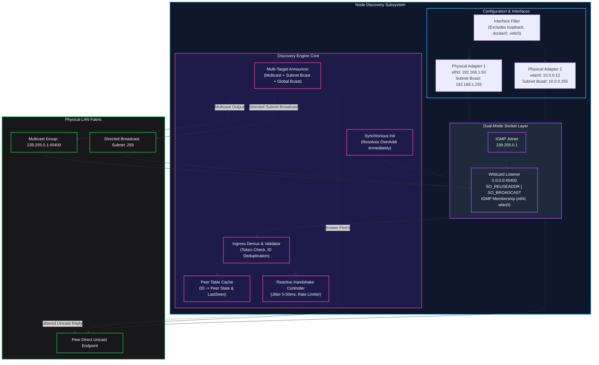
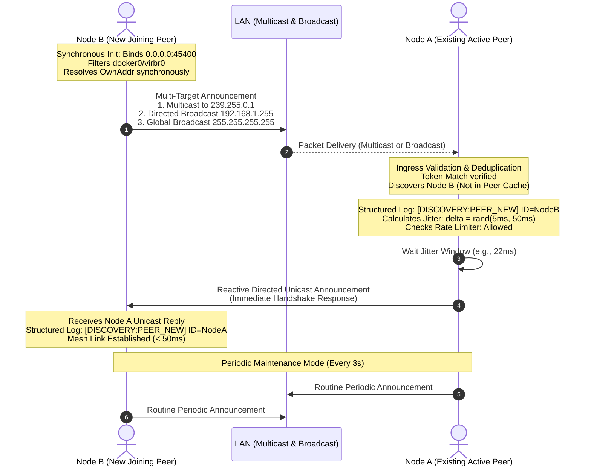

# ADR 0007: Hybrid Dual-Mode Peer Discovery with Subnet Broadcast and Multicast Failover

* **Status:** Accepted
* **Deciders:** Core Systems Architecture Team, Network & Distributed Systems Engineering, Edge Infrastructure Team
* **Date:** 2026-09-28

---

## Context and Problem Statement

The `audio-router-p2p` system relies on an autonomous, zero-configuration local area network (LAN) discovery mechanism to detect adjacent audio nodes, establish clock-synchronization endpoints, and negotiate low-latency real-time audio streams. In production deployments spanning enterprise office LANs, broadcast studios, campus subnets, and ad-hoc Wi-Fi setups, operators reported complete discovery failure between hosts residing on the same broadcast network: both nodes transmitted announcement packets, yet neither discovered the other, resulting in complete isolation.

Rigorous architectural analysis of the legacy discovery subsystem revealed four fundamental architectural flaws:

1. **Multicast Socket Isolation and L2 IGMP Filtering**:
   - The legacy receive socket was bound exclusively to the multicast address and port `239.255.0.1:45400` via `net.ListenMulticastUDP("udp4", ifc, group)`.
   - By binding the socket directly to the multicast IP rather than `0.0.0.0` (wildcard `INADDR_ANY`), the operating system network stack dropped any inbound UDP broadcast frames (such as global `255.255.255.255` or directed subnet broadcasts like `192.168.1.255`).
   - Furthermore, modern managed switches and enterprise 802.11 Wi-Fi Access Points (APs) frequently enforce IGMP snooping without an active IGMP querier present on the subnet, or suppress multicast entirely to mitigate 802.11 multicast rate degradation. As a consequence, IGMP join reports went unqueried or unrouted, causing the network fabric to drop all multicast frames silently at Layer 2.

2. **Single-Interface Selection Flaw and Virtual Interface Hijacking**:
   - During startup, `setup()` iterated over candidate network interfaces via `candidateInterfaces()` and terminated evaluation at the very first interface reporting `net.FlagUp` and `net.FlagMulticast`.
   - The selection logic did not exclude loopback adapters, bridge interfaces, or virtualized software interfaces installed by container engines and hypervisors (e.g., `docker0`, `veth*`, `virbr0`, `incusbr0`, `lxdbr0`, `br-*`, `cni0`).
   - If a host possessed an active Docker bridge, LXD/Incus bridge, or virtualization adapter enumerated earlier than the physical interface (e.g., `eth0` or `wlan0`), the discovery subsystem bound solely to the virtual bridge. Multicast packets were broadcast exclusively into an isolated host-only bridge network, rendering the node deaf and mute to the external physical LAN.

3. **Absence of Reactive Unicast Handshake (Silent 3-Second Discovery Latency)**:
   - When a node successfully received an announcement packet from an adjacent peer, it updated its internal hash map but performed no reactive acknowledgement.
   - Both nodes relied entirely on the decoupled, periodic announcement ticker (`AnnounceInterval = 3s`). If peer $A$ broadcasted just before peer $B$ launched, peer $B$ waited up to 3000ms to send its own announcement, leaving dependent subsystems idling.
   - Moreover, the subsystem lacked structured observability and logging for peer state transitions (`peer discovered`, `peer updated`, `peer aged out`), producing no diagnostic traces and leaving network engineers blind during incident response.

4. **Asynchronous Initialization Race Condition**:
   - In `cmd/client/main.go`, `disc, err := discovery.New(cfg, "")` instantiated the discovery struct, but socket binding and address resolution were deferred to `go disc.Run()`, which executed `d.setup()` asynchronously in a background goroutine.
   - Concurrently, the main thread proceeded immediately to invoke `disc.OwnAddr()`, `collectLocalIPs()`, and `newStreamManager()`.
   - Because `setup()` had not yet bound the socket or resolved the local IP, `disc.OwnAddr()` returned empty strings. Downstream components (streamers, DTLS transport, clock sync managers) initialized with invalid or empty advertised endpoints, inducing unrecoverable startup deadlocks.

---

## Decision Drivers

* **Ubiquitous L2 LAN Reachability**: Guarantee peer discovery across arbitrary physical networks, including enterprise switches with IGMP snooping disabled/unqueried, consumer Wi-Fi APs with multicast filtering, and unmanaged gigabit switches.
* **Hybrid Dual-Mode Reception**: Ensure a single listening endpoint can concurrently ingest UDP multicast, directed subnet broadcast, limited global broadcast, and directed unicast control datagrams.
* **Resilient Multi-Interface Traversal**: Detect and actively utilize all viable physical and routable interfaces, strictly filtering out loopback, virtual containers (`docker0`, `veth*`), hypervisor bridges (`virbr*`), and down interfaces.
* **Sub-100ms Discovery Convergence**: Transition from passive 3-second polling to a reactive event-driven discovery handshake that immediately replies upon detecting a new peer, achieving sub-second peer mesh convergence.
* **Storm and Flood Mitigation**: Prevent broadcast storms and network congestion through randomized jitter (5–50ms) and token-bucket / leaky-bucket per-peer rate limiting.
* **Deterministic Synchronous Lifecycle**: Eliminate startup race conditions by guaranteeing that socket allocation, interface binding, and advertised address resolution (`OwnAddr()`, `OwnSyncAddr()`, `OwnStreamAddr()`) complete synchronously before control loops begin.
* **Rich Observability**: Provide structured logging for peer lifecycles (discovery, update, age-out) and socket operational metrics.
* **Strict API Compatibility**: Preserve existing public Go interfaces (`Peers()`, `PeerByID()`, `PeerByAddr()`, `AddPeer()`, `OwnAddr()`, `OwnSyncAddr()`, `OwnStreamAddr()`, `Run()`, `Close()`).

---

## Considered Options

* **Option 1: Status Quo (Pure UDP Multicast on First Available Interface)**
  - Retain `net.ListenMulticastUDP` pinned to the first enumerated interface.
  - *Drawbacks*: Fails completely on networks blocking multicast or lacking IGMP queriers; hijacked by virtual adapters (`docker0`); race condition in startup; unacceptably high initial discovery latency (up to 3s).

* **Option 2: Dedicated mDNS / DNS-SD (Bonjour / Avahi) Protocol Stack**
  - Integrate an mDNS / DNS-SD library (e.g., `hashicorp/mdns` or Avahi C-bindings) on `224.0.0.251:5353`.
  - *Drawbacks*: Introduces heavy external dependencies or CGo bindings; mDNS relies exclusively on multicast and is equally susceptible to Wi-Fi AP multicast drops and IGMP snooping suppression; does not resolve broadcast-only network topologies; significant memory and binary footprint overhead.

* **Option 3: Centralized Signaling / Rendezvous Server (STUN / TURN / WebRTC Signaling)**
  - Require an external central coordinator or cloud signaling server to mediate peer addresses.
  - *Drawbacks*: Destroys the serverless, zero-configuration P2P topology of `audio-router-p2p`; requires WAN connectivity or on-premises infrastructure servers; introduces a single point of failure (SPOF) unacceptable for air-gapped studio venues.

* **Option 4: Hybrid Dual-Mode Peer Discovery with Subnet Broadcast, Multicast Failover, and Reactive Unicast Handshake**
  - Bind a dual-mode socket to wildcard `0.0.0.0:Port` configured with `SO_REUSEADDR` and `SO_BROADCAST`, and join IGMP multicast group `239.255.0.1` across all qualifying physical interfaces.
  - Multi-target transmission: Transmit announcements concurrently over multicast (per-interface `IP_MULTICAST_IF`), directed subnet broadcast (`IP | ^Mask`), and fallback limited broadcast (`255.255.255.255`).
  - Filter out loopback, virtual, and bridge interfaces deterministically.
  - Implement a reactive unicast handshake with randomized jitter (5–50ms) and rate limiting.
  - Synchronize socket binding and address resolution prior to background loop execution.

---

## Decision Outcome

Chosen Option: **Option 4**, because it eliminates single-point network failure modes by pairing multicast with L2 broadcast, eradicates virtual interface hijacking, guarantees sub-100ms peer convergence via reactive handshakes, and enforces deterministic startup lifecycle semantics while maintaining zero external dependencies and 100% backward compatibility.

---

### Decision Specifications

#### 1. Dual-Mode Socket Architecture and Wildcard Binding

To receive both multicast and broadcast traffic without port collision or protocol exclusivity, the listening architecture is unified into a dual-mode socket:

1. **Socket Allocation & Flags**:
   - The primary receive socket binds to `0.0.0.0:<DiscoveryPort>` (or an ephemeral port if `DiscoveryPort == 0`) using `net.ListenConfig` with socket control options:
     - `SO_REUSEADDR` (`syscall.SO_REUSEADDR = 1`): Permits immediate port re-binding across restarts and multi-listener bindings.
     - `SO_BROADCAST` (`syscall.SO_BROADCAST = 1`): Grants permission to receive and transmit link-layer broadcast frames (`255.255.255.255` and directed subnet broadcasts).
2. **Multi-Interface IGMP Multicast Join**:
   - Rather than invoking `net.ListenMulticastUDP` (which binds the socket exclusively to the multicast address and rejects broadcast), the system utilizes `golang.org/x/net/ipv4.PacketConn` or standard `syscall.SetsockoptIPMreqn` / `ipv4.PacketConn.JoinGroup(ifc, group)` on the wildcard-bound socket.
   - The engine iterates across *all* active, qualifying physical interfaces and issues an IGMP membership join for `239.255.0.1` on each interface individually. If an interface lacks multicast support or fails IGMP join, the error is logged non-fatally, and remaining interfaces proceed.
3. **Ingress Unification**:
   - Inbound packets arriving via multicast (`239.255.0.1`), subnet broadcast (e.g., `192.168.1.255`), global broadcast (`255.255.255.255`), or direct unicast control traffic are accepted through the same listener, eliminating the need for fragmented listener goroutines.

```
+---------------------------------------------------------------------------------------+
|                                    Network Ingress                                    |
|   +-------------------+   +--------------------+   +-------------------------------+  |
|   | Multicast Traffic |   | Subnet Broadcast   |   | Direct Unicast Handshake      |  |
|   |  (239.255.0.1)    |   | (192.168.1.255)    |   | (e.g., 192.168.1.50:45400)    |  |
|   +---------+---------+   +---------+----------+   +---------------+---------------+  |
+-------------|-----------------------|------------------------------|------------------+
              |                       |                              |
              +-----------------------v------------------------------+
                                      |
                      +---------------+---------------+
                      |   Dual-Mode Socket Listener   |
                      |   Bound to 0.0.0.0:Port       |
                      |   SO_REUSEADDR + SO_BROADCAST |
                      |   Joined to IGMP per Iface    |
                      +---------------+---------------+
                                      |
                                      v
                      +---------------+---------------+
                      |    Packet Demux & Ingestion   |
                      +-------------------------------+
```

#### 2. Physical Interface Filtering and Broadcast Calculation

To prevent container or hypervisor interfaces from hijacking discovery, interface enumeration applies strict validation:

1. **Inclusion Criteria**:
   - Interface flag must have `net.FlagUp` enabled.
   - Interface flag must NOT have `net.FlagLoopback` enabled.
   - Interface name must not match known virtual/container patterns:
     - Regular expression exclusion: `^(docker\d+|veth.*|virbr\d+|br-[a-f0-9]+|cni\d+|tun\d+|tap\d+|tailscale\d+|wg\d+)`
2. **Address & Subnet Broadcast Calculation**:
   - For each qualifying interface, enumerate its unicast addresses.
   - Select valid IPv4 addresses (`ip.To4() != nil && !ip.IsLoopback() && !ip.IsUnspecified() && !ip.IsLinkLocalUnicast()`).
   - For each IPv4 network CIDR (`IPNet`), calculate the directed subnet broadcast address using bitwise operations:
     $$\text{BroadcastIP} = \text{IP} \mid (\sim\text{Mask})$$
     *Example:* For `192.168.10.45/24` ($\text{Mask} = 255.255.255.0$), $\text{BroadcastIP} = 192.168.10.255$.
   - Store the list of valid physical interfaces alongside their calculated directed broadcast addresses and unicast IPs.

#### 3. Multi-Target Announcement Matrix

Periodic announcements (`AnnounceInterval = 3s`) execute a multi-target egress strategy:

1. **Per-Interface Multicast Transmission**:
   - Iterates through all qualified physical interfaces.
   - Sets the egress interface via `ipv4.PacketConn.SetMulticastInterface(ifc)` or binds an outbound UDP socket to the interface's local IP.
   - Emits the announcement payload to `239.255.0.1:<DiscoveryPort>`.
2. **Directed Subnet Broadcast Transmission**:
   - For every qualified interface subnet, sends the announcement payload to the calculated subnet broadcast address (`<SubnetBroadcastIP>:<DiscoveryPort>`).
3. **Limited Global Broadcast Fallback**:
   - Sends the announcement to `255.255.255.255:<DiscoveryPort>` with `SO_BROADCAST` enabled.
4. **Known Peer Unicast Refresh**:
   - Iterates through the active `peers` cache and transmits directed unicast UDP packets directly to each peer's `Addr`.

#### 4. Reactive Unicast Handshake with Jitter and Rate Limiting

To collapse discovery convergence from $3000\text{ms}$ down to $<50\text{ms}$:

1. **Trigger Condition**:
   - When `handleAnnouncement(msg, raddr)` receives a valid announcement from node $P$:
     - If $P$ is not in the `peers` table, or if $P$'s advertised endpoints have mutated, mark $P$ as requiring immediate reactive reply.
2. **Storm Mitigation via Randomized Jitter**:
   - Immediately replying from dozens of nodes simultaneously to a broadcast packet causes network switch buffer exhaustion and packet loss (the "thundering herd" problem).
   - The node schedules the reactive unicast reply after an injected uniform random delay:
     $$\Delta t_{\text{jitter}} \sim \mathcal{U}(5\text{ms}, 50\text{ms})$$
3. **Per-Peer Rate Limiting**:
   - To guard against misconfigured peers or packet amplification loops, each peer entry maintains a `lastReplied` timestamp and token counter.
   - Reactive replies to a specific peer are rate-limited to at most one reactive packet every $1000\text{ms}$. Subsequent announcements from the same peer within that window update the cache but do not trigger reactive packet transmission.
4. **Targeted Delivery & Static/Unicast Seed Peering**:
   - Reactive replies are transmitted directly via unicast to the sender's remote address (`raddr` or advertised `msg.Addr`), bypassing broadcast channels.
   - For networks where enterprise switches or 802.11 Wi-Fi Access Points enforce strict L2 broadcast/multicast isolation (e.g. UniFi / Aruba / Cisco AP client isolation dropping broadcast and multicast frames across the Wi-Fi bridge to wired Ethernet), the discovery engine supports direct unicast seed peering via `-peers <host:port>[,<host:port>...]` and `StaticPeers`. Unicast seed announcements bypass link-layer broadcast drop policies, immediately eliciting reactive unicast handshakes.

#### 5. Synchronous Initialization and Deterministic Addressing Lifecycle

To eradicate race conditions in `cmd/client/main.go`:

1. **Synchronous `Init()` Contract**:
   - Socket binding, port reservation, interface evaluation, and local address determination are extracted from `setup()` into a synchronous initialization method executed during `discovery.New()` or explicit `disc.Init()`.
   - Before `discovery.New()` returns, `d.ownAddr`, `d.ownSync`, and `d.ownStream` are guaranteed to be fully resolved and non-empty.
2. **Deterministic Port & IP Resolution**:
   - When `DiscoveryPort == 0`, the OS-assigned ephemeral port is inspected immediately via `conn.LocalAddr()` and assigned to `d.ownAddr`.
   - `advertisedIP()` selects the IP of the highest-priority physical interface (or user-defined `AdvHost`), guaranteeing that downstream callers (`collectLocalIPs`, `streamManager`) receive authoritative addresses immediately.
3. **Background Execution Contract**:
   - `disc.Run()` strictly handles loop execution (`recvLoop`, `annTicker`, `sweepTicker`) and blocks cleanly until `Close()` is called.

#### 6. Structured Observability and State Transitions

The discovery engine introduces structured log events with consistent tagging:

* `[DISCOVERY:BIND]`: Interface name, IP, broadcast target, and multicast status during startup.
* `[DISCOVERY:PEER_NEW]`: Node ID, unicast address, stream address, sync address, and transport mechanism (multicast vs. broadcast vs. unicast).
* `[DISCOVERY:PEER_UPDATE]`: Node ID and updated address metadata.
* `[DISCOVERY:PEER_EXPIRED]`: Node ID and elapsed silence duration exceeding `PeerTTL`.
* `[DISCOVERY:WARN]`: Suppressed interfaces, rate-limited announcements, and socket read errors.

---

## Consequences

### Positive Consequences

* **Guaranteed Interoperability**: Resolves discovery failures across heterogeneous networks, including Wi-Fi networks with multicast suppression, enterprise VLANs with IGMP snooping lacking queriers, and standard unmanaged consumer networks.
* **Rapid Mesh Convergence**: Sub-100ms peer discovery through reactive unicast handshakes, eliminating the legacy 3-second startup freeze.
* **Elimination of Virtual Interface Hijacking**: Containers (`docker0`), VM bridges (`virbr0`), and VPN tunnels are excluded, ensuring discovery packets consistently traverse physical Ethernet and Wi-Fi adapters.
* **Race-Free Subsystem Initialization**: Synchronous socket and address binding ensures `OwnAddr()`, `OwnSyncAddr()`, and `OwnStreamAddr()` are always populated prior to streamer and sync manager initialization.
* **Network Storm Protection**: Jittered reactive responses (5–50ms) and per-peer rate limiting prevent thundering herd broadcast storms.
* **Zero Dependency Overhead**: Implemented strictly using standard library networking (`net`, `syscall`) and existing internal configuration primitives.

### Negative Consequences / Trade-offs

* **Increased Outbound Transmission Density**: Sending over multicast, directed subnet broadcast, and limited broadcast increases the number of discovery frames emitted per announce cycle by a factor of $K$ (where $K$ is the number of active physical subnets). Given small frame sizes ($\approx 250\text{ bytes}$ every 3s), the bandwidth impact is negligible ($< 1\text{ KB/s}$).
* **Socket Configuration Privilege Requirements**: Setting `SO_BROADCAST` and binding to wildcard addresses requires standard user permissions on POSIX systems, but multi-interface IGMP socket joins require careful handling of OS-specific socket option differences between Linux, macOS, and Windows.
* **Jitter Memory Footprint**: Scheduling jittered replies requires spinning lightweight goroutines or timer wheels, incurring minor ephemeral runtime overhead.

### Neutral Consequences

* **Duplicate Announcement Processing**: Receiving announcements from both multicast and broadcast for the same node is normal; the deduplication logic in `handleAnnouncement()` safely handles duplicate sequence numbers or timestamps without redundant lock contention.
* **Public Interface Stability**: The external API surface (`Peers()`, `PeerByID()`, `OwnAddr()`, etc.) remains identical; client applications and higher-level managers require zero architectural refactoring.

### Operational and Network Considerations

* **Multi-Homed Nodes**: On systems with both wired Ethernet and Wi-Fi connected to the same subnet, both interfaces will announce. The peer table uses `ID` as the primary key, updating to the most recently received packet route.
* **Firewall Rules**: Local host firewalls (e.g., `ufw`, `iptables`, Windows Defender) must permit inbound UDP traffic on the configured discovery port (default `45400`) from both subnet broadcast and multicast sources.

---

## Visual Architecture

### 1. Hybrid Dual-Mode Discovery Component Architecture



### 2. Reactive Dual-Mode Peer Discovery Sequence


