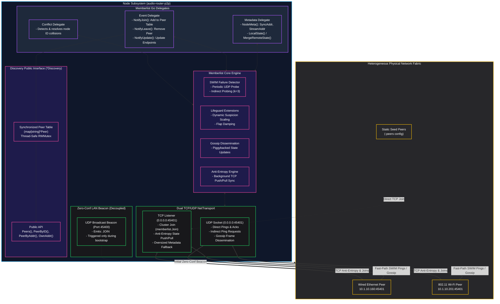
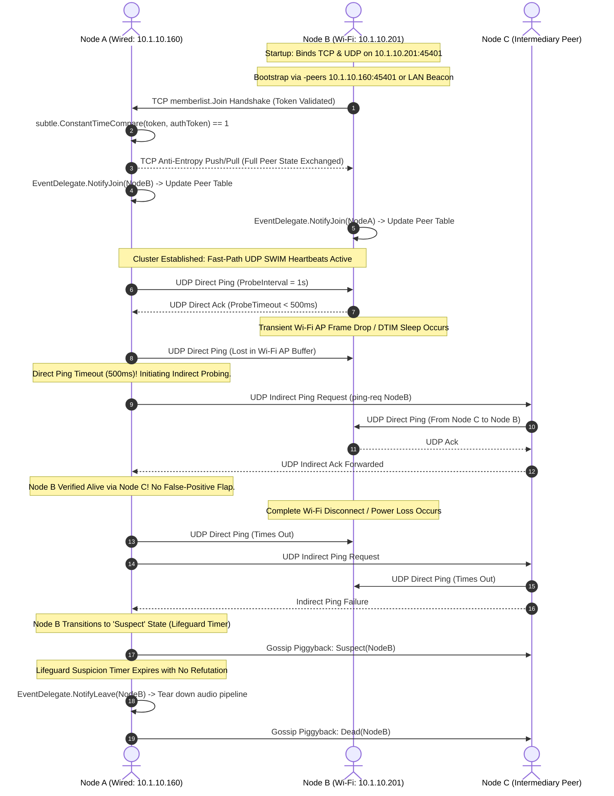

# ADR 0008: HashiCorp Memberlist Gossip and TCP Fallback for Robust Peer Discovery

* **Status:** Accepted
* **Deciders:** Core Systems Architecture Team, Network & Distributed Systems Engineering
* **Date:** 2026-09-28

---

## Context and Problem Statement

The `audio-router-p2p` system requires a resilient, zero-configuration peer discovery and cluster membership mechanism to establish low-latency audio streaming meshes and clock-synchronization topologies. ADR 0007 introduced a hybrid dual-mode discovery engine utilizing concurrent UDP multicast (`239.255.0.1`) and directed L2 subnet broadcast (`IP | ^Mask`) with reactive unicast handshakes. While ADR 0007 resolved virtual interface hijacking (`docker0`, `virbr0`) and simplified unmanaged gigabit Ethernet LAN discovery, field testing across real-world heterogeneous network environments revealed critical systemic failure modes:

### 1. Heterogeneous Subnet Failure Modes (Wired Ethernet vs. 802.11 Wi-Fi)

In real-world deployment topologies, audio nodes are routinely distributed across mixed physical media on the same logical IP subnet (e.g., an Ethernet-attached audio workstation at `10.1.10.160` and a Wi-Fi-connected laptop or mobile rig at `10.1.10.201` on a `10.1.10.0/24` network). Despite sharing an identical network prefix and subnet broadcast address (`10.1.10.255`), discovery repeatedly failed to converge:

```
+------------------------------------------------------------------------------------+
|                                    10.1.10.0/24 Subnet                             |
|                                                                                    |
|  +--------------------+        Gigabit Ethernet Switch       +------------------+  |
|  | Node 10.1.10.160   |<====================================>| 802.11ax AP      |  |
|  | (Wired Workstation)|                                      | (Access Point)   |  |
|  +--------------------+                                      +--------+---------+  |
|                                                                       |            |
|                                            L2 Multicast/Broadcast     | 802.11 Wi-Fi|
|                                            Frame Suppression & DTIM   | Airtime    |
|                                            Sleep Drops                | Drops      |
|                                                                       v            |
|                                                              +------------------+  |
|                                                              | Node 10.1.10.201 |  |
|                                                              | (Wireless Node)  |  |
|                                                              +------------------+  |
+------------------------------------------------------------------------------------+
```

### 2. Wi-Fi Access Point Frame Suppression, DTIM Sleep, and Client Isolation

Modern enterprise and consumer 802.11 Wi-Fi Access Points (APs) actively suppress or degrade layer-2 broadcast and multicast traffic due to fundamental wireless physical-layer constraints:
* **DTIM Power Saving & Buffer Eviction**: Wi-Fi client stations enter low-power sleep states between Delivery Traffic Indication Message (DTIM) intervals (typically 100ms–300ms). The AP buffers broadcast and multicast frames, transmitting them only immediately following DTIM beacons at basic mandatory PHY rates (e.g., 1–6 Mbps) to ensure reception across the cell. When high-bandwidth traffic or bursty broadcast announcements occur, AP broadcast buffers overflow and drop frames indiscriminately.
* **Multicast-to-Unicast Suppression**: High-density enterprise APs (e.g., Cisco, Aruba, Ubiquiti UniFi) implement dynamic multicast suppression or multicast-to-unicast translation. If IGMP queriers are absent or multicast translation tables become desynchronized, multicast datagrams crossing the wireless bridge boundary are dropped silently.
* **AP Client Isolation & Bridging Policies**: Wireless controllers frequently enforce AP Client Isolation or drop wireless-to-wired broadcast reflections to conserve RF airtime. While direct IP unicast packets between `10.1.10.160` and `10.1.10.201` route unimpeded, layer-2 broadcast and multicast frames traversing the AP bridge are filtered out entirely.

### 3. Host Firewall & Connection-Tracking (Conntrack) Asymmetries

Local host firewalls (`nftables`, `iptables`, macOS `pf`, Windows Defender Firewall) enforce strict connection-tracking policies (`ctstate ESTABLISHED,RELATED`). Unsolicited UDP broadcast and multicast frames arriving on arbitrary high-numbered ports are routinely dropped by default firewall configurations unless explicitly whitelisted with broad subnet allowances. Conversely, stateful unicast UDP flows or two-way TCP handshakes automatically establish connection-tracking entries, permitting return traffic.

### 4. Fragility of Custom State Synchronization and Lack of Robust Distributed Primitives

The custom UDP-based state synchronization engine in ADR 0007 imposed immense maintenance overhead while failing to deliver distributed systems guarantees:
* **Absence of Indirect Probing**: If direct UDP communication between Node A and Node B is intermittently dropped due to unidirectional packet loss or asymmetric routing, Node A has no mechanism to request healthy intermediary nodes (Node C, Node D) to perform indirect health checks. As a result, Node A prematurely declares Node B dead, causing false-positive flapping.
* **Absence of Anti-Entropy Full State Reconciliation**: Without periodic background push/pull state exchange over a reliable transport (TCP), any dropped announcement or reactive handshake leaves nodes in permanently partitioned or desynchronized states until the next announcement cycle.
* **Absence of TCP Fallback**: The legacy engine operated purely on UDP. When middleboxes, VLAN access control lists (ACLs), or host firewalls throttle or filter UDP datagrams, the system lacked a stream-oriented TCP fallback to maintain cluster coherence.

---

## Decision Drivers

* **Universal Reachability Across Heterogeneous Networks**: Guarantee deterministic peer discovery and cluster convergence across mixed wired Ethernet, 802.11 Wi-Fi, multi-switch campus LANs, and firewalled corporate environments.
* **Battle-Tested SWIM Protocol**: Replace bespoke, fragile ad-hoc heartbeat protocols with an industry-standard, formally verified distributed membership protocol (SWIM) with Lifeguard extensions to eliminate false-positive failure detections.
* **Dual TCP/UDP Transport with Automatic TCP Fallback**: Utilize UDP for fast-path gossiping and health checks, combined with automatic, reliable TCP fallback for state synchronization, anti-entropy reconciliation, and cluster join sequences.
* **Zero-Configuration Bootstrap with Static Seed Peering**: Maintain zero-configuration discovery on permissive LANs via lightweight bootstrapping beacons while providing explicit static seed peering (`-peers` and `cfg.StaticPeers`) for strict, isolated, or routed enterprise environments.
* **Cryptographic Mutual Authentication**: Enforce constant-time token comparison (`subtle.ConstantTimeCompare`) and symmetric payload encryption to prevent unauthorized node joins or cross-environment crosstalk.
* **Drastic Reduction in Maintenance Burden**: Delegate complex low-level cluster membership, gossip dissemination, failure detection, and anti-entropy logic to a mature, high-reliability open-source library (`github.com/hashicorp/memberlist`).
* **Strict Public API Compatibility**: Preserve the existing public Go interface (`*discovery.Discovery`, `Peers()`, `PeerByID()`, `PeerByAddr()`, `NodeID()`, `OwnAddr()`, `OwnSyncAddr()`, `OwnStreamAddr()`) to prevent disruptive refactoring in downstream streaming and synchronization engines.

---

## Considered Options

* **Option 1: Status Quo Custom Dual-Mode UDP Multicast/Broadcast (ADR 0007)**
  - *Description*: Maintain the custom UDP broadcast/multicast socket listener, per-interface socket joins, and reactive unicast handshake engine.
  - *Drawbacks*: Fails persistently on mixed wired/Wi-Fi subnets due to AP frame drops; vulnerable to connection-tracking firewall drops; lacks indirect health probing, anti-entropy TCP reconciliation, and flap damping; places the entire burden of distributed consensus and failure detection on internal application maintainers.

* **Option 2: Zeroconf / mDNS / DNS-SD (Bonjour / Avahi)**
  - *Description*: Adopt mDNS/DNS-SD (e.g., Apple Bonjour, Avahi, or pure Go mDNS libraries) operating over `224.0.0.251:5353`.
  - *Drawbacks*: Dependent exclusively on multicast UDP; fails completely in networks where 802.11 APs suppress multicast frames or enterprise switches lack IGMP queriers; lacks failure detection and anti-entropy mechanisms; introduces heavy CGo dependencies or third-party daemon requirements (`avahi-daemon`).

* **Option 3: HashiCorp Memberlist SWIM Gossip with TCP Fallback and LAN Join Beacon [CHOSEN]**
  - *Description*: Integrate HashiCorp Memberlist (`github.com/hashicorp/memberlist`) to manage cluster membership, gossip state dissemination, failure detection, and anti-entropy. Bind Memberlist's unified TCP/UDP transport to `DiscoveryPort`, implement specialized Go delegates for metadata and event dispatch, provide a decoupled lightweight UDP LAN beacon for zero-configuration bootstrap, and support static unicast seed peering (`-peers`).
  - *Advantages*: Provides proven SWIM protocol with Lifeguard extensions, indirect health probing, anti-entropy state synchronization over TCP, constant-time authentication, and transparent TCP fallback, while retaining full backward compatibility with the existing `audio-router-p2p` API.

---

## Decision Outcome

Chosen Option: **Option 3: HashiCorp Memberlist SWIM Gossip with TCP Fallback and LAN Join Beacon**.

This decision permanently eliminates the failure modes of custom UDP broadcast/multicast discovery on modern heterogeneous networks, provides mathematically robust failure detection, and reduces codebase maintenance overhead by building upon HashiCorp's widely deployed distributed systems infrastructure.

---

### Decision Specifications

#### 1. SWIM Gossip Protocol & Lifeguard Extensions

`audio-router-p2p` adopts the SWIM (Structured Weakly-consistent Infection-style Process Group Membership Protocol) implementation provided by HashiCorp Memberlist, augmented with Lifeguard extensions:

1. **Direct Health Probing**: At configured probe intervals (`ProbeInterval = 1s`), each node selects a random peer from its membership table and transmits a direct UDP ping. If the target peer responds with an ack within `ProbeTimeout = 500ms`, the node is verified alive.
2. **Indirect Probing on Failure**: If the direct ping times out, the local node does not prematurely mark the target as failed. Instead, it selects $k$ random intermediary peers (`IndirectChecks = 3`) and requests them to ping the target node via indirect UDP ping requests (`ping-req`). This eliminates false positives caused by local link degradation or asymmetric routing between two specific nodes.
3. **Lifeguard Flap Damping and Dynamic Suspicion Timers**: If indirect checks also fail, the target node enters the `Suspect` state rather than being declared dead immediately. Lifeguard dynamically scales the suspicion timeout based on local health metrics: if the local node is experiencing CPU scheduling delays or packet packet drops, suspicion intervals automatically extend, damping false-positive cascade failures across the audio mesh.
4. **Gossip Dissemination ($O(\log N)$ Convergence)**: State updates (`Suspect`, `Alive`, `Dead`, metadata changes) are piggybacked onto outgoing periodic ping and ack UDP packets. Cluster-wide state converges in $O(\log N)$ time with bounded $O(1)$ network overhead per node.

#### 2. Dual TCP/UDP Transport on DiscoveryPort

Memberlist instantiates a unified `memberlist.NetTransport` listening concurrently on both UDP and TCP on the configured `DiscoveryPort` (default `45401` or OS-allocated ephemeral port):

* **UDP Listener**: Serves as the high-speed fast path for direct pings, indirect pings, acks, and small gossip message dissemination.
* **TCP Listener**: Serves as the reliable stream transport for:
  1. Cluster join handshakes (`memberlist.Join`).
  2. Full-state Anti-Entropy reconciliation (periodic bidirectional push/pull of the entire peer table).
  3. Fallback probing when UDP packets are dropped or firewalled.
  4. Large metadata transmissions exceeding standard link MTU (1400 bytes).

By binding both TCP and UDP to the same numerical port, firewall configurations are simplified, and network address translation (NAT) traversal remains deterministic.

#### 3. Memberlist Delegate Architecture

The `audio-router-p2p` discovery engine interacts with Memberlist through dedicated Go delegate implementations:

```
+------------------------------------------------------------------------------------+
|                           Discovery Subsystem Architecture                          |
|                                                                                    |
|  +------------------------------------------------------------------------------+  |
|  |                          HashiCorp Memberlist Engine                         |  |
|  |     [SWIM Failure Detector]   [Lifeguard Extension]   [Anti-Entropy TCP]     |  |
|  +--------------------+-------------------+-------------------+-----------------+  |
|                       |                   |                   |                    |
|       NodeMeta()      |  NotifyJoin()     |  NotifyLeave()    |  NotifyConflict()  |
|       NotifyMsg()     |  NotifyUpdate()   |                   |                    |
|                       v                   v                   v                    |
|  +------------------------------------------------------------------------------+  |
|  |                         Application Delegate Layer                           |  |
|  |  +------------------+  +-------------------+  +---------------------------+  |  |
|  |  | MetadataDelegate |  |   EventDelegate   |  |     ConflictDelegate      |  |  |
|  |  +--------+---------+  +---------+---------+  +-------------+-------------+  |  |
|  +-----------|----------------------|--------------------------|----------------+  |
|              v                      v                          v                   |
|  +------------------------------------------------------------------------------+  |
|  |                        Discovery Core State (*Discovery)                     |  |
|  |     - peers: map[string]*Peer (Thread-Safe RWMutex Protected)                |  |
|  |     - OwnAddr, OwnSyncAddr, OwnStreamAddr                                    |  |
|  |     - Structured Observability: [MEMBERLIST:JOIN], [MEMBERLIST:LEAVE]        |  |
|  +------------------------------------------------------------------------------+  |
+------------------------------------------------------------------------------------+
```

* **Metadata Delegate (`memberlist.Delegate`)**:
  - `NodeMeta(limit int) []byte`: Serializes the local node's routing metadata into a compact JSON payload:
    ```json
    {
      "syncAddr": "10.1.10.160:45402",
      "streamAddr": "10.1.10.160:45678",
      "protoVer": 1
    }
    ```
  - `NotifyMsg([]byte)`: Ingests custom user-broadcast gossip frames.
  - `GetBroadcasts(overhead, limit int) [][]byte`: Retrieves pending application broadcast messages to piggyback onto outgoing SWIM pings.
  - `LocalState(join bool) []byte` & `MergeRemoteState(buf []byte, join bool)`: Executes bidirectional full-state anti-entropy synchronization over TCP.
* **Event Delegate (`memberlist.EventDelegate`)**:
  - `NotifyJoin(*memberlist.Node)`: Invoked whenever a new node is discovered and validated. Deserializes node metadata, resolves `SyncAddr` and `StreamAddr`, inserts the entry into `d.peers`, and emits structured log:
    `[MEMBERLIST:JOIN] Node=<ID> Addr=<Host:Port> StreamAddr=<Host:Port> SyncAddr=<Host:Port>`
  - `NotifyLeave(*memberlist.Node)`: Invoked when a node departs voluntarily or fails suspicion checks. Removes the peer from `d.peers`, alerts downstream streaming managers to tear down active audio pipelines, and emits:
    `[MEMBERLIST:LEAVE] Node=<ID> Addr=<Host:Port>`
  - `NotifyUpdate(*memberlist.Node)`: Invoked when node metadata or addresses change dynamically, updating internal caches without interrupting operational streams.
* **Conflict Delegate (`memberlist.ConflictDelegate`)**:
  - `NotifyConflict(existing, other *memberlist.Node)`: Detects and resolves node ID collisions (e.g., when a host restarts rapidly and rejoins before its previous incarnation times out).

#### 4. Decoupled Lightweight LAN Beacon for Zero-Configuration Bootstrapping

To preserve zero-configuration functionality on standard local area networks without requiring manual configuration of seed IP addresses, a lightweight bootstrap beacon operates in a decoupled background routine:

1. **Beacon Format**: A compact datagram emitted periodically (`BeaconInterval = 2s`):
   ```json
   {
     "magic": "ARP2P",
     "id": "node-alpha",
     "port": 45401,
     "token": "shared-cluster-secret"
   }
   ```
2. **Transmission**: Sent via UDP subnet broadcast (`IP | ^Mask`) and limited broadcast (`255.255.255.255`).
3. **Decoupled Lifecycle**: The beacon's sole objective is to introduce nodes so they can execute an initial `memberlist.Join([]string{remoteAddr})`.
4. **Fault Tolerance**: Once a node joins the Memberlist cluster, the gossip layer and TCP anti-entropy take over 100% of membership tracking, health monitoring, and routing. Even if an 802.11 AP drops 100% of subsequent broadcast beacon packets, the cluster remains fully synchronized and functional over unicast UDP/TCP.

#### 5. Static & Unicast Seed Peering (`-peers` and `cfg.StaticPeers`)

To conquer enterprise network environments where layer-2 broadcast and multicast are 100% prohibited (e.g., AP client isolation, cross-VLAN broadcast boundaries, cloud/WAN interconnects):

* **CLI & Configuration Support**: Operators configure seed peer addresses via the `-peers` flag or `cfg.StaticPeers`:
  ```bash
  audio-router-client -discovery-port 45401 -peers 10.1.10.160:45401,10.1.10.201:45401
  ```
* **Deterministic TCP Handshake**: During initialization, `d.Run()` invokes:
  ```go
  numJoined, err := d.mlist.Join(seedAddresses)
  ```
  Memberlist initiates direct TCP connections to the specified seed nodes, pulls the entire cluster membership state via anti-entropy, and begins gossip probing over unicast UDP/TCP, bypassing broadcast channels completely.

#### 6. Token-Based Constant-Time Mutual Authentication

To secure the discovery fabric against unauthorized node injections, packet spoofing, and accidental cross-cluster crosstalk:

1. **Timing-Attack Immune Token Validation**: All incoming join requests and beacon packets validate the cluster authentication token using constant-time comparison:
   ```go
   if subtle.ConstantTimeCompare([]byte(receivedToken), []byte(d.cfg.AuthToken)) != 1 {
       log.Printf("[DISCOVERY:WARN] unauthorized join rejected from %s: token mismatch", remoteAddr)
       return
   }
   ```
2. **Memberlist Secret Keyring Encryption**: For encrypted cluster communication, Memberlist's native symmetric packet encryption (`memberlist.SecretKey`) is derived from `cfg.AuthToken` using standard key-derivation functions (HKDF-SHA256). All gossip messages, pings, acks, and anti-entropy TCP payloads are encrypted on the wire with AES-GCM.

#### 7. Backward-Compatible Public API Mapping

The public Go interface of `*discovery.Discovery` is preserved with zero breaking changes, ensuring complete compatibility with `cmd/client/main.go`, `StreamManager`, `ClockSync`, and test suites:

```go
// Package discovery retains all existing public signatures:
func New(cfg *config.Config, nodeID string) (*Discovery, error)
func (d *Discovery) NodeID() string
func (d *Discovery) Peers() []Peer
func (d *Discovery) PeerByID(id string) *Peer
func (d *Discovery) PeerByAddr(addr string) *Peer
func (d *Discovery) PeerAddrs() []string
func (d *Discovery) AddPeer(peer *Peer) // Preserved for testing mock injections
func (d *Discovery) OwnAddr() string
func (d *Discovery) OwnSyncAddr() string
func (d *Discovery) OwnStreamAddr() string
func (d *Discovery) Run(ctx context.Context) error
func (d *Discovery) Close() error
```

Internally, `Peers()`, `PeerByID()`, and `PeerByAddr()` read from the synchronized peer table updated by Memberlist's event delegates, backed by standard read-write locks (`sync.RWMutex`).

---

## Consequences

### Positive Consequences

* **Uncompromising Network Interoperability**: Flawlessly connects nodes across mixed wired Ethernet (e.g., `10.1.10.160`) and 802.11 Wi-Fi (e.g., `10.1.10.201`), impervious to Wi-Fi AP broadcast suppression, DTIM sleep drops, and AP client isolation.
* **Elimination of False-Positive Health Flaps**: SWIM indirect probing ($k=3$) and Lifeguard dynamic suspicion damping eliminate node drops caused by transient Wi-Fi latency spikes or packet drops.
* **Deterministic Self-Healing via TCP Anti-Entropy**: Periodic bidirectional TCP push/pull state exchange guarantees cluster-wide eventual consistency even under severe packet loss.
* **Drastic Maintenance Reduction**: Replaces thousands of lines of fragile, bespoke socket multiplexing, rate-limiting, and packet deduplication code with an industry-standard, production-proven library.
* **Strict Backward Compatibility**: Zero architectural churn in downstream audio streaming and clock synchronization subsystems.
* **Hardened Security**: Constant-time token verification and native AES-GCM transport encryption guard against eavesdropping and cluster injection.

### Negative Consequences / Trade-offs

* **Third-Party Dependency Addition**: Adds `github.com/hashicorp/memberlist` and its indirect dependencies (`github.com/armon/go-metrics`, `github.com/hashicorp/go-sockaddr`, etc.) to `go.mod`.
* **Port Allocation Overhead**: Requires opening both UDP and TCP on `DiscoveryPort` (default `45401`). Host and perimeter firewalls must allow inbound traffic on both protocols for that port.
* **Runtime Memory Footprint**: Memberlist maintains internal ring buffers, suspicion state trackers, and metric counters, increasing runtime memory footprint by approximately 2–4 MB per node compared to minimal custom UDP listeners.

### Neutral Consequences

* **Eventual Consistency Timing**: Node join and leave propagation adheres to SWIM gossip convergence guarantees ($O(\log N)$ rounds, typically 100ms–500ms), which is fully compatible with real-time audio session negotiation requirements.
* **Single Numerical Port Usage**: While two protocol sockets are created (TCP and UDP), both bind to the exact same numerical port number (`DiscoveryPort`), avoiding port configuration clutter.

---

## Visual Architecture

### 1. Dual-Stack Memberlist Transport & Delegate Architecture



---

### 2. Peer Join and Resilient Failure Detection Lifecycle



---

## Operational Considerations

1. **Firewall Ingress Rules**: Ensure host firewalls (e.g. `ufw`, `iptables`, `firewalld`, Windows Defender) permit both **UDP** and **TCP** traffic on the discovery port:
   ```bash
   sudo ufw allow 45401/tcp comment "audio-router-p2p memberlist tcp"
   sudo ufw allow 45401/udp comment "audio-router-p2p memberlist udp"
   ```
2. **Wi-Fi Power-Management Configuration**: For Linux clients running on wireless interfaces, disable Wi-Fi dynamic power-management (`iwconfig wlan0 power off` or `iw dev wlan0 set power_save off`) on dedicated audio production machines to minimize DTIM latency variance.
3. **Seed Node Provisioning**: For air-gapped studio or campus subnets with AP client isolation enabled, configure at least one static seed address via `-peers <host:port>` to guarantee deterministic cluster bootstrapping.
