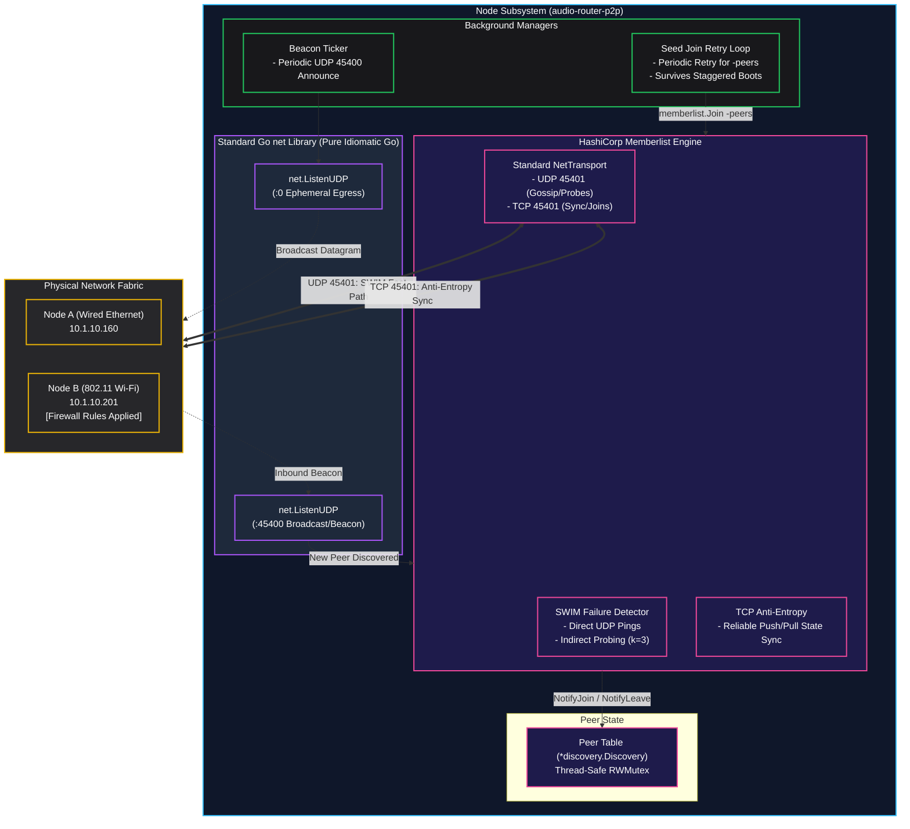

# ADR 0009: Simplification of Discovery Network Stack and Port Requirements

* **Status:** Accepted
* **Deciders:** Core Architecture Team, Network & Distributed Systems Engineering
* **Date:** 2026-09-28

---

## Context and Problem Statement

During cross-host interoperability testing between wired Ethernet (`10.1.10.160`) and 802.11 Wi-Fi (`10.1.10.201`), nodes initially failed to discover one another across the local area network. In an attempt to remedy what was hypothesized to be kernel socket packet drops, multicast interface misrouting, or port binding collisions, low-level OS socket manipulations were progressively introduced into `pkg/discovery/discovery.go`:

1. **Direct Kernel Syscalls and Raw Socket Controls**: Utilization of `golang.org/x/sys/unix` within `net.ListenConfig` `Control` closures (`syscall.RawConn`), applying low-level socket options (`SO_REUSEPORT`, `SO_REUSEADDR`, `SO_BROADCAST`).
2. **Raw IPv4 Control Message Sockets**: Wrapping UDP sockets with `golang.org/x/net/ipv4` (`ipv4.PacketConn`) to manually iterate through candidate network interfaces, invoking `SetMulticastInterface()` in per-interface unicast/broadcast send loops.
3. **Complex Interface Filtering Regexes**: Maintenance of heuristic regular expressions (`virtualIfaceRegex`) to filter container bridges (`docker0`, `incusbr0`, `virbr0`, `cni*`), tunnel devices (`tun*`, `wg*`, `tailscale*`), and Apple wireless direct links (`awdl0`).

### Root Cause Identification: Host Firewall Ingress Drops

Subsequent packet-level tracing and kernel log audits revealed that the root cause of the discovery failure was **not** Go socket binding mechanics, interface selection, or kernel socket reuse semantics. Rather, the drop occurred at the host OS packet filtering layer:

* The target wireless host was running NixOS with its default firewall enabled (`networking.firewall.enable = true`).
* Unsolicited inbound UDP and TCP datagrams targeting HashiCorp Memberlist on port `45401` were dropped by `nftables`/`iptables` default drop policies (`ctstate NEW` without matching inbound rules).
* Once port `45401` was explicitly opened on the host firewall, discovery and cluster state converged immediately.

### Architectural Problem

The low-level socket plumbing (`SO_REUSEPORT`, `ipv4.PacketConn`, OS syscall control functions) was an ineffective solution to an environmental firewall constraint. In practice, this code introduced significant liabilities:
* **Accidental Complexity & Maintenance Overhead**: Added ~400 lines of fragile, error-prone network code that obscures core application logic.
* **Portability Impediments**: Direct invocations of `golang.org/x/sys/unix` and Unix-specific socket flags degrade cross-platform ergonomics across macOS and Windows.
* **Redundancy with HashiCorp Memberlist**: ADR 0008 already introduced HashiCorp Memberlist, which natively manages SWIM failure detection, indirect health probing, and reliable TCP anti-entropy state synchronization.
* **Undocumented Infrastructure Prerequisites**: Lack of formalized firewall specifications left operators unaware of required port allocations across distributions (NixOS, Debian/Ubuntu, RHEL, Arch).

The core requirement from engineering is: **smaller own codebase, reliance on standard third-party libraries, pure idiomatic Go `net` package abstractions, zero-configuration UDP beacons for unmanaged LANs, resilient manual static seed peering (`-peers`), and unambiguous infrastructure firewall documentation.**

---

## Decision Drivers

* **KISS Principle & Code Minimization**: Strip away ad-hoc kernel socket manipulation in favor of idiomatic, standard Go library constructs (`net.ListenUDP`, `net.ListenMulticastUDP`, `net.Interfaces`).
* **Cross-Platform Portability**: Ensure the discovery networking layer compiles and executes cleanly across Linux, macOS, and Windows without platform-specific build tags or syscall dependencies.
* **Separation of Concerns**: Rely on HashiCorp Memberlist for distributed membership, failure detection, and state reconciliation; restrict local code to basic cluster bootstrapping and delegate translation.
* **Dual Bootstrapping Modalities**:
  * *Zero-Configuration*: Lightweight, standard UDP broadcast/multicast beacon for plug-and-play operation on open local networks.
  * *Deterministic Static Peering*: Configurable unicast seed list (`-peers` and `cfg.StaticPeers`) with an asynchronous background retry loop to guarantee cluster convergence regardless of broadcast/multicast network topologies.
* **Clear Environmental Contracts**: Authoritatively document required port allocations and firewall recipes across popular Linux distributions (specifically NixOS, Ubuntu/UFW, and raw nftables).

---

## Considered Options

* **Option 1: Retain Low-Level Socket Plumbery (`SO_REUSEPORT`, `ipv4.PacketConn`, Regex Filtering)**
  - *Description*: Keep the specialized `syscall.RawConn` listeners, `SO_REUSEPORT` flags, and raw per-interface IPv4 loops.
  - *Drawbacks*: High maintenance burden; platform portability risks; masks underlying network/firewall configurations without providing tangible packet delivery improvements over standard Go sockets.

* **Option 2: Rely Exclusively on Static Seed Peering (Eliminate Zero-Conf)**
  - *Description*: Remove all broadcast and multicast beaconing entirely; mandate that all nodes specify `--peers <addr1>,<addr2>` at launch.
  - *Drawbacks*: Degrades developer experience and plug-and-play usability in studio, stage, and ad-hoc rehearsal environments where zero-configuration startup is essential.

* **Option 3: Pure Go Standard Library Networking + Memberlist + Explicit Firewall Specifications [CHOSEN]**
  - *Description*:
    1. Eliminate all `golang.org/x/sys/unix`, `syscall.RawConn`, `SO_REUSEPORT`, and `golang.org/x/net/ipv4` dependencies from `pkg/discovery`.
    2. Adopt pure standard Go `net` package constructs (`net.ListenUDP`, standard broadcast, `net.Interfaces`).
    3. Retain HashiCorp Memberlist for cluster membership and TCP anti-entropy.
    4. Retain the lightweight UDP LAN beacon for zero-conf bootstrap and `-peers` static peering with background retry.
    5. Document normative firewall requirements and configuration templates.
  - *Advantages*: Eliminates hundreds of lines of complex socket code, ensures native cross-platform compilation, leverages battle-tested Memberlist protocols, and directly addresses the environmental root cause.

---

## Decision Outcome

Chosen Option: **Option 3: Pure Go Standard Library Networking + Memberlist + Explicit Firewall Specifications**.

### Key Architectural Changes

1. **Elimination of Low-Level OS Syscalls**:
   - Dropped `golang.org/x/sys/unix` and `syscall.RawConn` references.
   - Removed `listenConfigDualMode()` and `listenConfigBroadcast()`.
   - Eliminated `SO_REUSEPORT`, `SO_REUSEADDR`, and socket control hooks.
2. **Elimination of Raw IPv4 PacketConn Constructs**:
   - Dropped `golang.org/x/net/ipv4` (`annSendPConn`, `ipv4.PacketConn`).
   - Removed manual per-interface egress iteration; egress datagrams rely on standard Go UDP socket transmission and kernel routing tables.
3. **Pure Idiomatic Go Standard Library Networking**:
   - Replaced custom listeners with standard `net.ListenUDP("udp4", ...)` and standard `net.Interfaces()`.
4. **Preserved Resilient Dual Bootstrap**:
   - **Zero-Conf LAN Beacon**: Decoupled UDP beacon listener and emitter operating over standard UDP broadcast (`255.255.255.255` / subnet broadcast) on port `45400`.
   - **Static Seed Peering with Background Retries**: Static peers specified via `-peers host:port` or `cfg.StaticPeers` are queued in an asynchronous background retry worker (`seedJoinLoop`), ensuring eventual convergence even during staggered node startup sequences.
5. **Normative Network Firewall Requirements**:
   - Formally standardized all port allocations across control, state, synchronization, and media streaming subsystems.

---

## System Port Matrix & Firewall Specifications

For `audio-router-p2p` to establish connectivity and maintain peer membership, host firewalls and network access control lists (ACLs) must allow traffic on the following ports:

| Port | Protocol | Subsystem | Direction | Purpose |
| :--- | :--- | :--- | :--- | :--- |
| **45400** | UDP | Discovery Bootstrap | Inbound / Outbound | Zero-conf LAN UDP beacon (broadcast / multicast) |
| **45401** | UDP | Discovery / Membership | Inbound / Outbound | HashiCorp Memberlist SWIM pings, acks, indirect probes |
| **45401** | TCP | Discovery / Membership | Inbound / Outbound | HashiCorp Memberlist cluster joins, anti-entropy sync |
| **45402** | UDP | Clock Synchronization | Inbound / Outbound | Low-latency audio clock synchronization (PTP/NTP model) |
| **45403** | UDP | Distributed Election | Inbound / Outbound | Cluster leader/clockmaster election (if enabled) |
| **45678** | UDP | Audio Streaming Engine | Inbound / Outbound | Real-time low-latency Opus audio stream packets |
| **8443** | TCP | Management & WebUI | Inbound | HTTPS REST API, WebSocket event stream, WebUI |

---

## Host Firewall Configuration Recipes

### 1. NixOS (`/etc/nixos/configuration.nix`)

The default NixOS firewall drops all unsolicited inbound packets. To permit `audio-router-p2p` operations, declare the following within the host configuration:

```nix
{ config, pkgs, ... }:

{
  networking.firewall = {
    enable = true;
    allowedTCPPorts = [
      45401  # Memberlist TCP Join & Anti-Entropy
      8443   # WebUI & HTTPS API Server
    ];
    allowedUDPPorts = [
      45400  # Zero-Conf LAN Discovery Beacon
      45401  # Memberlist UDP SWIM Gossip & Health Checks
      45402  # Audio Clock Synchronization
      45403  # Cluster Election Socket
      45678  # Real-Time Audio Streaming (Opus/UDP)
    ];
    
    # Optional: Trust entire physical interface for local LAN nodes
    # trustedInterfaces = [ "enp4s0" "wlan0" ];
  };
}
```

Rebuild the system configuration:
```bash
sudo nixos-rebuild switch
```

### 2. Ubuntu / Debian (UFW)

```bash
# Discovery and Cluster Membership
sudo ufw allow 45400/udp comment 'audio-router-p2p zero-conf beacon'
sudo ufw allow 45401/tcp comment 'audio-router-p2p memberlist tcp'
sudo ufw allow 45401/udp comment 'audio-router-p2p memberlist udp'

# Audio Engine and Synchronization
sudo ufw allow 45402/udp comment 'audio-router-p2p clock sync'
sudo ufw allow 45403/udp comment 'audio-router-p2p election'
sudo ufw allow 45678/udp comment 'audio-router-p2p audio stream'

# WebUI and REST/WebSocket API
sudo ufw allow 8443/tcp comment 'audio-router-p2p webui api'

sudo ufw reload
```

### 3. Linux Raw `nftables` (`/etc/nftables.conf`)

```nftables
table inet filter {
    chain input {
        type filter hook input priority 0; policy drop;

        # Established and related connections
        ct state established,related accept
        iif "lo" accept

        # audio-router-p2p control and discovery
        tcp dport { 45401, 8443 } accept
        udp dport { 45400, 45401, 45402, 45403, 45678 } accept
    }
}
```

---

## Consequences

### Positive Consequences

* **Massive Code Reduction & Cleanliness**: Removed ~400 lines of complex networking code, eliminating custom RawConn listeners, manual socket options, and per-interface packet injectors.
* **Idiomatic Go Standard Library**: Relies entirely on standard `net.ListenUDP` and standard `net.Interfaces()`, improving code readability and auditability.
* **Universal Cross-Platform Portability**: Eliminates OS-specific Unix syscall imports (`golang.org/x/sys/unix`), allowing seamless compilation and execution across Linux, macOS, and Windows.
* **Zero Resource & Goroutine Leaks**: Standard Go network sockets cleanly terminate via standard context cancellation and `Close()` calls without hanging raw descriptors.
* **Deterministic Convergence**: Preserves HashiCorp Memberlist's robust SWIM gossip and TCP fallback while ensuring unmanaged LANs discover nodes via standard UDP beacons and managed environments converge via static seed peering (`-peers`).

### Negative Consequences

* **Reliance on OS Routing Tables for Multicast Egress**: Eliminating per-interface raw packet injectors means multicast egress relies on the host's default multicast route or OS interface selection. On systems with complex multi-homed routing, standard broadcast or static seed peering (`-peers`) is recommended.

### Neutral Consequences

* **Explicit Operator Responsibility**: Operators deploying across firewalled nodes (such as NixOS or enterprise cloud instances) must explicitly configure ingress rules for the required ports as documented in the Port Matrix.

---

## Visual Architecture

### 1. Simplified Discovery Architecture



---

### 2. Firewall Flow & End-to-End Handshake

```mermaid
sequenceDiagram
    autonumber
    actor NodeA as Node A (10.1.10.160)
    participant FW as NixOS Host Firewall (10.1.10.201)
    actor NodeB as Node B (10.1.10.201)

    Note over FW: Allowed Ports Configured:<br/>TCP: 45401, 8443<br/>UDP: 45400-45403, 45678

    alt Modality 1: Zero-Conf LAN Beacon
        NodeA->>FW: UDP 45400 Broadcast Beacon (Magic: ARP2P)
        FW->>NodeB: Ingress Permitted (UDP 45400)
        NodeB->>NodeB: Validate AuthToken (ConstantTimeCompare)
        NodeB->>NodeA: TCP 45401 memberlist.Join(10.1.10.160:45401)
    else Modality 2: Static Seed Peering (-peers)
        Note over NodeA: Launched with -peers 10.1.10.201:45401
        NodeA->>FW: TCP 45401 memberlist.Join
        FW->>NodeB: Ingress Permitted (TCP 45401)
    end

    NodeB-->>NodeA: TCP 45401 State Exchange (Anti-Entropy Push/Pull)
    Note over NodeA,NodeB: Cluster Established: Full Membership Exchanged

    rect rgb(20, 30, 45)
        Note over NodeA,NodeB: Steady-State Runtime Communication
        NodeA->>FW: UDP 45401 SWIM Direct Ping
        FW->>NodeB: Ingress Permitted (UDP 45401)
        NodeB-->>NodeA: UDP 45401 Direct Ack
        NodeA->>FW: UDP 45402 Clock Synchronization Datagram
        FW->>NodeB: Ingress Permitted (UDP 45402)
        NodeA->>FW: UDP 45678 Real-Time Opus Audio Packets
        FW->>NodeB: Ingress Permitted (UDP 45678)
    end
```


