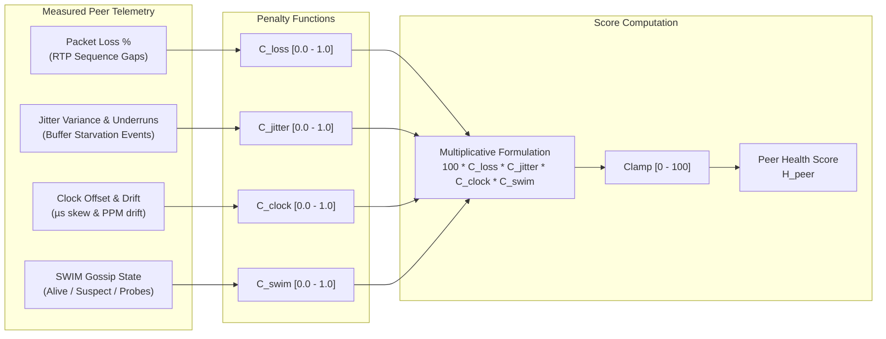

# ADR 0010: Comprehensive Network Health, Connection Telemetry, and Node Statistics

* **Status:** Accepted
* **Deciders:** Core Systems Architecture Team, Network & Distributed Systems Engineering
* **Date:** 2026-09-29

---

## Context and Problem Statement

The `audio-router-p2p` system operates as a distributed, peer-to-peer real-time audio routing matrix. Operating audio transport over unmanaged LANs and wireless links (802.11) requires tight coordination across three independent distributed domains:
1. **Cluster Membership and Discovery**: HashiCorp Memberlist SWIM gossip, UDP LAN beacons, seed node retries, and failure detectors.
2. **Real-Time Media Transport**: Low-latency UDP/DTLS streams, Opus packet encapsulation, adaptive jitter buffering, forward error correction (FEC), and packet loss concealment (PLC).
3. **Distributed Clock Synchronization**: High-precision PTP/NTP-like clock offset estimation, frequency drift tracking, and asynchronous sample rate conversion (ASRC).

### The Observability Gap

While baseline operational metrics previously existed across disparate components (such as raw peer counts, basic routing table maps, and localized DSP counters), operators and client user interfaces lacked a holistic, real-time telemetry model. Specifically:
* **Fragmented Visibility**: Operators could not correlate transport degradations (e.g., jitter buffer underruns) with distributed membership turbulence (e.g., SWIM indirect probe pings) or clock sync drift.
* **Absence of a Unified Health Index**: Operators and UI dashboards had to inspect dozens of disparate counters to evaluate peer link quality. There was no single composite metric indicating whether an active audio link was healthy, degraded, or failing.
* **Real-Time Audio Thread Safety Constraints**: Collecting telemetry must **never** block or delay the real-time audio processing loop. Mutex contention, memory allocations, or synchronous serialization inside packet ingress/egress loops (`PopNonBlock`, DSP sample pipelines) induce audio buffer underruns (glitches/clicks) and violate sub-5ms latency budgets.
* **Prometheus Metric Cardinality Explosion**: Exposing high-cardinality metrics in dynamically discovering peer-to-peer clusters presents memory exhaustion risks. Without strict label boundaries and lifecycle-managed peer metric lifecycles, time-series databases suffer performance degradation.
* **Multi-Surface Distribution Needs**: Metrics must be consumable across heterogeneous surfaces: pull-based monitoring engines (Prometheus scraper), low-overhead REST polling endpoints (`/api/v1/network/health`), and high-frequency real-time push streams (Server-Sent Events and WebSockets for dynamic WebUIs).

---

## Decision Drivers

* **Zero Audio Path Contention**: Enforce lock-free, allocation-free telemetry tapping on all real-time audio threads and UDP/RTP streaming paths.
* **Coherent Point-in-Time Snapshots**: Decouple metrics collection from metrics consumption using lock-free atomic pointer swaps (`atomic.Pointer[NetworkHealthSnapshot]`), guaranteeing atomic and consistent telemetry state across concurrent consumers.
* **Holistic Peer Connection Health Score**: Define a standardized, bounded (0–100) connection quality algorithm that aggregates packet loss, jitter variance, clock phase offset, and gossip responsiveness into a deterministic index.
* **Bounded Cardinality & Resource Predictability**: Design custom Prometheus metric collectors with strict label sets restricted to active `peer_id` values, ensuring automatic cleanup when peers depart the Memberlist topology.
* **Multi-Surface Telemetry Export**: Expose telemetry simultaneously via Prometheus scraping, REST JSON endpoints, and real-time push channels (SSE / WebSockets).

---

## Considered Options

* **Option 1: Ad-hoc Subsystem Mutex Scraping on Demand**
  * *Description*: Directly lock and scrape subsystem state (`streamer.Stats()`, `discovery.Peers()`, `sync.Offsets()`) whenever a Prometheus scrape or REST API call occurs.
  * *Drawbacks*: Introduces mutex contention directly into streamer and discovery subsystems. Scrapes happening during burst audio traffic can stall buffer operations. Additionally, concurrent reads produce torn reads and inconsistent point-in-time state between discovery and streaming.

* **Option 2: Heavyweight Third-Party Observability Agent (OpenTelemetry SDK Pipeline)**
  * *Description*: Embed standard OpenTelemetry Go SDK tracers, meters, and batch exporters across all packages.
  * *Drawbacks*: OTel SDK pipelines introduce substantial heap allocations, context propagations, background worker threads, and memory overhead. This is fundamentally incompatible with embedded and low-latency audio processing constraints where zero-allocation guarantees are paramount.

* **Option 3: Central Non-Blocking Aggregator with Lock-Free Atomic Snapshots and Multi-Surface Exporters [CHOSEN]**
  * *Description*:
    1. Implement a dedicated, lightweight `pkg/telemetry` aggregator utilizing atomic accumulators (`atomic.Uint64`, `atomic.Uint32`, `atomic.Int64`) on the write paths.
    2. Maintain an atomic snapshot reference (`atomic.Pointer[NetworkHealthSnapshot]`) updated at a periodic background cadence (e.g., 100ms–500ms).
    3. Instrument discovery, streaming, and clock sync subsystems via decoupled, non-blocking hooks.
    4. Compute a deterministic 0–100 Connection Health Score per peer and node.
    5. Expose snapshots across Prometheus (`NetworkMetricsCollector`), REST API (`/api/v1/network/health`), and live streaming broadcast (`TelemetryHub` SSE/WebSocket).
  * *Advantages*: Guarantees zero lock contention and zero heap allocation on audio paths, delivers atomic read coherence, bounds Prometheus cardinality, and provides rich multi-surface telemetry.

---

## Decision Outcome

Chosen Option: **Option 3: Central Non-Blocking Aggregator with Lock-Free Atomic Snapshots and Multi-Surface Exporters**.

### 1. Central Telemetry Aggregator Architecture (`pkg/telemetry`)

The central telemetry aggregator decouples metrics writers from metrics readers:
* **Write Path (Hot Audio & Packet Paths)**: Subsystems record packet events, sequence numbers, bytes, and latencies exclusively via primitive atomic operations (`Add`, `Store`, `Swap`). No mutexes, channel sends, or heap allocations occur on the audio hot paths.
* **Snapshot Pipeline (Decoupled Background Cadence)**: A background aggregator goroutine sweeps atomic accumulators at a fixed periodic interval (default: 250ms), computes derived rate metrics (e.g., effective kbps, loss percentages, jitter moving averages), evaluates health scores, and publishes a read-only `NetworkHealthSnapshot` struct via `atomic.Pointer.Store()`.
* **Read Path (Exporters & APIs)**: Prometheus collectors, REST handlers, and push hubs call `atomic.Pointer.Load()`, obtaining an immutable reference to the latest snapshot with zero lock contention and instantaneous $O(1)$ read performance.

### 2. Domain Subsystem Instrumentation

Instrumentation points are established across three primary subsystem domains:

#### A. Discovery & Cluster Membership (`pkg/discovery`)
* **Memberlist SWIM Metrics**: Active cluster node count, direct ping latency (RTT in ms), indirect probe requests/failures, suspect state transitions, and node churn events.
* **LAN Beacon Bootstrap Metrics**: UDP beacon datagrams sent/received on port `45400`, discarded invalid tokens, and static seed peer retry attempt/failure counts.

#### B. Media Transport & Buffer Health (`pkg/streamer`)
* **RTP Transport Metrics**: Inbound and outbound packets, byte throughput, and calculated effective throughput (kbps).
* **Loss & Error Metrics**: Sequence number discontinuities, burst loss count, and packet drop events.
* **Jitter Buffer Watermarks**: Instantaneous buffered frames, target depth capacity, underrun counts, and overrun counts.
* **DSP Adaptation Metrics**: FEC packets generated, received, and recovered; PLC pitch and noise concealment activations; ASRC smoothed vs. target watermark frames and dynamic drift adjustment (PPM).

#### C. Distributed Clock Synchronization (`pkg/sync`)
* **Clock Phase & Frequency**: Clock offset against master node (in microseconds $\mu\text{s}$), calculated clock frequency drift (parts-per-million, PPM).
* **Sync Link Telemetry**: Sync probe round-trip time (RTT in $\mu\text{s}$), lost sync probe packets, and current synchronization master status (`true`/`false`).

---

### 3. Composite 0–100 Connection Health Score Algorithm

To provide operators and automated failover systems with an unambiguous status index, the telemetry aggregator computes a normalized Connection Health Score ($H \in [0, 100]$) for each peer link, as well as an overall Node Health Score ($H_{\text{node}}$).

#### Peer Health Score ($H_{\text{peer}}$)

The peer health score begins at 100 and applies multiplicative penalty coefficients based on four core network attributes:

$$H_{\text{peer}} = \max\left(0, \; 100 \times C_{\text{loss}} \times C_{\text{jitter}} \times C_{\text{clock}} \times C_{\text{swim}}\right)$$

1. **Packet Loss Coefficient ($C_{\text{loss}}$)**:
   * Loss $\le 0.5\%$: $C_{\text{loss}} = 1.0$
   * Loss between $0.5\%$ and $5.0\%$: $C_{\text{loss}} = 1.0 - 0.08 \times (\text{Loss}\% - 0.5)$
   * Loss between $5.0\%$ and $20.0\%$: $C_{\text{loss}} = 0.64 - 0.035 \times (\text{Loss}\% - 5.0)$
   * Loss $> 20.0\%$: $C_{\text{loss}} = \max\left(0.0, \; 0.115 - 0.01 \times (\text{Loss}\% - 20.0)\right)$

2. **Jitter & Buffer Health Coefficient ($C_{\text{jitter}}$)**:
   * Based on underrun frequency over a 10-second sliding window and jitter delay variance:
   * $C_{\text{jitter}} = 1.0 - \min\left(0.5, \; \text{Underruns}_{10s} \times 0.15\right) - \min\left(0.5, \; \frac{\text{JitterMS}}{100}\right)$

3. **Clock Synchronization Coefficient ($C_{\text{clock}}$)**:
   * Evaluates offset $|\theta|$ (microseconds) and frequency drift $|\Delta f|$ (ppm):
   * $|\theta| \le 500\,\mu\text{s}$ and $|\Delta f| \le 20\,\text{ppm}$: $C_{\text{clock}} = 1.0$
   * $|\theta| > 500\,\mu\text{s}$: Penalty proportional to $\log_{10}\left(\frac{|\theta|}{500}\right)$ up to a maximum deduction of $0.35$.
   * $|\Delta f| > 50\,\text{ppm}$: Fixed deduction of $0.15$.

4. **SWIM Gossip Reachability Coefficient ($C_{\text{swim}}$)**:
   * Node status `Alive`: $1.0$
   * Node status `Suspect`: $0.4$
   * Direct ping failures requiring indirect routing: $0.85$

#### Overall Node Health Score ($H_{\text{node}}$)

The aggregate node health score evaluates overall stability by calculating the harmonic mean of active peer health scores, penalized if local audio hardware underruns occur:

$$H_{\text{node}} = \begin{cases} 
100, & \text{if } N_{\text{peers}} = 0 \\
\left(\frac{N}{\sum_{i=1}^N \frac{1}{\max(1, H_{\text{peer}, i})}}\right) \times P_{\text{local}}, & \text{if } N_{\text{peers}} > 0 
\end{cases}$$

Where $P_{\text{local}} = 1.0 - \min(0.5, \text{LocalHardwareUnderruns}_{10s} \times 0.1)$.

---

### 4. Multi-Surface Telemetry Exposure

Telemetry is exported across three unified interfaces:

#### A. Custom Prometheus Collector (`NetworkMetricsCollector`)
A dedicated Prometheus collector registers and describes metrics under standard namespaces. Metrics are bounded to active peers and automatically pruned when peers leave:

| Metric Family | Type | Labels | Description |
| :--- | :--- | :--- | :--- |
| `audio_router_network_node_health_score` | Gauge | `node_id` | Overall node health score (0–100) |
| `audio_router_network_cluster_members` | Gauge | `node_id`, `state` | Current Memberlist cluster members by state (`alive`, `suspect`) |
| `audio_router_network_beacon_packets_total` | Counter | `node_id`, `direction` | Total zero-conf UDP discovery beacons sent/received |
| `audio_router_peer_health_score` | Gauge | `peer_id` | Composite connection health score (0–100) per peer |
| `audio_router_peer_packets_sent_total` | Counter | `peer_id`, `stream_id` | Total RTP audio packets transmitted to peer |
| `audio_router_peer_packets_received_total`| Counter | `peer_id`, `stream_id` | Total RTP audio packets received from peer |
| `audio_router_peer_packet_loss_ratio` | Gauge | `peer_id`, `stream_id` | Real-time moving average packet loss ratio (0.00–1.00) |
| `audio_router_peer_jitter_buffer_depth` | Gauge | `peer_id`, `stream_id` | Instantaneous jitter buffer depth in frames |
| `audio_router_peer_jitter_buffer_underruns`| Counter | `peer_id`, `stream_id` | Cumulative jitter buffer starvation events |
| `audio_router_peer_clock_offset_microseconds` | Gauge | `peer_id` | Estimated clock phase offset relative to peer |
| `audio_router_peer_clock_drift_ppm` | Gauge | `peer_id` | Measured clock frequency drift in parts-per-million |
| `audio_router_peer_rtt_milliseconds` | Gauge | `peer_id`, `subsystem` | Round-trip latency (subsystems: `swim`, `sync`, `rtp`) |

#### B. REST API Endpoint: `GET /api/v1/network/health`
Provides an immediate JSON document summarizing cluster topology, peer links, score breakdowns, and system throughput:

```json
{
  "node_id": "node-audio-01",
  "timestamp": "2026-09-29T14:32:00.104Z",
  "health_score": 98.4,
  "cluster": {
    "active_members": 4,
    "suspect_members": 0,
    "lan_beacon_active": true,
    "seed_retry_active": false
  },
  "peers": {
    "node-audio-02": {
      "address": "10.1.10.160:45678",
      "health_score": 99.1,
      "swim_state": "alive",
      "rtt_ms": 1.24,
      "streaming": {
        "packets_sent": 145020,
        "packets_received": 145018,
        "loss_ratio": 0.00001,
        "effective_kbps": 512.4,
        "jitter_depth_frames": 4,
        "underruns": 0,
        "overruns": 0,
        "fec_recovered": 2,
        "plc_concealed": 0
      },
      "sync": {
        "offset_us": -12.4,
        "drift_ppm": 0.8,
        "sync_rtt_us": 1180,
        "is_master": false
      }
    }
  }
}
```

#### C. Push Hub Streaming (`TelemetryHub` SSE & WebSocket)
The existing `pkg/api/telemetry/hub.go` broadcast engine is extended to publish periodic network telemetry frames:
* **Server-Sent Events (SSE)**: `GET /api/v1/telemetry/network` emits `event: network_health` frames at a configurable rate (1 Hz to 10 Hz).
* **WebSocket**: `GET /api/v1/telemetry/ws` interleaves audio meter telemetry with compact network health telemetry messages for real-time frontend canvas rendering.

---

## Consequences

### Positive Consequences

* **Hard Real-Time Audio Guarantees**: Telemetry recording on audio hot paths is strictly lock-free and allocation-free, eliminating the risk of metrics-induced buffer underruns and jitter.
* **Instantaneous Read Performance**: Background atomic pointer swaps allow arbitrary consumers (Prometheus scraping, REST calls, UI WebSockets) to access complete, coherent system snapshots in $O(1)$ time without mutex contention.
* **Actionable Single-Pane Health Metrics**: The 0–100 composite health score enables operators and automated matrix routing logic to detect failing links and trigger route reconvergence before perceptible audio drops occur.
* **Controlled Prometheus Memory Consumption**: Metrics are dynamically bound to active peers and cleaned up upon departure, preventing time-series cardinality bloat in dynamic clusters.
* **Unified Observability Architecture**: Correlates cluster membership events (Memberlist), streaming transport statistics (RTP/FEC/Jitter), and physical hardware timing (PTP/ASRC) under a single cohesive framework.

### Negative Consequences

* **Telemetry Freshness Latency**: Because the snapshot is updated by a background aggregator worker on a periodic ticker (e.g., 250ms), external scrapers observe metrics with a bounded propagation latency of up to 250ms.
* **Memory Overhead of Sliding Metrics History**: Maintaining moving-average windows and rate accumulators for loss and jitter requires a small fixed memory footprint per active peer (~2 KB per peer).
* **Scoring Heuristic Sensitivity**: Composite score weighting coefficients require empirical validation and tuning across diverse environments (e.g., enterprise Wi-Fi vs. dedicated Gigabit Ethernet).

### Neutral Consequences

* **Schema Coordination**: Frontend WebUI components and external Grafana dashboards must adapt to the new `audio_router_network_*` and `audio_router_peer_*` metric naming conventions and JSON schemas.

---

## Visual Architecture

### 1. Telemetry Aggregation and Non-Blocking Snapshot Architecture

```mermaid
graph TB
    subgraph AudioEngine ["Real-Time Media Loop (Zero Locks / Zero Allocations)"]
        INGRESS["RTP/UDP Ingress\nPacket Receiver"]
        JB["Adaptive Jitter Buffer\n(PopNonBlock)"]
        DSP["DSP Pipeline\n(FEC / PLC / ASRC)"]
        
        ATOMIC_STREAM["Atomic Counters\n- Packets In/Out\n- Gaps & Drops\n- Watermark & Underrun"]
        
        INGRESS --> ATOMIC_STREAM
        JB --> ATOMIC_STREAM
        DSP --> ATOMIC_STREAM
    end

    subgraph DiscoverySync ["Distributed Control Plane"]
        ML["pkg/discovery\n- Memberlist SWIM RTT\n- Indirect Probes\n- Beacon Counters"]
        SYNC["pkg/sync\n- Clock Offset (µs)\n- Drift (PPM)\n- Sync RTT"]
        
        ATOMIC_DISC["Atomic / Mutex State\n- Member States\n- Clock Offsets"]
        
        ML --> ATOMIC_DISC
        SYNC --> ATOMIC_DISC
    end

    subgraph TelemetrySubsystem ["pkg/telemetry Core Engine"]
        WORKER["Background Aggregator Worker\n(Tick Cadence: 250ms)"]
        SCORE_CALC["Health Score Engine\n- C_loss * C_jitter * C_clock * C_swim\n- Harmonic Node Health"]
        
        SWAP["atomic.Pointer[NetworkHealthSnapshot]\n(Lock-Free Snapshot Swap)"]
        
        ATOMIC_STREAM -.->|Periodic Sweep| WORKER
        ATOMIC_DISC -.->|Periodic Query| WORKER
        WORKER --> SCORE_CALC
        SCORE_CALC -->|Publish New Snapshot| SWAP
    end

    subgraph Exporters ["Multi-Surface Exporters"]
        PROM["NetworkMetricsCollector\n(Prometheus /metrics)\nBounded Cardinality"]
        REST["REST API Handler\nGET /api/v1/network/health"]
        HUB["TelemetryHub Broadcast\nSSE / WebSocket Push"]
        
        SWAP ==>|Load Snapshot O(1)| PROM
        SWAP ==>|Load Snapshot O(1)| REST
        SWAP ==>|Load Snapshot O(1)| HUB
    end

    subgraph Consumers ["Consumers & Operators"]
        PROMETHEUS_SERVER["Prometheus Server / Grafana"]
        OPERATOR_CLI["CLI & Health Checks"]
        WEBUI_CLIENT["Browser WebUI (Real-Time Canvas)"]
        
        PROM -->|HTTP Scrape| PROMETHEUS_SERVER
        REST -->|JSON Response| OPERATOR_CLI
        HUB -->|SSE / WS Stream| WEBUI_CLIENT
    end
```

### 2. Peer Health Score Evaluation Pipeline


