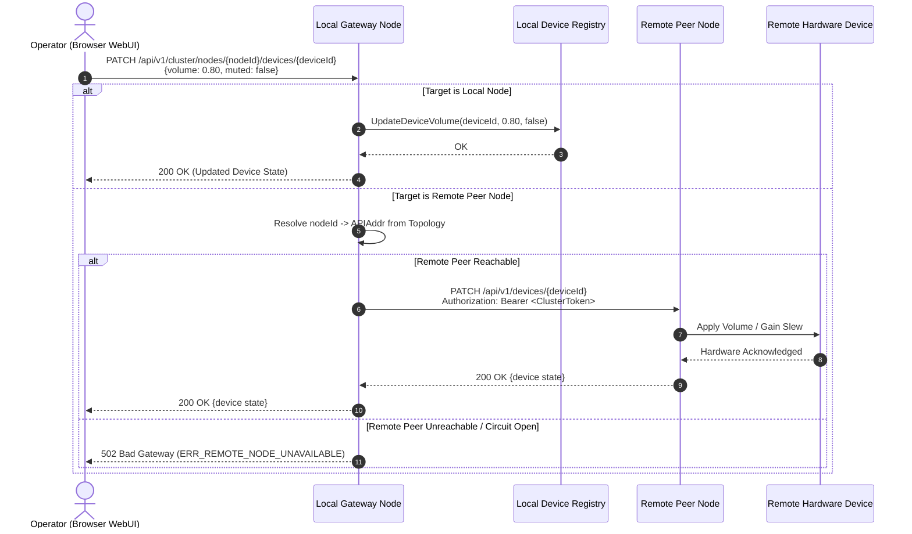
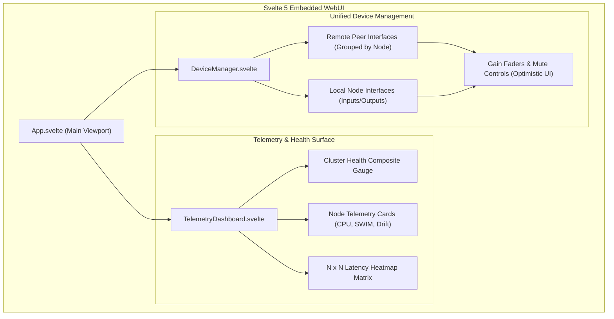

# ADR 0011: Cluster-Wide Node Observability and Remote Device Management

* **Status:** Accepted
* **Deciders:** Core Systems Architecture Team, Distributed Audio & Network Engineering
* **Date:** 2026-09-30

---

## Context and Problem Statement

`audio-router-p2p` nodes operate in decentralized peer-to-peer topologies where each node hosts physical ALSA/CoreAudio/WASAPI soundcards or virtual loopback devices, executes real-time Opus streaming, runs clock synchronization (PTP/ASRC), and exposes an embedded web management interface (ADR 0005, ADR 0010). In production studio facilities, multi-room broadcast stages, and distributed live sound environments, operators interact with the cluster via a browser session connected to an arbitrary "local gateway" node.

### The Single-Pane-of-Glass Challenge

Operators require a centralized, cluster-wide view to observe system health (composite 0–100 health index, SWIM membership states, $N \times N$ network round-trip time latency matrix, packet loss, clock drift) and configure audio hardware and virtual devices across all nodes. However, providing multi-node observability and control from a single browser session presents severe distributed systems, security, and real-time audio challenges:

1. **Browser Security and Direct Peer Mesh Infeasibility**:
   - If the frontend attempts direct browser-to-peer HTTPS connections to every discovered node in the mesh, browsers enforce strict Cross-Origin Resource Sharing (CORS) rules.
   - P2P nodes frequently utilize self-signed X.509 certificates, private IP addresses (`10.x.x.x`, `192.168.x.x`), or dynamic mDNS names. Modern browsers reject requests to self-signed endpoints without explicit per-node manual certificate exceptions, which completely breaks zero-configuration cluster UX.
   - NAT, VLAN boundaries, and enterprise firewalls often prevent the operator's browser machine from reaching every peer directly, even when peers can route traffic between each other over Memberlist/DTLS control channels.

2. **Real-Time DSP and Audio Thread Safety**:
   - Audio routing daemons execute hard real-time DSP pipelines where sample buffer underruns degrade audio quality (causing audible clicks, pops, and dropout).
   - Under no circumstances may telemetry collection, peer state scraping, or cross-node mutation proxying block, allocate within, or lock resources shared with the real-time audio engine, the jitter buffer, or high-priority UDP streaming sockets.

3. **Control Plane Addressing Disconnect**:
   - The HashiCorp Memberlist SWIM gossip layer (`pkg/discovery`) previously distributed node identifiers, UDP broadcast ports, clock-sync addresses, and audio streaming endpoints (`Addr`, `SyncAddr`, `StreamAddr`).
   - The gossip layer lacked an explicit HTTP/HTTPS control plane endpoint (`APIAddr`). As a result, nodes had no deterministic mechanism to resolve the REST API address of remote peers through gossip discovery.

4. **Fault Tolerance, Latency, and Scalability**:
   - In dynamic Wi-Fi or hybrid broadcast networks, nodes may experience packet drops, transient partitions, or crash failures.
   - Synchronously querying all peer nodes on every incoming operator HTTP request induces severe tail latency ($O(N)$ serial or bounded parallel fan-out latency), risks cascading HTTP connection exhaustion, and degrades responsiveness when peers become suspect or unreachable.

---

## Decision Drivers

* **Zero-Configuration Single-Pane Management**: Enable operators to inspect telemetry and configure audio devices across the entire cluster through whichever node's web UI they connect to, without requiring direct browser connections to remote peers or manual certificate acceptance.
* **Hard Real-Time Media Loop Isolation**: Guarantee that cluster scraping, caching, and proxying execute entirely in decoupled background routines with zero lock contention or memory allocations on real-time DSP and streaming paths.
* **Sub-Millisecond Read Latency**: Serve cluster-wide telemetry and device lists instantaneously ($O(1)$ lock-free read access) from local memory snapshots, eliminating blocking synchronous fan-out during browser page loads.
* **Deterministic Fault Containment & Degradation**: Isolate unreachable, partitioned, or crashing peers using bounded scraping worker pools, aggressive request timeouts, and circuit breakers, ensuring local node stability and partial view availability during network turbulence.
* **Extensible Control Plane Discovery**: Propagate HTTP/HTTPS control plane addressing over the existing Memberlist SWIM gossip wire format without breaking backward compatibility.
* **Consistent Cross-Node Mutation Semantics**: Provide an atomic, targeted reverse-proxy mechanism for device mutations (volume, mute, gain trimming) with transparent error propagation and authorization forwarding.

---

## Considered Options

### Option 1: Direct Browser-to-Peer Multi-Connection Mesh
* **Description**: The browser queries the local node for active peer addresses, then executes parallel `fetch()` requests directly from the client browser to every remote peer's REST API.
* **Drawbacks**:
  * Blocked by browser security: self-signed TLS certificates on remote nodes trigger untrusted certificate warnings or silent connection aborts.
  * Strict CORS policies require permissive headers across all nodes.
  * Firewall/NAT traversal failures occur when client workstations reside on different network segments than remote audio edge appliances.
  * High client-side bandwidth and connection overhead on mobile/tablet control surfaces.

### Option 2: Synchronous Gateway Proxying on Request
* **Description**: When the browser requests `/api/v1/cluster/nodes` or `/api/v1/cluster/devices`, the local node synchronously dispatches concurrent HTTP requests to all known peers, aggregates responses in memory, and returns the unified JSON payload.
* **Drawbacks**:
  * Response latency is pegged to the slowest peer in the mesh ($P_{99}$ latency tail problem).
  * Suspect or ungracefully disconnected peers stall the request until HTTP timeouts expire (multi-second delays).
  * High burst concurrency on the local gateway node during frequent UI polling or multiple simultaneous operator sessions.

### Option 3: Background Worker-Pool Scraping with Lock-Free Atomic Snapshots and Targeted Mutation Proxying [CHOSEN]
* **Description**:
  1. Extend `nodeMetadata` in `pkg/discovery` to gossip `APIAddr` alongside streaming endpoints.
  2. Implement an autonomous `ClusterManager` in `pkg/cluster` that executes periodic, bounded-concurrency scraping cycles (e.g., every 2.0s with a 1.5s per-peer timeout).
  3. Store aggregated node metrics and device inventories in an immutable `ClusterSnapshot`, published via lock-free atomic pointer swapping (`atomic.Pointer[ClusterSnapshot]`).
  4. Track peer reachability with circuit-breaking state machines to immediately skip suspect/dead nodes.
  5. Proxy device write mutations (`PATCH /api/v1/cluster/nodes/{nodeId}/devices/{deviceId}`) directly to the target node's local device API via a dedicated HTTP reverse-proxy client.
  6. Present unified cluster views in the Svelte 5 WebUI using reactive runes and an $N \times N$ latency heatmap.
* **Advantages**: Delivers $O(1)$ instant UI reads, complete isolation of the real-time audio pipeline, robust failure containment, transparent bypass of browser certificate/CORS constraints, and deterministic control plane routing.

---

## Decision Outcome

Chosen Option: **Option 3: Background Worker-Pool Scraping with Lock-Free Atomic Snapshots and Targeted Mutation Proxying**.

### 1. Gossip Layer Control Plane Extension (`pkg/discovery`)

To enable control plane reachability across the cluster, the Memberlist gossip metadata structure `nodeMetadata` is extended with `APIAddr`:

```go
type nodeMetadata struct {
    ID         string `json:"id"`
    Addr       string `json:"addr,omitempty"`       // Unicast discovery host:port
    APIAddr    string `json:"apiAddr,omitempty"`    // HTTP/HTTPS control plane base URL
    SyncAddr   string `json:"syncAddr"`             // Clock-sync host:port
    StreamAddr string `json:"streamAddr"`           // Audio stream host:port
    AuthToken  string `json:"authToken,omitempty"`  // Cluster auth token
    Token      string `json:"token,omitempty"`      // Backward-compat alias
}
```

#### API Address Derivation Rules
1. If the node configuration specifies an explicit `AdvHost` and `ListenAddr`:
   - `scheme`: `https` if TLS certificates are configured (`cert.pem`, `key.pem`); otherwise `http`.
   - `host`: `AdvHost` (or the bound interface IP if `AdvHost` is empty or wildcard `0.0.0.0`).
   - `port`: Port parsed from `ListenAddr` (e.g., `8080`).
   - Format: `http(s)://<host>:<port>`
2. This string is serialized into the Memberlist node metadata payload during cluster join and read by all peers upon Memberlist delegate callbacks (`NotifyJoin`, `NotifyUpdate`).

---

### 2. Cluster Manager Engine (`pkg/cluster`)

The `pkg/cluster.Manager` subsystem manages cluster telemetry aggregation, health tracking, and remote mutation routing:

```go
type Manager struct {
    cfg        *config.Config
    disc       *discovery.Discovery
    localNode  *api.V1Server
    httpClient *http.Client
    
    // Lock-free read plane
    snapshot   atomic.Pointer[ClusterSnapshot]
    
    // Scraper worker configuration
    scrapeInterval time.Duration // Default: 2.0s
    scrapeTimeout  time.Duration // Default: 1.5s
    maxWorkers     int           // Default: 8
    
    // Circuit breaker state
    peerStateMu sync.RWMutex
    peerFailures map[string]int
    circuitOpen  map[string]time.Time
}
```

#### A. Periodic Scrape Cycle and Worker Pool
1. **Periodic Ticker**: A background goroutine fires every `2.0 seconds`.
2. **Target Enumeration**: The manager gathers all active peers from `pkg/discovery.Peers()`.
3. **Bounded Worker Pool**: A worker channel bounded to `maxWorkers` (default: 8 concurrent workers) scrapes peers in parallel.
4. **Scrape Timeout**: Each HTTP scrape request is governed by a strict `1.5s` context timeout (`context.WithTimeout`).
5. **Payload Extraction**: The worker retrieves:
   - `GET {peer.APIAddr}/api/v1/network/health` (health score, link metrics, SWIM states, clock offsets)
   - `GET {peer.APIAddr}/api/v1/devices` (audio hardware and virtual loopback devices)

#### B. Lock-Free Atomic Snapshot Swapping
To eliminate mutex contention between background scraping routines and incoming API/UI requests:
- The background aggregator compiles the scraped metrics and local node telemetry into a newly allocated, immutable `ClusterSnapshot` struct.
- The snapshot is atomically published using `atomic.Pointer.Store(&newSnapshot)`.
- HTTP handlers serving `/api/v1/cluster/nodes` and `/api/v1/cluster/devices` call `atomic.Pointer.Load()`, achieving instant, zero-lock $O(1)$ response times.

#### C. Circuit Breaking & Fault Isolation
- When a peer fails consecutive scrape attempts (threshold: 3 failures), its circuit is transitioned to `OPEN` for 10 seconds.
- While the circuit is `OPEN`, the background scraper skips HTTP requests to that peer, marking its state as `unreachable` in the snapshot while retaining its last-known identity from Memberlist SWIM gossip.
- Nodes flagged by SWIM as `Suspect` or `Dead` immediately trigger circuit bypass to prevent wasting worker-pool capacity on dying nodes.

#### D. Control Plane Mutation Proxying
When an operator updates a remote device (e.g., volume slider, mute toggle):
1. The client issues `PATCH /api/v1/cluster/nodes/{nodeId}/devices/{deviceId}` to the local gateway node.
2. If `nodeId` matches the local node, the request is dispatched directly to the local device registry.
3. If `nodeId` targets a remote peer:
   - The manager resolves the peer's `APIAddr` from the current topology.
   - The manager constructs a reverse-proxy request: `PATCH {peer.APIAddr}/api/v1/devices/{deviceId}`.
   - Headers, authentication tokens (`Bearer` or shared secret), and JSON payload are forwarded.
   - The remote response (status and body) is streamed back to the client.
   - If the remote peer is unreachable, the proxy immediately returns `HTTP 502 Bad Gateway` with a structured `ERR_REMOTE_NODE_UNAVAILABLE` code.

---

### 3. Cluster REST API Surface

The control plane exposes versioned, OpenAPI 3.1-compliant endpoints under `/api/v1/cluster/*`:

#### A. `GET /api/v1/cluster/nodes`
Returns telemetry and status across all cluster nodes, including the composite health score, SWIM gossip status, packet loss, clock drift, and the aggregate $N \times N$ latency matrix.

```json
{
  "cluster_id": "audio-net-prod-01",
  "total_nodes": 3,
  "healthy_nodes": 3,
  "degraded_nodes": 0,
  "timestamp": "2026-09-30T10:15:30.000Z",
  "nodes": [
    {
      "node_id": "node-audio-01",
      "name": "FOH-Mixer-Master",
      "api_addr": "https://10.0.1.10:8080",
      "is_local": true,
      "health_score": 98.5,
      "health_grade": "excellent",
      "swim_state": "alive",
      "clock_role": "master",
      "clock_offset_us": 0.0,
      "clock_drift_ppm": 0.0,
      "active_streams": 4,
      "packet_loss_ratio": 0.0001
    },
    {
      "node_id": "node-audio-02",
      "name": "Stagebox-Left",
      "api_addr": "https://10.0.1.11:8080",
      "is_local": false,
      "health_score": 94.2,
      "health_grade": "good",
      "swim_state": "alive",
      "clock_role": "slave",
      "clock_offset_us": -14.2,
      "clock_drift_ppm": 1.1,
      "active_streams": 2,
      "packet_loss_ratio": 0.0024
    }
  ],
  "latency_matrix": {
    "node-audio-01": {
      "node-audio-02": 0.85,
      "node-audio-03": 1.12
    },
    "node-audio-02": {
      "node-audio-01": 0.85,
      "node-audio-03": 1.45
    }
  }
}
```

#### B. `GET /api/v1/cluster/devices`
Returns all physical and virtual audio inputs and outputs discovered across the entire mesh, annotated by host node:

```json
{
  "timestamp": "2026-09-30T10:15:30.000Z",
  "devices": [
    {
      "node_id": "node-audio-01",
      "node_name": "FOH-Mixer-Master",
      "is_local": true,
      "device_id": "hw:USBStreamer,0",
      "name": "MiniDSP USBStreamer 8ch",
      "type": "hardware",
      "direction": "duplex",
      "channels": 8,
      "sample_rate": 48000,
      "volume": 1.0,
      "muted": false,
      "state": "active"
    },
    {
      "node_id": "node-audio-02",
      "node_name": "Stagebox-Left",
      "is_local": false,
      "device_id": "hw:Scarlett18i20,0",
      "name": "Focusrite Scarlett 18i20",
      "type": "hardware",
      "direction": "input",
      "channels": 8,
      "sample_rate": 48000,
      "volume": 0.85,
      "muted": false,
      "state": "active"
    }
  ]
}
```

#### C. `PATCH /api/v1/cluster/nodes/{nodeId}/devices/{deviceId}`
Proxies device volume and mute modifications directly to the specified node:

```json
// Request Body
{
  "volume": 0.75,
  "muted": false
}

// Response (HTTP 200 OK)
{
  "device_id": "hw:Scarlett18i20,0",
  "node_id": "node-audio-02",
  "volume": 0.75,
  "muted": false,
  "updated_at": "2026-09-30T10:15:31.102Z"
}
```

---

### 4. Svelte 5 Single-Pane WebUI Architecture

The embedded web interface utilizes Svelte 5 runes (`$state`, `$derived`, `$effect`) to deliver real-time observability and cross-node control without client-side polling storms:

1. **Multi-Node Observability Dashboard (`TelemetryDashboard.svelte`)**:
   - **Cluster Health Gauge**: Displays the global cluster health index computed from the harmonic mean of individual node scores.
   - **Node Cards**: Visualizes each peer node's health grade, CPU utilization, clock offset/drift, and active streams.
   - **$N \times N$ RTT Latency Heatmap**: Renders a dynamic crosspoint matrix showing round-trip times between all node pairs, color-coded from green ($<2\text{ms}$) to amber ($2\text{--}5\text{ms}$) to red ($>5\text{ms}$).
2. **Unified Distributed Device Manager (`DeviceManager.svelte`)**:
   - Audio devices are grouped hierarchically: **Local Node** vs. **Remote Peers**.
   - Input and output channels across all physical and virtual interfaces are displayed with responsive gain sliders, mute toggles, and channel format badges.
   - Control actions trigger optimistic UI updates with background synchronization via `PATCH /api/v1/cluster/nodes/{nodeId}/devices/{deviceId}`.

---

## Consequences

### Positive Consequences

* **Zero-CORS, Single-Certificate Operational Simplicity**: Operators connect to one node's web UI; all cross-cluster inspection and control traffic routes through server-to-server HTTP channels, completely eliminating browser CORS blocks and untrusted TLS warnings.
* **Hard Real-Time Audio Isolation**: Background worker-pool scraping and atomic snapshot swapping ensure that cluster management operations introduce zero lock contention, channel blocking, or heap churn into the audio DSP engine.
* **Instantaneous Frontend Response**: UI views load immediately from local atomic pointer references in $O(1)$ time without waiting for remote network round-trips.
* **Resilient Failure Handling**: Circuit breakers prevent slow or crashing remote nodes from degrading local API responsiveness or exhausting HTTP connection pools.
* **Unified Hardware and Virtual Matrixing**: Operators gain full visibility and remote control over every soundcard and loopback bus across the entire physical facility from any terminal.

### Negative Consequences

* **Eventual Consistency Window**: Metrics and remote device inventories reflect the state from the most recent scrape cycle (up to a 2.0-second delay), meaning transient spikes lasting $<2\text{s}$ may only appear in subsequent snapshots.
* **Control Plane Network & Goroutine Overhead**: Running periodic background scraping introduces modest CPU and network traffic (~few KB/s per peer) and utilizes a bounded worker pool of up to 8 goroutines during scrape intervals.
* **Mutation Proxy Latency**: Remote device updates incur an extra HTTP round-trip hop (Browser $\to$ Local Gateway $\to$ Remote Peer $\to$ Local Gateway $\to$ Browser), adding 2–10ms of latency compared to direct local device manipulation.

### Neutral Consequences

* **Configuration Management**: The control plane requires accurate host and port configuration (`AdvHost` / `ListenAddr`) to ensure generated `APIAddr` values are reachable by peer nodes across complex subnets.
* **Token Propagation**: Cluster authentication tokens must be uniformly shared or validated across nodes to enable authenticated server-to-server proxying.

---

## Visual Architecture

### 1. Cluster Observability, Scraping Worker Pool, and Read Plane

```mermaid
graph TB
    subgraph BrowserClient ["Browser Client (Single-Pane-of-Glass)"]
        UI["Svelte 5 WebUI\n- Cluster Health Gauge\n- N x N Latency Heatmap\n- Unified Device Manager"]
    end

    subgraph LocalGateway ["Local Gateway Node (Server-Side)"]
        API_ROUTER["API Router\n/api/v1/cluster/*"]
        
        subgraph ClusterEngine ["pkg/cluster Engine"]
            SWAP["atomic.Pointer[ClusterSnapshot]\n(Lock-Free Read Cache)"]
            MGR["Cluster Manager\n(Scrape Scheduler: 2.0s Cadence)"]
            WORKERS["Bounded Worker Pool\n(Max 8 Workers, 1.5s Timeout)"]
            CB["Circuit Breakers\n(Track Suspect / Failing Nodes)"]
            PROXY["Mutation Reverse Proxy\n(PATCH Forwarder)"]
        end

        subgraph LocalSubsystems ["Local Subsystems"]
            LOCAL_AUDIO["Real-Time Audio Loop\n(DSP / ALSA / ASRC)\n*ISOLATED - ZERO LOCKS*"]
            LOCAL_DISC["pkg/discovery\n(Memberlist SWIM Gossip\n+ APIAddr Metadata)"]
            LOCAL_DEV["Local Device Registry"]
        end
    end

    subgraph RemotePeers ["Remote Peer Nodes in Cluster Mesh"]
        PEER_A["Peer Node A\n(:8080 APIAddr)"]
        PEER_B["Peer Node B\n(:8080 APIAddr)"]
        PEER_DEAD["Peer Node C\n(Suspect / Partitioned)"]
    end

    %% Read Path
    UI ==>|GET /api/v1/cluster/nodes\nO(1) Lock-Free Read| API_ROUTER
    UI ==>|GET /api/v1/cluster/devices\nO(1) Lock-Free Read| API_ROUTER
    API_ROUTER -->|atomic.Load| SWAP

    %% Background Scraping Pipeline
    LOCAL_DISC -.->|Gossip Topology + APIAddrs| MGR
    MGR --> WORKERS
    WORKERS --> CB
    CB -->|HTTP GET /network/health\nHTTP GET /devices| PEER_A
    CB -->|HTTP GET /network/health\nHTTP GET /devices| PEER_B
    CB -.->|Circuit OPEN (Bypass)| PEER_DEAD

    WORKERS -->|Compile & Store| SWAP

    %% Mutation Path
    UI -.->|PATCH /api/v1/cluster/nodes/{id}/devices/{id}| API_ROUTER
    API_ROUTER -.->|Proxy Write| PROXY
    PROXY -.->|Local Update| LOCAL_DEV
    PROXY -.->|HTTP PATCH /api/v1/devices/{id}| PEER_A
```

### 2. Remote Device Mutation Proxy Sequence



### 3. Svelte 5 Single-Pane UI Component Topology


