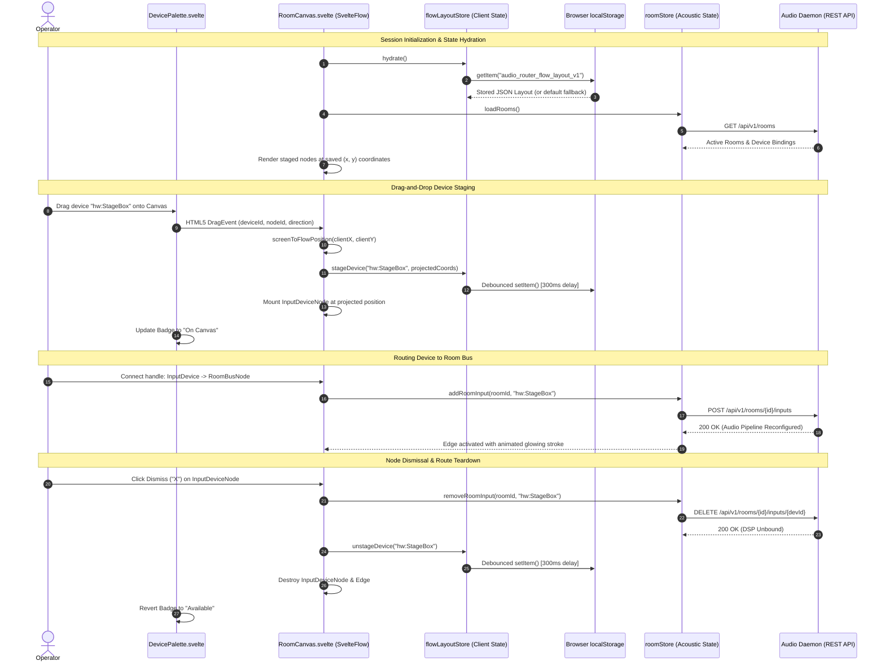

# ADR 0012: Audio Flow Canvas Consolidation, Dynamic Device Palette, and Layout Persistence

* **Status:** Accepted
* **Deciders:** Core Systems Architecture Team, Frontend Platform Engineering, Distributed Audio Team
* **Date:** 2026-09-30

---

## Context and Problem Statement

`audio-router-p2p` provides low-latency, multi-channel distributed audio routing across physical soundcards, virtual ALSA/CoreAudio/WASAPI loopbacks, and network Opus streams (ADR 0001, ADR 0002, ADR 0006). With the introduction of multi-node observability and remote device management (ADR 0011), an operator connecting to any gateway node can inspect and interact with dozens of hardware and virtual audio interfaces distributed across local and remote cluster peers.

However, the rapid expansion of cluster device density and dual routing abstractions created severe user experience (UX), cognitive load, and architectural tension in the WebUI:

### 1. Cognitive Overload from Eager Auto-Population
Previously, the visual Audio Flow canvas (`RoomCanvas.svelte`) automatically generated node cards for *every* audio interface reported by the local daemon upon mounting. In a multi-node cluster with 4–12 physical nodes (each hosting built-in audio, multi-channel USB/Thunderbolt interfaces, and multiple virtual loopback buses), the canvas instantly rendered 40 to 100+ unorganized device cards. Operators were overwhelmed by visual clutter, overlapping nodes, and massive horizontal/vertical sprawling, making it tedious to isolate the 3–4 specific interfaces relevant to a targeted broadcast or monitoring room.

### 2. Mental Model Duplication: Matrix Crossbar vs. Audio Flow
The management interface exposed two competing routing surfaces:
- **Matrix Crossbar (`MatrixCrossbar.svelte`)**: An $N \times M$ hardware-style crossbar grid mapping inputs directly to outputs.
- **Audio Flow Canvas (`RoomCanvas.svelte`)**: A directional, room-centric node graph built on SvelteFlow (`@xyflow/svelte`) mapping Input Devices $\to$ Room Mixing Busses $\to$ Output Devices.

Because the underlying core audio architecture moved definitively to the room-centric distributed audio bus model (ADR 0002, ADR 0006), the 2D crossbar grid duplicated routing concepts, lacked room grouping semantics, did not represent multi-node network boundaries cleanly, and fragmented frontend development resources.

### 3. Spatial Volatility Across Page Reloads
While operators could drag nodes around the infinite canvas, node positions and workspace configurations were held solely in transient component memory (`nodePositionCache = new Map()`). Navigating away to the diagnostics dashboard, refreshing the browser, or reconnecting after a session drop wiped all spatial arrangements and forced the canvas to re-run auto-arrangement heuristics. Operators lost their customized visual groupings, causing significant frustration in live studio and production environments.

### 4. Lack of Multi-Node Selective Staging
Operators needed the ability to selectively pull specific audio interfaces—whether located on the local gateway node or a remote peer stage-box—onto the workspace on demand, connect them into rooms, dismiss them when finished, and maintain their canvas composition indefinitely without polluting the global routing state.

---

## Decision Drivers

* **Zero-Clutter Visual Workspaces**: Render only the devices and rooms that the operator explicitly stages on the canvas. High signal-to-noise ratio must replace blanket auto-population.
* **Single Canonical Routing Surface**: Establish the visual Room Audio Flow canvas as the single, authoritative routing interface in primary navigation, retiring mental-model duplication.
* **Unified Multi-Node Inventory Discovery**: Leverage the cluster-wide device inventory (ADR 0011 `clusterStore`) in a unified, searchable, left-hand device palette that clearly differentiates local hardware from remote cluster peers.
* **Sub-Pixel Coordinate Projection**: Enable fluid HTML5 drag-and-drop from the external DOM palette into the transformed (zoomed and panned) SvelteFlow canvas coordinate system.
* **Strict Separation of Presentation vs. Acoustic State**: Spatial coordinates, zoom scales, sidebar drawer visibility, and active staging lists are client presentation concerns; they must never mutate real-time audio routing on the backend daemons or induce audio-thread latency.
* **Resilient Client Layout Persistence**: Persist canvas topology, staging lists, and positions in versioned local storage with automatic debouncing, corruption fallbacks, and orphaned route cleanup upon device dismissal.
* **Accessibility and Multi-Modal Interaction**: Provide accessible "+ Add" buttons and clean dismissal controls ("X") alongside pointer drag-and-drop gestures.

---

## Considered Options

### Option 1: Retain Eager Auto-Population with Filtering and Matrix Crossbar Tab
* **Description**: Keep the Matrix Crossbar tab in primary navigation. Enhance `RoomCanvas.svelte` with quick-filter pills (e.g., "Hide Unused", "Filter by Node") while still generating canvas nodes for every device discovered in `clusterStore`.
* **Drawbacks**:
  * Continues to force large numbers of DOM and SVG elements into SvelteFlow, causing rendering sluggishness on low-spec control tablets.
  * Filters hide nodes visually but complicate edge routing and SvelteFlow layout calculations.
  * Perpetuates user confusion regarding whether to route audio via the Matrix Crossbar or Room Flow.
  * Does not address persistent spatial workspace customization.

### Option 2: Server-Synchronized Workspace Layout Database
* **Description**: Create a persistent REST API and daemon storage engine (`pkg/storage/workspace.go`) to synchronize canvas layouts, node $(x, y)$ positions, and palette visibility to the local daemon's filesystem or BoltDB/SQLite.
* **Drawbacks**:
  * Substantially increases backend architectural complexity and storage maintenance for purely aesthetic presentation state.
  * Multi-operator collisions: Two sound engineers viewing the same gateway from different laptops would overwrite each other's viewport pan/zoom and node positions in real time.
  * Requires authentication, user account management, and session identification on what is designed to be a lightweight, decentralized audio edge daemon.

### Option 3: Canonical Audio Flow Surface with Collapsible Multi-Node Palette, Client-Side `flowLayoutStore`, and Defensive Unbinding [CHOSEN]
* **Description**:
  1. Remove Matrix Crossbar from primary navigation, making Audio Flow the sole routing viewport.
  2. Implement a collapsible, left-hand multi-node Device Palette grouping local and remote peer devices with search, direction filtering, and channel counts.
  3. Support HTML5 drag-and-drop using SvelteFlow's `screenToFlowPosition` coordinate projector, complemented by click-to-add action buttons.
  4. Implement `flowLayoutStore` backed by versioned, corruption-safe `localStorage` (`audio_router_flow_layout_v1`) with 300ms trailing write debouncing.
  5. Provide explicit device dismissal ("X") with defensive unbinding of dangling audio routes from `roomStore` to prevent ghost routing.
* **Advantages**: Decouples presentation layout entirely from the Go audio daemons, supports multiple concurrent operators with independent viewports, delivers instantaneous load times, and eliminates workspace clutter.

---

## Decision Outcome

Chosen Option: **Option 3: Canonical Audio Flow Surface with Collapsible Multi-Node Palette, Client-Side `flowLayoutStore`, and Defensive Unbinding**.

### 1. Primary Navigation Consolidation

The primary navigation bar (`Header.svelte`, `App.svelte`) is consolidated to establish **Audio Flow** as the canonical audio routing surface. 

- The `matrix` tab (`MatrixCrossbar.svelte`) is removed from the primary header navigation tabs.
- The default landing view remains `flow` (`RoomCanvas.svelte`).
- The remaining primary navigation tabs are:
  1. `flow`: **Audio Flow** (Visual room-centric canvas and interactive patchbay).
  2. `meters`: **Live Meters** (Multi-channel peak/RMS visualizer).
  3. `devices`: **Audio Devices** (Detailed ALSA/CoreAudio/WASAPI hardware & virtual loopback configuration).
  4. `rooms`: **Mesh Rooms** (High-level distributed room membership and leader status).
  5. `diagnostics`: **Cluster Diagnostics** (SWIM gossip topology, $N \times N$ network RTT matrix, packet loss, clock drift).

```
[Audio Router P2P]  |  [Audio Flow]  [Live Meters]  [Audio Devices]  [Mesh Rooms]  [Cluster Diagnostics]  |  (ONLINE)
```

---

### 2. Dynamic Multi-Node Device Palette

A dedicated, collapsible drawer component (`DevicePalette.svelte`) is integrated into the left margin of `RoomCanvas.svelte`.

#### Data Ingestion & Grouping
The palette consumes data reactively from `clusterStore` (ADR 0011) and `deviceStore`:
- **Local Devices**: Interfaces hosted on the node serving the current session (`is_local: true`).
- **Remote Peer Devices**: Interfaces hosted on remote cluster members, grouped hierarchically by peer hostname / node ID.

#### Visual Indicators & Badges
Each device item in the palette renders rich operational metadata:
- **Direction & Channel Badges**: Visual indicators for input, output, or duplex capabilities with exact channel counts (e.g., `IN (2ch)`, `OUT (8ch)`, `DUPLEX (2x2)`).
- **Virtual vs. Physical**: Distinct styling for physical hardware soundcards vs. virtual loopback interfaces (`virt:loop-*`).
- **Staging Status Badges**:
  - `On Canvas`: Displayed when the device ID is present in the active layout set. Clicking the item centers/focuses the canvas viewport on that node.
  - `Available`: Displayed when the device is not currently on the canvas, indicating it can be dragged or added.

#### Palette Search & Filtering
The palette header provides a real-time textual filter allowing operators to filter devices across the entire cluster by:
- Device ID or display name (e.g., `Focusrite`, `hw:0`, `loop-main`).
- Node ID or hostname (e.g., `stage-box-02`).
- Directional filter toggles (`All`, `Inputs`, `Outputs`, `Virtual`).

---

### 3. Canvas Drag-and-Drop, Projection, and Node Dismissal Lifecycle

```
[ Device Palette Item ] 
       │ (HTML5 dragstart: application/json)
       ▼
[ SvelteFlow Drop Zone ]
       │ clientX, clientY
       ▼
[ screenToFlowPosition() ] ──> Corrects for Canvas Zoom & Pan Offset
       │
       ▼
[ flowLayoutStore.addDeviceNode(id, projectedPos) ]
       │
       ├─> Appends to nodes[] in SvelteFlow
       ├─> Updates Status Badge in Palette ("On Canvas")
       └─> Debounced write to localStorage (300ms)
```

#### Coordinate Projection via `screenToFlowPosition`
When an operator drags a device card from the palette onto the canvas:
1. The DOM `dragstart` event packages the device metadata:
   ```json
   {
     "deviceId": "hw:USB-Audio",
     "nodeId": "node-stage-box-02",
     "direction": "input",
     "name": "Stage USB Preamp"
   }
   ```
2. The canvas container intercepts the `dragover` event (executing `event.preventDefault()` to enable dropping).
3. The `drop` handler extracts `(event.clientX, event.clientY)` and passes them through SvelteFlow's projection utility:
   ```typescript
   const flowPosition = svelteFlowInstance.screenToFlowPosition({
     x: event.clientX,
     y: event.clientY,
   });
   ```
   This ensures that regardless of whether the user has panned 2000px right or zoomed out to 40%, the new node appears precisely beneath the pointer cursor.

#### Non-Pointer Accessibility ("+ Add" Control)
For keyboard navigation, touchscreens, or rapid staging, each palette item includes a secondary "+ Add" action button. Activating this action positions the node at the current viewport center or in the next staggered slot in the standard studio column layout.

#### Node Dismissal & Clean Route Unbinding
Every device node card on the canvas (`InputDeviceNode.svelte`, `OutputDeviceNode.svelte`) features an explicit dismissal button (`X`):
1. **Unbinding Dangling Routes**: If the dismissed device is currently bound to any active rooms as an input or output, `RoomCanvas` automatically invokes `roomStore.removeRoomInput(roomId, deviceId)` or `roomStore.removeRoomOutput(roomId, deviceId)`. This prevents "phantom" audio routes where audio continues streaming across the network or mixing in the room without visible representation on the canvas.
2. **Layout Removal**: The node is purged from `flowLayoutStore.stagedDeviceIds` and `nodes`.
3. **Palette State Synchronization**: The palette item immediately reverts its badge from `On Canvas` to `Available`.

---

### 4. Presentation vs. Acoustic State Separation & Layout Persistence

To maintain architectural purity, real-time stability, and multi-operator safety, visual layout state is strictly quarantined from backend audio processing.

```
┌────────────────────────────────────────────────────────────────────────┐
│                          BROWSER CLIENT                                │
│                                                                        │
│  ┌───────────────────────────────┐   ┌──────────────────────────────┐  │
│  │     Presentation State        │   │        Acoustic State        │  │
│  │      (flowLayoutStore)        │   │         (roomStore)          │  │
│  │  • Staged Device IDs          │   │  • Room Definitions          │  │
│  │  • (x, y) Node Coordinates    │   │  • Input/Output Bindings     │  │
│  │  • Viewport Pan & Zoom        │   │  • Volume, Mute, Matrix Gains│  │
│  │  • Palette Sidebar Collapsed  │   │  • PTP Clock Master State    │  │
│  └──────────────┬────────────────┘   └──────────────┬───────────────┘  │
│                 │ (300ms Debounce)                  │ (REST / SSE)     │
│                 ▼                                   ▼                  │
│       ┌──────────────────┐               ┌──────────────────────┐      │
│       │   localStorage   │               │   Backend Daemon     │      │
│       │ (audio_router_   │               │   (pkg/rooms, ALSA)  │      │
│       │  flow_layout_v1) │               │   Real-Time Audio    │      │
│       └──────────────────┘               └──────────────────────┘      │
└────────────────────────────────────────────────────────────────────────┘
```

#### The `flowLayoutStore` Schema (`audio_router_flow_layout_v1`)
Client-side layout configuration is serialized to `localStorage` under the versioned key `audio_router_flow_layout_v1`:

```typescript
interface FlowLayoutStorageV1 {
  version: 1;
  lastUpdated: number; // Unix timestamp
  sidebarCollapsed: boolean;
  stagedDeviceIds: string[]; // Explicitly staged devices
  nodePositions: Record<string, { x: number; y: number }>;
  viewport?: {
    x: number;
    y: number;
    zoom: number;
  };
}
```

#### Trailing Write Debouncing (300ms)
Moving nodes or panning the canvas generates high-frequency pointer move events (up to 120Hz on high-refresh displays). Direct synchronous writes to `localStorage` during drag operations would trigger layout thrashing and micro-stutters. `flowLayoutStore` implements a 300ms trailing-edge debounce on all mutations:

```typescript
let saveTimeout: ReturnType<typeof setTimeout> | null = null;

function queuePersist(state: FlowLayoutStorageV1) {
  if (saveTimeout) clearTimeout(saveTimeout);
  saveTimeout = setTimeout(() => {
    try {
      localStorage.setItem('audio_router_flow_layout_v1', JSON.stringify(state));
    } catch (err) {
      console.warn('Failed to persist audio flow canvas layout to localStorage:', err);
    }
  }, 300);
}
```

#### Corruption Recovery & Version Upgrades
Upon initialization, `flowLayoutStore` validates parsed JSON against the V1 schema. If:
- The data fails to parse,
- The schema `version` is incompatible, or
- Required fields are missing,

the store safely discards the corrupted entry, initializes clean default studio layout coordinates (Inputs at $x=50$, Rooms at $x=440$, Outputs at $x=970$), and resets `localStorage` without interrupting UI operation.

#### Disconnected / Disappeared Device Handling
If a device that was staged in `localStorage` is no longer present in `clusterStore` (e.g., a USB interface was unplugged, or a remote node crashed):
- The device remains in `stagedDeviceIds` marked with an `[OFFLINE / DISCONNECTED]` visual indicator on its canvas node card.
- If the operator clicks "X" on the disconnected node or triggers "Prune Missing Devices", it is cleanly purged from the persistent layout.

---

## Visual Architecture

### Dynamic Device Palette and Canvas Interaction Flow



---

## Consequences

### Positive Consequences

* **Dramatically Reduced Visual Cognitive Load**: Operators work in clean, intentional workspaces displaying only the specific hardware and virtual devices active in their current routing session.
* **Streamlined Mental Model**: Retiring the Matrix Crossbar from primary navigation establishes a single, unified room-centric paradigm across the product.
* **Persistent Visual Context**: Workspaces survive page refreshes, accidental tab closures, and gateway reconnects. Operator-curated visual alignments remain intact.
* **Independent Multi-Operator Viewports**: Storing presentation layouts locally in the client browser allows multiple studio engineers to configure different visual layouts from different workstations without clobbering each other.
* **Clean Distributed Acoustic Teardown**: Explicitly unbinding room routes upon device dismissal prevents phantom audio streaming across nodes, preserving network bandwidth and DSP cycles.
* **Fluid Drag-and-Drop Ergonomics**: Accurate canvas projection ensures seamless staging regardless of viewport zoom level or pan translation.

### Negative Consequences

* **Client-Local Layout Bound to Specific Workstation**: Because canvas positions reside in `localStorage`, an operator switching from an audio control room desktop to an iPad stage tablet will not see their exact spatial layout mirrored on the second device. (Mitigation: Auto-arrange provides an instantaneous, structured layout fallback).
* **Initial Learning Curve for Unstaged Devices**: Operators accustomed to the canvas automatically populating every connected device must now stage them via the left-hand palette. (Mitigation: Prominent "On Canvas" / "Available" pills and "+ Add" buttons clearly indicate availability).
* **Storage Quota & Private Browsing Ephemerality**: In strict incognito/private browsing windows or environments where browser storage is cleared on exit, layout persistence is temporary for that session only.

### Neutral Consequences

* **Legacy Matrix Availability**: While removed from primary navigation, matrix diagnostic inspection remains accessible internally for diagnostic validation if needed.
* **Local Storage Footprint**: The JSON footprint for `audio_router_flow_layout_v1` is negligible ($< 5\text{ KB}$ for 50 devices and 10 rooms), having zero measurable impact on browser storage limits.

---

## Next Steps

1. **Frontend Refactoring**:
   - Update `Header.svelte` to remove the Matrix Crossbar tab and designate `flow` as the canonical default.
   - Implement `DevicePalette.svelte` in `web/src/lib/components/rooms/flow/DevicePalette.svelte`.
   - Implement `flowLayoutStore` in `web/src/lib/stores/flowLayout.svelte.ts`.
   - Update `RoomCanvas.svelte` to integrate SvelteFlow's `useSvelteFlow` hook for `screenToFlowPosition`, handle drop events, and connect to `flowLayoutStore`.
2. **Component Integration**:
   - Update `InputDeviceNode.svelte` and `OutputDeviceNode.svelte` to render the dismissal ("X") action button and trigger route cleanup callbacks.
3. **End-to-End Verification**:
   - Test drag-and-drop coordinate projection across multiple zoom factors ($0.5\times, 1.0\times, 2.0\times$).
   - Verify that dismissing a device unbinds all associated room input/output routes via the daemon API and cleans up edges.
   - Verify `localStorage` persistence across hard page reloads (`Ctrl+F5`) and browser restarts.
