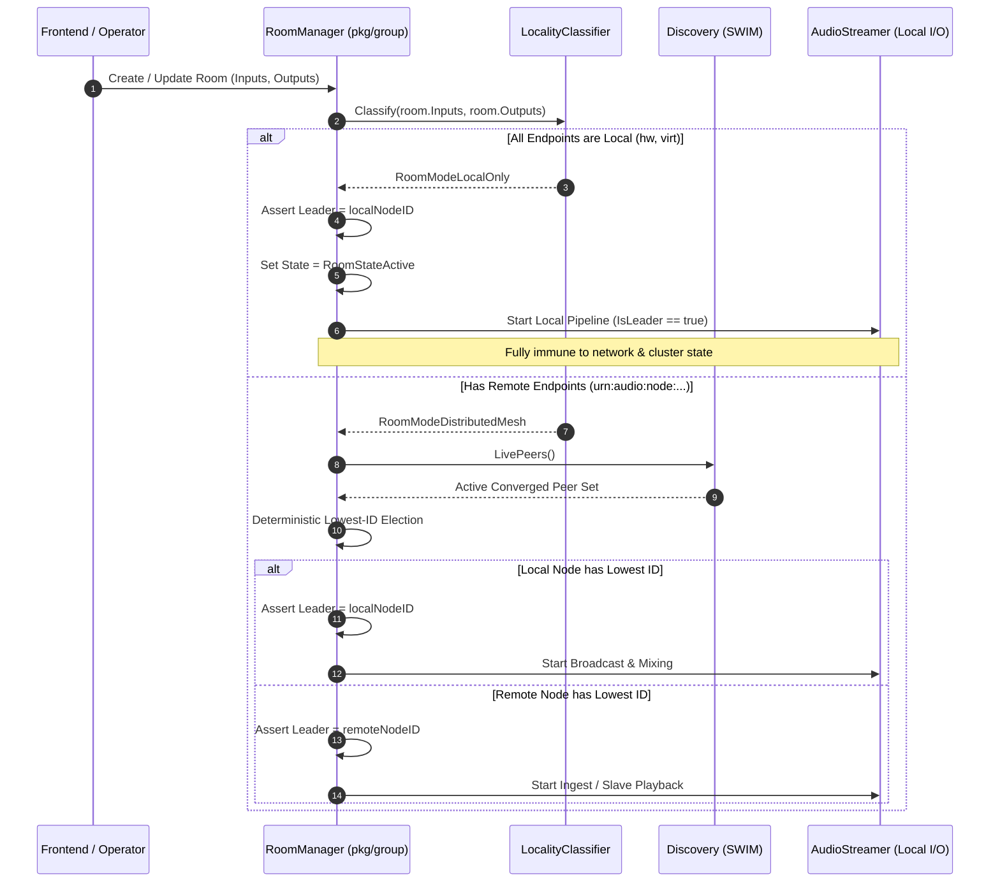
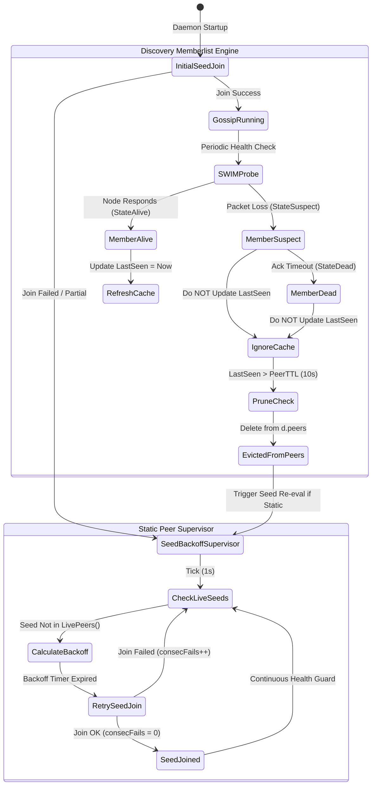

# ADR 0016: Room Locality Resolution and Static Peer Liveness Resilience

* **Status:** Accepted
* **Deciders:** Core Systems Architecture Team, Real-Time Audio Infrastructure Engineering, Distributed Systems & Network Engineering
* **Date:** 2026-10-03

---

## Context and Problem Statement

`audio-router-p2p` orchestrates deterministic, low-latency audio distribution across physical soundcards, virtual software loopbacks, and peer-to-peer cluster meshes (ADR 0001, ADR 0002, ADR 0006, ADR 0013, ADR 0015). Under ADR 0006, the engine adopted a "Room-as-a-Bus" paradigm wherein audio endpoints (inputs and outputs) are bound to logical rooms. Audio flowing through a room is managed by an elected room leader that coordinates mixing, timing, and network transport. Concurrently, ADR 0008 and ADR 0009 established a HashiCorp Memberlist SWIM gossip discovery layer to manage dynamic cluster membership, node health, and static seed peering across heterogeneous networks.

In production deployments—ranging from isolated multi-room studio facilities to federated stage-box networks—two compounding architectural defects emerged at the intersection of room coordination and peer discovery, causing audio dropouts, leader deadlocks, and cascading control-plane failures.

---

### Defect 1: Unconditional Global Peer Ingestion and Remote Hijacking of Local Audio Buses

The room leader election algorithm in `pkg/group/room.go` (`recomputeLeader`) implemented a deterministic lowest-ID rule across all peers visible in discovery:

```go
// Legacy recomputeLeader in pkg/group/room.go
func (r *Room) recomputeLeader() {
    var present map[string]bool
    if r.disc != nil {
        present = make(map[string]bool, 16)
        for _, p := range r.disc.Peers() {
            present[p.ID] = true
        }
    }

    r.mu.RLock()
    var lowest string
    for id := range r.members {
        if lowest == "" || id < lowest {
            lowest = id
        }
    }
    ...
```

When an audio room was configured strictly with local inputs and local outputs on a given host (e.g., an executive microphone on `urn:audio:hw:alsa:c=PCH:d=0` routing to local studio monitors on `urn:audio:hw:alsa:c=PCH:d=1` on `node-02`), the discovery engine nevertheless announced the room and ingested remote cluster peers (e.g., `node-01`). 

Because `"node-01" < "node-02"`, `node-01` was unconditionally elected leader of `node-02`'s purely local room:

1. **Local Audio Playback Halts**: In `pkg/group/streamer_api.go`, the audio pipeline enforces leader gating:
   ```go
   if !gs.room.IsLeader() {
       continue // Silent drop of local audio frames
   }
   ```
   Because `gs.room.IsLeader()` evaluated to `false` on `node-02`, local audio streaming halted immediately, resulting in total silence on the local hardware outputs.
2. **Election Deadlock on Remote Flapping**: Furthermore, `recomputeLeader` verified the health of all room members against the discovery peer table:
   ```go
   if now.Sub(m.LastSeen) > peerTTL || (r.disc != nil && !present[id]) {
       unhealthy = true
       break
   }
   ```
   If remote peer `node-01` rebooted, experienced Wi-Fi packet loss, or left the mesh, `unhealthy` was flagged as `true`. This locked `node-02`'s local room permanently into `RoomStateElection`, preventing local leadership re-establishment and stalling local audio pipelines indefinitely.

---

### Defect 2: SWIM Phantom Peers, Infinite Cache Resurrection, and Seed Join Starvation

The peer discovery subsystem (`pkg/discovery/discovery.go`) interfaces with HashiCorp Memberlist to maintain cluster state. In configurations utilizing static seed peers (`-peers` flag or `cfg.StaticPeers`), disconnected or unreachable seeds caused systemic state corruption:

1. **Unconditional Cache Refresh of Dead Members (`refreshActiveMembers`)**:
   ```go
   // Legacy refreshActiveMembers in pkg/discovery/discovery.go
   func (d *Discovery) refreshActiveMembers() {
       members := mlist.Members()
       d.mu.Lock()
       for _, m := range members {
           if m != nil && m.Name != d.nodeID {
               if p, ok := d.peers[m.Name]; ok {
                   p.LastSeen = now // Unconditionally refreshed!
               }
           }
       }
       d.mu.Unlock()
   }
   ```
   HashiCorp Memberlist retains suspect and dead nodes in `mlist.Members()` during protocol dead-node reap intervals. `refreshActiveMembers` unconditionally updated `p.LastSeen = now` for every node returned by `mlist.Members()`, without checking whether the SWIM state was actually alive.
2. **Failure of Pruning and Phantom Peer Persistence**:
   Because `p.LastSeen` was continuously refreshed, `d.prune()` never met the `p.LastSeen.Before(cutoff)` condition. Dead peers persisted indefinitely in `d.peers`. Consequently, `d.Peers()` continuously returned dead nodes as active cluster members.
3. **Permanent Ceasing of Static Seed Reconnections (`attemptSeedJoin`)**:
   The static peer reconnection worker evaluated candidates against `d.peers`:
   ```go
   for _, addr := range seedAddrs {
       found := false
       for _, p := range d.peers {
           if p != nil && p.Addr == addr {
               found = true; break
           }
       }
       if !found { unjoined = append(unjoined, addr) }
   }
   ```
   Because dead static seeds were never purged from `d.peers`, `found` remained `true` forever. `unjoined` became empty, and the supervisor **permanently stopped retrying connection attempts** to disconnected seeds.
4. **Cluster Telemetry Scraping Worker Starvation**:
   The cluster manager (`pkg/cluster/manager.go`) polled `d.Peers()` to scrape remote node telemetry over HTTP. Ghost peers in `d.peers` caused worker goroutines to block against unresponsive endpoints until the scrape HTTP client timed out. This saturated the fixed worker pool (`MaxWorkers = 8`), starving legitimate telemetry scrapes and corrupting the cluster health score.
5. **Cascading Room Election Stalls**:
   Rooms with remote members stalled in `RoomStateElection` because discovery reported dead peers as present, but their stale timestamps or failing health checks triggered `unhealthy = true` indefinitely.

A comprehensive architectural redesign is required to decouple local audio bus operations from cluster mesh states, filter peer liveness strictly through SWIM health detectors, provide exponential backoff reconnection for static seeds, and protect cluster telemetry scrapers from starvation.

---

## Decision Drivers

* **Zero-Drop Local Routing Invariant**: Audio rooms consisting solely of local endpoints must maintain continuous, uninterrupted audio routing and playback regardless of network interface failures, cluster partitions, or remote peer states.
* **Deterministic Local Leadership**: Purely local rooms must deterministically elect the local host node as leader without cluster election rounds or interference from lexicographically lower remote peer IDs.
* **Dynamic Endpoint Locality Classification**: The runtime must automatically categorize rooms into operational modes (`LocalOnly` vs. `DistributedMesh`) by inspecting canonical RFC 8141 audio device URNs (ADR 0013).
* **SWIM Failure Detector Integration**: Peer discovery must reflect true SWIM liveness states (`memberlist.Node.State`), ensuring suspect or dead nodes are never refreshed as active, and isolating live cluster views (`LivePeers()`).
* **Resilient Static Peer Reconnection**: Unreachable or disconnected static seeds must be retried indefinitely using a supervised reconnect loop with truncated exponential backoff and randomized jitter.
* **Resource Isolation and Non-Blocking Scraper Execution**: Telemetry scraping must pre-filter targets against verified live peers and enforce circuit breakers to prevent worker pool starvation during network turbulence.
* **ADR Ecosystem Consistency**: All changes must preserve strict backward compatibility with existing room manager abstractions (ADR 0002, ADR 0006), gossip discovery (ADR 0008, ADR 0009), observability APIs (ADR 0011), and canonical device URNs (ADR 0013).

---

## Considered Options

### Option 1: Manual Room Mode Configuration and Static Failure Thresholds
* **Description**: Require operators to manually tag rooms as `"local"` or `"distributed"` via the REST API/UI, and increase peer liveness timeouts in `recomputeLeader` to mask transient disconnects.
* **Drawbacks**:
  * High operational overhead: Users must manually configure metadata that the engine can infer deterministically from device URNs.
  * Human error: Misconfiguring a local room as distributed causes unexpected audio dropouts when networks partition.
  * Masks underlying bugs: Increasing timeouts fails to address phantom peer resurrection in `discovery.go` and leaves seed join starvation unresolved.

### Option 2: Full Distributed Consensus (Raft/Paxos) for All Room State
* **Description**: Introduce a multi-raft consensus engine to replicate all room configurations and elect leaders across the cluster.
* **Drawbacks**:
  * Massive architectural bloat: Incurs significant CPU, memory, and network overhead ill-suited for edge and embedded audio appliances.
  * Total failure in offline/isolated mode: A node running isolated without a quorum ($N/2 + 1$) would be unable to route even local audio inputs to local audio outputs.
  * Violates the soft real-time media path requirements of `audio-router-p2p`.

### Option 3: Dynamic Room Locality Resolution, SWIM Liveness Filtering, and Backoff Seed Supervisor [CHOSEN]
* **Description**:
  1. Implement an automated **Device URN Locality Classifier** and a dual-mode **Room Operational Mode State Machine** (`LocalOnly` vs. `DistributedMesh`).
  2. Enforce deterministic local leadership for `LocalOnly` rooms, bypassing discovery and cluster election entirely.
  3. Integrate SWIM node liveness checks into discovery: prevent suspect/dead nodes from resetting `LastSeen`, introduce `LivePeers()`, and enable aggressive pruning of dead entries.
  4. Implement an autonomous **Static Peer Exponential Backoff Supervisor** that validates static seeds against live SWIM state rather than stale local cache.
  5. Enhance `pkg/cluster/manager.go` with scraper pre-filtering and per-peer circuit breaking.
* **Advantages**: Fully automated zero-configuration operation, guarantees zero-drop local playback, robustly restores disconnected static seeds, eliminates phantom peer deadlocks, and preserves lightweight pure-Go architecture.

---

## Decision Outcome

Chosen Option: **Option 3: Dynamic Room Locality Resolution, SWIM Liveness Filtering, and Backoff Seed Supervisor**.

---

## Architectural Specifications

### 1. Device URN Locality Classifier

In accordance with ADR 0013, all audio endpoints are addressed via canonical RFC 8141 URNs. The locality classifier inspects the URNs of all assigned inputs and outputs within a Room:

```
               +-------------------------------------------+
               | Enumerate Room Input & Output Device URNs |
               +-------------------------------------------+
                                     |
                                     v
                       [ Inspect Endpoint URN Scopes ]
                                     |
        +----------------------------+----------------------------+
        |                                                         |
        v                                                         v
   All endpoints match:                                 Any endpoint matches:
   - urn:audio:hw:...                                   - urn:audio:node:<remote_id>:dev:...
   - urn:audio:virt:...                                 - Explicit remote mesh bridge
   - urn:audio:node:<local_id>:dev:...                            |
        |                                                         |
        v                                                         v
+-------------------------------+                       +-------------------------------+
|   Mode: RoomModeLocalOnly     |                       |  Mode: RoomModeDistributedMesh|
+-------------------------------+                       +-------------------------------+
```

#### Classification Rules:
1. **Local Endpoints**:
   - `urn:audio:hw:...` (Physical host hardware interfaces)
   - `urn:audio:virt:...` (Host software loopbacks and DSP buses)
   - `urn:audio:node:<local_node_id>:dev:...` (Proxy URN explicitly resolving to the local node)
2. **Remote Endpoints**:
   - `urn:audio:node:<remote_node_id>:dev:...` where `<remote_node_id> != local_node_id`.
3. **Operational Mode Decision**:
   - **`RoomModeLocalOnly`**: Every assigned input and output resolves to the local node. No network streams are required for intra-room mixing.
   - **`RoomModeDistributedMesh`**: One or more assigned endpoints belong to a remote cluster node, requiring network RTP/Opus streaming and inter-node clock synchronization.

---

### 2. Room Operational Mode State Machine and Segregated Leadership

The room lifecycle state machine (`pkg/group/room.go`) branches based on the resolved `RoomMode`:

```
                       +-------------------------+
                       |   Room Initialization   |
                       +-------------------------+
                                    |
                        [ Evaluate Room Mode ]
                                    |
                 +------------------+------------------+
                 |                                     |
                 v                                     v
      [ RoomModeLocalOnly ]                [ RoomModeDistributedMesh ]
                 |                                     |
                 v                                     v
   +---------------------------+         +---------------------------+
   | Assert Leader = localNode |         | State = RoomStateElection |
   | State = RoomStateActive   |         +---------------------------+
   +---------------------------+                       |
                 |                         [ Query LivePeers() & Filter ]
                 v                                     |
   +---------------------------+                       v
   | Continuous Local Routing  |         +---------------------------+
   | (Ignores Cluster Events)  |         | Deterministic Lowest-ID   |
   +---------------------------+         | Among Active Participants |
                                         +---------------------------+
                                                       |
                                                       v
                                         +---------------------------+
                                         | State = RoomStateActive   |
                                         +---------------------------+
```

#### Leadership Resolution Mechanics:
1. **`RoomModeLocalOnly` Pipeline**:
   - `recomputeLeader()` detects `RoomModeLocalOnly` and immediately sets `r.leader.Store(r.localID)` and `r.state.Store(RoomStateActive)`.
   - Cluster discovery peers are completely excluded from the member set.
   - External network state changes, peer joins, timeouts, or departures are ignored.
   - `gs.room.IsLeader()` remains permanently `true` on the host, guaranteeing uninterrupted local hardware audio processing.
2. **`RoomModeDistributedMesh` Pipeline**:
   - Participates in deterministic lowest-ID leader recomputation.
   - Membership convergence queries `disc.LivePeers()` instead of unfiltered peer sets.
   - If a remote member disconnects, it is evicted from `r.members` upon SWIM failure detection. The room recomputes leadership among surviving live participants without freezing in election deadlock.

---

### 3. Discovery SWIM Liveness Filtering and State Segregation

The discovery subsystem (`pkg/discovery/discovery.go`) is refactored to treat HashiCorp Memberlist as an authoritative SWIM failure detector rather than a passive address cache:

```go
// Refactored refreshActiveMembers in pkg/discovery/discovery.go
func (d *Discovery) refreshActiveMembers() {
    d.mlistMu.RLock()
    mlist := d.mlist
    d.mlistMu.RUnlock()
    if mlist == nil {
        return
    }

    now := time.Now()
    members := mlist.Members()
    d.mu.Lock()
    defer d.mu.Unlock()

    for _, m := range members {
        if m == nil || m.Name == d.nodeID {
            continue
        }
        // CRITICAL: Only refresh LastSeen if the member is strictly ALIVE.
        // Suspect or Dead members retained during tombstone reaping must decay.
        if m.State == memberlist.StateAlive {
            if p, ok := d.peers[m.Name]; ok {
                p.LastSeen = now
            }
        }
    }
}
```

#### Pruning and Liveness API:
* **Decoupled Live View (`LivePeers()`)**:
  ```go
  func (d *Discovery) LivePeers() []Peer
  ```
  Returns strictly those peers whose `LastSeen` is within `PeerTTL` and whose underlying Memberlist state is verified alive.
* **Deterministic Pruning (`prune()`)**:
  Dead nodes whose `LastSeen` exceeds `PeerTTL` (default: 10s) are evicted from `d.peers`. This breaks the infinite resurrection cycle and allows tombstoned nodes to be garbage-collected cleanly.

---

### 4. Static Peer Exponential Backoff Supervisor

To eliminate seed join starvation, the static peer supervisor in `pkg/discovery/discovery.go` is decoupled from the transient discovery cache and upgraded to an exponential backoff loop:

```go
type seedTracker struct {
    addr         string
    consecFails  int
    nextAttempt  time.Time
}
```

#### Supervisor Logic:
1. **Liveness Validation**: On each tick, the supervisor checks configured `seedAddrs` against currently alive Memberlist nodes.
2. **Target Extraction**: A seed is marked unjoined if its IP/port does not match any node in `mlist.Members()` with `State == StateAlive`.
3. **Exponential Backoff with Jitter**:
   $$T_{\text{wait}} = \min\left(T_{\text{max}}, T_{\text{base}} \times 2^{\text{consecFails}}\right) \pm \text{Jitter}$$
   - $T_{\text{base}} = 1.0\text{ s}$
   - $T_{\text{max}} = 30.0\text{ s}$
   - $\text{Jitter} = \text{Uniform}(-0.2 \times T_{\text{wait}}, +0.2 \times T_{\text{wait}})$
4. **Autonomous Recovery**: When an unreachable seed boots or rejoins the network, the supervisor successfully executes `mlist.Join([]string{addr})`, resets `consecFails = 0`, and restores cluster coherence.

---

### 5. Cluster Scraper Pre-Filtering and Circuit Breaking

In `pkg/cluster/manager.go`, the telemetry scraping engine is hardened against slow or unreachable remote endpoints:

1. **Live Peer Target Pre-Filtering**:
   `ScrapeCluster()` queries `disc.LivePeers()` rather than the raw unfiltered peer set, immediately excluding nodes that have timed out or failed SWIM health checks.
2. **Circuit Breaker Integration**:
   - If a peer fails 3 consecutive HTTP telemetry scrapes (`ScrapeTimeout = 1.5s`), its circuit breaker trips to `Open`.
   - While `Open`, background scrapes to that peer are bypassed immediately without worker allocation, preventing worker pool saturation (`MaxWorkers = 8`).
   - After a cooldown period (`CircuitBreakerCooldown = 10s`), a single canary request tests connectivity (`Half-Open`). If successful, the breaker resets to `Closed`.

---

## Visual Architecture

### Room Locality & Leadership Resolution Sequence



### Discovery SWIM Liveness & Static Peer Reconnection Loop



---

## Consequences

### Positive Consequences

* **Absolute Local Routing Immunity**: Purely local audio rooms are fully decoupled from cluster networking. Hardware soundcards and local loopbacks route continuously without interruption, even if network cables are unplugged, Wi-Fi drops, or remote cluster nodes crash.
* **Deterministic Local Leadership**: Local-only rooms instantly elect the local node as leader, eliminating silent audio drops caused by remote lowest-ID peer hijacking.
* **Elimination of Phantom Discovery Peers**: By checking `m.State == memberlist.StateAlive`, suspect and dead nodes naturally expire and are pruned from discovery caches within `PeerTTL` (10s), resolving cluster election deadlocks.
* **Resilient Static Seed Reconnection**: Disconnected static seed peers are continuously retried with exponential backoff and jitter, ensuring automatic mesh healing after network partitions or sequential node reboots.
* **Telemetry Worker Pool Starvation Prevention**: Telemetry scraping operates strictly on pre-filtered live peers with circuit breaker fallback, preserving sub-millisecond API responsiveness and accurate cluster health scoring.
* **Full Compliance with Architectural Standards**: Fully complies with ADR 0002 (Room Management), ADR 0006 (Room-as-a-Bus), ADR 0008/ADR 0009 (Memberlist SWIM Discovery), ADR 0011 (Cluster Observability), and ADR 0013 (Persistent Device URNs).

### Negative Consequences and Operational Trade-offs

* **Delayed Distributed Leadership Transfer**: In `DistributedMesh` rooms, leader failover following an ungraceful node crash is bound to the SWIM failure detection period ($\sim 1\text{s} - 3\text{s}$) plus `PeerTTL` eviction before the next lowest-ID node is promoted. (Acceptable and standard for decentralized gossip topologies without synchronous heartbeats).
* **Memory Overhead of Seed Supervision**: Maintaining per-seed reconnection state and failure counters introduces a minor heap allocation overhead (negligible, $< 1\text{ KB}$ per cluster daemon).
* **Dynamic Mode Transition Constraints**: Mutating an active room from `LocalOnly` to `DistributedMesh` (e.g., adding a remote output device on the fly) triggers a brief state machine pause while the room transitions through `RoomStateElection` to synchronize with mesh peers.

---

## Compliance and Interoperability

| ADR Number | Subject Area | Interaction and Alignment |
|:---|:---|:---|
| **ADR 0002** | Room Manager & Agility | Preserves room configuration formats and dynamic endpoint assignment interfaces. |
| **ADR 0006** | Room-Centric Distributed Bus | Honors the "Room-as-a-Bus" mental model while resolving leadership deadlock on local buses. |
| **ADR 0008** | Memberlist Peer Discovery | Directly resolves member lifecycle defects within the HashiCorp Memberlist integration. |
| **ADR 0009** | Discovery Simplification | Maintains unified gossip addressing (`Addr`, `SyncAddr`, `StreamAddr`, `APIAddr`). |
| **ADR 0011** | Cluster Observability | Protects `pkg/cluster/manager.go` worker pools and scraping loops from stale-peer starvation. |
| **ADR 0013** | Canonical Device URNs | Leverages RFC 8141 URN grammar (`hw`, `virt`, `node`) for runtime endpoint locality classification. |
| **ADR 0015** | Stream Lifecycle & Handles | Ensures reference-counted audio handles remain active and uninterrupted during cluster topology changes. |
