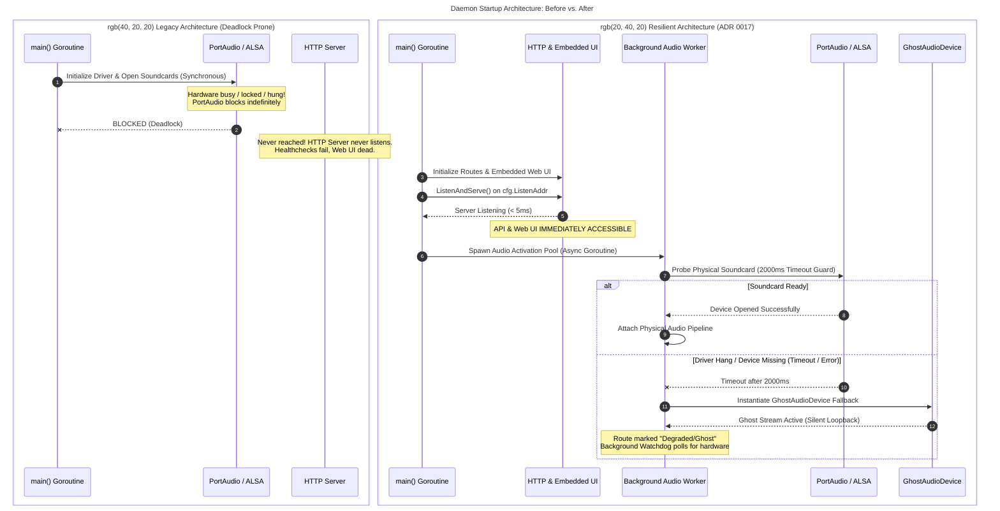

# ADR 0017: Distributed CRDT Groups, Cross-Node Matrix Routing, and Resilient Web UI Architecture

* **Status:** Accepted
* **Deciders:** Core Systems Architecture Team, Real-Time Audio Infrastructure Engineering, Distributed Systems & Network Engineering
* **Date:** 2026-10-03

---

## Context and Problem Statement

`audio-router-p2p` provides deterministic, sub-millisecond audio distribution across physical soundcards, virtual loopbacks, and peer-to-peer mesh clusters. Preceding architectural records established deterministic demuxing and jitter buffer scheduling (ADR 0001), Room-as-a-Bus abstractions (ADR 0002, ADR 0006), HashiCorp Memberlist SWIM gossip discovery (ADR 0008, ADR 0009), canonical RFC 8141 audio device URNs (ADR 0013), and room locality and static peer liveness resilience (ADR 0016).

Despite these foundations, real-world deployment across distributed multi-host environments (e.g., broadcast facilities, stage-box rigs, distributed rehearsal rooms) exposed four systemic architectural bottlenecks that crippled operational reliability, cluster convergence, and operator usability:

1. **Synchronous Daemon Boot Deadlock on Route Persistence**:
   During daemon startup (`cmd/client/main.go`), routes persisted in `routes.json` and rooms in `rooms.json` were activated synchronously before the HTTP control plane, telemetry aggregator, and Web UI listener were instantiated. Physical soundcard backends (ALSA, CoreAudio, ASIO via PortAudio) frequently block indefinitely when hardware is disconnected, exclusive device locks are held by rogue processes, or hardware clock rates renegotiate. Because this activation was executed inline on the main goroutine, the entire daemon deadlocked prior to opening port `cfg.ListenAddr`. Operators could not inspect node state, health checks failed, orchestrators killed the process, and management dashboards remained unreachable.

2. **Absence of Single-Pane-of-Glass Embedded Web UI and Broken SPA Routing**:
   The daemon HTTP server (`pkg/api/server.go`) only mounted `/metrics`, `/status`, and `/api/v1/*`. The compiled Svelte/TypeScript Web UI located in `web/dist` was never embedded into the daemon binary or served by the HTTP engine. Operators were forced to run standalone Node.js development servers or external reverse proxies to interface with the nodes. Furthermore, standard Single Page Application (SPA) browser navigation to deep routes (e.g., `/rooms`, `/matrix`, `/telemetry`) failed with HTTP 404 errors due to the lack of an SPA HTML fallback router.

3. **Inability to Route Audio Cross-Node (Address Malformation and Missing Ingress Demuxer)**:
   When creating cross-node routes across physical mesh boundaries, the routing engine suffered from two critical faults:
   - *Address Resolution Malformation*: Routes configured with a remote node identifier (e.g., `sr.PeerID = "node-02"`) passed the bare string directly into transport sockets without resolving the peer's RTP audio streaming port (`peer.StreamAddr`). Calling `net.ResolveUDPAddr` or UDP socket writes failed with `missing port in address` errors.
   - *Lack of Ingress Demuxing on Destination Nodes*: Even when RTP datagrams successfully crossed the physical network, destination nodes had no ingress demuxing pipeline. Incoming RTP streams were discarded at the transport socket because the receiver lacked a dynamic registration binding the sender's SSRC or RouteID to a local hardware output DAC or virtual sink.

4. **Distributed Group Fragmentation and Split-Brain Partition Divergence**:
   Room metadata and member assignments were retained purely in node-local memory and local disk files (`rooms.json`). Memberlist gossip delegate methods (`NotifyMsg`, `GetBroadcasts`, `LocalState`, `MergeRemoteState`) in `pkg/discovery/discovery.go` were empty stubs. Nodes had no mechanism to synchronize room topologies, group membership, or gain states across the cluster. When transient network splits occurred, nodes made conflicting local room updates that never reconciled, producing permanent state divergence, phantom rooms, and split-brain audio buses.

A unified architectural solution is required to eliminate boot deadlocks, embed a resilient single-pane-of-glass operator interface, establish robust cross-node audio matrix routing, and provide deterministic, conflict-free state convergence across all cluster nodes.

---

## Decision Drivers

* **Zero-Deadlock Daemon Initialization**: The HTTP control plane, telemetry subsystem, and embedded Web UI must bind and serve incoming requests immediately upon boot, regardless of hardware device availability, audio driver hangs, or missing soundcards.
* **Deterministic Asynchronous Device Reconciliation**: Audio device binding, route restoration, and PortAudio initialization must execute asynchronously with strict timeout guards, transitioning unready devices into transparent ghost fallbacks without stalling the node.
* **Embedded Self-Contained Management Plane**: The daemon binary must natively embed all static Web UI assets (`web/dist`) via Go standard library compilation (`embed.FS`), serving an interactive single-pane-of-glass console with seamless SPA client-side route fallback.
* **Seamless Cross-Node Matrix Crossbar**: Operators must be able to route any physical or virtual audio input on any node to any physical or virtual audio output on any other node across the mesh with automatic port resolution and dynamic receiver ingress demuxing.
* **Conflict-Free Distributed State Convergence (CRDT)**: Mesh room configurations, input/output bindings, and gain states must replicate across nodes using an eventually consistent Conflict-free Replicated Data Type (CRDT) capable of deterministic split-brain healing without centralized coordinators.
* **Bandwidth-Efficient Gossip and Anti-Entropy Replication**: State synchronization must operate over existing SWIM gossip channels via delta broadcast piggybacking, complemented by periodic TCP push-pull anti-entropy for full partition recovery.

---

## Considered Options

### Option 1: Centralized External Coordinator (Consul / etcd / Redis) with Inline Audio Binding

* **Description**: Require an external consensus store (Consul, etcd, or Redis) to maintain room topologies, routing state, and node discovery. Soundcard binding remains synchronous during daemon startup, failing fast if devices are unavailable.
* **Pros**:
  * Strong CP consistency; trivial state synchronization logic in the daemon.
  * Offloads state replication and leader election to mature external systems.
* **Cons**:
  * Violates the core zero-dependency, peer-to-peer distributed design principle of `audio-router-p2p`.
  * Introduces a fatal single point of failure (SPOF) for edge and mobile stage rigs lacking external infrastructure.
  * Retains synchronous PortAudio initialization, continuing to cause daemon boot deadlocks if audio hardware stalls.
  * Incurrs massive operational complexity and configuration friction for field technicians.

### Option 2: Raft Consensus Cluster Engine over SWIM with Monolithic Server Architecture

* **Description**: Embed a distributed Raft consensus protocol directly inside the Go daemon, electing a cluster leader to serialize all room, group, and route modifications.
* **Pros**:
  * Strong linearizable consistency across the cluster without external dependencies.
  * Clear authoritative source of truth for all room operations.
* **Cons**:
  * Strict quorum requirement ($N/2 + 1$) makes 2-node rigs or partitioned mobile stages impossible to operate when quorums are lost.
  * Unsuitable for intermittent or high-latency wireless peer meshes where leader elections churn incessantly.
  * Does not address daemon boot deadlocks or audio ingress demuxing.
  * Substantial computational and network overhead on embedded target hardware (Raspberry Pi, ARM stage boxes).

### Option 3 (Selected): LWW-Element-Set CRDT over Gossip/Anti-Entropy, Cross-Node Intent Dissemination with SSRC Demuxing, Asynchronous Background Device Activation with Ghost Devices, and Go-Embedded SPA

* **Description**: 
  1. Decouple daemon startup by launching HTTP APIs and embedded Web UI immediately, delegating route activation and PortAudio binding to asynchronous background workers protected by timeout guards and `GhostAudioDevice` loopbacks.
  2. Embed compiled frontend assets (`web/dist`) directly into the daemon executable using `go:embed all:dist/*` and implement an HTTP SPA fallback handler.
  3. Implement a state-based / delta-mutator Last-Write-Wins Element-Set (LWW-Element-Set) CRDT with Hybrid Lamport Timestamps (HLT) and 72-hour tombstone retention, synchronized over Memberlist SWIM gossip (`GetBroadcasts`/`NotifyMsg`) and anti-entropy TCP push-pull (`LocalState`/`MergeRemoteState`).
  4. Implement an end-to-end Cross-Node Matrix Routing Protocol comprising routing intent dissemination, discovery-driven peer endpoint resolution, and dynamic receiver-side SSRC/RouteID ingress demuxers bound to local output engines.
* **Pros**:
  * Full offline resilience: any node operates independently during network partitions and deterministically reconciles upon reconnection.
  * Immune to hardware initialization hangs; HTTP API and Web UI are available in under 5 milliseconds.
  * Zero external dependencies; single, fully self-contained Go binary with embedded real-time management dashboard.
  * Fully transparent cross-node matrix patching across heterogeneous physical nodes.
* **Cons**:
  * Eventual consistency latency: remote node updates take 1-2 gossip rounds (100–300ms) to converge.
  * Tombstone memory footprint: deleted rooms must be retained for 72 hours to prevent resurrection across network partitions.
  * UDP broadcast delta frame size constraints require packet MTU packing and fallback to TCP anti-entropy for large bulk state changes.

---

## Decision Outcome

**Chosen Option:** **Option 3**. Option 3 definitively resolves daemon boot deadlocks, delivers an embedded single-pane-of-glass operator interface, provides bulletproof split-brain CRDT state convergence, and enables transparent cross-node audio matrix routing.

---

## Architectural Details

### 1. Non-Blocking Daemon Boot and Asynchronous Device Reconciliation

To prevent hardware drivers and PortAudio initialization from blocking control-plane availability, the daemon startup sequence in `cmd/client/main.go` is re-architected into a multi-phase non-blocking lifecycle:

```
[Daemon Start]
     │
     ├── 1. Load Configurations & Instantiate In-Memory State
     ├── 2. Start Peer Discovery (SWIM Memberlist)
     ├── 3. Mount HTTP API & Embedded Web UI Handler
     ├── 4. BIND & SERVE HTTP/HTTPS LISTENER (< 5ms) ───► [API & Web UI LIVE]
     │
     └── 5. Spawn Asynchronous Audio Activation Goroutine (Background)
              │
              ├── Iterate Persistent Routes (routes.json)
              │     ├── Resolve Device URN with 2000ms Timeout
              │     ├── Success ──► Bind Hardware PortAudio Stream
              │     └── Failure/Timeout ──► Fallback to GhostAudioDevice
              │
              └── Iterate Persistent Rooms (rooms.json)
                    └── Reconcile CRDT State & Activate Local Endpoints
```

#### Asynchronous Route Worker and GhostAudioDevice Fallback
When `StartRoute` is invoked during boot or runtime:
1. Device resolution runs under a strict context deadline (default `2000ms`).
2. If the physical audio device cannot be initialized (device busy, unplugged, driver hung), the runtime does not crash or block. Instead, it instantiates a synthetic `GhostAudioDevice`.
3. The `GhostAudioDevice` matches the requested sample rate and channel geometry, accepting or emitting digital silence while maintaining clock metrics.
4. A background hardware watchdog continuously probes for the appearance of the physical device. Once detected, the stream seamlessly migrates from the ghost device to the physical hardware without interrupting network RTP streaming or control-plane operations.

---

### 2. Embedded Single-Pane-of-Glass Web UI and SPA Fallback Router

The daemon HTTP server embeds the production web dashboard compiled from `web/dist` directly into the Go binary using `//go:embed all:dist/*`.

#### SPA Fallback Routing Architecture
In `pkg/api/server.go`, incoming HTTP requests are multiplexed through three priority tiers:
1. **API Endpoints (`/api/v1/*`, `/status`)**: Routed to JSON REST controllers and SSE/WebSocket event streams.
2. **Prometheus Telemetry (`/metrics`)**: Routed to the Prometheus metric collector registry.
3. **Static Assets & SPA Fallback (`/*`)**:
   - If the request path matches an embedded file (e.g., `/assets/index-W_aqUmcF.js`, `/favicon.ico`, `/assets/index-gLf0bAkz.css`), the file is served with appropriate `Content-Type` headers, compression, and aggressive `Cache-Control: public, max-age=31536000, immutable` headers.
   - If the request path does not match any static file and does not begin with `/api/`, the handler transparently serves `/index.html` with `Content-Type: text/html; charset=utf-8` and `Cache-Control: no-cache`. This allows client-side routers (SvelteKit / client-side router) to handle deep links (`/rooms`, `/matrix`, `/telemetry`, `/devices`) on page reload.

#### Single-Pane-of-Glass Cluster Visualization
The embedded UI interfaces with `pkg/cluster/manager.go` to present:
- **Global Crossbar Matrix**: A dynamic routing matrix displaying every input device (hardware soundcards, ALSA loopbacks, software generators) across every cluster node on the Y-axis, mapped against every output device (DACs, monitor speakers, headphones, virtual bridges) across every cluster node on the X-axis.
- **Cross-Node Patching**: Clicking any crosspoint automatically establishes or tears down a cross-node audio route, dispatching routing intents across the mesh.
- **Cluster Telemetry Overlay**: Live VU meters, packet jitter, clock drift PPM, and packet loss percentages rendered directly on the crossbar cells.

---

### 3. Distributed CRDT Group and Room Synchronization Engine

To eliminate split-brain divergence and ensure all nodes agree on room topologies without a central master, rooms and group memberships are modeled as an **LWW-Element-Set (Last-Write-Wins Element-Set)** Conflict-free Replicated Data Type.

#### Mathematical Definition and Hybrid Lamport Timestamps
Every state change (room creation, room deletion, input/output binding, gain adjustment) is tagged with a Hybrid Lamport Timestamp (HLT):

$$\text{HLT} = \langle T_{\text{wall}}, C_{\text{logical}}, N_{\text{nodeID}} \rangle$$

Where:
* $T_{\text{wall}}$: Physical Unix timestamp in nanoseconds.
* $C_{\text{logical}}$: Monotonically increasing logical sequence counter incremented on local operations or when an incoming timestamp satisfies $T_{\text{incoming}} \ge T_{\text{local}}$.
* $N_{\text{nodeID}}$: Unique canonical node identifier, acting as an immutable lexicographical tie-breaker.

Comparison operator $\succ$:
$$\langle T_1, C_1, N_1 \rangle \succ \langle T_2, C_2, N_2 \rangle \iff (T_1 > T_2) \lor (T_1 = T_2 \land C_1 > C_2) \lor (T_1 = T_2 \land C_1 = C_2 \land N_1 > N_2)$$

#### LWW-Element-Set Schema and Tombstone Life Cycle
The CRDT maintains two internal collections for each entity type (Rooms, Device Bindings, Gain Settings):
* **Add Set ($A$)**: Contains active entity state records associated with the latest $\text{HLT}_{\text{add}}$.
* **Remove Set ($R$)**: Contains tombstone records marking entity deletion associated with $\text{HLT}_{\text{remove}}$.

An element $e$ exists in the active cluster state if and only if:
$$e \in A \land (\forall r \in R, r.id = e.id \implies \text{HLT}(e) \succ \text{HLT}(r))$$

* **Tombstone Retention**: Tombstones are retained in memory and persisted to disk for a garbage collection window of **72 hours** ($\tau = 259,200\text{s}$). This guarantees that nodes partitioned from the cluster for up to 3 days cannot resurrect deleted rooms upon reconnection. Tombstones older than 72 hours are pruned during anti-entropy sweeps.

#### Memberlist Delegate Synchronization Protocols
The CRDT engine binds directly to HashiCorp Memberlist delegates in `pkg/discovery/discovery.go`:
1. **Fast-Convergence SWIM Gossip Delta Broadcasts (`NotifyMsg` & `GetBroadcasts`)**:
   - When a local room is created, edited, or deleted, a compact binary/JSON delta payload (`CRDTDeltaMsg`) is queued into a broadcast queue (`memberlist.TransmitLimitedQueue`).
   - `GetBroadcasts(overhead, limit)`: Piggybacks pending delta packets onto outbound SWIM ping/ack datagrams within UDP MTU constraints (default maximum 1400 bytes).
   - `NotifyMsg(buf)`: Ingests incoming gossip deltas, parses the HLT, and merges the record into the local CRDT store if the incoming timestamp dominates the local record.
2. **Deterministic Anti-Entropy Push-Pull State Transfer (`LocalState` & `MergeRemoteState`)**:
   - Executed periodically over reliable TCP connections (default every 30 seconds) and immediately upon new node join events.
   - `LocalState(join bool)`: Serializes the complete local CRDT store (including active tombstones within the 72h window) into a compressed stream.
   - `MergeRemoteState(buf []byte, join bool)`: Performs a pairwise join-semilattice merge ($\sqcup$) between local and remote CRDT sets:
     $$A_{\text{merged}} = A_{\text{local}} \sqcup A_{\text{remote}}, \quad R_{\text{merged}} = R_{\text{local}} \sqcup R_{\text{remote}}$$
     Resolving all elements using the $\succ$ rule.

---

### 4. Cross-Node Matrix Routing Protocol and Receiver Ingress Demuxing

Direct cross-node routing enables any audio source to be patched to any audio destination on a remote node without manual intermediate configuration.

```
+----------------------------------------------------------------------------------------------------+
|                                      CROSS-NODE ROUTING ARCHITECTURE                               |
|                                                                                                    |
|  [Node 01: Audio Source]                                             [Node 02: Audio Destination]  |
|                                                                                                    |
|  1. Patch Request:                                                                                 |
|     Src: "urn:audio:hw:alsa:c=USB:d=0"                                                             |
|     Dst: "node-02/urn:audio:hw:alsa:c=PCH:d=0"                                                     |
|                                                                                                    |
|  2. Resolve Peer Endpoint:                                                                         |
|     Query disc.PeerByID("node-02")                                                                 |
|     ──► StreamAddr: "192.168.1.150:45678"                                                          |
|                                                                                                    |
|  3. Disseminate Ingress Intent:                                                                    |
|     Emit Gossip IngressIntentMsg:                                                                  |
|     { RouteID, SSRC: 0x9A4F, TargetURN } ──────( SWIM Gossip )─────► Ingests Intent                |
|                                                                     Binds Ingress Demuxer:         |
|                                                                     SSRC 0x9A4F ──► Output Stream  |
|                                                                                                    |
|  4. Audio Pipeline Streaming:                                                                      |
|     Capture PCM Frame (Hardware ADC)                                                               |
|     Opus Encode + RTP Encapsulate (SSRC=0x9A4F)                                                    |
|     UDP/SRTP WriteTo("192.168.1.150:45678") ─────( RTP Audio )────► Receive Packet at UDP Socket   |
|                                                                     Demux SSRC 0x9A4F              |
|                                                                     Opus Decode + PLC/Jitter Buff  |
|                                                                     Playback PCM (Hardware DAC)    |
+----------------------------------------------------------------------------------------------------+
```

#### Protocol Workflow
1. **Patch Request Validation**: The operator requests a matrix route connecting local source `urn:audio:hw:alsa:c=USB:d=0` to remote destination `node-02/urn:audio:hw:alsa:c=PCH:d=0`.
2. **Peer Endpoint Resolution**:
   - The router parses the destination target into node ID `node-02` and target URN `urn:audio:hw:alsa:c=PCH:d=0`.
   - The router queries `disc.PeerByID("node-02")`.
   - If the peer exists and provides a valid `StreamAddr` (`host:port`), the destination network endpoint is resolved. If the port is missing, it falls back to the peer's base address with the canonical streaming port (`cfg.StreamPort`). Bare node IDs are never forwarded to low-level UDP sockets.
3. **Ingress Intent Dissemination**:
   - The sending node allocates a unique 32-bit Synchronization Source identifier (`SSRC`) and Route UUID.
   - The sender disseminates an `IngressIntentMsg` over the Memberlist gossip channel containing `{RouteID, SSRC, TargetDeviceURN, Channels, SampleRate}`.
   - Upon receipt, `node-02`'s `streamManager` dynamically instantiates an `IngressRouteDemuxer`:
     - It opens the target physical output soundcard (`urn:audio:hw:alsa:c=PCH:d=0`) via `audio.GlobalResolver()`.
     - It registers the SSRC in its active stream table, allocating a dedicated jitter buffer and Opus decoder.
4. **Real-Time RTP Transmission and Demuxing**:
   - Node 01 captures PCM frames, encodes them via Opus, tags the RTP packets with the agreed SSRC, and transmits them over UDP/DTLS directly to `192.168.1.150:45678`.
   - Node 02 receives the datagram on its audio transport socket.
   - The transport layer demuxes incoming packets by SSRC, feeding them directly into the pre-bound `IngressRouteDemuxer`.
   - Audio is decoded, synchronized through the adaptive jitter buffer, and rendered to the physical DAC with sub-millisecond latency.

---

## Consequences

### Positive Consequences

* **Instantaneous Daemon Availability**: The daemon HTTP API, Prometheus metrics, and Web UI initialize in $< 5\text{ms}$. Soundcard driver stalls, missing audio hardware, or bus renegotiations never prevent the operator from accessing control or diagnostic endpoints.
* **Turnkey Single-Binary Deployment**: Eliminates external reverse proxies and Node.js servers. The entire web management suite is statically bundled into the Go binary with fully functional SPA deep-linking.
* **Deterministic Split-Brain Self-Healing**: Network partitions heal automatically upon reconnection. LWW-Element-Set CRDTs resolve concurrent modifications deterministically using Hybrid Lamport Timestamps without manual intervention or data corruption.
* **Transparent Multi-Node Matrix Patching**: Operators can cross-patch audio between any input and output in the cluster using standard matrix views without manually creating separate sender and receiver route pairs.
* **Graceful Degradation via Ghost Devices**: Unplugged or busy audio devices automatically fall back to silent ghost loopbacks, preserving route configurations and network pipelines until hardware is re-attached.

### Negative Consequences and Trade-offs

* **Eventual Consistency Lag for Control Operations**: CRDT gossip synchronization introduces an eventual consistency window of 100–300ms. If two operators adjust the same room name simultaneously on different partitioned nodes, the operation with the highest HLT silently overwrites the other once the partition heals.
* **Tombstone Memory Retention Overhead**: Deleted rooms and routes must retain tombstone records in memory for 72 hours. In environments with thousands of ephemeral room creations/deletions, tombstones will consume approximately 150 bytes per record (e.g., 10,000 deletions $\approx 1.5\text{MB}$ of memory), mitigated by automatic pruning after 72 hours.
* **Broadcast Delta MTU Packing Limits**: Gossip broadcast deltas must not exceed Ethernet MTU limits (1400 bytes post-headers). Rapid bulk updates (e.g., reconfiguring 50 routes simultaneously) cannot fit into a single gossip datagram and must fall back to chunked gossip messages or trigger a TCP anti-entropy push-pull sync.
* **Ghost Audio Clock Skew on Hardware Reconnect**: When a physical device reappears and replaces a `GhostAudioDevice`, the jitter buffer must absorb a momentary phase jump as the clock source transitions from synthetic monotonic wall-clock ticks to the physical crystal oscillator of the soundcard.

---

## Mermaid Architecture and Sequence Diagrams

### Diagram 1: Startup Lifecycle — Synchronous Boot Deadlock (Before) vs. Asynchronous Resilient Boot (After)



---

### Diagram 2: Distributed CRDT State Synchronization (SWIM Gossip + Anti-Entropy TCP)

```mermaid
sequenceDiagram
    autonumber
    title CRDT State Synchronization over Memberlist

    participant NodeA as Node A (Operator UI)
    participant CRDTA as Node A CRDT Engine
    participant MlistA as Node A Memberlist
    participant MlistB as Node B Memberlist
    participant CRDTB as Node B CRDT Engine
    participant NodeB as Node B Audio Engine

    NodeA->>CRDTA: CreateRoom("studio-a", Name="Studio A")
    Note over CRDTA: Generate HLT:<br/>T_wall=1700000000, C=1, N="NodeA"<br/>Add to Add-Set (A)
    CRDTA->>MlistA: Queue CRDTDeltaMsg in TransmitLimitedQueue
    
    rect rgb(30, 40, 50)
    note right of MlistA: Tier 1: Fast Gossip Delta Broadcast (UDP)
    MlistA->>MlistB: SWIM Ping + Piggybacked CRDTDeltaMsg (GetBroadcasts)
    MlistB->>CRDTB: NotifyMsg(CRDTDeltaMsg)
    CRDTB->>CRDTB: Evaluate HLT: Incoming HLT dominates local?
    CRDTB->>CRDTB: Merge into Add-Set (A)
    CRDTB->>NodeB: Notify Room Created ("studio-a")
    end

    rect rgb(40, 30, 50)
    note right of MlistA: Tier 2: Anti-Entropy Push-Pull (TCP) Every 30s
    MlistA->>MlistB: Initiate TCP Push/Pull Stream
    MlistA->>CRDTA: LocalState(join=false)
    CRDTA-->>MlistA: Serialized Full State (A + R with 72h Tombstones)
    MlistA->>MlistB: Transmit State Buffer
    MlistB->>CRDTB: MergeRemoteState(StateBuffer, join=false)
    CRDTB->>CRDTB: Semilattice Join (A_merged = A_a ⊔ A_b, R_merged = R_a ⊔ R_b)
    CRDTB->>CRDTB: Purge Tombstones older than 72 Hours
    end
```



---

### Diagram 3: End-to-End Cross-Node Matrix Routing Protocol

```mermaid
sequenceDiagram
    autonumber
    title End-to-End Cross-Node Audio Matrix Routing

    actor Op as Audio Engineer
    participant WebUI as Embedded Web UI (Node 01)
    participant Router1 as Router (Node 01)
    participant Disc1 as Discovery (Node 01)
    participant Streamer1 as Streamer Engine (Node 01)
    participant Disc2 as Discovery (Node 02)
    participant Streamer2 as Streamer Engine (Node 02)
    participant Soundcard2 as Physical DAC (Node 02)

    Op->>WebUI: Click Matrix Crosspoint:<br/>Src: Node 01 Mic ──► Dst: Node 02 Speaker
    WebUI->>Router1: POST /api/v1/routes (SourceURN, DestNode="node-02", DestURN)
    Router1->>Disc1: PeerByID("node-02")
    Disc1-->>Router1: Peer Info (StreamAddr="192.168.1.150:45678")

    Router1->>Router1: Allocate RouteID="rt-99" & SSRC=0x7E3A11C2
    
    rect rgb(35, 45, 55)
    note over Router1,Streamer2: Step 1: Ingress Intent Dissemination
    Router1->>Disc1: Broadcast IngressIntentMsg{RouteID, SSRC, DestURN}
    Disc1->>Disc2: Memberlist Gossip Dissemination
    Disc2->>Streamer2: Handle IngressIntentMsg
    Streamer2->>Soundcard2: OpenOutput(DestURN) via GlobalResolver()
    Soundcard2-->>Streamer2: AudioStream Handle
    Streamer2->>Streamer2: Register SSRC 0x7E3A11C2 Ingress Demuxer Pipeline
    end

    rect rgb(45, 35, 55)
    note over Streamer1,Soundcard2: Step 2: Real-Time Audio Streaming
    Router1->>Streamer1: Start Transmission to "192.168.1.150:45678" (SSRC=0x7E3A11C2)
    loop Every 2.5ms Audio Buffer
        Streamer1->>Streamer2: RTP Packet [SSRC: 0x7E3A11C2, Opus Payload]
        Streamer2->>Streamer2: Demux SSRC 0x7E3A11C2 ──► Ingress Queue
        Streamer2->>Streamer2: Jitter Buffer Deskew + Opus Decode
        Streamer2->>Soundcard2: Write PCM Frames to Physical DAC
    end
    end
```



---

## Implementation Specification

### 1. Hybrid Lamport Timestamp and CRDT Data Structures

```go
package crdt

import (
	"bytes"
	"encoding/json"
	"strings"
	"sync"
	"time"
)

// HLT represents a Hybrid Lamport Timestamp with unique node ID tie-breaking.
type HLT struct {
	WallTime int64  `json:"wall"`    // Unix time in nanoseconds
	Counter  uint64 `json:"logical"` // Logical sequence counter
	NodeID   string `json:"node"`    // Canonical node ID
}

// After returns true if h dominates other in total order.
func (h HLT) After(other HLT) bool {
	if h.WallTime != other.WallTime {
		return h.WallTime > other.WallTime
	}
	if h.Counter != other.Counter {
		return h.Counter > other.Counter
	}
	return strings.Compare(h.NodeID, other.NodeID) > 0
}

// RoomRecord is the payload stored in the LWW-Element-Set.
type RoomRecord struct {
	ID          string             `json:"id"`
	Name        string             `json:"name"`
	Inputs      []string           `json:"inputs"`
	Outputs     []string           `json:"outputs"`
	Synced      bool               `json:"synced"`
	InputGains  map[string]float64 `json:"input_gains,omitempty"`
	OutputGains map[string]float64 `json:"output_gains,omitempty"`
	Timestamp   HLT                `json:"ts"`
}

// Tombstone marks the deletion of an entity.
type Tombstone struct {
	ID        string `json:"id"`
	Timestamp HLT    `json:"ts"`
}

// LWWSet represents the thread-safe LWW-Element-Set CRDT for audio rooms.
type LWWSet struct {
	mu         sync.RWMutex
	addSet     map[string]RoomRecord
	removeSet  map[string]Tombstone
	retention  time.Duration
	localNode  string
	logicalSeq uint64
}

// NewLWWSet creates an initialized CRDT store with a 72-hour tombstone window.
func NewLWWSet(nodeID string) *LWWSet {
	return &LWWSet{
		addSet:    make(map[string]RoomRecord),
		removeSet: make(map[string]Tombstone),
		retention: 72 * time.Hour,
		localNode: nodeID,
	}
}
```

### 2. Embedded Web UI SPA Router

```go
package api

import (
	"embed"
	"io/fs"
	"net/http"
	"path"
	"strings"
)

//go:embed all:dist/*
var embeddedDistFS embed.FS

// MountSPAHandler attaches static asset serving with Single-Page Application (SPA) fallback.
func (s *Server) mountSPAHandler() {
	distFS, err := fs.Sub(embeddedDistFS, "dist")
	if err != nil {
		distFS = embeddedDistFS
	}
	fileServer := http.FileServer(http.FS(distFS))

	s.mux.HandleFunc("/", func(w http.ResponseWriter, r *http.Request) {
		// Bypass API, status, and metric paths
		if strings.HasPrefix(r.URL.Path, "/api/") || r.URL.Path == "/metrics" || r.URL.Path == "/status" {
			http.NotFound(w, r)
			return
		}

		cleanPath := path.Clean(r.URL.Path)
		filePath := strings.TrimPrefix(cleanPath, "/")
		if filePath == "" {
			filePath = "index.html"
		}

		// Check if file exists in the embedded virtual filesystem
		if f, err := distFS.Open(filePath); err == nil {
			_ = f.Close()
			if strings.HasPrefix(filePath, "assets/") {
				w.Header().Set("Cache-Control", "public, max-age=31536000, immutable")
			}
			fileServer.ServeHTTP(w, r)
			return
		}

		// Fallback to index.html for client-side routing
		indexBytes, err := fs.ReadFile(distFS, "index.html")
		if err != nil {
			http.NotFound(w, r)
			return
		}
		w.Header().Set("Content-Type", "text/html; charset=utf-8")
		w.Header().Set("Cache-Control", "no-cache")
		w.WriteHeader(http.StatusOK)
		_, _ = w.Write(indexBytes)
	})
}
```

### 3. Cross-Node Route Address Resolver and Ingress Demuxer

```go
package streamer

import (
	"fmt"
	"net"
	"strings"

	"github.com/audio-router-p2p/pkg/discovery"
	"github.com/audio-router-p2p/pkg/router"
)

// ResolvePeerDestination maps a route destination into a validated UDP/DTLS host:port address.
func ResolvePeerDestination(sr router.StreamRoute, disc *discovery.Discovery, defaultPort string) (string, error) {
	if sr.PeerAddr != "" {
		if _, _, err := net.SplitHostPort(sr.PeerAddr); err == nil {
			return sr.PeerAddr, nil
		}
	}

	peerID := sr.PeerID
	if peerID == "" || peerID == "local" {
		return "", fmt.Errorf("local route does not require peer address resolution")
	}

	if disc == nil {
		return "", fmt.Errorf("discovery subsystem required for cross-node resolution")
	}

	peer := disc.PeerByID(peerID)
	if peer == nil {
		return "", fmt.Errorf("peer %q not found in active discovery table", peerID)
	}

	if peer.StreamAddr != "" {
		if _, _, err := net.SplitHostPort(peer.StreamAddr); err == nil {
			return peer.StreamAddr, nil
		}
	}

	// Fallback: derive stream address from discovery unicast address and default stream port
	host, _, err := net.SplitHostPort(peer.Addr)
	if err != nil {
		host = peer.Addr
	}
	return net.JoinHostPort(host, defaultPort), nil
}
```

---

## Verification and Testing Protocols

To validate this architecture against regressions and operational failure modes, the test suite is augmented with the following deterministic end-to-end verifications:

1. **Daemon Boot Deadlock Resilience Test (`cmd/client/boot_resilience_test.go`)**:
   - Configure a mock audio backend whose `OpenInput` and `OpenOutput` calls hang indefinitely on a blocked mutex.
   - Start the daemon using `cmd/client/main.go`.
   - Assert that `srv.ListenAndServe()` binds and successfully responds to HTTP `GET /status` and `GET /index.html` within $< 100\text{ms}$.
   - Assert that background workers detect the hung device, instantiate a `GhostAudioDevice`, and report `status: "degraded"` in the node health telemetry API.

2. **Embedded Web UI and SPA Deep Routing Test (`pkg/api/spa_test.go`)**:
   - Execute HTTP GET requests against `/`, `/assets/index-*.js`, `/rooms/studio-a`, `/matrix`, and `/telemetry`.
   - Verify that `/assets/*` returns HTTP 200 with immutable caching headers.
   - Verify that `/rooms/studio-a` and `/matrix` return HTTP 200 with `Content-Type: text/html` and content matching `index.html`.

3. **LWW-Element-Set CRDT Split-Brain Reconciliation Test (`pkg/group/crdt_partition_test.go`)**:
   - Initialize two simulated nodes, Node A and Node B, connected via an in-memory transport.
   - Partition Node A and Node B.
   - On Node A: Create Room "Alpha", delete Room "Beta".
   - On Node B: Update Room "Beta" name to "Beta-Renamed", create Room "Gamma".
   - Heal the partition and trigger `MergeRemoteState`.
   - Assert that both nodes converge to an identical room set: "Beta" is tombstoned (delete dominates if timestamp higher), "Alpha" and "Gamma" exist on both nodes.
   - Fast-forward time past 72 hours; verify tombstone garbage collection prunes "Beta".

4. **Cross-Node Matrix Audio Streaming E2E Test (`pkg/streamer/matrix_crossnode_test.go`)**:
   - Spin up Node 1 and Node 2 on distinct ports (`streamPort=45678` and `streamPort=45679`).
   - Emit an `IngressIntentMsg` from Node 1 to Node 2 targeting local loopback on Node 2.
   - Stream 1000 RTP Opus audio packets with SSRC `0xAABBCCDD`.
   - Assert Node 2's ingress demuxer captures, decodes, and measures $< 0.01\%$ packet drop across the loopback sink.
