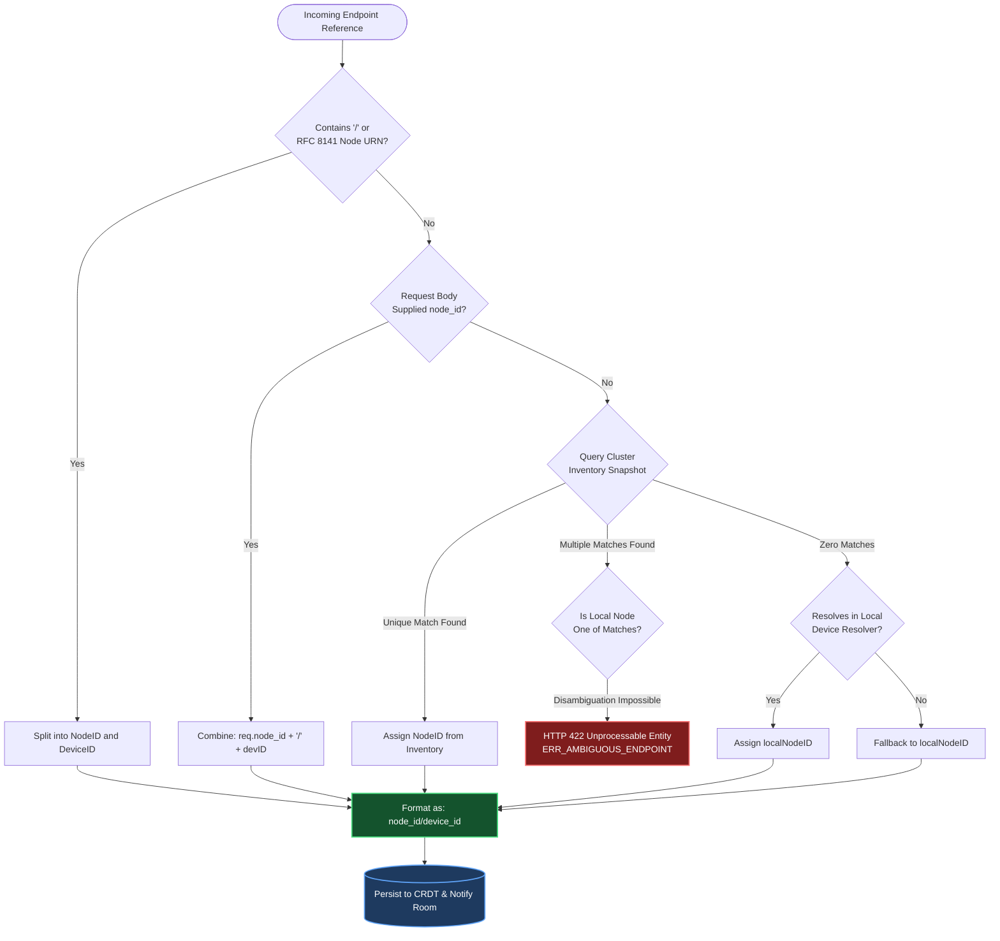
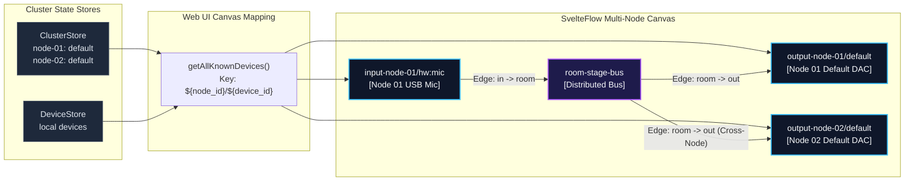

# ADR 0018: Canonical Node-Qualified Endpoint Disambiguation, Ingress Normalization, and Multi-Node Audio Flow Canvas

* **Status:** Accepted
* **Deciders:** Core Systems Architecture Team, Distributed Systems & Network Engineering, Frontend Web UI Engineering, Real-Time Audio Infrastructure
* **Date:** 2026-10-03

---

## Context and Problem Statement

`audio-router-p2p` routes deterministic, low-latency multichannel audio across physical soundcards, virtual loopbacks, and multi-node peer-to-peer mesh clusters. Prior architectural records established RFC 8141 audio device URNs (ADR 0013), Room-as-a-Bus routing models (ADR 0002, ADR 0006), SWIM gossip discovery (ADR 0008), and distributed CRDT room replication with cross-node matrix routing (ADR 0017).

Under ADR 0013, physical soundcards and virtual audio endpoints are identified via structured Uniform Resource Names (URNs), such as:
* ALSA default hardware: `urn:audio:hw:name:default:37a8eec1`
* Standard USB audio interface: `urn:audio:hw:alsa:c=CODEC:d=0`
* Virtual loopback sink: `virt:loopback:monitor`

When multiple physical machines participate in a distributed cluster, homogeneous operating environments (such as identical Linux distributions running ALSA) or identical USB soundcards generate **byte-for-byte identical device URNs on distinct physical nodes**. When room records storing un-prefixed device URNs replicated across the mesh via CRDT gossip, four critical architectural failures materialized:

1. **Split-Brain Route Synthesis and Silent Audio Black Holes**:
   When a room bound an input from Node 1 and an output intended for Node 2 using unqualified device URNs (e.g., input: `urn:audio:hw:alsa:c=MIC:d=0`, output: `urn:audio:hw:name:default:37a8eec1`), route compilation evaluated device ownership locally on each node:
   - **Transmitter Node (Node 1)**: Resolved `urn:audio:hw:name:default:37a8eec1` against its own local ALSA hardware, concluded the destination was node-local, synthesized an internal matrix crossbar route, and transmitted **zero UDP/RTP datagrams** over the network.
   - **Receiver Node (Node 2)**: Resolved `urn:audio:hw:alsa:c=MIC:d=0` against its local hardware, or detected an incoming ingress stream that never arrived, opening its local DAC and rendering continuous digital silence.
   Neither node reported an error, while the distributed audio pipeline silently failed to bridge physical network boundaries.

2. **Dependency Injection Omission in Dynamic Room Construction**:
   `DefaultRoomManager` (`pkg/group/manager.go`) manages the lifecycle of distributed rooms. However, three critical entry points—`CreateRoom`, CRDT gossip sync (`applyRecordLocked`), and disk restoration (`Load`)—instantiated `Room` objects via `NewRoom(RoomConfig{...})` without injecting `ClusterManager` and `DeviceResolver` dependencies. Consequently, dynamically synchronized or loaded rooms lacked access to cluster device inventories and local device registries, causing all subsequent endpoint resolution logic to fail or fall back to naive defaults.

3. **Inverted Endpoint Disambiguation Waterfall in `Room.resolveDeviceEndpoint`**:
   The internal endpoint resolution method `Room.resolveDeviceEndpoint` evaluated the local device resolver *prior* to inspecting cluster-wide inventory state. Because common devices (such as ALSA's `default` PCM) resolve successfully on virtually every Linux host, any bare URN was immediately claimed as node-local, completely bypassing cluster consensus and masking the existence of remote devices.

4. **Web UI Namespace Collisions and Identity Erasure in SvelteFlow Canvas**:
   In the single-pane-of-glass operator interface (`RoomCanvas.svelte`), the device store aggregator merged node-local devices directly over cluster devices using the bare device URN as the key. This stripped the essential `node_id` metadata. Furthermore, SvelteFlow canvas nodes were keyed using `output-${dev.id}` and `input-${dev.id}`. When multiple cluster nodes possessed identical hardware soundcards, canvas nodes collapsed onto identical DOM IDs, causing visual overwrites, corrupted drag layouts, erratic edge connections, and impossible cross-node patching.

A comprehensive architectural solution is required to establish globally unambiguous device endpoint addressing, enforce strict normalization at API ingress boundaries, guarantee uniform dependency injection across all room lifecycle paths, prioritize cluster consensus during resolution, and isolate multi-node identities across the Web UI flow canvas.

---

## Decision Drivers

* **Split-Brain Route Immunity**: Distributed room compilation must deterministically distinguish between local and remote devices, ensuring cross-node routes reliably emit and demux RTP network datagrams.
* **Namespace Isolation for Identical Audio Hardware**: Two or more nodes with identical soundcards (same ALSA hardware IDs, vendor IDs, or default PCM URNs) must coexist within the same room without identity collisions or device hijacking.
* **Strict Ingress Contract Enforcement**: The REST control plane must reject or canonicalize ambiguous device references before persisting them into CRDT records or notifying peer nodes.
* **Uniform Architectural Lifecycle (Guaranteed DI)**: Dynamic room instances created via REST APIs, gossip deltas, or disk loads must possess identical dependencies, specifically `ClusterManager` and `DeviceResolver`.
* **Single-Pane-of-Glass Multi-Node Canvas Integrity**: The graphical canvas must visually separate identical soundcards across different physical hosts, keying canvas nodes and drag coordinates by unambiguous node-device composite tuples.

---

## Considered Options

### Option 1: Strictly Local Scoping with Disallowed Cross-Node Room Bindings
* **Description**: Restrict audio rooms to single-node operation. Cross-node audio distribution would be forbidden inside rooms and relegated entirely to manual point-to-point matrix crossbar routes.
* **Pros**:
  - Trivial local endpoint resolution; no node qualification required within rooms.
  - Avoids Web UI canvas changes for rooms.
* **Cons**:
  - Breaks the core distributed "Room-as-a-Bus" abstraction, forcing operators to manually manage individual peer RTP endpoints, SSRCs, and jitter buffers.
  - Eliminates collaborative multi-stage studio setups where performers across different rooms or mobile stage boxes join a unified virtual bus.
  - Reverts significant functional capabilities established in ADR 0006 and ADR 0017.

### Option 2: Dynamic Cryptographic Hardware Fingerprinting (MAC + PCI Hash)
* **Description**: Replace ALSA device URNs with dynamically generated cryptographic hashes incorporating hardware MAC addresses, PCI bus paths, and soundcard serial numbers (e.g., `urn:audio:hw:sha256:7f8a9c...`).
* **Pros**:
  - Guarantees uniqueness across all hardware globally without explicit node prefixing.
  - Device references remain flat strings without node delimiters.
* **Cons**:
  - Completely opaque and non-human-readable in configuration files, API payloads, and operator logs.
  - Fragile: changing PCI slots, USB hub ports, or network interfaces mutates the device hash, breaking existing route and room bindings.
  - Fails to address virtual loopback sinks (`virt:loopback:monitor`) or ALSA virtual aliases which lack unique physical hardware signatures.

### Option 3 (Selected): Canonical Node-Qualified Endpoints, REST Ingress Normalization, Unified Room Factory DI, and Composite SvelteFlow Canvas Keys
* **Description**:
  1. Define a strict canonical endpoint representation: `<node_id>/<device_id>`, alongside full support for RFC 8141 URNs (`urn:audio:node:<nodeID>:dev:<device_id>`).
  2. Implement an ingress normalization pipeline in the REST API (`pkg/api/v1/room_handlers.go`) that inspects POST `/inputs`, POST `/outputs`, and PUT `/bindings`, resolving unqualified references against the local node or cluster inventory snapshot, and returning HTTP 422 Unprocessable Entity for ambiguous references.
  3. Refactor `DefaultRoomManager` to construct all room instances through a centralized factory (`newRoomInstanceLocked`), ensuring `ClusterManager` and `DeviceResolver` are injected across all paths (`CreateRoom`, `applyRecordLocked`, `Load`).
  4. Invert the disambiguation waterfall in `Room.resolveDeviceEndpoint` so explicit node qualifiers and cluster inventory snapshots take precedence over local device resolution.
  5. Refactor the Web UI flow canvas (`RoomCanvas.svelte` and `flowLayout.svelte.ts`) to key nodes, staging stores, and layout coordinates using composite `${nodeId}/${devId}` identifiers.
* **Pros**:
  - Complete elimination of split-brain route compilation; transmitter and receiver nodes unambiguously agree on stream directionality.
  - Transparent coexistence of identical audio hardware across arbitrary numbers of mesh nodes.
  - Resilient backward compatibility: un-prefixed inputs submitted by legacy clients are automatically normalized when unambiguous.
  - Structural consistency in Go codebase: centralized factory guarantees zero uninitialized room pointers or missing subsystems.
  - Clean, collision-free multi-node graphical patching in the Web UI.
* **Cons**:
  - Breaking changes for external API clients submitting ambiguous bare URNs that exist on multiple nodes (now rejected with HTTP 422).
  - Migration overhead for persisted legacy `rooms.json` files and CRDT records lacking node prefixes.
  - Incremental string parsing and map lookup overhead in room route compilation and canvas state synchronization.

---

## Decision Outcome

**Chosen Option:** **Option 3**. Option 3 provides a mathematically deterministic, architecture-wide solution across the API control plane, the distributed CRDT synchronization layer, the real-time audio routing engine, and the frontend user experience.

---

## Architectural Details

### 1. Canonical Node-Qualified Endpoint Specification

To eliminate ambiguity across distributed audio topologies, device endpoints within rooms, routes, CRDT deltas, and telemetry must conform to the canonical node-qualified endpoint grammar:

```
Canonical Device Reference:
  <node_id>/<device_id>

RFC 8141 Node-Scoped URN Variant:
  urn:audio:node:<node_id>:dev:<device_id>
```

#### Grammar and Field Rules
1. `<node_id>`: The canonical peer identifier of the hosting daemon (e.g., `stage-box-01`, `fOH-console-main`).
2. `<device_id>`: The persistent RFC 8141 device URN (e.g., `urn:audio:hw:alsa:c=USB:d=0`), virtual sink identifier (`virt:loopback:monitor`), or legacy hardware identifier (`hw:0,0`).
3. If an endpoint reference contains a forward slash (`/`), the substring preceding the first slash is strictly interpreted as the `<node_id>`, and the remainder is the `<device_id>`.
4. If an endpoint reference conforms to `urn:audio:node:<nodeID>:dev:<deviceID>`, it is functionally equivalent to `<nodeID>/<deviceID>`.

```
Example Canonical Mappings:
  node-01/urn:audio:hw:name:default:37a8eec1
  node-02/urn:audio:hw:name:default:37a8eec1
  node-01/virt:loopback:room-master
  urn:audio:node:stage-box:dev:urn:audio:hw:alsa:c=Scarlett:d=0
```

---

### 2. REST API Ingress Normalization Pipeline

All mutating room API endpoints in `pkg/api/v1/room_handlers.go`—specifically `POST /api/v1/rooms/{id}/inputs`, `POST /api/v1/rooms/{id}/outputs`, and `PUT /api/v1/rooms/{id}/bindings`—must pass incoming device strings through a deterministic normalization filter before mutating room state or propagating CRDT deltas.

```
Incoming Request: { "device_id": "urn:audio:hw:alsa:c=USB:d=0", "node_id": "" }
                             │
                             ▼
             Does device_id contain explicit node prefix?
             (e.g., "node-01/urn:..." or "urn:audio:node:...")
                             │
              ┌──────────────┴──────────────┐
              │ YES                         │ NO
              ▼                             ▼
       Extract nodeID and devID      Is explicit req.NodeID provided?
              │                             │
              │                      ┌──────┴──────┐
              │                      │ YES         │ NO
              │                      ▼             ▼
              │            Prepend req.NodeID   Query Cluster Snapshot
              │                      │             │
              │                      │      ┌──────┴──────────────────┐
              │                      │      │ Exactly 1 Match Found?  │
              │                      │      │ in Cluster Snapshot     │
              │                      │      └──────┬──────────────────┘
              │                      │             │
              │                      │      ┌──────┴──────┐
              │                      │      │ YES         │ NO
              │                      │      ▼             ▼
              │                      │   Use Matching  Does local node match?
              │                      │   Node ID              │
              │                      │      │          ┌──────┴──────┐
              │                      │      │          │ YES         │ NO
              │                      │      │          ▼             ▼
              │                      │      │      Use Local    Multiple / Zero
              │                      │      │      Node ID      Matches in Cluster
              │                      │      │          │             │
              ▼                      ▼      ▼          ▼             ▼
           ===========================================         HTTP 422
           Persist Canonical "<node_id>/<device_id>"         Unprocessable
           ===========================================          Entity
```

#### Ingress Error Contract
If an incoming request provides a bare, unqualified device URN:
* If the device exists uniquely on exactly one node in the cluster inventory snapshot, it is transparently normalized to that node.
* If the device exists on the local node and nowhere else in the cluster snapshot, it is normalized to `localNodeID`.
* If the device exists on multiple cluster nodes (e.g., default ALSA PCM on two distinct hosts) and the caller omitted `node_id`, the API immediately aborts the operation and returns:

```json
{
  "code": "ERR_AMBIGUOUS_ENDPOINT",
  "error": "device URN 'urn:audio:hw:name:default:37a8eec1' exists on multiple nodes ([node-01, node-02]); explicit node_id qualification required",
  "status": 422
}
```

This guarantees that unresolvable, ambiguous state never enters the CRDT replication log.

---

### 3. Centralized Room Factory and Dependency Injection

To eliminate omissions where rooms were constructed without necessary subsystem references, `DefaultRoomManager` introduces a private, centralized factory method: `newRoomInstanceLocked`.

```go
func (m *DefaultRoomManager) newRoomInstanceLocked(id RoomID, name, leader string) *Room
```

#### Architectural Invariants
* Every code path that instantiates a `Room` object—including `CreateRoom`, `applyRecordLocked` (invoked during CRDT gossip delta reception and TCP anti-entropy state merges), and `Load` (disk hydration)—**must** call `newRoomInstanceLocked`.
* The factory binds all mandatory dependencies into `RoomConfig`:
  1. `Transport`: Audio streamer network transport.
  2. `Router`: Local matrix crossbar engine.
  3. `StreamManager`: Low-level stream lifecycle controller.
  4. `Discovery`: Peer discovery provider (SWIM gossip).
  5. `ClusterManager`: Cluster device inventory snapshot provider.
  6. `DeviceResolver`: Node-local hardware and virtual audio device resolver.
* Dynamic mutators (`SetClusterManager` and `SetDeviceResolver`) iterate all active managed rooms and propagate updated dependencies under write locks.

---

### 4. Disambiguation Waterfall in `Room.resolveDeviceEndpoint`

When compiling room audio routes, `Room.resolveDeviceEndpoint` resolves a device reference into a 2-tuple: `(nodeID string, cleanDevID string)`. 

The resolution waterfall is re-architected to prioritize explicit qualifiers and global cluster consensus over local fallbacks:

```
[devRef String]
       │
       ▼
[Tier 1: Explicit Node Prefix]
  Does string contain "<node_id>/<device_id>"?
  ──► TRUE: Return (node_id, device_id)
       │ FALSE
       ▼
[Tier 2: RFC 8141 Node-Scoped URN]
  Matches "urn:audio:node:<node_id>:dev:<device_id>"?
  ──► TRUE: Return (node_id, device_id)
       │ FALSE
       ▼
[Tier 3: Cluster Inventory Consensus]
  Does cleanDevID exist in ClusterManager.GetSnapshot().ClusterDevices?
  ──► EXACT MATCH: Return (matchingNodeID, cleanDevID)
  ──► CONFLICT / MULTI-MATCH: If local node is one of the owners, prefer localNodeID;
                              otherwise, select deterministic lexicographical lowest nodeID.
       │ NO CLUSTER RECORD
       ▼
[Tier 4: Local Device Resolver]
  Does cleanDevID resolve in LocalDeviceResolver or audio.GlobalResolver()?
  ──► TRUE: Return (localNodeID, cleanDevID)
       │ FALSE
       ▼
[Tier 5: Fallback]
  Return (localNodeID, cleanDevID)
```

By placing the **Cluster Inventory Consensus** check ahead of the **Local Device Resolver**, remote endpoints registered in cluster state are never hijacked by local soundcard drivers sharing the same name.

---

### 5. Multi-Node SvelteFlow Audio Canvas Architecture

In the Web UI (`RoomCanvas.svelte` and `flowLayout.svelte.ts`), device identity and canvas node rendering are updated to treat `(nodeId, devId)` as a strictly composite key.

#### Canvas Key Architecture
1. **Device Map Keys**: `getAllKnownDevices()` indexes devices in the lookup map by composite key `${nodeId}/${devId}` as well as secondary fallback keys. Local devices from `deviceStore` are tagged with `node_id = localNodeID` and never overwrite remote cluster devices with identical hardware names.
2. **SvelteFlow Node IDs**: Canvas nodes for hardware devices are keyed by composite strings:
   - Input Nodes: `input-${dev.node_id}/${dev.id}`
   - Output Nodes: `output-${dev.node_id}/${dev.id}`
   - Room Nodes: `room-${room.id}`
3. **Canvas Edge Generation**:
   - Audio input edges connect from `input-${nodeId}/${devId}` (source handle `out`) to `room-${room.id}` (target handle `in`).
   - Audio output edges connect from `room-${room.id}` (source handle `out`) to `output-${nodeId}/${devId}` (target handle `in`).
4. **Layout Persistence**: Spatial dragging coordinates in `flowLayout.svelte.ts` are stored against the composite node ID, preserving independent visual placement for identical soundcards operating on separate physical hosts.

---

## Consequences

### Positive Consequences

* **Complete Immunity to Route Split-Brain**: Transmitter nodes correctly recognize when a room output belongs to a remote peer, generating and transmitting network RTP packets. Receiver nodes correctly identify remote sources and bind ingress demuxers.
* **Coexistence of Identical Audio Hardware**: Production setups utilizing standardized USB soundcards or default ALSA configurations across dozens of nodes operate without device collisions.
* **Guaranteed Subsystem Injection**: All rooms instantiated at boot, during runtime, or via gossip possess complete access to cluster discovery and device resolution services.
* **Deterministic API Semantics**: Ambiguous device bindings are rejected at ingress with HTTP 422, providing immediate operational feedback rather than silent routing failures.
* **High-Fidelity Graphical Canvas**: SvelteFlow canvas nodes cleanly render separate visual cards for every device on every node, complete with node-origin badges and unambiguous patch cables.

### Negative Consequences and Trade-offs

* **Strict API Ingress Rejections**: Legacy automation scripts that posted un-prefixed device names (e.g., `default`) will receive HTTP 422 errors if multiple nodes in the cluster report a `default` device, requiring client updates to supply explicit node IDs.
* **Storage and Memory Footprint Growth**: Storing qualified `<node_id>/<device_id>` keys increases string allocation overhead in CRDT logs and memory caches by approximately 20–40 bytes per device binding.
* **Cluster Snapshot Lock Contention**: Ingress normalization and route compilation perform read locks against `ClusterManager` snapshots. High-frequency room mutations could experience minor mutex serialization during large topology updates.
* **Frontend Key Migration**: Stored browser layout positions keyed under legacy `output-${dev.id}` format require migration logic or will reset to default column coordinates upon first launch under the new composite key schema.

---

## Mermaid Architecture and Sequence Diagrams

### Diagram 1: Split-Brain Route Synthesis (Before) vs. Canonical Resolution (After)

```mermaid
sequenceDiagram
    autonumber
    title Cross-Node Room Route Synthesis: Legacy Split-Brain vs. Canonical Disambiguation

    box rgb(40, 20, 20) Legacy Architecture (Split-Brain Failure)
    participant N1_Old as Node 01 (Transmitter)
    participant N2_Old as Node 02 (Receiver)
    end

    Note over N1_Old,N2_Old: Room Bound: In="hw:USB", Out="default" (Unqualified)
    N1_Old->>N1_Old: Compile Routes: Resolves "default" locally!
    N1_Old->>N1_Old: Routes to local DAC. Sends 0 UDP packets to Node 02.
    N2_Old->>N2_Old: Compile Routes: Resolves "hw:USB" locally (fails or waits).
    N2_Old->>N2_Old: Ingress demuxer waits for UDP packets that never arrive.
    Note over N1_Old,N2_Old: RESULT: SILENT AUDIO BLACK HOLE

    box rgb(20, 40, 20) Canonical Qualified Architecture (ADR 0018)
    participant N1_New as Node 01 (Transmitter)
    participant CRDT as CRDT Gossip Mesh
    participant N2_New as Node 02 (Receiver)
    participant DAC2 as Node 02 Physical DAC
    end

    Note over N1_New,N2_New: Normalized Binding: In="node-01/hw:USB", Out="node-02/default"
    N1_New->>CRDT: Replicate Normalized RoomRecord
    CRDT-->>N2_New: Gossip Delta / Anti-Entropy Sync
    
    rect rgb(30, 45, 60)
    note over N1_New: Transmitter Route Compilation
    N1_New->>N1_New: resolveDeviceEndpoint("node-02/default") ──► Node="node-02"
    N1_New->>N1_New: Target is Remote! Mount Egress Route.
    N1_New->>N1_New: Encode Opus Frames (SSRC: 0x4B21)
    end

    rect rgb(45, 30, 60)
    note over N2_New: Receiver Route Compilation
    N2_New->>N2_New: resolveDeviceEndpoint("node-02/default") ──► Node="node-02" (Local)
    N2_New->>N2_New: Source is Remote ("node-01")! Mount Ingress Route.
    N2_New->>DAC2: Open Local Output Device ("default")
    end

    N1_New->>N2_New: Transmit RTP Datagrams [SSRC: 0x4B21]
    N2_New->>DAC2: Jitter Buffer Deskew + Decode ──► Write PCM Frames
    Note over N1_New,N2_New: RESULT: SUB-MILLISECOND DETERMINISTIC AUDIO BRIDGING
```



---

### Diagram 2: Ingress API Normalization and Disambiguation Waterfall



---

### Diagram 3: Multi-Node SvelteFlow Canvas Composite Identity Flow



---

## Implementation Specification

### 1. Centralized Room Factory in `DefaultRoomManager`

```go
package group

import (
	"github.com/audio-router-p2p/pkg/audio"
	"github.com/audio-router-p2p/pkg/cluster"
	"github.com/audio-router-p2p/pkg/discovery"
)

// newRoomInstanceLocked is the authoritative factory for all Room instances.
// Must be called with m.mu held.
func (m *DefaultRoomManager) newRoomInstanceLocked(id RoomID, name, leader string) *Room {
	localPeerID := ""
	var disc DiscoveryProvider
	if m.disc != nil {
		localPeerID = m.disc.NodeID()
		disc = m.disc
	}

	var devRes LocalDeviceResolver
	if m.devProvider != nil {
		if lr, ok := m.devProvider.(LocalDeviceResolver); ok {
			devRes = lr
		}
	}
	if devRes == nil {
		devRes = audio.GlobalResolver()
	}

	room := NewRoom(RoomConfig{
		ID:             id,
		Name:           name,
		LocalPeerID:    localPeerID,
		Config:         m.cfg,
		Discovery:      disc,
		SyncManager:    m.syncMgr,
		Transport:      m.trans,
		Router:         m.router,
		StreamManager:  m.streamMgr,
		ClusterManager: m.clusterMgr,
		DeviceResolver: devRes,
	})

	roomID := room.ID()
	room.SetCallbacks(
		nil,
		nil,
		func(newLeader string) {
			go m.handleLeaderChange(string(roomID), newLeader)
		},
		nil,
	)

	if leader != "" {
		room.SetLeader(leader)
	}

	return room
}
```

---

### 2. Disambiguation Waterfall in `Room.resolveDeviceEndpoint`

```go
package group

import (
	"strings"
	"github.com/audio-router-p2p/pkg/audio"
)

// resolveDeviceEndpoint maps an arbitrary device string to an unambiguous (nodeID, cleanDevID).
func (r *Room) resolveDeviceEndpoint(devRef string) (nodeID, cleanDevID string) {
	devRef = strings.TrimSpace(devRef)
	if devRef == "" {
		return "local", ""
	}

	// 1. Explicit canonical prefix: "nodeID/urn:..."
	if slash := strings.Index(devRef, "/"); slash > 0 {
		return devRef[:slash], devRef[slash+1:]
	}

	// 2. RFC 8141 node-scoped URN: "urn:audio:node:<nodeID>:dev:<deviceID>"
	const nodePrefix = "urn:audio:node:"
	if strings.HasPrefix(devRef, nodePrefix) {
		remainder := strings.TrimPrefix(devRef, nodePrefix)
		if idx := strings.Index(remainder, ":dev:"); idx > 0 {
			return remainder[:idx], remainder[idx+5:]
		}
	}

	cleanDevID = devRef

	// 3. Cluster inventory snapshot consensus lookup (prioritized over local)
	if r.clusterMgr != nil {
		if snap := r.clusterMgr.GetSnapshot(); snap != nil {
			var matchingNodes []string
			for _, cd := range snap.ClusterDevices {
				if cd.URN == cleanDevID || cd.ID == cleanDevID || cd.DeviceID == cleanDevID {
					if cd.NodeID != "" {
						matchingNodes = append(matchingNodes, cd.NodeID)
					}
				}
			}
			if len(matchingNodes) == 1 {
				return matchingNodes[0], cleanDevID
			} else if len(matchingNodes) > 1 {
				// Deterministic tie-breaker: if local node owns it, prefer local; else lowest lexicographical
				for _, n := range matchingNodes {
					if n == r.localID {
						return r.localID, cleanDevID
					}
				}
				return matchingNodes[0], cleanDevID
			}
		}
	}

	// 4. Local hardware / virtual device resolver check
	if r.devResolver != nil {
		if _, ok := r.devResolver.Resolve(cleanDevID); ok {
			if r.localID != "" {
				return r.localID, cleanDevID
			}
			return "local", cleanDevID
		}
	} else if gr := audio.GlobalResolver(); gr != nil {
		if _, ok := gr.Resolve(cleanDevID); ok {
			if r.localID != "" {
				return r.localID, cleanDevID
			}
			return "local", cleanDevID
		}
	}

	// 5. Fallback: single live discovery peer or local node ID
	if r.disc != nil {
		live := r.disc.LivePeers()
		if len(live) == 1 && live[0].ID != "" {
			return live[0].ID, cleanDevID
		}
	}

	if r.localID != "" {
		return r.localID, cleanDevID
	}
	return "local", cleanDevID
}
```

---

### 3. REST API Ingress Normalization Helper in `pkg/api/v1`

```go
package v1

import (
	"fmt"
	"net/http"
	"strings"
)

// normalizeEndpoint resolves an incoming device reference to canonical "<node_id>/<device_id>".
func (s *V1Server) normalizeEndpoint(deviceID, explicitNodeID string) (string, error) {
	deviceID = strings.TrimSpace(deviceID)
	if deviceID == "" {
		return "", fmt.Errorf("device_id is required")
	}

	// Already qualified with explicit node prefix
	if slash := strings.Index(deviceID, "/"); slash > 0 {
		return deviceID, nil
	}

	// RFC 8141 node URN format
	const nodePrefix = "urn:audio:node:"
	if strings.HasPrefix(deviceID, nodePrefix) {
		remainder := strings.TrimPrefix(deviceID, nodePrefix)
		if idx := strings.Index(remainder, ":dev:"); idx > 0 {
			return remainder[:idx] + "/" + remainder[idx+5:], nil
		}
	}

	// Explicit node parameter supplied by client
	if explicitNodeID != "" {
		return explicitNodeID + "/" + deviceID, nil
	}

	localNodeID := "local"
	if s.discovery != nil && s.discovery.NodeID() != "" {
		localNodeID = s.discovery.NodeID()
	}

	// Inspect cluster inventory for unambiguous ownership
	if s.clusterMgr != nil {
		snap := s.clusterMgr.GetSnapshot()
		if snap != nil {
			var owners []string
			for _, cd := range snap.ClusterDevices {
				if cd.URN == deviceID || cd.ID == deviceID || cd.DeviceID == deviceID {
					if cd.NodeID != "" {
						owners = append(owners, cd.NodeID)
					}
				}
			}
			if len(owners) == 1 {
				return owners[0] + "/" + deviceID, nil
			}
			if len(owners) > 1 {
				return "", fmt.Errorf("device URN %q exists on multiple nodes (%v); explicit node_id required", deviceID, owners)
			}
		}
	}

	// Fallback to local node qualification
	return localNodeID + "/" + deviceID, nil
}
```

---

### 4. SvelteFlow Composite Canvas Node Construction

```typescript
// web/src/lib/components/rooms/RoomCanvas.svelte

function getAllKnownDevices(): Map<string, AudioDevice | AudioDeviceSummary> {
  const map = new Map<string, AudioDevice | AudioDeviceSummary>();
  const localNode = deviceStore.localNodeId || 'local';

  // 1. Ingest Cluster Devices (preserve explicit node_id)
  if (clusterStore.devices) {
    for (const d of clusterStore.devices) {
      const node = d.node_id || 'unknown';
      map.set(`${node}/${d.id}`, d);
      if (d.device_id) {
        map.set(`${node}/${d.device_id}`, d);
      }
    }
  }

  // 2. Ingest Local Devices (explicitly qualified under localNode)
  if (deviceStore.devices) {
    for (const d of deviceStore.devices) {
      const devWithNode = { ...d, node_id: localNode };
      map.set(`${localNode}/${d.id}`, devWithNode);
      // Secondary fallback for un-prefixed local lookups
      if (!map.has(d.id)) {
        map.set(d.id, devWithNode);
      }
    }
  }
  return map;
}

// Staged Output Node generation using composite keys
outputDevs.forEach((dev, index) => {
  const nodeId = `output-${dev.node_id}/${dev.id}`;
  let pos = flowLayoutStore.getPosition(nodeId) || getDefaultPosition('output', index);
  
  nextNodes.push({
    id: nodeId,
    type: 'outputDevice',
    position: { x: pos.x, y: pos.y },
    data: {
      device: dev,
      sourceRooms: currentRooms.filter(r => isDevAssigned(`${dev.node_id}/${dev.id}`, r.outputs)),
      onAddToRoom: (roomId: string) => roomStore.addRoomOutput(roomId, dev.id, dev.node_id),
    }
  });
});
```

---

## Verification and Testing Protocols

The following test suites must be executed to ensure verification against regressions:

1. **REST Ingress Normalization and Validation Test (`pkg/api/v1/room_handlers_test.go`)**:
   - `TestAddInputAmbiguousDeviceFails422`: Register mock cluster snapshot with two nodes reporting identical device `urn:audio:hw:name:default:37a8eec1`. Post to `/api/v1/rooms/r1/inputs` with un-prefixed device and empty `node_id`. Assert response is HTTP 422 with `ERR_AMBIGUOUS_ENDPOINT`.
   - `TestAddInputUnambiguousDeviceAutoNormalized`: Post device existing on only one remote node. Assert room record persists `remote-node/urn:...` and returns HTTP 200.

2. **Centralized Room Factory Dependency Injection Test (`pkg/group/manager_factory_test.go`)**:
   - Instantiate `DefaultRoomManager` with mocked `ClusterManager` and `DeviceResolver`.
   - Execute `CreateRoom`, `MergeRecord` (simulating CRDT gossip delta), and `Load` (from disk).
   - Assert that for every room instance, `r.clusterMgr` and `r.devResolver` are non-nil.

3. **Disambiguation Waterfall Resolution Test (`pkg/group/room_waterfall_test.go`)**:
   - Setup a `Room` on Node 01 with a local soundcard named `urn:audio:hw:alsa:default`.
   - Populate `ClusterManager` snapshot indicating Node 02 owns `urn:audio:hw:alsa:remote-usb`.
   - Assert `resolveDeviceEndpoint("urn:audio:hw:alsa:remote-usb")` resolves to `("Node 02", "urn:audio:hw:alsa:remote-usb")` without local hijacking.
   - Assert `resolveDeviceEndpoint("Node 03/urn:audio:hw:alsa:default")` resolves to `("Node 03", "urn:audio:hw:alsa:default")`, honoring explicit prefix over local presence.

4. **Multi-Node SvelteFlow Visual Collision Test (`web/src/tests/RoomCanvas.test.ts`)**:
   - Feed `clusterStore` two devices with identical IDs (`hw:0`) from `node-a` and `node-b`.
   - Render `RoomCanvas.svelte`.
   - Assert two distinct output nodes exist in SvelteFlow graph: `output-node-a/hw:0` and `output-node-b/hw:0`.
   - Drag `node-a`'s node and assert `flowLayoutStore` updates only `output-node-a/hw:0`, leaving `node-b`'s position unchanged.
