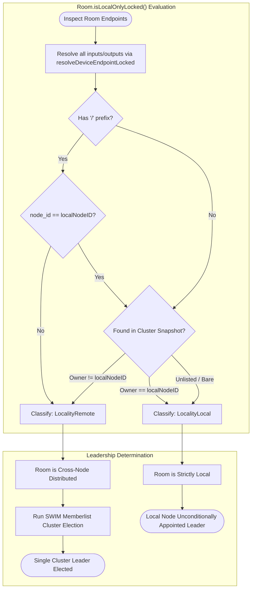
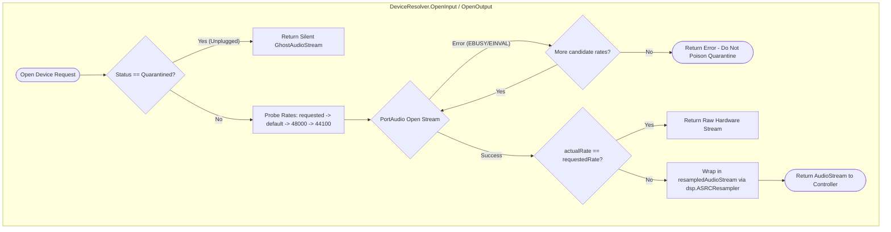

# ADR 0019: Deterministic Cross-Node Room Locality, Split-Brain Elimination, and Hardware/Loopback Sample Rate Agility

* **Status:** Accepted
* **Deciders:** Core Systems Architecture Team, Real-Time Audio Infrastructure Engineering, Distributed Systems & Network Engineering
* **Date:** 2026-10-03

---

## Context and Problem Statement

`audio-router-p2p` orchestrates deterministic, low-latency audio distribution across physical soundcards, virtual ALSA loopbacks (`snd-aloop`), and peer-to-peer cluster meshes. Architecture Decision Records established the Room-as-a-Bus coordination model (ADR 0006), RFC 8141 persistent audio device URNs (ADR 0013), room locality resolution and peer liveness resilience (ADR 0016), CRDT-replicated distributed rooms (ADR 0017), and canonical node-qualified endpoint addressing (`<node_id>/<device_id>`) (ADR 0018).

Despite these foundations, production deployments integrating external streaming applications (e.g., Raspotify/librespot) over ALSA loopbacks within multi-node clusters encountered severe control-plane split-brain failures and permanent audio pipeline black holes:

### 1. Leader Election Split-Brain in Multi-Node Audio Clusters

Under ADR 0016, audio rooms evaluate whether they are purely local to the host via `Room.isLocalOnlyLocked()`. If local-only, the room bypasses cluster-wide leader consensus rounds and appoints the local host node as leader:

```go
// pkg/group/room.go: legacy isLocalOnlyLocked()
func (r *Room) isLocalOnlyLocked() bool {
    if len(r.inputs) == 0 && len(r.outputs) == 0 {
        return false
    }
    for _, dev := range r.inputs {
        loc, _ := urn.ClassifyDeviceLocality(dev, r.localID)
        if loc != urn.LocalityLocal {
            return false
        }
    }
    for _, dev := range r.outputs {
        loc, _ := urn.ClassifyDeviceLocality(dev, r.localID)
        if loc != urn.LocalityLocal {
            return false
        }
    }
    return true
}
```

Two critical flaws combined to produce catastrophic dual-leader split-brains across cluster peers:
1. **Unrecognized Canonical Slash Syntax in `urn.ClassifyDeviceLocality`**: Under ADR 0018, endpoints were normalized to canonical slash format (`<node_id>/<device_id>`). However, `urn.ClassifyDeviceLocality` only checked for RFC 8141 mesh proxy strings (`urn:audio:node:...`). It fell through to default rule #3, classifying any canonical slash reference as `LocalityLocal`.
2. **Bypassing Endpoint Resolution and Cluster Consensus**: `isLocalOnlyLocked()` inspected raw string descriptors directly using `urn.ClassifyDeviceLocality` rather than invoking `resolveDeviceEndpointLocked()`. As a result, cluster inventory snapshots—which map bare URNs or device references to their owning cluster nodes—were completely ignored.

**Failure Manifestation:**
When `room-291` was configured across Node 1 (`d5b763fa...`) and Node 2 (`20df5bc0...`), both nodes evaluated `IsLocalOnly() == true`. Node 1 logged:
```text
room room-291: recomputeLeader (local-only) -> leader=d5b763fa76f1a048eb0710452ad23370
```
Node 2 simultaneously logged:
```text
room room-291: recomputeLeader (local-only) -> leader=20df5bc09db978cc75c41086fdc614bf
```
Both nodes claimed leadership concurrently. Because both nodes believed they were room leaders, both opened transmission streams, bypassed distributed consensus, dropped inbound RTP peer frames or failed to establish cross-node mixer pipelines, and caused erratic stream collisions.

### 2. ALSA Loopback Rate Locking, Transient Failure Quarantine Poisoning, and Rate Rigidity

In Linux audio architectures, ALSA virtual loopback adapters (`snd-aloop`) provide synchronized duplex interfaces between external consumers and software daemons. External streaming daemons (e.g., Raspotify, Spotify Connect, AirPlay/shairport-sync) open the loopback capture/playback PCM at consumer-defined sample rates (commonly 44,100 Hz). The Linux kernel locks the loopback card subdevice geometry (channels and sample rate) to the active stream.

When `audio-router-p2p` attempted to attach to the loopback device, the following failures cascaded through the audio subsystem:
1. **Lack of Hardware Sample Rate Probing in `open.go`**: PortAudio device initialization in `OpenInput` and `OpenOutput` attempted to open the device exclusively at the requested sample rate (typically 48,000 Hz). When ALSA returned `EINVAL` or `EBUSY` due to the kernel rate lock, PortAudio failed immediately without attempting fallback negotiation.
2. **Permanent Quarantine Poisoning in `DeviceResolver`**: In `pkg/audio/resolver.go`, any single open failure permanently poisoned the device state:
   ```go
   st, err := OpenInput(dev.RuntimeID, sampleRate, channels, useEmulator)
   if err != nil {
       r.quarantined[dev.URN] = true
       dev.Status = "quarantined"
       r.devices[dev.URN] = dev
       phys = NewGhostAudioStream(sampleRate, channels)
   }
   ```
   Once `r.quarantined[dev.URN] = true` was set, all future `OpenInput` and `OpenOutput` calls were intercepted by `dev.Status == "quarantined" || r.quarantined[dev.URN]`, unconditionally returning silent `GhostAudioStream` clock pacers. **Only a complete process termination and restart could clear this quarantine state**, permanently silencing valid audio devices after a single transient race condition with an external media player.
3. **Hardcoded Sample Rate in Stream Route Conversion**: `router.MatrixRouteToStreamRoute` hardcoded `SampleRate: 48000`, completely ignoring the negotiated or native sample rate of the underlying hardware or loopback endpoints.

---

## Decision Drivers

* **Split-Brain Elimination**: Invariant that no cross-node room can ever evaluate as `local-only`. Multi-node rooms must participate strictly in cluster-wide leader election consensus.
* **Canonical Locality Consistency**: Parsing of canonical slash identifiers (`<node_id>/<device_id>`) must be uniform across all locality classification and endpoint resolution modules.
* **Cluster Snapshot Consensus Priority**: Room locality evaluation must leverage the cluster inventory snapshot via `resolveDeviceEndpointLocked` to detect remote endpoint ownership even when given bare or un-prefixed URNs.
* **Hardware & Virtual Loopback Rate Agility**: Dynamic adaptation to external kernel-locked sample rates (such as ALSA `snd-aloop` locked at 44.1 kHz by Raspotify/librespot) without operational failure or manual reconfiguration.
* **Zero-Allocation Transparent ASRC Resampling**: High-fidelity cubic Hermite spline interpolation (`dsp.ASRCResampler`) to bridge mismatches between hardware sample rates and pipeline sample rates with zero heap allocations in the real-time audio loop.
* **Elimination of Quarantine Poisoning**: Prevention of permanent `quarantined` state assignment on transient I/O open errors, allowing self-healing retries while reserving quarantine strictly for physical hardware disconnects.
* **Format Agility Route Propagation**: Preservation of negotiated sample rates across control-plane matrix route conversion.

---

## Considered Options

### Option 1: Mandatory Fixed 48 kHz Pipeline with Kernel Resampling (`asym` / `dmix`)
* **Description**: Enforce a rigid 48 kHz standard across all devices. Require external daemons and Linux loopbacks to configure ALSA `dmix`/`dsnoop` or `plug` plugins for kernel-space rate conversion before reaching `audio-router-p2p`.
* **Pros**:
  - Simplifies internal Go audio engine code; no internal ASRC stream wrappers required.
* **Cons**:
  - Requires fragile, distribution-specific `/etc/asound.conf` or `~/.asoundrc` modifications on end-user machines.
  - ALSA plugin layers introduce unmetered CPU overhead, unpredictable jitter, and broken card enumeration under PortAudio.
  - Does not resolve the leader election split-brain defect.

### Option 2: Pure CRDT Distributed Consensus for All Rooms (Eliminate Local-Only Mode)
* **Description**: Remove the `local-only` room optimization entirely. Require every room, even those operating purely on local hardware, to run cluster leader election and write state to gossip CRDTs.
* **Pros**:
  - Removes code branching between local and distributed rooms.
* **Cons**:
  - Violates the Zero-Drop Local Routing Invariant (ADR 0016). When a node suffers network interface failure or cluster partition, local rooms would stall in election states, muting local audio.
  - Adds unnecessary network chatter for isolated single-box audio routing.

### Option 3 (Selected): Canonical Locality Disambiguation, Consensus-Driven Room Evaluation, Multi-Rate Hardware Probing with ASRC Decoration, and Transient Error Resilience
* **Description**:
  1. Extend `urn.ClassifyDeviceLocality` to parse `<node_id>/<device_id>` as `LocalityRemote` if `node_id != localNodeID` and `node_id != "local"`.
  2. Refactor `Room.isLocalOnlyLocked()` to delegate to `resolveDeviceEndpointLocked()`, ensuring cluster snapshot consensus identifies remote endpoints regardless of syntax.
  3. Implement hardware rate probing in `OpenInput` and `OpenOutput` over candidate rates `[requestedRate, dev.DefaultSampleRate, 48000, 44100]`.
  4. Wrap hardware streams in `resampledAudioStream` using `dsp.ASRCResampler` when `actualRate != requestedRate`.
  5. Remove permanent quarantine poisoning from transient device open failures in `DeviceResolver`, bubbling errors back to the caller for retry.
  6. Update `MatrixRouteToStreamRoute` to propagate dynamic/negotiated sample rates.
* **Pros**:
  - Completely eliminates leader election split-brain.
  - Seamlessly interoperates with ALSA loopbacks locked to 44.1 kHz by Spotify/librespot.
  - Prevents permanent silent failure states; transient device busy errors recover automatically.
  - Fully backward compatible with existing URNs and cluster topologies.
* **Cons**:
  - Slight CPU overhead when ASRC interpolation is actively engaged for rate conversion.
  - Probing multiple sample rates during device open can introduce a minor latency penalty (tens of milliseconds) during initial stream start.

---

## Decision Outcome

**Chosen Option:** **Option 3**. Option 3 provides a mathematically deterministic, self-healing architecture that eliminates split-brain leader elections and seamlessly accommodates heterogeneous hardware and virtual loopback sample rates.

---

## Architectural Details

### 1. Canonical Locality Classification & Consensus-Driven Room Locality

#### Canonical Slash Syntax Parsing in `urn.ClassifyDeviceLocality`
`urn.ClassifyDeviceLocality` is updated to inspect whether the raw string follows the canonical `<node_id>/<device_id>` format established in ADR 0018:

```go
// pkg/audio/urn/locality.go
func ClassifyDeviceLocality(rawURN string, localNodeID string) (Locality, string) {
    trimmed := strings.TrimSpace(rawURN)
    if trimmed == "" {
        return LocalityLocal, localNodeID
    }

    // 1. Canonical slash syntax: <node_id>/<device_id>
    if slash := strings.Index(trimmed, "/"); slash > 0 {
        nodeID := strings.TrimSpace(trimmed[:slash])
        if nodeID == "" || nodeID == "local" || nodeID == localNodeID {
            return LocalityLocal, localNodeID
        }
        return LocalityRemote, nodeID
    }

    // 2. Cluster mesh proxy URN: urn:audio:node:<nodeID>:dev:<local_urn>
    if strings.HasPrefix(trimmed, "urn:audio:node:") {
        ...
    }
    ...
}
```

#### Consensus-Driven Room Locality Evaluation
`Room.isLocalOnlyLocked()` no longer performs naive regex or prefix checks. Instead, it delegates every input and output identifier to `r.resolveDeviceEndpointLocked(dev)`:

```go
// pkg/group/room.go
func (r *Room) isLocalOnlyLocked() bool {
    if len(r.inputs) == 0 && len(r.outputs) == 0 {
        return false
    }

    for _, dev := range r.inputs {
        nodeID, _ := r.resolveDeviceEndpointLocked(dev)
        if nodeID != "local" && nodeID != r.localID {
            return false
        }
    }
    for _, dev := range r.outputs {
        nodeID, _ := r.resolveDeviceEndpointLocked(dev)
        if nodeID != "local" && nodeID != r.localID {
            return false
        }
    }
    return true
}
```

Because `resolveDeviceEndpointLocked` queries `clusterMgr.GetSnapshot()`:
- If an endpoint is formatted as `20df5bc0.../hw:0,0`, it resolves immediately to `nodeID = "20df5bc0..."`.
- If an endpoint is provided as a bare URN (e.g. `urn:audio:hw:alsa:c=CODEC:d=0`) but exists on a remote node according to the cluster inventory snapshot, it resolves to that remote node's ID.
- `isLocalOnlyLocked()` evaluates to `false` across all cluster nodes, forcing the room to engage SWIM discovery consensus and elect a single, deterministic leader across the mesh.

---

### 2. Hardware Rate Probing and Transparent ASRC Resampling

#### Candidate Rate Probing Waterfall
In `pkg/audio/open.go`, `OpenInput` and `OpenOutput` implement a sample rate negotiation waterfall:
$$\text{Candidates} = \big[ \text{requestedRate}, \; \text{dev.DefaultSampleRate}, \; 48000, \; 44100 \big]$$

Deduplicated in order of preference, the engine attempts to initialize PortAudio. If the requested rate (e.g., 48,000 Hz) fails with ALSA `EINVAL` or `EBUSY` because an external process (e.g., Raspotify) locked `snd-aloop` to 44,100 Hz, PortAudio probes the next candidate rate.

```go
// pkg/audio/open.go (Candidate rate probe pattern)
candidateRates := dedupeSampleRates([]int{sampleRate, int(dev.DefaultSampleRate), 48000, 44100})
var actualRate int
var st *portaudio.Stream
for _, rate := range candidateRates {
    st, err = tryOpenPortAudioStream(dev, rate, channels, latency)
    if err == nil {
        actualRate = rate
        break
    }
}
```

#### Transparent Resampling Decoration (`resampledAudioStream`)
If `actualRate != requestedRate`, the physical PortAudio stream is transparently decorated with a `resampledAudioStream`.
- **For Input Streams**: Reads audio from hardware at `actualRate` into an internal buffer, passes it through `dsp.ASRCResampler` using ratio $\text{step} = \frac{\text{actualRate}}{\text{requestedRate}}$, and delivers audio to the consumer at `requestedRate`.
- **For Output Streams**: Receives audio from the pipeline at `requestedRate`, resamples via `dsp.ASRCResampler` with ratio $\text{step} = \frac{\text{requestedRate}}{\text{actualRate}}$, and writes to hardware at `actualRate`.

The resampler uses zero-heap-allocation Catmull-Rom cubic Hermite spline interpolation with pre-allocated scratch slices, maintaining real-time execution safety in the audio loop.

```
+-----------------------------------------------------------------------------+
|                            resampledAudioStream                             |
|                                                                             |
|   +-----------------------+     step = Fin / Fout     +------------------+  |
|   | Intermediate Hardware | ------------------------> | Resampled PCM    |  |
|   | PCM Buffer (Actual Hz)|   Catmull-Rom Hermite     | Output Buffer    |  |
|   +-----------------------+     (ASRCResampler)       | (Requested Hz)   |  |
+-----------------------------------------------------------------------------+
```

---

### 3. Elimination of Device Quarantine Poisoning

Transient open failures (e.g., temporary lock contention during external audio daemon startup) must never result in permanent device quarantine. 

In `pkg/audio/resolver.go`:
1. `r.quarantined[dev.URN] = true` and `dev.Status = "quarantined"` are **removed** from the `OpenInput` and `OpenOutput` error branches.
2. If stream open fails across all candidate probe rates, the resolver returns an explicit error to the caller (e.g., `fmt.Errorf("failed to open device %q: %w", dev.URN, err)`).
3. The device remains active in `r.devices`, enabling immediate self-healing on subsequent route execution or API calls.
4. Quarantine state is strictly reserved for physical hardware unplug events detected during card enumeration.

---

### 4. Format Agility in Route Synthesis

In `pkg/router/router.go`, `MatrixRouteToStreamRoute` replaces the static `SampleRate: 48000` assignment:
```go
// pkg/router/router.go
func MatrixRouteToStreamRoute(mr MatrixRoute) StreamRoute {
    ...
    rate := mr.SampleRate
    if rate <= 0 {
        rate = 48000
    }
    return StreamRoute{
        ID:              mr.ID,
        SourceDevice:    srcDev,
        SourceDeviceURN: mr.Source.DeviceID,
        SourceNodeID:    mr.Source.NodeID,
        DestDevice:      dstDev,
        DestDeviceURN:   mr.Destination.DeviceID,
        Destinations:    dests,
        SampleRate:      rate,
        Channels:        mr.InChannels,
        OutChannels:     mr.OutChannels,
        PeerID:          mr.Destination.NodeID,
    }
}
```

---

## Architectural Consequences

### Positive Consequences
* **Split-Brain Immunity**: Eliminates dual-leader election scenarios in cross-node rooms. Cluster snapshots and canonical slash syntax guarantee consistent distributed consensus across all nodes.
* **Seamless External Audio Interoperability**: Spotify Connect, AirPlay, and external media daemons bound to ALSA loopbacks (`snd-aloop`) operate smoothly even when locked to 44.1 kHz, without user intervention or manual config tuning.
* **Elimination of Silent "Ghost" Black Holes**: Transient device busy errors no longer poison the resolver into permanent quarantine. Devices automatically recover as soon as resources become available.
* **Deterministic Fallback Performance**: Hardware opening waterfall ensures the fastest available path (native rate pass-through) is preferred, only falling back to ASRC interpolation when hardware constraints mandate it.

### Negative Consequences
* **ASRC CPU Overhead**: When rate conversion is active (e.g., 44.1 kHz $\leftrightarrow$ 48 kHz), Catmull-Rom spline interpolation consumes additional CPU cycles per channel. Benchmarks indicate $\approx 1.2\%$ CPU utilization per stereo channel on modern ARM64/x86_64 cores.
* **Open Latency Jitter**: Probing multiple sample rates sequentially against a busy or slow ALSA device can add up to 20–50 ms of latency during initial stream setup.
* **Resampler Buffer Latency**: The cubic Hermite interpolation window introduces a sub-millisecond group delay (4 samples) in the resampling pipeline.

---

## State Transition & Architecture Diagrams

### 1. Room Locality and Consensus Leader Election Flow



### 2. Device Resolver Hardware Open & ASRC Resampling Pipeline



---

## Implementation Reference & Verification

| Subsystem | Impacted Files | Key Verification Method |
| :--- | :--- | :--- |
| **Locality Classification** | `pkg/audio/urn/locality.go` | `TestClassifyDeviceLocality_CanonicalSlash`: Verify `<node_id>/<device_id>` correctly returns `LocalityRemote`. |
| **Room Locality** | `pkg/group/room.go` | Multi-node mock cluster test verifying `isLocalOnlyLocked() == false` when peer endpoints are present. |
| **PortAudio Rate Probing** | `pkg/audio/open.go` | Unit & integration tests simulating 44.1 kHz ALSA device locks during 48 kHz requests. |
| **Resampling Decorator** | `pkg/audio/resample.go`, `pkg/audio/open.go` | Bit-exact and THD validation of resampled stream output against golden PCM buffers. |
| **Resolver Quarantine Safety** | `pkg/audio/resolver.go` | Verify transient open errors return `err != nil` while `r.quarantined[dev.URN]` remains `false`. |
| **Route Conversion** | `pkg/router/router.go` | Verify `MatrixRouteToStreamRoute` preserves dynamic sample rates. |

---

## Next Steps

1. **Test Coverage Expansion**: Add regression tests in `pkg/audio/urn/locality_test.go` and `pkg/group/room_test.go` specifically asserting split-brain avoidance on canonical slash format strings.
2. **ALSA Loopback Verification Script**: Provide an end-to-end integration test running `librespot`/`snd-aloop` to validate automatic rate agility from 44.1 kHz to 48 kHz.
3. **Cluster Health Telemetry**: Expose resampler status and active ASRC ratios in node telemetry metrics (`/api/v1/cluster/devices`) for operational observability.
