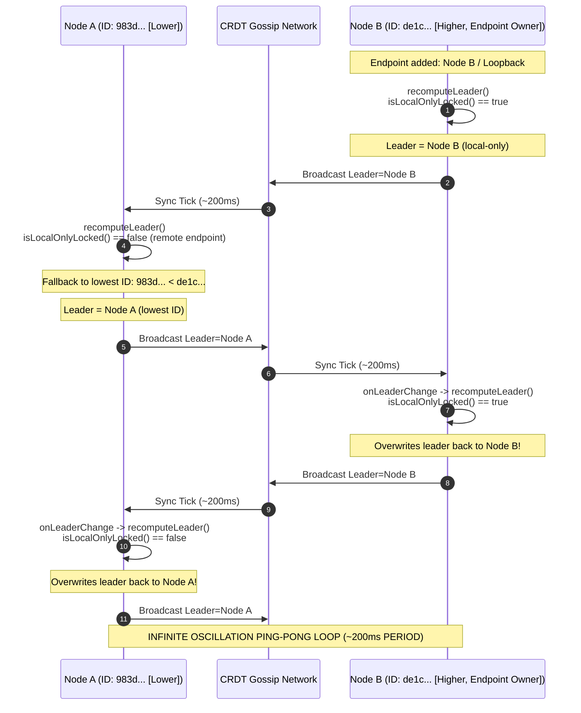
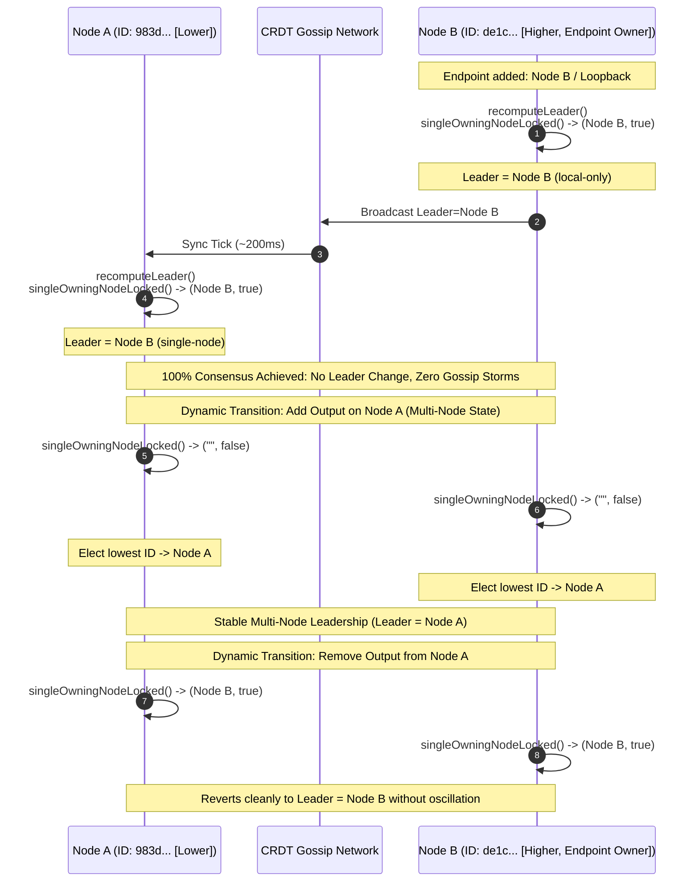
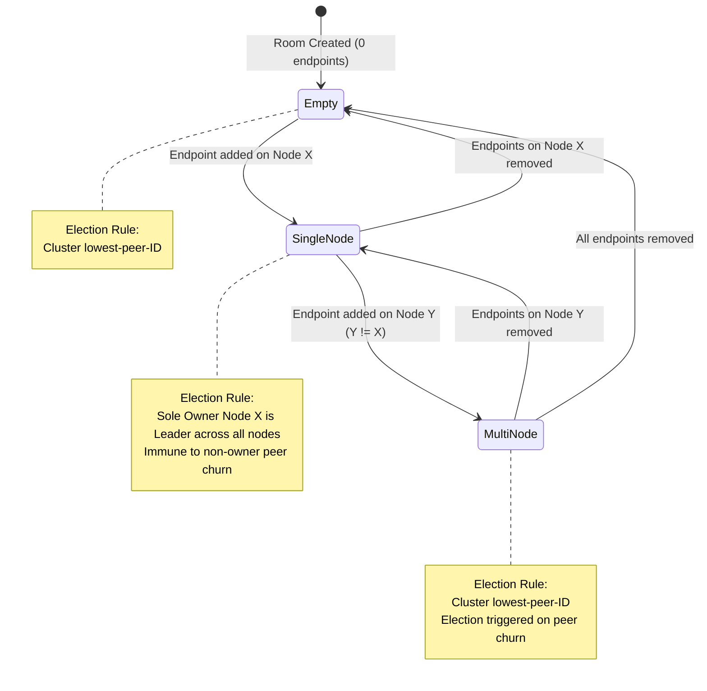

# ADR 0020: Single-Node Room Ownership and Elimination of Control-Plane Leader Oscillation

* **Status:** Accepted
* **Deciders:** Core Systems Architecture Team, Real-Time Audio Infrastructure Engineering, Distributed Systems & Network Engineering
* **Date:** 2026-10-03

---

## Context and Problem Statement

In `audio-router-p2p`, multi-node clusters rely on CRDT-replicated state (ADR 0017) and canonical node-qualified endpoint addressing (`<node_id>/<device_id>`) (ADR 0018) to coordinate audio routing. Under ADR 0016 and ADR 0019, room leader election followed a dual-path mechanism:
1. **Local-Only Bypass**: Rooms whose endpoints were classified as local to the host node bypassed cluster-wide leader consensus, immediately assigning the local node as the leader.
2. **Deterministic Lowest-Peer-ID Election**: Rooms containing distributed endpoints evaluated cluster membership and elected the peer with the lexicographically lowest peer ID as leader.

### The Asymmetric Invariant Failure

While this dual-path election worked when all endpoints were purely local to every evaluating node (an impossibility in multi-node setups) or when endpoints were already spread across multiple nodes, it introduced a catastrophic control-plane failure when a room contained endpoints belonging exclusively to a single remote node.

Consider a multi-node cluster with two active nodes:
* **Node A**: Peer ID `983d45fc200dbad1ead6cb5a69c6281f` (lexicographically lower peer ID).
* **Node B**: Peer ID `de1c65acdf9893492d461bbc809d699d` (lexicographically higher peer ID).

A user or workflow creates `room-742` and binds an input endpoint on Node B (e.g., `de1c65acdf9893492d461bbc809d699d/urn:audio:hw:alsa:c=Loopback:d=1`), while output endpoints are empty or pending configuration.

Because leader election logic was evaluated unilaterally and asymmetrically on each node:

1. **Evaluation on Node B (Endpoint Owner)**:
   * Node B evaluated `isLocalOnlyLocked()`. Because the only endpoint in `room-742` resided on Node B, `isLocalOnlyLocked()` returned `true`.
   * Node B bypassed cluster election and appointed itself leader:
     ```text
     room room-742: recomputeLeader (local-only) -> leader=de1c65acdf9893492d461bbc809d699d
     ```
   * Node B marked the room state as `Active` and published its leader assignment into the cluster CRDT gossip.

2. **Evaluation on Node A (Non-Owner Peer)**:
   * Node A evaluated `isLocalOnlyLocked()`. Because the endpoint belonged to remote Node B (`nodeID != nodeA`), `isLocalOnlyLocked()` returned `false`.
   * Node A fell through to cluster-wide deterministic lowest-ID election across all discovered peers (`{Node A, Node B}`).
   * Because `983d45fc...` < `de1c65ac...`, Node A appointed *itself* leader:
     ```text
     room room-742: recomputeLeader -> became leader (lowestID=983d45fc200dbad1ead6cb5a69c6281f)
     ```
   * Node A marked the room state as `Active` and published its leader assignment into the cluster CRDT gossip.

### The Infinite Oscillation Loop

Because both nodes continuously synchronized state via CRDT gossip ticks (scheduled every ~200ms) and registered `onLeaderChange` callbacks:

```text
[Node B] room room-742: leader change "983d45fc200dbad1ead6cb5a69c6281f" -> "de1c65acdf9893492d461bbc809d699d"
[Node B] room room-742: recomputeLeader (local-only) -> leader=de1c65acdf9893492d461bbc809d699d
[Node A] room room-742: leader change "de1c65acdf9893492d461bbc809d699d" -> "983d45fc200dbad1ead6cb5a69c6281f"
[Node A] room room-742: recomputeLeader -> became leader (lowestID=983d45fc200dbad1ead6cb5a69c6281f)
[Node B] room room-742: leader change "983d45fc200dbad1ead6cb5a69c6281f" -> "de1c65acdf9893492d461bbc809d699d"
[Node A] room room-742: leader change "de1c65acdf9893492d461bbc809d699d" -> "983d45fc200dbad1ead6cb5a69c6281f"
... (repeating infinitely every ~200ms)
```

This rapid ping-pong oscillation loop caused severe system degradation:
* Control-plane CRDT gossip storms flooded the network with conflicting leader records.
* Stream transports and RTP pipelines were repeatedly torn down and reconstructed every 200ms.
* Audio streams dropped out continuously, rendering single-node rooms non-functional whenever a lower-ID peer existed in the cluster mesh.
* Unrelated remote peer departures or membership churn forced single-node rooms into spurious `Election` transitions.

---

## Decision Drivers

* **Cluster-Symmetric Consensus**: Every node in the cluster, regardless of whether it owns any endpoint in a room, must compute identical leader assignments for that room given identical endpoint configurations.
* **Single-Node Autonomous Ownership**: When all endpoints of a room reside on a single node X, node X must be the sole recognized leader across the entire cluster, ensuring zero unnecessary cross-network mixing hops.
* **Churn Isolation for Single-Node Topologies**: Single-node rooms must operate independently and remain immune to cluster peer churn (joins, leaves, partitions) unless the owning node itself departs.
* **Seamless Dynamic Multi-Node Transitions**: Adding an endpoint from a second node must deterministically and synchronously transition all nodes to cluster-wide lowest-peer-ID leader election; removing endpoints back to a single node must smoothly revert to single-node ownership without oscillation.
* **Zero Disruption to Existing Zero-Drop Local Invariants**: Purely local workflows (e.g., single-node ALSA playback/capture) must retain local zero-drop guarantees (ADR 0016).

---

## Considered Options

### Option 1: Unconditional Lowest-Peer-ID Election for All Rooms (Eliminate Ownership Optimization)
* **Description**: Remove all local/single-node optimizations. Every room, whether empty, single-node, or multi-node, elects the cluster-wide lowest peer ID as leader.
* **Pros**:
  - Extremely simple implementation.
  - Symmetrical across all nodes.
* **Cons**:
  - Catastrophic for single-node audio routing: If Node B owns both the microphone and speakers, but Node A has a lower peer ID, Node A would be elected leader. Audio would be forced across the network to Node A for mixing and streamed back to Node B, introducing unneeded network latency, jitter, packet loss vulnerability, and bandwidth consumption.
  - Violates the Zero-Drop Local Routing Invariant (ADR 0016).

### Option 2: CRDT Leader Lease / First-Writer-Wins LWW Register
* **Description**: The first node that creates the room writes its peer ID into a Last-Write-Wins (LWW) CRDT register as leader. Subsequent nodes accept this leader until lease expiration.
* **Pros**:
  - Avoids algorithmic recomputation based on peer ID comparison.
* **Cons**:
  - Introduces race conditions during concurrent creation or network partitions.
  - Requires clock synchronization or Lamport timestamps with complex lease renewal and heartbeat timeouts.
  - Does not adapt cleanly when endpoints are added or removed dynamically.

### Option 3 (Selected): Cluster-Symmetric Single-Node Ownership with Deterministic Fallback
* **Description**:
  1. Replace unilateral `isLocalOnlyLocked()` checks with a symmetric `singleOwningNodeLocked() (string, bool)` evaluator that inspects the ownership of all assigned inputs and outputs using endpoint resolution.
  2. If all endpoints belong to exactly one node X (`owner == X, isSingleNode == true`):
     - **All nodes** across the cluster unconditionally recognize Node X as the leader.
     - Node X logs `recomputeLeader (local-only) -> leader=X`.
     - Non-owning nodes log `recomputeLeader (single-node) -> leader=X (localID=...)`.
     - The room remains immune to remote peer membership churn unless Node X departs.
  3. If endpoints span more than one node (`isSingleNode == false`) or if the room is empty (0 endpoints):
     - All nodes fall through to cluster-wide deterministic lowest-peer-ID election.
  4. Bidirectional endpoint mutations cleanly transition between single-node and multi-node modes with immediate consensus convergence.
* **Pros**:
  - 100% mathematical symmetry across all nodes: eliminates the root cause of the leader election ping-pong loop.
  - Audio locality preserved: Single-node rooms process audio strictly locally on the owning node without network hops.
  - Resilient to peer churn: Remote node joins and leaves cannot destabilize active single-node audio buses.
  - Dynamic agility: Transparently scales up to distributed multi-node mixing and back down to single-node ownership.

---

## Decision Outcome

Chosen: **Option 3**.

### Architectural Specification & Consensus Mechanics

#### 1. Symmetric Ownership Evaluation (`singleOwningNodeLocked`)

The core resolution function inspects all inputs and outputs currently assigned to the room:

```go
// pkg/group/room.go

func (r *Room) singleOwningNodeLocked() (string, bool) {
	if len(r.inputs) == 0 && len(r.outputs) == 0 {
		return "", false
	}
	var owner string
	for _, dev := range r.inputs {
		nodeID, _ := r.resolveDeviceEndpointLocked(dev)
		if nodeID == "" || nodeID == "local" {
			nodeID = r.localID
		}
		if owner == "" {
			owner = nodeID
		} else if nodeID != "" && nodeID != owner {
			return "", false
		}
	}
	for _, dev := range r.outputs {
		nodeID, _ := r.resolveDeviceEndpointLocked(dev)
		if nodeID == "" || nodeID == "local" {
			nodeID = r.localID
		}
		if owner == "" {
			owner = nodeID
		} else if nodeID != "" && nodeID != owner {
			return "", false
		}
	}
	if owner == "" {
		owner = r.localID
	}
	return owner, true
}
```

* `isLocalOnlyLocked()` is now a trivial predicate derived from `singleOwningNodeLocked()`:
  ```go
  func (r *Room) isLocalOnlyLocked() bool {
      owner, ok := r.singleOwningNodeLocked()
      return ok && (owner == "local" || owner == r.localID || r.localID == "")
  }
  ```

#### 2. Recompute Leader Convergence Matrix

When `recomputeLeader()` is executed on any node:

```go
func (r *Room) recomputeLeader() {
	r.mu.RLock()
	owner, isSingleNode := r.singleOwningNodeLocked()
	r.mu.RUnlock()

	if isSingleNode && owner != "" {
		old := r.Leader()
		r.leader.Store(owner)
		r.state.Store(RoomState(RoomStateActive))
		if owner == r.localID {
			log.Printf("room %s: recomputeLeader (local-only) -> leader=%s", r.id, r.localID)
		} else {
			log.Printf("room %s: recomputeLeader (single-node) -> leader=%s (localID=%s)", r.id, owner, r.localID)
		}
		if old != "" && old != owner {
			log.Printf("room %s: leader change %q -> %q", r.id, old, owner)
			if r.onLeaderChange != nil {
				r.onLeaderChange(owner)
			}
		}
		return
	}

	// Multi-node or Empty Room: Cluster lowest-peer-ID election fallback
	// ... (deterministic lowest ID among live discovery peers)
}
```

#### Consensus Evaluation Matrix

| Room Configuration | Node A Evaluation | Node B Evaluation | Cluster Consensus |
| :--- | :--- | :--- | :--- |
| **All endpoints on Node B** | `isSingleNode=true`, `owner=Node B`<br>Log: `recomputeLeader (single-node) -> leader=B` | `isSingleNode=true`, `owner=Node B`<br>Log: `recomputeLeader (local-only) -> leader=B` | **Leader = Node B** (Zero Oscillation) |
| **All endpoints on Node A** | `isSingleNode=true`, `owner=Node A`<br>Log: `recomputeLeader (local-only) -> leader=A` | `isSingleNode=true`, `owner=Node A`<br>Log: `recomputeLeader (single-node) -> leader=A` | **Leader = Node A** (Zero Oscillation) |
| **Inputs on Node B, Outputs on Node A** | `isSingleNode=false`<br>Elects lowest ID (`min(A, B) = A`) | `isSingleNode=false`<br>Elects lowest ID (`min(A, B) = A`) | **Leader = Node A** (Zero Oscillation) |
| **0 endpoints assigned (Empty Room)** | `isSingleNode=false`<br>Elects lowest ID (`min(A, B) = A`) | `isSingleNode=false`<br>Elects lowest ID (`min(A, B) = A`) | **Leader = Node A** (Zero Oscillation) |

#### 3. Peer Churn Immunity for Single-Node Rooms

In `removeMember(id string)`:
```go
owner, isSingleNode := r.singleOwningNodeLocked()
if left != nil && (!isSingleNode || id == owner) {
    r.state.Store(RoomState(RoomStateElection))
}
r.mu.Unlock()

if left != nil && id != r.localID {
    if r.onStateChange != nil && (!isSingleNode || id == owner) {
        r.onStateChange(RoomStateElection)
    }
    if r.onMemberLeave != nil {
        r.onMemberLeave(left)
    }
}
```
If a remote node drops offline, single-node rooms on Node B are unaffected unless Node B itself departs.

---

## State Transition & Consensus Diagrams

### Failure Scenario: Previous Oscillation Loop (Before ADR 0020)



### Resolved Scenario: Cluster-Symmetric Consensus (ADR 0020)



### State Machine of Room Ownership



---

## Consequences

### Positive Consequences

* **Complete Elimination of Control-Plane Oscillation**: Resolves the infinite leader election ping-pong loop when rooms contain single-node endpoints on higher-ID peers.
* **Control-Plane Bandwidth Conservation**: Prevents spurious CRDT gossip storms, reducing CPU overhead and network traffic across the cluster.
* **Stream Stability**: Prevents unnecessary transport tear-downs and RTP session re-initializations during steady-state single-node audio streaming.
* **Peer Churn Resilience**: Single-node audio buses remain active and uninterrupted when un-involved cluster peers join, depart, or experience transient network disconnects.
* **Symmetric Determinism**: Removes hidden assumptions between local and remote perspectives; all nodes evaluate the identical state machine.

### Negative Consequences & Trade-Offs

* **Owner Node Critical Dependency**: Because a single-node room relies entirely on its sole owner as leader, the departure or failure of that specific owning node halts the room until new endpoints are assigned or the room is dissolved. (This is expected behavior, as the audio hardware is bound to that node).
* **Endpoint Resolution Overhead**: Evaluating `singleOwningNodeLocked` requires resolving device URNs for each input and output against local and cluster device inventories. This is mitigated by in-memory cached map lookups under read locks.

---

## Validation & Verification

Consensus stability and bidirectional dynamic transitions are verified in unit and integration test suites:

1. **`TestRoomSingleNodeEndpointLeaderConsensus` (`pkg/group/room_test.go`)**:
   * Evaluates Node 1 (`983d...`) and Node 2 (`de1c...`) with an input bound to Node 2.
   * Asserts both nodes elect Node 2 as leader without split-brain.
   * Dynamically adds an output endpoint on Node 1, asserting both nodes transition to Node 1 as lowest-ID leader.
   * Dynamically removes the output from Node 1, asserting both nodes revert back to Node 2 as leader without oscillation.
2. **Multi-Node E2E Pipeline Integration Test (`cmd/client/multinode_pipeline_e2e_test.go`)**:
   * Validates continuous audio transmission across loopback capture and playback with active discovery and CRDT gossip while leader consensus remains completely stable.
