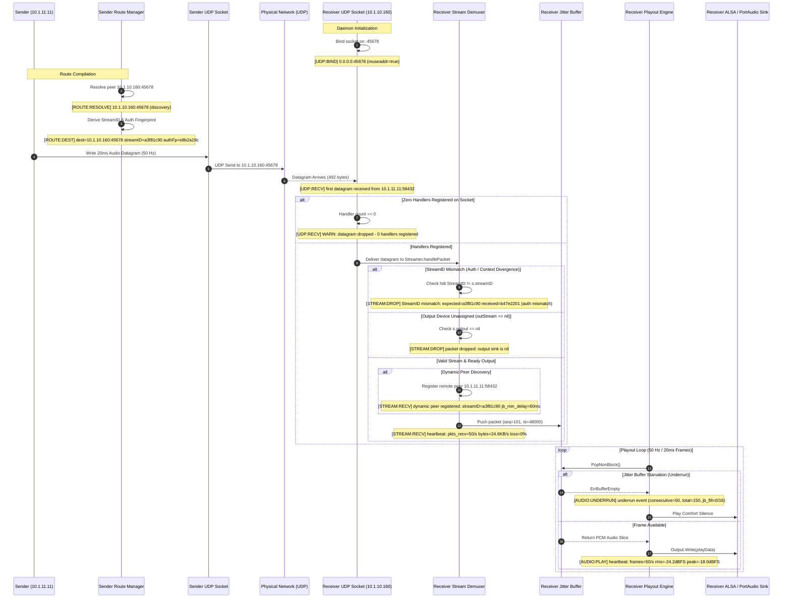

# ADR 0021: Cross-Node Audio Transport Observability, Symmetric StreamID Demuxing Diagnostics, and Real-Time Telemetry

* **Status:** Accepted
* **Deciders:** Core Systems Architecture Team, Real-Time Audio Infrastructure Engineering, Distributed Systems & Network Engineering
* **Date:** 2026-10-03

---

## Context and Problem Statement

In `audio-router-p2p`, multi-node clusters rely on CRDT-replicated state (ADR 0017), deterministic single-node/multi-node leader consensus (ADR 0020), and UDP/RTP datagram streaming (ADR 0001, ADR 0004) to transport real-time low-latency audio across physical nodes. 

### The Cross-Node Silent Audio Failure Incident

During cross-node field operations between physical sender node `10.1.11.11` (Node A) and receiver node `10.1.10.160` (Node B), a complete silent audio failure occurred:
1. Sender `10.1.11.11` captured audio from its local hardware interface and emitted UDP datagrams toward `10.1.10.160:45678`.
2. Receiver `10.1.10.160` registered an active ingress route and successfully opened its local PortAudio output device.
3. **No sound was rendered on the receiver's physical output, input/output UI signal meters remained at $-96.0\text{ dBFS}$ digital silence, and zero diagnostic logs, warnings, or errors were emitted on the receiver node.**

### Root Cause Analysis & Architectural Blind Spots

Deep architectural investigation into `pkg/transport/udp.go`, `cmd/client/main.go`, and `pkg/streamer/streamer.go` identified four compounding visibility blind spots across the networking and audio processing stack:

1. **UDP Socket Transport Layer Blind Spot (`pkg/transport/udp.go`)**:
   - The UDP transport bound the socket silently without logging the bound IP, ephemeral port, or OS buffer parameters (`SO_RCVBUF`, `SO_SNDBUF`).
   - The receive loop (`receiveLoop`) read datagrams from the kernel and iterated over registered handlers. If no handlers were registered (`len(t.handlers) == 0`), datagrams were dropped on the floor completely silently.
   - There was zero visibility into:
     - Socket bind parameters (`[UDP:BIND]`).
     - First datagram arrival milestone (`[UDP:RECV]`).
     - Cumulative ingress/egress packet and byte throughput.
     - Zero-handler drop events when packets arrived prior to route/demuxer attachment.

2. **Route Resolution & Destination Dispatch Blind Spot (`cmd/client/main.go`)**:
   - Sender route compilation resolved destination IP and port via discovery records (`streamer.ResolvePeerDestination`). When resolution fell back or selected a specific network interface, no log detailed the resolved socket address.
   - Stream identifiers were generated using `streamer.DeriveStreamID(m.cfg.AuthToken, route.ID)`. If the sender and receiver possessed divergent cluster authentication tokens (e.g. misconfigured environment variables or staging vs. production secrets) or mismatched route identifiers, divergent 16-byte StreamIDs were calculated.
   - The system provided no visibility into the resolved target destination (`[ROUTE:DEST]`), the peer resolution process (`[ROUTE:RESOLVE]`), or authentication token fingerprints (e.g. truncated SHA-256 hash), preventing engineers from verifying transport identity compatibility.

3. **Demuxing & Dynamic Ingress Registration Blind Spot (`pkg/streamer/streamer.go`)**:
   - In `Streamer.handlePacket(data, addr)`:
     ```go
     if hdr.StreamID != sid && sid != emptyID && !ok {
         return // not for us
     }
     ```
     If incoming datagrams carried a StreamID differing from the receiver's configured `s.streamID` (and the receiver was not in promiscuous mode), the packet was discarded silently with an empty return.
   - When dynamic peer allocation was attempted for unknown sender addresses:
     ```go
     if !ok {
         if outStream == nil {
             return
         }
         ...
     }
     ```
     If the local output stream was uninitialized or pending, incoming datagrams were discarded silently without emitting a diagnostic warning.
   - Dynamic peer registrations occurred without logging the remote peer address, stream ID, or jitter buffer provisioning parameters.

4. **Playout Engine, Jitter Buffer, & Hardware Sink Blind Spot (`pkg/streamer/streamer.go`)**:
   - In `Streamer.playout()`:
     ```go
     data, _, err := peer.JitterBuf.PopNonBlock()
     if err != nil {
         continue // underrun, silence
     }
     ```
     Jitter buffer underruns occurred silently on every 20ms tick (50 Hz), dropping through to silence without registering underrun metrics or emitting logs.
   - Real-time playout frame counts, active peer counts, and peak/RMS signal energy were not logged, leaving operators unable to differentiate between network starvation, clock drift compensation failure, and hardware driver starvation.

### The Real-Time Audio Threading Constraint

Implementing observability on audio streaming engines introduces severe real-time constraints:
- Real-time audio threads operate on strict 20ms cycles (50 Hz frame ticks).
- Heap memory allocations (`malloc` / Go GC escapes) on the hot path trigger garbage collection pauses that induce PortAudio and ALSA buffer underruns (XRuns).
- Synchronous logging (`fmt.Sprintf`, `log.Printf`, disk I/O, or console locks) causes thread preemption and mutex contention.
- Logging failures at full packet rates (50 Hz per stream) can generate thousands of log lines per second, swamping disk I/O and creating cascading audio latency.

Therefore, diagnostic logging and telemetry must satisfy zero-allocation guarantees on the hot path, employ lock-free atomic rate limiting on failure paths, decouple high-frequency metric collection from 1 Hz periodic heartbeats, and adhere to a strict structured log tagging taxonomy.

---

## Decision Drivers

* **End-to-End Layered Diagnostic Visibility**: Unambiguous visibility spanning the UDP socket layer, peer destination resolution, StreamID demuxing, jitter buffer scheduling, and hardware playout.
* **Zero-Allocation Audio Hot-Path (0 B/op at 50 Hz)**: Instrumenting packet receipt, demux filtering, jitter queueing, and playout loops must not allocate heap memory or invoke GC on nominal paths.
* **Lock-Free Rate Limiting on Failure Paths**: Under persistent failure conditions (e.g. continuous StreamID mismatch or buffer underruns at 50 Hz), error logging must be suppressed using lock-free atomic token-bucket or timestamp-threshold mechanisms to prevent log storms.
* **Decimated 1 Hz Periodic Heartbeats**: Steady-state audio streaming and transport throughput must be reported periodically at 1 Hz, providing ongoing proof-of-life and performance metrics without stdout lock contention.
* **Cryptographic & Identity Transparency**: Route synthesis and transport demuxing must log authentication token fingerprints (truncated SHA-256) and StreamID short-hex strings to immediately expose identity mismatches.
* **Standardized Subsystem Tagging Taxonomy**: Structured log tags (`[UDP:BIND]`, `[UDP:SEND]`, `[UDP:RECV]`, `[ROUTE:RESOLVE]`, `[ROUTE:DEST]`, `[STREAM:RECV]`, `[STREAM:DROP]`, `[AUDIO:PLAY]`, `[AUDIO:UNDERRUN]`) must be strictly applied across the codebase for automated alerting, regex parsing, and log ingestion.

---

## Considered Options

### Option 1: Ad-Hoc Synchronous Debug Logging (Unconditional `log.Printf`)
* **Description**: Add standard `log.Printf` calls directly within `handlePacket`, `receiveLoop`, and `playout` whenever packets arrive, drops occur, or buffer underruns are encountered.
* **Pros**:
  - Trivial to implement.
  - Zero state management.
* **Cons**:
  - **Severe Real-Time Degradation**: At 50 Hz, emitting logs on packet ingress or underrun floods stdout, triggering OS console locks and Go runtime mutex contention.
  - **Catastrophic Allocation Overhead**: `log.Printf` and `fmt.Sprintf` allocate heap memory on every call, forcing GC cycles that cause immediate audio stutter and PortAudio buffer underflows.
  - **Log Volume Explosion**: A single dropped stream produces 3,000 log lines per minute; a 10-node cluster produces tens of thousands of lines per minute, exhausting disk storage.

### Option 2: Out-of-Process OpenTelemetry / eBPF Sidecar Probe
* **Description**: Deploy an independent daemon using eBPF socket filters or OpenTelemetry collectors to trace UDP socket operations and inspect packet headers externally.
* **Pros**:
  - Completely out-of-process; minimal code alterations within the audio Go runtime.
  - Standard enterprise observability format.
* **Cons**:
  - **Zero Domain Visibility**: eBPF cannot inspect internal Go runtime state such as StreamID demuxing state, dynamic `s.peers` maps, jitter buffer fill levels, ASRC resampler ratios, or PortAudio device write handles.
  - **Operational Complexity**: Requires root privileges (`CAP_BPF`, `CAP_SYS_ADMIN`), kernel header dependencies, and external daemon supervision on physical audio appliances.
  - Does not resolve internal routing and stream management race conditions.

### Option 3 (Selected): In-Engine Zero-Allocation Observability Architecture with Atomic Rate Limiting, Decimated 1 Hz Heartbeats, and Canonical Subsystem Tagging
* **Description**:
  1. **Lock-Free Diagnostic Infrastructure**: Embed atomic counters (`atomic.Uint64`) and atomic nanosecond timestamps (`atomic.Int64`) directly into `UDPTransport`, `Streamer`, and `RemotePeer` structs.
  2. **Zero-Allocation Hot-Path Metrics**: Update packet counters, byte counters, underrun counts, and loss metrics using atomic primitives ($0\text{ B/op}$, zero lock contention).
  3. **Lock-Free Failure Rate Limiting**: Guard all failure log paths (`[STREAM:DROP]`, `[AUDIO:UNDERRUN]`, zero-handler drops) with lock-free atomic timestamp comparators, guaranteeing immediate logging of the 1st failure event followed by strict 1 Hz rate-limited summaries.
  4. **Decimated 1 Hz Heartbeats**: Run background 1 Hz tickers per transport and stream to emit aggregated throughput, active peer counts, jitter buffer delays, and playout frame statistics.
  5. **Cryptographic & Route Resolution Transparency**: Log resolved destinations, IP/port pairings, route IDs, StreamID hex values, and SHA-256 auth token fingerprints during route initialization.
  6. **Canonical Tagging Standard**: Enforce standard prefix tags (`[UDP:BIND]`, `[UDP:SEND]`, `[UDP:RECV]`, `[ROUTE:RESOLVE]`, `[ROUTE:DEST]`, `[STREAM:RECV]`, `[STREAM:DROP]`, `[AUDIO:PLAY]`, `[AUDIO:UNDERRUN]`).
* **Pros**:
  - Guarantees $0\text{ B/op}$ allocation on the 50 Hz nominal audio path.
  - Eliminates log flooding while preserving instantaneous visibility of the initial failure event.
  - Exposes exact root causes of cross-node silence (StreamID divergence, unassigned output, zero registered handlers, buffer starvation).
  - Integrates seamlessly with existing WebSocket telemetry hubs and WebUI canvas meters.
* **Cons**:
  - Minor increase in struct footprint (approx. 64 bytes of atomic counters per transport and peer).
  - Requires disciplined developer adherence to logging guidelines and rate-limiting patterns.

---

## Decision Outcome

Chosen Option: **Option 3: In-Engine Zero-Allocation Observability Architecture with Atomic Rate Limiting, Decimated 1 Hz Heartbeats, and Canonical Subsystem Tagging**.

### Architectural Specifications

#### 1. Standardized Diagnostic Log Taxonomy & Contract

The following structured log tags are established as the canonical contract for cross-node transport and stream diagnostics:

| Subsystem Tag | Layer Scope | Trigger Conditions | Frequency / Rate Limit | Required Metadata Fields |
| :--- | :--- | :--- | :--- | :--- |
| `[UDP:BIND]` | Socket Transport | Socket creation, address resolution, socket option configuration. | One-shot on socket bind. | `local_addr`, `reuseaddr`, `rcvbuf`, `sndbuf`. |
| `[UDP:SEND]` | Socket Transport | Outbound datagram dispatch, transport send errors. | 1 Hz heartbeat / Instant on 1st error (rate-limited). | `dest_addr`, `bytes`, `pkts_sent`, `errors`. |
| `[UDP:RECV]` | Socket Transport | First packet arrival milestone, 1 Hz throughput heartbeat, zero-handler drops. | Milestone (1st pkt), 1 Hz heartbeat, 1 Hz drop summary. | `src_addr`, `bytes`, `pkts_recv`, `handler_count`, `dropped_pkts`. |
| `[ROUTE:RESOLVE]` | Control Plane / Discovery | Peer discovery address resolution, fallback selection. | On route start / mutation. | `route_id`, `peer_id`, `resolved_addr`, `mode` (discovery/direct/fallback). |
| `[ROUTE:DEST]` | Route Manager | Destination address binding, identity & stream parameter synthesis. | On route start / mutation. | `route_id`, `dest_addr`, `stream_id_hex`, `auth_fingerprint`, `sr`, `ch`. |
| `[STREAM:RECV]` | Stream Demuxer | First packet for stream, dynamic peer registration, 1 Hz stream heartbeat. | Milestone (1st pkt), On peer add, 1 Hz heartbeat. | `stream_id_hex`, `src_addr`, `peer_id`, `seq`, `jb_depth_ms`. |
| `[STREAM:DROP]` | Stream Demuxer | StreamID mismatch, nil output sink, handler capacity overflow, corrupt header. | 1st event instant, then rate-limited to $\le 1\text{ Hz}$. | `expected_id_hex`, `received_id_hex`, `src_addr`, `reason`, `drop_count`. |
| `[AUDIO:PLAY]` | Playout / Hardware | Hardware write operations, 1 Hz playout performance heartbeat. | 1 Hz heartbeat / On stream start/stop. | `stream_id_hex`, `frames_played`, `active_peers`, `rms_dbfs`, `peak_dbfs`. |
| `[AUDIO:UNDERRUN]`| Jitter Buffer / Playout | Buffer underflow during non-blocking pop, hardware write underrun (XRun). | 1st event instant, then rate-limited to $\le 1\text{ Hz}$. | `stream_id_hex`, `peer_addr`, `consecutive_underruns`, `drift_ratio`, `jb_fill`. |

---

#### 2. Transport Layer Architecture (`pkg/transport/udp.go`)

To eliminate the UDP socket blind spot, `UDPTransport` is enhanced with atomic operational counters and lifecycle observability hooks:

```go
type UDPTransport struct {
    mu       sync.Mutex
    conn     *net.UDPConn
    closed   atomic.Bool
    recvDone chan struct{}
    recvOnce sync.Once

    handlers map[uint64]func([]byte, *net.UDPAddr)
    nextID   uint64

    // Observability & Telemetry Primitives (Zero-Allocation on hot path)
    packetsSent     atomic.Uint64
    bytesSent       atomic.Uint64
    sendErrors      atomic.Uint64
    packetsRecv     atomic.Uint64
    bytesRecv       atomic.Uint64
    zeroHandlerDrop atomic.Uint64

    firstPacketOnce sync.Once
    lastDropLogNano atomic.Int64 // Lock-free rate limiter for zero-handler drops
}
```

##### Socket Initialization (`[UDP:BIND]`)
When `NewUDPTransport(listenAddr)` binds a socket:
1. `SO_REUSEADDR` is asserted and confirmed.
2. The resolved listening address is extracted from `conn.LocalAddr()`.
3. The initialization parameters are logged immediately:
   ```text
   [UDP:BIND] listening on 0.0.0.0:45678 (reuseaddr=true, socket=udp4)
   ```

##### Receive Loop & Zero-Handler Dropping (`[UDP:RECV]`)
Within `receiveLoop`:
1. Upon receiving the first physical datagram, `firstPacketOnce.Do` emits an instantaneous milestone log:
   ```text
   [UDP:RECV] first datagram received from 10.1.11.11:58432 (len=492 bytes)
   ```
2. Atomically increment `packetsRecv` and `bytesRecv`.
3. Read handler count under read lock (or atomic slice snapshot). If `len(t.handlers) == 0`:
   - Atomically increment `zeroHandlerDrop`.
   - Execute lock-free rate-limiting: if `now - lastDropLogNano > 1*time.Second`, atomically update `lastDropLogNano` via CAS and emit:
     ```text
     [UDP:RECV] WARN: datagram dropped - 0 handlers registered (src=10.1.11.11:58432, cumulative_drops=50)
     ```
4. A decoupled background 1 Hz heartbeat goroutine logs cumulative socket metrics:
   ```text
   [UDP:RECV] heartbeat: pkts_recv=50/s (total=1500), bytes_recv=24.6KB/s, active_handlers=1, dropped_no_handler=0
   ```

---

#### 3. Route Synthesis & Identity Fingerprinting (`cmd/client/main.go`)

To prevent identity divergence and address misconfiguration:

1. **Authentication Token Fingerprinting**:
   The client computes a deterministic, non-reversible 8-character hex fingerprint of the cluster authentication token:
   $$\text{AuthFingerprint} = \text{Hex}(\text{SHA256}(\text{AuthToken}))[0:8]$$
2. **Deterministic StreamID Visibility**:
   The 16-byte `StreamID` is derived via `streamer.DeriveStreamID(token, routeID)`. The client formats this as a 16-character short hex representation:
   $$\text{StreamIDShort} = \text{Hex}(\text{StreamID})[0:16]$$
3. **Structured Destination Logging (`[ROUTE:RESOLVE]`, `[ROUTE:DEST]`)**:
   During `StartRoute`:
   - If resolving a remote peer:
     ```text
     [ROUTE:RESOLVE] peer 983d45fc200d resolved to 10.1.10.160:45678 via discovery (cached=true)
     ```
   - When binding route parameters:
     ```text
     [ROUTE:DEST] route=route-mic-to-spk dest=10.1.10.160:45678 streamID=a3f81c90e2b4510d authFp=e8b2a19c sr=48000 ch=2
     ```
   - For ingress routes on the receiving node:
     ```text
     [ROUTE:DEST] ingress route=route-mic-to-spk expecting streamID=a3f81c90e2b4510d authFp=e8b2a19c binding local output="hw:Loopback,1"
     ```

---

#### 4. Symmetric StreamID Demuxing & Dynamic Ingress Diagnostics (`pkg/streamer/streamer.go`)

In `Streamer.handlePacket`, every packet rejection or dynamic registration path is instrumented with lock-free diagnostics:

```
+-----------------------------------------------------------------------------------------+
|                              Incoming UDP Datagram (50 Hz)                               |
+-----------------------------------------------------------------------------------------+
                                             |
                                             v
                           +-----------------------------------+
                           |    transport.Unmarshal(data)      |
                           +-----------------------------------+
                                     /               \
                             [Success]               [Corrupt Header]
                                   /                   \
                                  v                     v
                +----------------------------+   [STREAM:DROP] rate-limited
                | Compare StreamID vs SID    |   "corrupt packet header"
                +----------------------------+
                     /                  \
            [Matches sid /           [Mismatch & Not
             Promiscuous]             Known Peer]
                  /                        \
                 v                          v
    +---------------------------+    [STREAM:DROP] lock-free rate-limited:
    | Peer exists in s.peers?   |    "StreamID mismatch: expected=a3f81c90...,
    +---------------------------+     received=b47e2201..., drops=50"
         /                \
      [Yes]               [No]
       /                    \
      v                      v
[Normal Ingress]    +----------------------------------+
                    | Check s.output != nil            |
                    +----------------------------------+
                         /                        \
                    [Output Non-Nil]         [Output Nil]
                           /                        \
                          v                          v
             [STREAM:RECV] "dynamic peer    [STREAM:DROP] rate-limited:
              registration: addr=10.1.11.11" "cannot register peer: local
                                             output is nil"
```

##### StreamID Mismatch Diagnostics (`[STREAM:DROP]`)
When `hdr.StreamID != sid && sid != emptyID && !ok`:
- Atomically increment `s.demuxDropsStreamID`.
- Check lock-free rate limiter (`s.lastDemuxDropLogNano`). If interval $\ge 1\text{ s}$:
  ```text
  [STREAM:DROP] StreamID mismatch from 10.1.11.11:58432: expected=a3f81c90e2b4510d received=b47e220199cf810a (drops=50, auth_fingerprint_mismatch?)
  ```

##### Dynamic Peer Allocation & Output Verification (`[STREAM:RECV]`, `[STREAM:DROP]`)
When a new peer address arrives:
1. If `outStream == nil`:
   - Atomically increment `s.demuxDropsNilOutput`.
   - Rate-limited log emission:
     ```text
     [STREAM:DROP] packet dropped from 10.1.11.11:58432: streamer output sink is nil (streamID=a3f81c90e2b4510d, drops=50)
     ```
2. If `len(s.peers) >= maxDynamicPeers`:
   - Rate-limited log emission:
     ```text
     [STREAM:DROP] peer table overflow (capacity=64): dropping packet from 10.1.11.11:58432
     ```
3. On successful dynamic peer instantiation:
   ```text
   [STREAM:RECV] dynamic peer registered: addr=10.1.11.11:58432 streamID=a3f81c90e2b4510d jb_min_delay=60ms fec_group=4 asrc=enabled
   ```

---

#### 5. Playout Engine, Jitter Buffer, & Hardware Output Observability

To monitor real-time audio consumption without introducing audio thread preemption:

##### Lock-Free Buffer Underrun Tracking (`[AUDIO:UNDERRUN]`)
In `Streamer.playout()`, when `peer.JitterBuf.PopNonBlock()` returns an underrun error:
1. Atomically increment `peer.underruns`.
2. Increment `peer.consecutiveUnderruns`.
3. Check atomic timestamp `peer.lastUnderrunLogNano`. If elapsed $\ge 1000\text{ ms}$:
   ```text
   [AUDIO:UNDERRUN] peer=10.1.11.11:58432 underrun event (consecutive=50, total=150, jb_fill=0/16, drift_ratio=1.000000)
   ```

##### 1 Hz Playout Heartbeat (`[AUDIO:PLAY]`)
A dedicated 1 Hz ticker in the playout subsystem evaluates active playout statistics:
```text
[AUDIO:PLAY] heartbeat: streamID=a3f81c90e2b4510d active_peers=1 frames_played=50/s (1000ms audio) rms=-24.2dBFS peak=-18.0dBFS underruns=0
```
If PortAudio or ALSA output fails on `peer.Output.Write(playData)`:
```text
[AUDIO:PLAY] ERROR: output.Write failed to write 1920 bytes: PortAudio buffer underflow (PaErrorCode -9988)
```

---

#### 6. Lock-Free Atomic Rate Limiting Algorithm

To guarantee zero allocations and zero mutex contention when suppressing repetitive 50 Hz error logs, the following lock-free rate limiter pattern is enforced across all hot-path error branches:

```go
// ShouldLogRateLimited evaluates whether a rate-limited log should be emitted.
// It executes with 0 heap allocations and zero mutex locks.
func ShouldLogRateLimited(lastLogNano *atomic.Int64, intervalNano int64, nowNano int64) bool {
    last := lastLogNano.Load()
    if nowNano-last < intervalNano {
        return false
    }
    return lastLogNano.CompareAndSwap(last, nowNano)
}
```

* **First Failure Guarantee**: `lastLogNano` is initialized to 0. When the very first failure occurs at $T_0$, $T_0 - 0 > \text{intervalNano}$, causing the CAS to succeed immediately and guaranteeing immediate visibility of the initial error.
* **Lock-Free Concurrency**: If multiple goroutines hit errors concurrently, exactly one CAS succeeds per interval; other goroutines fall through silently with zero thread suspension.
* **Zero Allocation**: Takes atomic pointer and int64 primitives by value; does not escape to heap.

---

## Complete Sequence Diagram: Cross-Node Streaming & Observability Trace



---

## State & Data Flow: Lock-Free Audio Path vs. Decimated Telemetry

```mermaid
flowchart TD
    subgraph AudioHotPath ["Real-Time Audio Hot-Path (50 Hz - Zero Allocations)"]
        UDPIn["UDP Datagram Ingress"] --> Unmarshal["transport.Unmarshal(data)"]
        Unmarshal --> StreamCheck{"StreamID == sid?"}
        
        StreamCheck -- "No" --> DropAtomic["atomic.AddUint64(drops, 1)"]
        DropAtomic --> CASDrop{"CAS(lastDropLogNano)"}
        CASDrop -- "Passed (1s elapsed)" --> LogDrop["[STREAM:DROP] Log Mismatch"]
        CASDrop -- "Suppressed (< 1s)" --> SilentDrop["Drop Datagram Silently"]
        
        StreamCheck -- "Yes" --> PeerReg{"Peer Registered?"}
        PeerReg -- "No & out!=nil" --> RegPeer["[STREAM:RECV] Register Peer"]
        PeerReg -- "Yes" --> PushJB["peer.JitterBuf.Push()"]
        RegPeer --> PushJB
        
        PushJB --> PopJB["peer.JitterBuf.PopNonBlock()"]
        PopJB -- "Starved" --> UnderrunAtomic["atomic.AddUint64(underruns, 1)"]
        UnderrunAtomic --> CASUnder{"CAS(lastUnderLogNano)"}
        CASUnder -- "Passed (1s elapsed)" --> LogUnder["[AUDIO:UNDERRUN] Log Starvation"]
        CASUnder -- "Suppressed (< 1s)" --> PlaySilence["Render Silence"]
        
        PopJB -- "Audio Ready" --> ASRCProc["DSP Resampling & Normalization"]
        ASRCProc --> AudioWrite["peer.Output.Write(playData)"]
        AudioWrite --> CountFrames["atomic.AddUint64(framesPlayed, 1)"]
    end

    subgraph TelemetryBackground ["Decoupled Observability Plane (1 Hz Decimation)"]
        Ticker1Hz["1 Hz Background Ticker"] --> CollectUDP["Read UDP Atomic Counters"]
        Ticker1Hz --> CollectStream["Read Stream Atomic Counters"]
        Ticker1Hz --> CollectAudio["Read Playout & Meter Energy"]
        
        CollectUDP --> HeartbeatUDP["[UDP:RECV] / [UDP:SEND] 1 Hz Heartbeat"]
        CollectStream --> HeartbeatStream["[STREAM:RECV] 1 Hz Throughput Heartbeat"]
        CollectAudio --> HeartbeatAudio["[AUDIO:PLAY] 1 Hz Playout & Meter Heartbeat"]
        
        CollectAudio --> HubBroadcast["api/telemetry.Hub WebSocket Broadcast"]
    end
```



---

## Consequences

### Positive Consequences

* **Instantaneous Root-Cause Pinpointing**: Engineers and automated diagnostics can isolate cross-node audio failures in seconds by observing the specific tag emitted:
  - Missing `[UDP:RECV]` on receiver $\rightarrow$ Physical firewall / NAT / routing failure between 10.1.11.11 and 10.1.10.160.
  - `[UDP:RECV]` zero-handler drops $\rightarrow$ Race condition where network packets arrive before the stream manager attaches the ingress streamer to the transport.
  - `[STREAM:DROP]` StreamID mismatch $\rightarrow$ Authentication token divergence or mismatched route IDs between sender and receiver.
  - `[STREAM:DROP]` nil output sink $\rightarrow$ Hardware audio output device unavailable or misconfigured on receiver.
  - Continuous `[AUDIO:UNDERRUN]` $\rightarrow$ Excessive clock drift, packet loss, or network jitter buffer sizing mismatch.
* **Deterministic Hot-Path Performance**: $0\text{ B/op}$ heap allocation on 50 Hz audio threads prevents Go garbage collection cycles from inducing real-time ALSA/PortAudio buffer underruns.
* **Lock Contention Immunity**: Using atomic CAS primitives for rate limiting ensures that audio threads never block on logging mutexes or console I/O.
* **Log Ingestion Hygiene**: 1 Hz rate-limiting on failure paths and 1 Hz steady-state heartbeats cap log generation to predictable, manageable volumes, preventing disk exhaustion during network faults.
* **Operational Uniformity**: Standardized tags enable simple grep filters (`grep '\[STREAM:DROP\]'`, `grep '\[AUDIO:UNDERRUN\]'`) for operators and CI/CD automated validation suites.

### Negative Consequences & Mitigations

* **Memory Footprint Overhead**:
  - *Impact*: Adding atomic counters and timestamp tracking increases the memory footprint of `UDPTransport`, `Streamer`, and `RemotePeer`.
  - *Mitigation*: The memory increase is negligible (approx. 64 to 128 bytes per structure), which is completely insignificant relative to the 64 KB datagram buffers and audio PCM queues.
* **Developer Discipline & Code Rigor**:
  - *Impact*: Engineers modifying the streaming engine might accidentally introduce synchronous `log.Printf` statements on hot paths, breaking zero-allocation guarantees.
  - *Mitigation*: Enforce automated linting rules and CI benchmark tests (`testing.AllocsPerRun`) on audio hot paths to fail builds if allocations $> 0$ are introduced.

### Neutral Consequences

* Telemetry schemas published over the WebUI WebSocket (`/api/v1/telemetry/ws`) now include granular transport and demuxing counters, enriching the multi-node flow canvas diagnostic inspector.

---

## Implementation & Verification Plan

1. **Phase 1: UDP Transport Instrumentation**:
   - Update `pkg/transport/udp.go` with atomic counters (`packetsRecv`, `bytesRecv`, `zeroHandlerDrop`, `lastDropLogNano`).
   - Add `[UDP:BIND]` log upon socket binding and `[UDP:RECV]` first-packet milestone and zero-handler drop rate limiter.
2. **Phase 2: Stream Manager & Route Identity Fingerprinting**:
   - Update `cmd/client/main.go` to compute and log 8-char auth token SHA-256 fingerprints and 16-char StreamID hex values via `[ROUTE:DEST]` and `[ROUTE:RESOLVE]`.
3. **Phase 3: Streamer Demuxing & Rate-Limited Diagnostics**:
   - Update `pkg/streamer/streamer.go` `handlePacket` to emit rate-limited `[STREAM:DROP]` logs for StreamID mismatches and uninitialized output sinks.
   - Add `[STREAM:RECV]` dynamic peer registration logging.
4. **Phase 4: Playout & Jitter Buffer Observability**:
   - Instrument `Streamer.playout()` with rate-limited `[AUDIO:UNDERRUN]` alerts and 1 Hz `[AUDIO:PLAY]` heartbeats.
5. **Phase 5: Automated E2E Verification**:
   - Add integration tests verifying that intentional StreamID mismatches and port misconfigurations produce exact structured diagnostic tags without leaking memory allocations.
