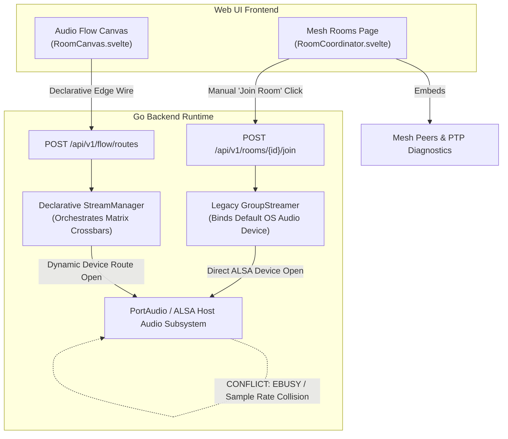
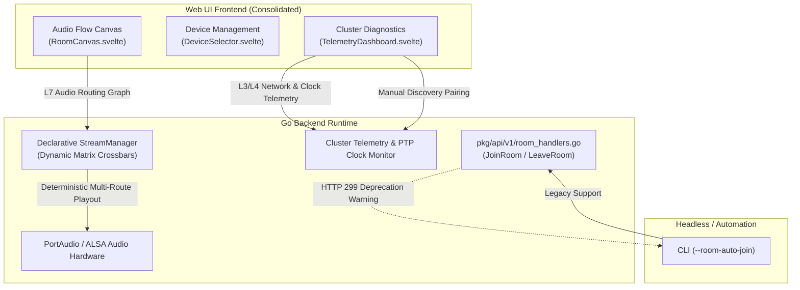

# ADR 0022: Deprecate Legacy Manual Room Streamers and Retire Mesh Rooms Page in Favor of Declarative Audio Flow Synthesis

* **Status:** Accepted
* **Deciders:** Core Systems Architecture Team, Real-Time Audio Infrastructure Engineering, Frontend/UX Engineering
* **Date:** 2026-10-03

---

## Context and Problem Statement

In earlier iterations of `audio-router-p2p`, distributed room collaboration was modeled around an imperative "Join Room / Leave Room" workflow. The Web UI exposed a dedicated "Mesh Rooms" view (`RoomCoordinator.svelte`) accessible via the primary navigation header (`Header.svelte`). From this interface, users could manually click "Join Room" or "Leave Room", trigger room creation, inspect discovered mesh peers, monitor PTP clock synchronization, and invoke manual peer pairing via IP/port.

Under the hood, clicking "Join Room" invoked the REST endpoint:
```http
POST /api/v1/rooms/{id}/join
```
This endpoint instantiated and engaged a legacy `GroupStreamer` backend (`pkg/streamer/group_streamer.go`), which bound the host operating system's default audio input and output devices directly to the room's shared RTP multicast/unicast group.

### The Evolution to Declarative Audio Flow Synthesis

The system's core audio processing engine has fundamentally evolved to a declarative, node-graph crossbar routing architecture (ADR 0006, ADR 0012, ADR 0018, ADR 0020). On the "Audio Flow" canvas (`RoomCanvas.svelte`):
1. Operators declaratively connect persistent hardware/virtual endpoints (`URN`-qualified audio capture and playout devices; ADR 0013) to room bus nodes.
2. In-memory and CRDT-synchronized state transitions trigger `Room.recompileRoutesLocked()`, compiling intra-node and cross-node matrix crossbars.
3. The underlying `StreamManager` dynamically spawns, manages, and terminates point-to-point real-time streams (`StartRoute`/`StopRoute`), dynamically orchestrating sample rate adaptation (ADR 0019), packetization, jitter buffering, and FEC/PLC (ADR 0004).

### The Split-Brain Dilemma & Hardware Lock Contention

Operating both the legacy imperative "Join Room" mechanism and the declarative "Audio Flow" canvas concurrently introduced severe operational liabilities:

1. **Split-Brain User Experience & Mental Model Incoherence**:
   Users faced two competing paradigms for streaming audio:
   - The *Imperative Paradigm* ("Mesh Rooms" tab): Click "Join Room" to attach the system's global default microphone and speaker to a room bus.
   - The *Declarative Paradigm* ("Audio Flow" tab): Drag wires between specific device URNs and room buses to orchestrate exact routing channels.
   Operators frequently joined a room via "Mesh Rooms" while simultaneously configuring edge connections on the "Audio Flow" canvas, creating ambiguous routing states where operators could not deduce which pipeline was responsible for transmitted signal energy.

2. **Operating System Audio Device Lock Contention (ALSA `EBUSY`)**:
   When `POST /api/v1/rooms/{id}/join` spun up a `GroupStreamer`, it opened exclusive or non-shareable ALSA / PortAudio device handles on the host's default audio interface. When the declarative `StreamManager` subsequently attempted to compile crossbar routes for specific local hardware devices, capture initialization failed with `EBUSY: Device or resource busy` or experienced unrecoverable hardware sample-rate mismatches.

3. **Layer Violations (L3/L4 Network Infrastructure vs. L7 Audio Routing)**:
   `RoomCoordinator.svelte` commingled high-level room audio routing controls with low-level network infrastructure primitives (PTP clock alignment, remote peer manual pairing, memberlist cluster membership). Placing transport-layer diagnostics inside an audio room coordinator obfuscated node diagnostics.

4. **Redundant Client-Side Polling and Overhead**:
   `RoomCoordinator.svelte` maintained high-frequency polling intervals for room listings, peer discovery, and PTP offsets, competing with the WebSocket/polling loops on the Flow Canvas and Telemetry Dashboard, consuming unnecessary network and CPU cycles.

---

## Decision Drivers

* **Single Source of Truth for Audio Routing**: The declarative node-graph canvas (`RoomCanvas.svelte`) backed by `Room.recompileRoutesLocked()` and `StreamManager` must be the exclusive mechanism for audio routing in the UI.
* **Hardware Device Exclusivity & ALSA Stability**: Prevent dual-streamer device contention and ALSA `EBUSY` race conditions by eliminating the UI trigger for imperative `GroupStreamer` attachment.
* **Clean Architectural Separation of Concerns**: Isolate L7 Audio Application Routing (Audio Flow canvas) from L3/L4 Transport & Discovery Infrastructure (Cluster Diagnostics / Telemetry Dashboard).
* **Zero-Regress Headless & Automation Compatibility**: Preserve backward compatibility for headless automation, legacy daemon scripts, and automated test runners leveraging CLI flags such as `--room-auto-join` or legacy REST endpoints.
* **Minimized Polling Overhead**: Eliminate redundant reactive poll loops in the frontend application shell.

---

## Considered Options

### Option 1: Maintain Dual Paradigms with UI Synchronization
* **Description**: Retain the "Mesh Rooms" page and synchronize its state with the "Audio Flow" canvas (e.g., clicking "Join Room" creates implicit canvas edges).
* **Pros**:
  - Retains the legacy "quick connect" button for casual single-device users.
* **Cons**:
  - **Extreme Architectural Complexity**: Bidirectional reconciliation between imperative UI buttons and declarative directed acyclic graph (DAG) route compilation is error-prone.
  - **Persistent ALSA Contention**: Implicit device bindings risk hijacking devices required by explicit canvas routes.
  - **UX Confusion**: Fails to resolve the split-brain mental model for multi-node deployments.

### Option 2: Full Immediate Hard Deletion of Legacy Endpoints and UI
* **Description**: Delete `RoomCoordinator.svelte`, remove the UI tab, and immediately remove `POST /api/v1/rooms/{id}/join` and `DELETE /api/v1/rooms/{id}/leave` from the backend API router.
* **Pros**:
  - Absolute code eradication of unused paths.
  - Cleanest backend surface area.
* **Cons**:
  - **Breaking Change for Headless Infrastructure**: Breaks existing automated scripts, CLI instances launched with `--room-auto-join`, and third-party orchestration agents relying on `/api/v1/rooms/{id}/join`.

### Option 3 (Selected): Retire "Mesh Rooms" Page, Migrate Peer Ops to Telemetry Dashboard, and Deprecate Backend Endpoints with HTTP 299 Warnings
* **Description**:
  1. Remove the `rooms` tab from `Header.svelte` and route dispatch in `App.svelte`.
  2. Permanently delete `RoomCoordinator.svelte`.
  3. Relocate "Pair Remote Peer" and "Discovered Mesh Peers & PTP Clock Alignment" tables to `TelemetryDashboard.svelte` under the Cluster Diagnostics view.
  4. Retain `POST /api/v1/rooms/{id}/join` and `DELETE /api/v1/rooms/{id}/leave` in `pkg/api/v1/room_handlers.go`, but mark them deprecated by emitting RFC 7234 / RFC 9110 HTTP `Warning: 299 - "JoinRoom is deprecated; use declarative Audio Flow routes"` headers and structured deprecation log warnings.
* **Pros**:
  - Eliminates all frontend ambiguity and accidental ALSA device lock collisions.
  - Places L3/L4 mesh discovery and PTP synchronization where operators expect them: within Cluster Diagnostics.
  - Zero breaking changes for headless CLI environments and legacy API consumers.
* **Cons**:
  - Backend must maintain legacy handler wrappers until the next major API version (v2).
  - Minor increase in scope for `TelemetryDashboard.svelte`.

---

## Decision Outcome

**Chosen Option: Option 3.**

### Detailed Implementation Specifications

#### 1. Frontend Shell & Navigation Refactoring
- **`ui/src/components/Header.svelte`**:
  - The navigation item for `rooms` (`Mesh Rooms`) is deleted. The primary navigation is consolidated strictly around `Flow` (`Audio Flow`), `Devices` (`Audio Devices`), and `Telemetry` (`Diagnostics`).
- **`ui/src/App.svelte`**:
  - Import of `RoomCoordinator.svelte` is removed.
  - The conditional block `{:else if currentTab === 'rooms'}` is deleted. Default fallback routes redirect directly to `'flow'`.
- **`ui/src/components/RoomCoordinator.svelte`**:
  - The file is deleted from source control.

#### 2. Network Infrastructure Relocation to Telemetry Dashboard
- In `ui/src/components/TelemetryDashboard.svelte`:
  - An infrastructure diagnostics panel ("Cluster Network & PTP Synchronization") is integrated.
  - The "Pair Remote Peer" modal and the reactive "Discovered Mesh Peers & PTP Clock Alignment" table are housed here.
  - Operators can inspect remote node IP/port resolution, memberlist gossip state, and hardware/software PTP clock drift without entering an audio routing view.

#### 3. Backend Graceful Deprecation Contract
- In `pkg/api/v1/room_handlers.go`:
  - `JoinRoom` (`POST /api/v1/rooms/{id}/join`) and `LeaveRoom` (`DELETE /api/v1/rooms/{id}/leave`) are maintained.
  - Responses include standard deprecation headers:
    ```http
    Warning: 299 - "POST /api/v1/rooms/{id}/join is deprecated and will be removed in v2.0.0. Configure routes declaratively via the Audio Flow engine."
    Deprecation: @1759449600
    Link: </api/v1/docs/adr/0022>; rel="deprecation"
    ```
  - Backend emits structured warning logs:
    ```
    [DEPRECATION] Client invoked legacy JoinRoom endpoint: room_id=%s remote_addr=%s. Migrate to declarative Audio Flow routing.
    ```
  - Headless CLI daemons operating with `--room-auto-join` continue functioning without runtime termination.

---

## Architecture Diagrams

### Before: Dual Imperative and Declarative Topologies



### After: Unified Declarative Architecture with Clean Domain Separation



---

## Consequences

### Positive Consequences

* **Elimination of ALSA Hardware Contention**: Prevents accidental simultaneous instantiation of `GroupStreamer` and `StreamManager` on identical audio hardware devices, eliminating ALSA `EBUSY` runtime panics.
* **Unified Mental Model**: Operators have exactly one path for routing audio: the declarative "Audio Flow" node canvas.
* **Clean Layer Separation (L3/L4 vs. L7)**: Network topology, PTP synchronization, and node discovery reside under Diagnostics/Telemetry, while audio buses and device routing reside exclusively in Audio Flow.
* **Reduced Frontend Resource Utilization**: Eliminates recurring HTTP polling loops from `RoomCoordinator.svelte`, freeing browser CPU and network bandwidth for real-time VU meter streaming and canvas layout operations.
* **Unbroken Backward Compatibility**: Existing headless daemon deployments using CLI flags or automation scripts continue to function while receiving transparent HTTP 299 deprecation notices.

### Negative Consequences / Trade-offs

* **Loss of "One-Click Quick Join" Interface**: Operators cannot connect default system devices with a single button click; they must wire the capture device to the room bus on the Audio Flow canvas (or use default canvas templates).
* **Increased Telemetry Dashboard Scope**: `TelemetryDashboard.svelte` absorbs manual peer pairing modals and PTP alignment tables, slightly expanding its component surface.
* **Technical Debt Horizon**: Legacy `GroupStreamer` and `room_handlers.go` join/leave functions remain in the backend code tree until removal in `v2.0.0`.

---

## Implementation & Migration Plan

1. **Phase 1 (Complete)**:
   - Deprecate UI components: Remove `RoomCoordinator.svelte`, remove navigation link in `Header.svelte`, update routing in `App.svelte`.
   - Relocate PTP and peer pairing UI into `TelemetryDashboard.svelte`.
   - Inject HTTP 299 deprecation headers into `POST /api/v1/rooms/{id}/join` and `DELETE /api/v1/rooms/{id}/leave`.
2. **Phase 2 (v1.x Maintenance)**:
   - Monitor backend logs for occurrences of `[DEPRECATION] Client invoked legacy JoinRoom endpoint`.
   - Update headless CLI flags to synthesize declarative flow routes directly rather than calling `JoinRoom`.
3. **Phase 3 (v2.0.0 Sunset)**:
   - Remove `GroupStreamer` implementation from `pkg/streamer/`.
   - Drop `JoinRoom` and `LeaveRoom` endpoints from `pkg/api/v1/` routes.

---

## References

* **ADR 0006**: Room-Centric Distributed Audio Bus Engine
* **ADR 0012**: Flow Canvas Consolidation and Layout Persistence
* **ADR 0013**: Canonical Persistent Audio Device URNs
* **ADR 0017**: Distributed CRDT Groups, Cross-Node Routing, and Resilient WebUI
* **ADR 0018**: Canonical Node-Qualified Endpoints and Multi-Node Flow Canvas
* **ADR 0020**: Single-Node Room Ownership and Leader Consensus
* **ADR 0021**: Cross-Node Audio Transport Observability and Telemetry
* **RFC 7234 / RFC 9110**: HTTP Caching and Warning Header Field Specifications (Warning: 299)
