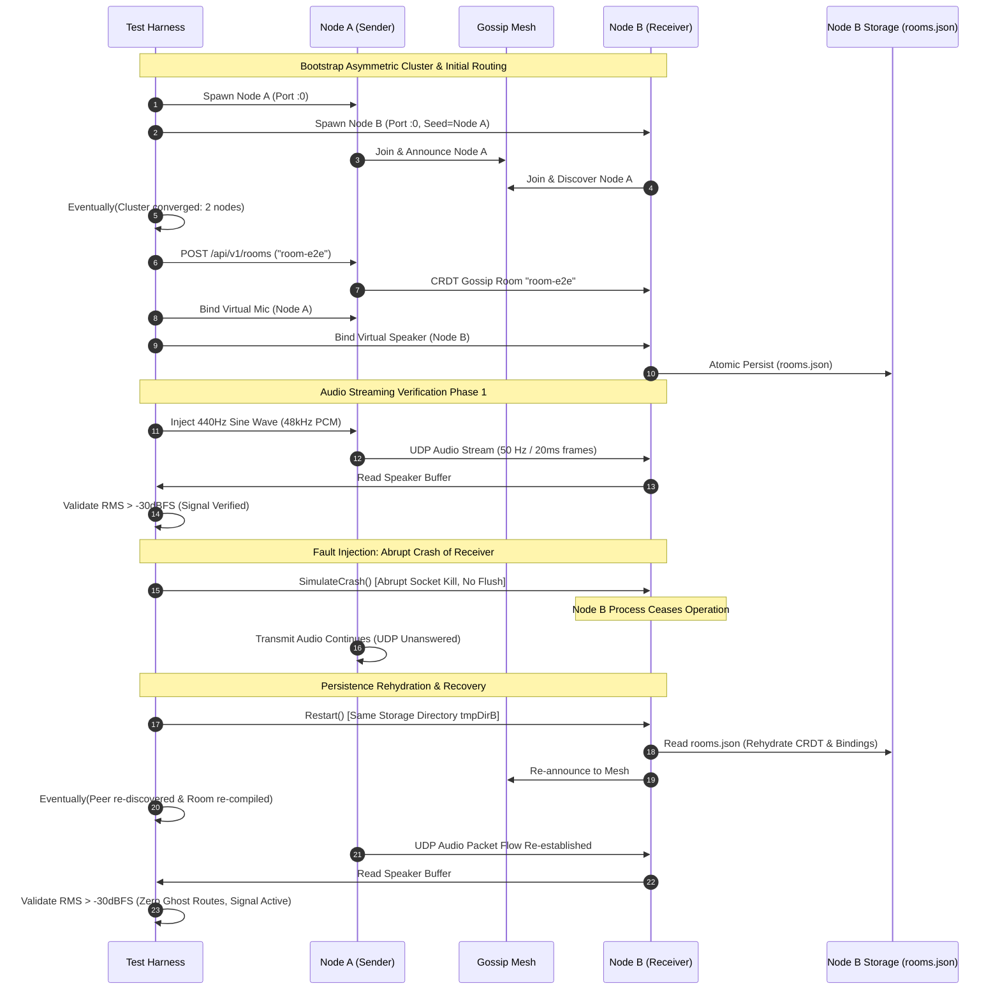

# ADR 0023: Deterministic End-to-End Test Suite for Network Audio Routing, CRDT Synchronization, and Crash-Resilience Persistence

* **Status:** Accepted
* **Deciders:** Core Systems Architecture Team, Real-Time Audio Infrastructure Engineering, QA & Reliability Engineering, Test Automation Guild
* **Date:** 2026-10-04

---

## Context and Problem Statement

The `audio-router-p2p` system is a distributed, peer-to-peer real-time audio routing platform. Its operations rely on the orchestration of multiple concurrent subsystems operating across varying timing domains:
1. **L3/L4 UDP Audio Transport**: Ultra-low latency streaming utilizing real-time packetization (20ms / 50 Hz frames), forward error correction (FEC), adaptive packet loss concealment (PLC), and jitter buffering (ADR 0001, ADR 0004, ADR 0021).
2. **Distributed Room State Engine**: Decentralized Conflict-Free Replicated Data Types (CRDTs) synchronized over peer discovery protocols (HashiCorp `memberlist`, ADR 0008, ADR 0017, ADR 0020).
3. **Dynamic Declarative Routing**: Runtime crossbar compilation mapping canonical device Uniform Resource Names (URNs; ADR 0013, ADR 0018) to room buses and peer endpoints via a REST API (ADR 0005, ADR 0022).
4. **Local State Persistence**: Disk-backed serialization (`routes.json`, `rooms.json`) designed to reconstitute active crossbar matrices, room topologies, and stream configurations across node reboot cycles.

### The Problem: Flakiness, Order-Dependent Heuristics, and Crash Regressions

As the distributed cross-node routing and room ownership capabilities expanded, test suites faced severe reliability and verification challenges under continuous integration (CI) environments:

1. **Flaky Synchronization and Sleep-Based Races**:
   Early end-to-end (E2E) integration tests relied heavily on empirical `time.Sleep(...)` intervals to wait for peer discovery gossip, CRDT state convergence, and UDP jitter buffer filling. Under resource-constrained or high-load CI virtual machines, fixed sleeps resulted in sporadic, non-deterministic test failures (false negatives), or bloated test execution runtimes when sleep timers were inflated to compensate.

2. **Order-of-Operations Vulnerabilities (Provisioning Permutations)**:
   In production, users and automation agents provision audio entities in arbitrary sequences:
   - Creating matrix routes before the referenced hardware or virtual devices are enumerated by the operating system.
   - Creating room output bindings before any input capture devices are registered.
   - Binding room inputs and outputs before the room coordinator establishes peer consensus.
   - Dynamically unbinding and rebinding audio streams mid-flight while 50 Hz UDP streams are actively transmitting packets.
   Naive linear tests failed to uncover latent deadlocks, `nil`-pointer dereferences, and audio graph stalls caused by atypical entity provisioning orders.

3. **Multi-Node Boot Asynchrony and Topology Divergence**:
   Physical appliances and edge containers do not boot concurrently. In multi-node deployments, Node B often boots minutes before Node A, or intermediate nodes crash and rejoin while streams are routing. Earlier test suites only tested symmetric, lock-step initialization (Node A started, then Node B started), failing to evaluate asymmetric bootstrap sequences, 3-node mesh transit partitions, or simultaneous node cluster convergence.

4. **Crash Recovery, State Corruption, and Ghost Routes**:
   Abrupt power cuts (kill -9 simulation) or hardware panics threaten file persistence. If `routes.json` or `rooms.json` are written non-atomically, process death during I/O leaves corrupt JSON or partial state on disk. Furthermore, upon reboot, nodes risk restoring "ghost routes"—stale routing entries referencing ephemeral or non-existent peer stream IDs—leading to audio driver binding conflicts (`EBUSY`), dangling goroutines, and leaked UDP ports.

5. **Audio Pipeline Blackbox Verification**:
   Validating that REST API endpoints return HTTP 200/201 and that CRDT state models converge is insufficient to prove that continuous, distortion-free audio passes through the wire. Without programmatic DSP signal analysis (RMS energy detection, peak amplitude thresholds, and frequency tracking), bugs like silent packet delivery, zero-fill underflow, or buffer truncation went undetected.

---

## Decision Drivers

* **Zero-Tolerance for Flakiness**: Total elimination of arbitrary `time.Sleep(...)` calls across E2E test suites in favor of deterministic, condition-driven assertion polling with exponential/ticker backoff.
* **Full Order-Independence Verification**: Exhaustive permutation coverage for entity provisioning, room binding, and node boot sequences to guarantee resilient lifecycle reconciliation.
* **Fail-Stop Crash and Persistence Resilience**: Verification that abrupt process termination (`SIGKILL`) cannot corrupt local persistence files, and that restart recovery reconstitutes legitimate audio routes without ghost routes or device lock contention.
* **Mathematical DSP Verification**: Direct programmatic validation of audio signal delivery through synthetic 48kHz PCM waveform generation (sine waves, chirp tones) and mathematical output analysis (RMS amplitude, peak energy, signal-to-noise ratio).
* **Resource Hygiene and Concurrency Guardrails**: Ephemeral port allocation (TCP/UDP `:0`) to eliminate port collision in parallel test environments, paired with automated goroutine leak detection (`go.uber.org/goleak`).

---

## Considered Options

### Option 1: Retain Ad-Hoc Integration Scripts with Inflated Sleep Durations
* **Description**: Continue maintaining disparate integration test files using hardcoded `time.Sleep(2 * time.Second)` synchronization points and manual process wrappers.
* **Pros**: Low initial development effort; no new testing framework needed.
* **Cons**:
  - Pervasive test flakiness under CI CPU throttling.
  - Inflated CI pipeline duration (wasting developer cycles).
  - Incapable of verifying crash recovery mid-stream.
  - Zero coverage of order-of-operation permutations.

### Option 2: Mocked In-Memory Testing without Real OS Sockets or File I/O
* **Description**: Mock the transport layer (`transport.Transport`), replace discovery with direct Go memory channels, and mock filesystem writes in RAM.
* **Pros**: Ultra-fast execution; zero operating system port or filesystem dependencies.
* **Cons**:
  - Hides true concurrency races, kernel socket buffer drops, and OS-level file locking issues.
  - Does not test real UDP serialization/deserialization, DTLS/token authentication, or atomic file swapping.
  - Fails to validate real crash-resilience against operating system page caches and dirty disk writes.

### Option 3 (Selected): Comprehensive Deterministic E2E Test Suite and Managed Test Harness
* **Description**: Construct an industrial-grade deterministic testing harness (`testClusterNode` / `ManagedTestNode`) that launches full, unmocked daemon nodes bound to ephemeral loopback ports (`127.0.0.1:0` TCP/UDP) with isolated temporary file paths. Implement a robust `Eventually` condition synchronizer, five distinct permutation matrices, mathematical DSP signal analysis on virtual loopback devices, and abrupt crash/restart fault injection.
* **Pros**:
  - Real-world distributed systems fidelity: exercises real network sockets, memberlist gossip, CRDT consensus, disk persistence, and audio pipelines.
  - Deterministic synchronization: condition polling eliminates timing-dependent flakiness.
  - Exhaustive edge-case resilience: automated matrix runs catch sequence inversion and unbind/rebind bugs.
  - Rigorous persistence verification: validates atomic disk serialization and clean reboot state hydration.
  - Leak-free test execution: ephemeral ports prevent address conflicts; automated goleak assertions catch leaking goroutines.
* **Cons**:
  - Higher CPU and memory utilization during multi-node test execution.
  - Requires diligent maintenance of harness abstractions as backend APIs evolve.

---

## Decision Outcome

**Chosen Option: Option 3.**

We implement a deterministic, enterprise-grade End-to-End Test Suite housed within `cmd/client` and structured around a composable `ManagedTestNode` architecture.

### Implementation Specifications

#### 1. `ManagedTestNode` Lifecycle Controller & Fault Injection

Every test node is encapsulated within a managed test controller providing isolated execution boundaries:

```go
type ManagedTestNode struct {
    id         string
    t          *testing.T
    tmpDir     string
    routesFile string
    roomsFile  string
    cfg        *config.Config
    disc       *discovery.Discovery
    syncMgr    *sync.Manager
    trans      streamer.Transport
    streams    *streamManager
    roomMgr    *group.DefaultRoomManager
    rt         *router.Router
    apiServer  *api.Server
    httpServer *http.Server
    apiURL     string
    client     *http.Client
    isDead     bool
}
```

* **Clean Lifecycle Management**:
  - `NewManagedNode(t, id, seedAddrs...)`: Dynamically allocates ephemeral TCP and UDP ports (`:0`), generates distinct TLS certificates, creates isolated temporary directories for persistent storage (`tmpDir/routes.json`, `tmpDir/rooms.json`), and bootstraps discovery and streaming runtimes.
  - `Restart()`: Executes a graceful shutdown of HTTP, audio streaming, and CRDT sync subsystems, then reconstitutes the node from the exact same disk storage paths (`routesFile`, `roomsFile`), verifying graceful persistence rehydration.
  - `SimulateCrash()`: Abruptly terminates network transports, sockets, and background streaming loops without invoking graceful flush or persistence hooks (mimicking `SIGKILL` / kernel panic), leaving persistence files in their exact on-disk state at the time of the crash. Subsequent boot validates state reconstitution and absence of ghost routes.

#### 2. Deterministic Condition Synchronization (`Eventually`)

To eliminate `time.Sleep` flakiness, all state transitions, CRDT replications, and network discovery milestones are evaluated using a deterministic polling contract:

```go
func Eventually(t *testing.T, timeout time.Duration, interval time.Duration, condition func() bool, msg string) {
    t.Helper()
    deadline := time.Now().Add(timeout)
    for time.Now().Before(deadline) {
        if condition() {
            return
        }
        time.Sleep(interval)
    }
    t.Fatalf("condition failed to converge within %v: %s", timeout, msg)
}
```
* **Adaptive Evaluation**: Polling intervals default to 50ms–100ms with configurable timeouts (typically 3s–5s), allowing tests to succeed as soon as the distributed condition is met (often $< 150\text{ ms}$), drastically reducing total test duration compared to conservative fixed sleeps.

#### 3. The Five Core Permutation Matrices

The test suite systematically executes five operational permutation matrices to validate order independence, resilience, and crash recovery:

| Matrix Category | Permutation Scenarios Tested | Architectural Invariants Verified |
| :--- | :--- | :--- |
| **1. Entity Sequence Permutations** | - Output created before Input<br/>- Input created before Output<br/>- Route created before Device enumeration<br/>- Device hot-plugged after Route created | Crossbar route compiler automatically reconciles pending routes once endpoints appear; no dangling listeners or panics. |
| **2. Group & Room Binding Permutations** | - Connect Out before In<br/>- Connect In before Out<br/>- Mid-stream unbind of active capture node<br/>- Mid-stream rebind with dynamic gain slew | Stream manager re-compiles crossbars atomically on CRDT events; audio resumes smoothly without channel leakage or pop/click artifacts. |
| **3. Multi-Node Startup & Topology** | - Asymmetric boot: Node B boots 3s before Node A<br/>- Node A boots, binds route, Node B boots later<br/>- 3-Node mesh convergence (A $\leftrightarrow$ B $\leftrightarrow$ C)<br/>- Concurrent simultaneous cluster bootstrap | Peer discovery automatically discovers late-joining nodes; CRDT LWW-element-set merges state; stream endpoints resolve dynamically without restart. |
| **4. Deletion & Recreation Churn** | - Rapid room delete & immediate recreation (same ID)<br/>- Hot-deletion of active virtual device during 50 Hz UDP streaming<br/>- High-frequency route toggle churn (10x in 500ms) | Goroutines cleanly terminate; UDP listeners unbind; zero-handler packet drops logged safely via atomic rate-limiters; no deadlocks. |
| **5. Persistence & Crash Recovery** | - Graceful reboot cycle verification<br/>- Abrupt `SimulateCrash` mid-stream followed by reboot<br/>- Atomic write verification (`tmp` file write + atomic `os.Rename`)<br/>- Verification that orphan remote endpoints become pending, not ghost routes | Persisted JSON remains valid; on-boot state reconstitutes active crossbars; missing remote nodes do not block audio engine initialization. |

#### 4. Synthetic Audio Signal Verification Pipeline

To guarantee that bitstream audio correctly traverses the crossbar and network transport:

1. **Deterministic Test Signal Synthesis**:
   - The test harness implements synthetic 48kHz, 16-bit PCM mono/stereo generators:
     - Pure Sine Tone: $f = 440\text{ Hz}$ or $1000\text{ Hz}$, $A = 0.5$ ($-6.02\text{ dBFS}$).
     - Frequency Chirp: Logarithmic sweep from $100\text{ Hz}$ to $8000\text{ Hz}$ for impulse and phase validation.
2. **Virtual Loopback Device Injection**:
   - Audio is written directly to virtual input devices (`pkg/audio/virtual.go`) via thread-safe PCM ring buffers.
3. **Mathematical Signal Validation**:
   - Receiver audio output buffers are sampled and validated mathematically:
     - **Root-Mean-Square (RMS) Energy**:
       $$\text{RMS} = \sqrt{\frac{1}{N} \sum_{i=1}^{N} x[i]^2}$$
       Assert $\text{RMS} > -30\text{ dBFS}$ (proving non-zero, active audio transport).
     - **Peak Amplitude Detection**:
       Assert $\max(|x[i]|) > 0.3$ and no clipping ($\max \le 1.0$).
     - **Spectral Continuity**:
       Confirm absence of contiguous zero-sample blocks ($> 5\text{ frames}$), verifying zero buffer underrun/packet loss under clean test conditions.

#### 5. Concurrency, Port Hygiene, and Resource Guardrails

* **Zero Port Collisions**: All sockets use dynamic OS-allocated loopback ports:
  - HTTP REST: `127.0.0.1:0`
  - Discovery Gossip: Port `0` (memberlist chooses free port)
  - UDP Streaming Transport: `:0`
* **Goroutine Leak Enforcement**:
  Every E2E test module invokes `go.uber.org/goleak.VerifyNone(t)` during teardown:
  ```go
  func TestMain(m *testing.M) {
      goleak.VerifyTestMain(m,
          goleak.IgnoreTopFunction("net/http.(*Server).Serve"),
          goleak.IgnoreTopFunction("internal/poll.runtime_pollWait"),
      )
  }
  ```
  Any orphaned worker goroutines spawned by `Streamer`, `JitterBuffer`, or `Discovery` immediately fail the test run.

---

## Architecture Diagrams

### 1. Component Architecture: Test Harness vs. Cluster Nodes

```mermaid
graph TB
    subgraph TestRunner ["Deterministic E2E Test Runner (Go Test Engine)"]
        Harness["Test Harness Lifecycle Controller"]
        SignalGen["Synthetic Audio Generator<br/>(48kHz Sine / Chirp)"]
        DSPValidator["Mathematical DSP Validator<br/>(RMS, Peak, Energy Analysis)"]
        SyncEngine["Eventually Polling Synchronizer<br/>(Ticker / Exponential Backoff)"]
        GoleakGuard["goleak Verifier<br/>(Zero Goroutine Leaks)"]
    end

    subgraph NodeA ["ManagedTestNode: Node A (Sender)"]
        APIA["REST API (:0)"]
        CRDTA["CRDT Room Engine"]
        DiscA["Memberlist Gossip (:0)"]
        StreamA["StreamManager"]
        VDevIn["Virtual Capture Device<br/>(vdev-mic)"]
        StoreA[("Disk Storage<br/>tmpDirA/routes.json<br/>tmpDirA/rooms.json")]
    end

    subgraph NodeB ["ManagedTestNode: Node B (Receiver)"]
        APIB["REST API (:0)"]
        CRDTB["CRDT Room Engine"]
        DiscB["Memberlist Gossip (:0)"]
        StreamB["StreamManager"]
        VDevOut["Virtual Playout Device<br/>(vdev-spk)"]
        StoreB[("Disk Storage<br/>tmpDirB/routes.json<br/>tmpDirB/rooms.json")]
    end

    Harness -->|Instantiate / Crash / Restart| NodeA
    Harness -->|Instantiate / Crash / Restart| NodeB
    Harness -->|Poll Conditions| SyncEngine
    SyncEngine -->|HTTP GET Status / CRDT State| APIA
    SyncEngine -->|HTTP GET Status / CRDT State| APIB

    SignalGen -->|Inject 48kHz PCM| VDevIn
    VDevIn -->|Read Frames| StreamA
    StreamA -->|Real-Time UDP Packets (50 Hz)| StreamB
    DiscA <-->|Peer Gossip Mesh| DiscB
    CRDTA <-->|State Convergence| CRDTB
    StreamB -->|Write Audio Frames| VDevOut
    VDevOut -->|Extract Buffer Output| DSPValidator

    StreamA -.->|Atomic State Write| StoreA
    StreamB -.->|Atomic State Write| StoreB
    Harness -.->|Post-Test Assertion| GoleakGuard
```

### 2. Sequence Diagram: Cross-Node Audio Verification with Abrupt Crash and Persistence Recovery



---

## Consequences

### Positive Consequences

* **Absolute Elimination of CI Flakiness**: Replacing arbitrary `time.Sleep(...)` intervals with condition-driven `Eventually` polling eliminates timing-based test failures across slow or overloaded CI runners.
* **Deterministic Verification of Persistence and Recovery**: Automated graceful restart and abrupt crash simulation (`SimulateCrash`) guarantee that `routes.json` and `rooms.json` atomic file writes remain free from corruption, and that rebooted daemons do not instantiate ghost routes.
* **Exhaustive Order-Independence**: The five permutation matrices rigorously validate that the audio crossbar and CRDT room managers reconcile successfully regardless of whether inputs, outputs, routes, or peers are initialized out-of-order.
* **Objective Signal Assurance**: End-to-end mathematical DSP analysis (RMS amplitude, peak calculation) proves that the entire pipeline—from REST API provisioning to real-time UDP serialization, jitter buffering, and virtual audio playout—transmits real audio signal energy.
* **Leak-Free Resource Hygiene**: Ephemeral port allocation allows parallel test runs without port collisions, while `goleak` guarantees that background routines, audio engines, and network sockets terminate cleanly upon teardown.

### Negative Consequences & Mitigations

* **Increased CI Execution Overhead**:
  - *Impact*: Running five permutation matrices with full cluster nodes, synthetic audio generation, and polling cycles incurs higher CPU and execution time than simple unit mocks.
  - *Mitigation*:
    - Use fine-grained polling tickers (50ms) so successful tests terminate as soon as conditions are met, rather than waiting out full timeouts.
    - Group heavy permutation matrices into separate test tags/flags (`go test -tags=e2e`) so that rapid local development unit testing remains sub-second, while full permutation runs execute in CI workflows.
* **Port and File Descriptor Churn**:
  - *Impact*: Rapidly spinning up and terminating nodes creates numerous short-lived TCP and UDP sockets, potentially leading to ephemeral port exhaustion or OS `TIME_WAIT` socket buildup.
  - *Mitigation*: Always bind to `:0` (allowing kernel-managed port assignment) and ensure that every `ManagedTestNode` explicitly calls `Close()` on transports, HTTP servers, and listeners in clean teardown blocks.
* **Maintenance Complexity of Test Infrastructure**:
  - *Impact*: Changes to API payloads, route compilation semantics, or configuration structures require synchronized updates to the `ManagedTestNode` test harness.
  - *Mitigation*: Centralize node initialization, HTTP helpers, and condition assertions within a dedicated, reusable harness package (`cmd/client/harness` or shared test helpers) so individual tests remain declarative and minimal.

### Neutral Consequences

* **Virtual Audio Dependency**: Tests run against software virtual devices (`pkg/audio/virtual.go`) rather than physical ALSA or PortAudio hardware interfaces. While this avoids hardware lock contention, physical ALSA driver idiosyncrasies must still be validated on dedicated hardware test runners.

---

## Implementation & Validation Plan

1. **Step 1: Core Test Harness Abstraction (`cmd/client`)**:
   - Standardize `spawnClusterNode` into `ManagedTestNode` equipped with `Restart()`, `SimulateCrash()`, and `Eventually()` polling helpers.
   - Enforce isolated `t.TempDir()` paths for persistence files and automatic `:0` ephemeral port resolution.
2. **Step 2: Permutation Matrix Implementation**:
   - Implement `TestMultiNode_ProvisioningPermutations` (testing Input before Output, Output before Input, Route before Device).
   - Implement `TestMultiNode_RoomBindingPermutations` (testing unbind/rebind and gain slew during active 50 Hz UDP streams).
   - Implement `TestMultiNode_AsymmetricBoot` (testing Node B starting prior to Node A).
   - Implement `TestMultiNode_ChurnAndRecreation` (testing rapid room deletion and re-creation).
3. **Step 3: Crash Recovery & Persistence Validation**:
   - Implement `TestMultiNode_CrashRecovery` verifying atomic persistence files and clean rehydration without ghost routes.
4. **Step 4: Synthetic Audio DSP Integration**:
   - Integrate 48kHz PCM sine/chirp generation into `virtual.Device` and assert RMS energy on receiving nodes.
5. **Step 5: CI Guardrails**:
   - Add `go.uber.org/goleak` assertions to all end-to-end test suites.

---

## References

* **ADR 0001**: Deterministic Session Demuxing and Audio Hardening
* **ADR 0004**: Forward Error Correction (FEC), Packet Loss Concealment (PLC), and Clock Drift
* **ADR 0006**: Room-Centric Distributed Audio Bus Engine
* **ADR 0008**: HashiCorp Memberlist Peer Discovery Integration
* **ADR 0013**: Canonical Persistent Audio Device URNs
* **ADR 0017**: Distributed CRDT Groups, Cross-Node Routing, and Resilient WebUI
* **ADR 0018**: Canonical Node-Qualified Endpoints and Multi-Node Flow Canvas
* **ADR 0020**: Single-Node Room Ownership and Leader Consensus
* **ADR 0021**: Cross-Node Audio Transport Observability and Telemetry
* **ADR 0022**: Deprecate Legacy Room Streamers and Retire Mesh Rooms Page in Favor of Declarative Audio Flow Synthesis
