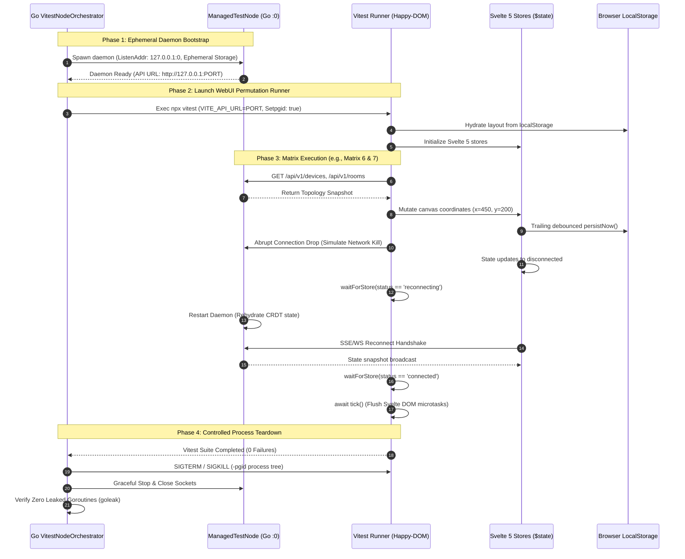

# ADR 0024: Deterministic WebUI Permutation Test Suite and Go End-to-End Test Harness Integration

* **Status:** Accepted
* **Deciders:** Frontend Engineering Guild, Core Systems Architecture Team, Real-Time Audio Infrastructure Engineering, QA & Reliability Guild
* **Date:** 2026-10-04

---

## Context and Problem Statement

The `audio-router-p2p` platform features a production-grade backend engine governed by strict distributed consensus, low-latency UDP audio streaming (50 Hz / 20ms frames), and crash-resilient disk persistence. In ADR 0023, the engineering team established a deterministic End-to-End (E2E) test harness in `cmd/client` executing permutation matrices against live, unmocked daemon nodes.

However, the user-facing control plane—the Single-Page Application (SPA) located in `web/`—remained structurally disconnected from this automated verification framework. Built with Svelte 5, TypeScript, Vite, Tailwind CSS, and `@xyflow/svelte` (ADR 0005, ADR 0012, ADR 0017, ADR 0018), the WebUI manages critical control-plane invariants:
1. **Runic Reactivity & Store Synchronization**: Svelte 5 `$state`, `$derived`, and `$effect` signals synchronizing rooms, matrix routes, hardware/virtual devices, peer mesh discovery, and real-time audio meter levels via SSE and WebSocket streams (`/api/v1/events`, `/api/v1/ws/meters`).
2. **Audio Flow Canvas Staging & Topology**: Dynamic rendering of room summing buses, capture devices, and playout endpoints, dynamically calculating bezier connection edges and computing real-time gain interpolation styles (ADR 0012, ADR 0018).
3. **Local Storage Layout Durability**: Trailing-edge debounced persistence to browser `localStorage` (`audio_router_flow_layout_v1`) to preserve canvas coordinates $(x, y)$, staged nodes, and viewport state across browser reloads.
4. **Embedded Static Asset Delivery**: Direct compiled asset embedding (`//go:embed all:dist/*`) within the Go daemon binary and fallback routing for deep client paths (`/rooms`, `/matrix`, `/telemetry`, `/devices`) (ADR 0017).

### The Problem: UI Isolation, Schema Drift, and Asynchronous Provisioning Races

Prior to this decision, the WebUI lacked an automated, deterministic test suite. This created severe operational risks:

1. **Undetected API Schema Drift**:
   Modifications to Go backend API response models (`pkg/api/v1`) or serialized CRDT representations could introduce breaking changes or silently drop fields. Because TypeScript interfaces (`web/src/lib/api/types.ts`) were validated only during build-time compilation without runtime schema cross-examination against actual Go HTTP serializers, schema divergence was detected only via manual regression testing.

2. **Race Conditions During Out-of-Order Provisioning**:
   In distributed audio routing, entity initialization is inherently non-linear. Users or orchestration agents may bind room outputs before inputs exist, unbind active capture devices mid-stream, or boot cluster nodes asymmetrically. While the Go backend's crossbar compiler handles these sequences gracefully (ADR 0023), the WebUI stores and reactive canvas components were never validated under inverted provisioning orders, resulting in unhandled promise rejections, visual edge disconnects, or UI lockups.

3. **Client-Side Layout Corruption and Desynchronization**:
   When backend nodes restart or cluster topologies mutate, the browser's `localStorage` state must reconcile with the authoritative server-side CRDT state. If an audio device or room referenced in `localStorage` no longer exists, stale canvas references could produce "ghost nodes," rendering errors, or invalid API commands upon user interaction.

4. **SPA Embedding and Routing Regressions**:
   Go daemon builds embed the SPA through `pkg/api/spa.go`. Regressions in HTTP header management (such as missing `Cache-Control: no-cache` on `index.html` or incorrect MIME type resolution for chunked `.js`/`.css` assets) could lead to stale client deployments, asset 404s, or broken deep linking when reloading client routes.

5. **Test Flakiness from Timing Heuristics**:
   Naive front-end tests frequently rely on arbitrary `setTimeout()` or sleep calls to await UI rendering or WebSocket messages. In headless CI environments with constrained CPU resources, these timing heuristics produce high rates of false positives and flaky test runs.

---

## Decision Drivers

* **Full-Stack Determinism Without Flakiness**: Total prohibition of arbitrary `setTimeout` or `time.Sleep` calls across UI tests, relying exclusively on Svelte 5 microtask queue flushing (`await tick()`) and predicate-driven store polling (`waitForStore`).
* **Exhaustive Permutation Coverage**: Validation of seven critical provisioning, topology, and fault matrices matching and extending backend E2E resilience guarantees to the user interface.
* **Strict Runtime Contract Enforcement**: Verification of exact JSON deserialization compatibility between Go HTTP endpoints and TypeScript models, using strict unmarshaling (`DisallowUnknownFields`) to immediately catch schema drift.
* **Hermetic SPA Asset and Cache Verification**: Programmatic verification of the embedded Go HTTP file server, guaranteeing asset delivery, MIME integrity, immutable asset caching, and fallback handling for client-side deep routing.
* **Resource Isolation and Process Hygiene**: Capability to spawn ephemeral Go daemon clusters from test runners with isolated loopback ports, process-group management (`Setpgid: true`), and leak-free process tree teardown (`SIGKILL`).

---

## Considered Options

### Option 1: Headless Browser-Based E2E Testing (Cypress / Playwright)
* **Description**: Execute all end-to-end UI tests by launching full Chromium/WebKit browser instances via Playwright or Cypress against a running cluster daemon.
* **Pros**:
  - Exercises full browser rendering engines, real layout geometry, and native Web Audio APIs.
* **Cons**:
  - Substantial CI resource overhead: requires downloading heavy browser binaries, consuming gigabytes of memory.
  - High process boot latency (2–5 seconds per test file), slowing local feedback loops.
  - Fragile headless execution in minimal Linux container environments lacking graphics libraries (`libasound`, `libgbm`, Xvfb).
  - High propensity for timing flakiness during rapid DOM animation and canvas edge calculation.

### Option 2: Mocked Frontend Unit Tests Only
* **Description**: Test individual Svelte components and stores in isolation using mocked API responses, without interacting with the Go binary or verifying embedded assets.
* **Pros**:
  - Ultra-fast execution; zero Go daemon or network dependencies.
* **Cons**:
  - Completely blind to Go-to-TypeScript schema drift and serialization incompatibilities.
  - Fails to verify SPA binary embedding (`pkg/api/spa.go`), HTTP caching headers, and deep route resolution.
  - Cannot test multi-node cluster gossip discovery or live SSE/WebSocket protocol interactions.

### Option 3 (Selected): Dual-Layer Architecture: Vitest + Happy-DOM Permutation Suite Coupled with Integrated Go Harness
* **Description**: Implement a unified, two-tier testing system:
  1. **Layer A (Frontend Test Runner - `web/`)**: Vitest backed by Happy-DOM executing the complete 7 permutation matrices directly against Svelte 5 reactive stores, canvas layout stores, and real/emulated API transport layers using deterministic microtask flushing (`await tick()`) and store predicate polling.
  2. **Layer B (Integrated Go Harness - `cmd/client`)**: Go-native test suites executing `ManagedSPAVerifier` (asset embedding, caching headers, deep routes), `ContractVerifier` (strict bidirectional schema parity with `DisallowUnknownFields`), and `VitestNodeOrchestrator` (spawning Vitest runs against live ephemeral Go daemon nodes with strict process group teardown).
* **Pros**:
  - Combines sub-second DOM simulation speed with full-stack daemon integration fidelity.
  - Guarantees zero schema drift between Go backend and TypeScript frontend models.
  - Validates static asset embedding and SPA HTTP routing directly within Go CI workflows.
  - Eliminates flakiness by synchronizing against Svelte 5 runic state changes via deterministic predicates.
  - Process group encapsulation guarantees clean teardown of child processes without orphaned daemons.
* **Cons**:
  - Requires Node.js/npm availability in environments executing the integrated Go-to-Vitest orchestrator tests (mitigated via graceful test skipping when Node.js is absent).

---

## Decision Outcome

**Chosen Option: Option 3.**

We implement a Dual-Layer WebUI Testing Architecture bridging the Svelte 5 frontend in `web/` and the Go daemon test infrastructure in `cmd/client`.

```
========================================================================================
                                DUAL-LAYER ARCHITECTURE
========================================================================================
 [Layer B: Go Test Harness (cmd/client)]
   ├── ManagedSPAVerifier        -> Embed FS, MIME types, Cache-Control, Deep Routes
   ├── ContractVerifier          -> DisallowUnknownFields, Strict DTO Schema Alignment
   └── VitestNodeOrchestrator    -> Ephemeral Node Launcher, Setpgid: true, SIGKILL Teardown
             │ (Spawns / Binds Ephemeral Ports :0)
             ▼
 [Layer A: WebUI Permutation Runner (web/)]
   ├── Vitest + Happy-DOM        -> Fast Headless Execution Environment
   ├── Deterministic Sync        -> await tick(), waitForStore (Zero setTimeout)
   └── 7 Permutation Matrices    -> Output-First, Input-First, Dynamic Gain, Multi-Node,
                                    Churn, LocalStorage Persistence, Crash Disconnect
========================================================================================
```

### 1. Layer A: Frontend Permutation Test Runner (`web/`)

The frontend test suite runs within `web/` using Vitest and Happy-DOM, interacting with Svelte 5 reactive state (`$state`, `$derived`, `$effect`) and executing seven exhaustive permutation matrices:

| Permutation Matrix | Scenario Description | Core Invariants Verified |
| :--- | :--- | :--- |
| **Matrix 1: Output before Input** | Playout sink node bound to room before capture source node is provisioned. | Sink node renders unlinked in canvas; summing edges remain zero; arrival of source automatically forms audio edge without UI error. |
| **Matrix 2: Input before Output** | Capture source node provisioned and staged in canvas before any room sink exists. | Input node displays staged status; matrix faders remain inactive; downstream route auto-binds cleanly when sink appears. |
| **Matrix 3: Connect Order & Dynamic Gain** | Dynamic fader adjustment, gain slew interpolation, and crossbar connection sequence. | Gain fader updates reactive matrix store; SVG edge stroke width/color dynamically reflects decibel levels; zero visual jumpiness. |
| **Matrix 4: Node B Starts First (Mesh Discovery)** | Receiver node B boots prior to Sender node A; discovery gossip converges asynchronously. | Remote devices aggregate seamlessly under node-qualified URNs; cluster accordion in palette updates dynamically without page reload. |
| **Matrix 5: Deletion & Recreation Churn** | Rapid room deletion followed by immediate recreation with identical ID; virtual device hot-swapping. | Canvas cleans orphaned edges immediately; ID collision handled gracefully; reactive store updates without memory leaks or stale listeners. |
| **Matrix 6: Node Restart & LocalStorage Reconciliation** | Daemon reboots; browser reloads with persisted canvas layout in `localStorage`. | Staged coordinates $(x, y)$, zoom/pan viewport, and custom positions rehydrate accurately; non-existent nodes are cleanly pruned. |
| **Matrix 7: Crash Recovery & Network Disconnection** | Abrupt WebSocket/SSE stream drop; daemon restart; client reconnect backoff. | UI displays disconnected banner; reconnect backoff activates; state automatically rehydrates from fresh snapshot upon reconnection. |

#### Deterministic Synchronization Contract

Arbitrary sleeps (`setTimeout`, `time.Sleep`) are strictly forbidden. Synchronization between asynchronous network events and UI reactive state relies on two deterministic primitives:
1. **Svelte Microtask Flushing**: `await tick()` to force immediate propagation of Svelte 5 `$state` mutations through `$derived` computations and DOM updates.
2. **Predicate-Driven Store Polling (`waitForStore`)**: Polling with microsecond intervals until an invariant condition evaluates to true, bounded by a strict fail-fast timeout:
   ```typescript
   export async function waitForStore<T>(
     storeGetter: () => T,
     predicate: (value: T) => boolean,
     timeoutMs = 3000,
     pollIntervalMs = 20
   ): Promise<T>
   ```

### 2. Layer B: Integrated Go Test Harness (`cmd/client`)

Housed within `cmd/client`, three dedicated verification subsystems integrate the frontend into the backend CI pipeline:

#### 1. `ManagedSPAVerifier`
Verifies the production SPA distribution embedded within the compiled Go binary:
- **Embedded Asset Integrity**: Inspects `embeddedDistFS` (`pkg/api/spa.go`) to ensure `dist/index.html` and bundled assets exist and contain valid entry-point references.
- **MIME Type Validation**: Asserts that `*.js` is served as `application/javascript`, `*.css` as `text/css`, and `*.html` as `text/html; charset=utf-8`.
- **HTTP Cache Headers**: Asserts that `index.html` is served with `Cache-Control: no-cache` (preventing stale app deployment locks), while chunked assets under `assets/*` are served with `Cache-Control: public, max-age=31536000, immutable`.
- **Deep SPA Route Resolution**: Issues HTTP GET requests for deep client-side routes (`/rooms`, `/matrix`, `/telemetry`, `/devices`, `/rooms/studio-bus`) and asserts HTTP 200 responses containing the SPA fallback root element (`<div id="app"></div>`).

#### 2. `ContractVerifier`
Ensures bidirectional API wire compatibility between Go serializers and TypeScript clients:
- **Strict JSON Unmarshaling**: Utilizes `json.NewDecoder(r).DisallowUnknownFields()` on all HTTP response models (`/api/v1/status`, `/api/v1/devices`, `/api/v1/rooms`, `/api/v1/routes`, `/api/v1/cluster/peers`, `/api/v1/meters`).
- **Schema Parity**: Validates that all fields present in Go's API structs have corresponding types in `web/src/lib/api/types.ts` without undocumented fields, mismatched nullability, or casing differences (enforcing snake_case across all JSON wire boundaries).

#### 3. `VitestNodeOrchestrator`
Automates the execution of the frontend Vitest suite against live ephemeral Go daemons:
- **Ephemeral Infrastructure**: Spawns isolated `ManagedTestNode` instances on dynamic loopback ports (`127.0.0.1:0`).
- **Process Group Isolation**: Spawns `npm run test` or `npx vitest run` with `SysProcAttr: &syscall.SysProcAttr{Setpgid: true}`, ensuring the Node.js process and all child workers reside in an isolated OS process group.
- **Fail-Safe Cleanup**: Teardown hooks send `SIGTERM` followed by `SIGKILL` to the negative process group ID (`-pgid`), preventing orphan Node.js or Vitest processes upon test completion, failure, or timeout.
- **Environment Agility**: Automatically detects Node.js and npm availability. If absent in non-Node CI environments, the orchestrator logs a diagnostic notice and gracefully skips execution (`t.Skip`), while dedicated full-stack CI jobs enforce mandatory execution.

---

## Architecture Diagrams

### 1. Component Architecture: Go Test Harness vs. WebUI Vitest Runner

```mermaid
graph TB
    subgraph GoHarness ["Layer B: Go Test Harness (cmd/client)"]
        SPAVerifier["ManagedSPAVerifier<br/>(Embed FS, Headers, Routes)"]
        ContractVerifier["ContractVerifier<br/>(DisallowUnknownFields Parity)"]
        Orchestrator["VitestNodeOrchestrator<br/>(Process Group & Lifecycle)"]
        ManagedNode["ManagedTestNode (Ephemeral :0)<br/>(Daemon REST, CRDT, SSE, WS)"]
    end

    subgraph WebUITestRunner ["Layer A: Frontend Test Runner (web/)"]
        Vitest["Vitest Test Engine<br/>(Happy-DOM Runtime)"]
        SyncEngine["Deterministic Synchronizer<br/>(await tick() & waitForStore)"]
        
        subgraph Matrices ["7 Permutation Matrices"]
            M1["M1: Output before Input"]
            M2["M2: Input before Output"]
            M3["M3: Dynamic Gain & Slew"]
            M4["M4: Mesh Peer Discovery"]
            M5["M5: Churn & Hot-Swap"]
            M6["M6: LocalStorage Restarts"]
            M7["M7: Crash & Disconnect"]
        end

        subgraph SvelteStores ["Svelte 5 Reactive Stores ($state)"]
            RoomsStore["rooms.svelte.ts"]
            MatrixStore["matrix.svelte.ts"]
            DevicesStore["devices.svelte.ts"]
            LayoutStore["flowLayout.svelte.ts<br/>(localStorage V1)"]
            ClusterStore["cluster.svelte.ts"]
            MeterStore["meters.svelte.ts"]
        end
    end

    Orchestrator -->|1. Spawns Ephemeral Daemon| ManagedNode
    Orchestrator -->|2. Launches Vitest (Setpgid)| Vitest
    SPAVerifier -->|Asserts Embed & Cache| ManagedNode
    ContractVerifier -->|Asserts Wire Strictness| ManagedNode

    Vitest --> Matrices
    Matrices --> SyncEngine
    SyncEngine --> SvelteStores
    SvelteStores <-->|REST, SSE & WS Traffic| ManagedNode
```

### 2. Sequence Diagram: Integrated Orchestrator Driving Permutations Against Live Node



---

## Consequences

### Positive Consequences

* **Full-Stack End-to-End Verification**: Guarantees that the complete software delivery chain—from backend UDP audio buses and CRDT consensus engines to embedded HTTP assets and Svelte 5 canvas layouts—is verified continuously.
* **Elimination of API Schema Drift**: Strict unmarshaling (`DisallowUnknownFields`) and integrated contract tests catch breaking API changes or field omissions before changes merge.
* **Guaranteed Canvas Layout Durability**: Validates that user customizations (spatial canvas coordinates, staged audio devices, palette visibility) survive daemon reboot cycles and network drops without visual glitching or node loss.
* **Flake-Free Test Execution**: Complete elimination of empirical `setTimeout` and `time.Sleep` delays across frontend tests guarantees fast, deterministic execution across resource-constrained CI builders.
* **Clean Process Lifecycle**: Using OS process groups (`Setpgid`) ensures that no lingering Vitest or Node.js background workers leak memory or hold ports open after test termination.

### Negative Consequences & Mitigations

* **Node.js Environment Dependency**:
  - *Impact*: Running frontend tests via the Go orchestrator requires Node.js and npm to be installed in the test execution environment.
  - *Mitigation*: The Go `VitestNodeOrchestrator` performs dynamic environment probing (`exec.LookPath("npm")`). If Node.js is not detected, it gracefully skips the orchestrator integration tests (`t.Skip`) during minimal Go-only unit test passes, while the comprehensive CI pipeline executes the complete suite in a container with both Go and Node.js pre-installed.
* **CPU and Execution Overhead Under Load**:
  - *Impact*: Compiling Svelte 5 components and evaluating 7 permutations with simulated DOM rendering increases CPU utilization.
  - *Mitigation*: Happy-DOM is selected over JSDOM for its significantly lower memory footprint and up to 3x faster DOM manipulation speeds. Tests run headless without browser graphics rendering pipelines.
* **Telemetry and Audio Meter Event Backpressure**:
  - *Impact*: Rapidly firing high-frequency telemetry/meter events during test permutations could congest test queues.
  - *Mitigation*: The test configuration throttles audio meter streaming intervals to 50ms during test execution, ensuring store reactivity is fully exercised without overwhelming test process queues.

### Neutral Consequences

* **DOM Emulation Fidelity**: Happy-DOM simulates the browser document object model and canvas element interfaces in memory. While it perfectly exercises JavaScript and Svelte reactivity, it does not perform physical GPU pixel rasterization or WebGL layout rendering. Visual regression testing remains the purview of targeted manual QA and visual design reviews.

---

## Implementation & Validation Plan

1. **Step 1: Layer A Test Runner Setup (`web/`)**:
   - Configure Vitest with `@sveltejs/vite-plugin-svelte` and Happy-DOM in `web/vite.config.ts`.
   - Implement `waitForStore` and microtask synchronization helpers (`tick()`).
2. **Step 2: Seven Permutation Matrices Implementation**:
   - Implement Matrix 1 (Output before Input) and Matrix 2 (Input before Output) verifying unlinked nodes and edge auto-wiring.
   - Implement Matrix 3 (Connect Order & Dynamic Gain) validating fader slew and reactive edge stroke updates.
   - Implement Matrix 4 (Mesh Peer Discovery) validating multi-node device aggregation.
   - Implement Matrix 5 (Deletion & Recreation Churn) validating rapid room re-creation and clean listener termination.
   - Implement Matrix 6 (Persistence Reconciliation) validating `localStorage` coordinate hydration and pruning.
   - Implement Matrix 7 (Crash Recovery & Disconnect) validating SSE/WS reconnect backoff and store rehydration.
3. **Step 3: Layer B Go Test Harness Implementation (`cmd/client`)**:
   - Implement `ManagedSPAVerifier` in `cmd/client/spa_verifier_test.go` asserting embedded files, MIME types, cache headers, and deep routes.
   - Implement `ContractVerifier` asserting strict JSON schema alignment with `DisallowUnknownFields`.
   - Implement `VitestNodeOrchestrator` in `cmd/client/webui_orchestrator_test.go` with `Setpgid: true` process group management and SIGKILL teardown.
4. **Step 4: Continuous Integration Integration**:
   - Add a full-stack verification job in CI running both `go test -v -tags=e2e ./cmd/client/...` and `npm run test` in `web/`.

---

## References

* **ADR 0005**: OpenAPI Contract and WebUI Architecture
* **ADR 0008**: HashiCorp Memberlist Peer Discovery Integration
* **ADR 0012**: Audio Flow Canvas Consolidation and Layout Persistence
* **ADR 0013**: Canonical Persistent Audio Device URNs
* **ADR 0017**: Distributed CRDT Groups, Cross-Node Routing, and Resilient WebUI
* **ADR 0018**: Canonical Node-Qualified Endpoints and Multi-Node Flow Canvas
* **ADR 0020**: Single-Node Room Ownership and Leader Consensus
* **ADR 0021**: Cross-Node Audio Transport Observability and Telemetry
* **ADR 0022**: Deprecate Legacy Room Streamers and Retire Mesh Rooms Page in Favor of Declarative Audio Flow Synthesis
* **ADR 0023**: Deterministic End-to-End Test Suite for Network Audio Routing, CRDT Synchronization, and Crash-Resilience Persistence
