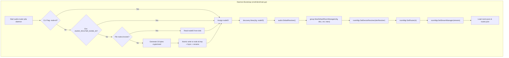
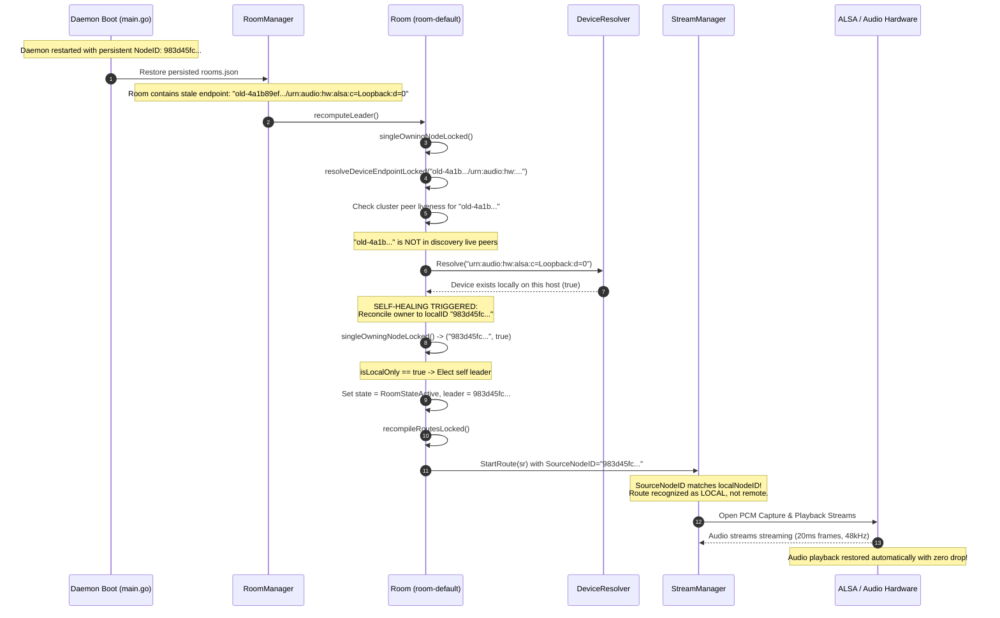

# ADR 0025: Persistent Node Identity and Single-Node Reboot State Reconciliation

* **Status:** Accepted
* **Deciders:** Core Systems Architecture Team, Real-Time Audio Infrastructure Engineering, Distributed Systems & Network Engineering
* **Date:** 2026-10-04

---

## Context and Problem Statement

In `audio-router-p2p`, distributed nodes coordinate audio streaming across local hardware devices and network peer transports. The system relies on local JSON state persistence files (`rooms.json` and `routes.json`) to preserve routing topologies and room memberships across daemon restarts and operating system reboots (ADR 0017, ADR 0020, ADR 0023).

Under ADR 0018, endpoints within rooms and routes are addressed using canonical node-qualified references in the format `<nodeID>/<deviceID>` or RFC 8141 URNs (`urn:audio:node:<nodeID>:dev:<deviceID>`). 

### The Reboot Failure Cascade

In both standalone single-node installations and distributed multi-node clusters, a critical operational bug emerged: **after a daemon restart or host reboot, all audio playback and capture ceased functioning immediately**. While the HTTP REST API reported rooms and routes as restored, no audio was passed through soundcards or network streams.

Detailed post-mortem analysis identified a cascading chain of five interdependent architectural defects across discovery, room coordination, routing, and stream management:

1. **Ephemeral Node ID Generation**:
   The bootstrap sequence in `cmd/client/main.go` invoked `discovery.New(cfg, "")` with an empty string for the node identifier. In `pkg/discovery/discovery.go`, when provided an empty node ID, the system generated a fresh, random 32-character hexadecimal string derived from crypto-random bytes. Consequently, every daemon restart or reboot cycle minted an entirely new `NodeID` (e.g., node `983d45fc...` became `4a1b89ef...`). This instantly orphaned every persistent binding in `rooms.json` and `routes.json`, as saved endpoints remained tagged with the previous boot cycle's obsolete node ID.

2. **Stale Endpoint Prefix Blindness**:
   Inside `pkg/group/room.go`, the function `resolveDeviceEndpointLocked(devRef)` parsed canonical slash references `<nodeID>/<deviceID>`. It unconditionally extracted and returned the literal `<nodeID>` prefix without verifying:
   - Whether `<nodeID>` corresponded to an active, live peer registered in discovery or cluster membership.
   - Whether `<deviceID>` actually resided on the local host as a physical or virtual audio device.
   As a result, stale node prefixes from prior boot cycles were perpetually treated as external remote nodes.

3. **Leadership Consensus Gridlock**:
   In `pkg/group/room.go`, `room.singleOwningNodeLocked()` and `room.recomputeLeader()` evaluated room ownership based on the unresolved endpoint owners. Because all endpoints were prefixed with the obsolete node ID, the room identified the obsolete node ID as the sole owner (`isSingleNode == true`). However, in `recomputeLeader()`:
   ```go
   m, exists := r.members[owner]
   isOwnerHealthy = exists && now.Sub(m.LastSeen) <= peerTTL && (r.disc == nil || present[owner])
   if !isOwnerHealthy {
       // Remote owner is absent or unhealthy: defer assertion and remain in Election
       log.Printf("room %s: single owning node %s is absent or unhealthy, deferring active leader assertion", r.id, owner)
       return
   }
   ```
   Because the obsolete node was not present in the live peer list of the discovery service, the room deferred active leadership indefinitely, trapped permanently in `RoomStateElection`.

4. **Stream Manager Route Dropping**:
   When the room manager attempted to compile routes via `streamManager.StartRoute()`, the stream manager inspected `sr.SourceNodeID` against `localNodeID`:
   ```go
   isRemoteSource := sr.SourceNodeID != "" && sr.SourceNodeID != "local" && (localNodeID == "" || sr.SourceNodeID != localNodeID)
   isLocalDest := sr.PeerID == "" || sr.PeerID == "local" || (localNodeID != "" && sr.PeerID == localNodeID)

   if isRemoteSource && !isLocalDest {
       log.Printf("[STREAM:MGR] Route %s is between remote peers (src=%s, dst=%s); ignoring locally", sr.ID, sr.SourceNodeID, sr.PeerID)
       return nil
   }
   ```
   Because `sr.SourceNodeID` held the obsolete node ID (classified as remote) and `sr.PeerID` was either empty or held the obsolete node ID, the route was classified as an unhandled inter-remote peer stream. The local daemon ignored the route entirely and refused to initialize the underlying ALSA/PulseAudio soundcard devices.

5. **Missing Dependency Injection**:
   In `cmd/client/main.go`, `group.NewDefaultRoomManager` was instantiated without binding the local device resolver (`roomMgr.SetDeviceResolver(devResolver)`). Without an injected resolver, the room manager was unable to verify local device existence during endpoint parsing, crippling its ability to reconcile stale endpoints.

---

## Decision Drivers

* **Zero-Touch Reboot Recovery**: Audio routing graphs must survive daemon restarts, host reboots, and power cycles with 100% automated recovery and zero operator intervention.
* **Deterministic Node Identity**: A node's network identity must remain stable across process lifecycles and reboots while supporting automated, headless provisioning and explicit configuration overrides.
* **Self-Healing Endpoint Reconciler**: The room manager must dynamically reconcile stale or orphaned node prefixes in stored endpoints, mapping them back to the active local node if the referenced devices are local hardware/virtual URNs and the old node is absent.
* **Single-Node Fast-Path Convergence**: Rooms whose inputs and outputs map exclusively to local host hardware must converge immediately to `RoomStateActive` without waiting for discovery timeouts or entering leader oscillation loops.
* **Robust Inversion of Control (IoC) Wiring**: All foundational dependency injection contracts (resolvers, transports, routers, cluster managers) must be fully satisfied during the client bootstrap phase.
* **Backwards Compatibility**: Existing `rooms.json` and `routes.json` files generated under prior releases must load seamlessly without manual migration or JSON file deletions.

---

## Considered Options

### Option 1: Ephemeral Identity with Volatile In-Memory Topology (Wipe on Reboot)
* **Description**: Discard `rooms.json` and `routes.json` persistence across restarts. Every restart begins with a clean slate, requiring external orchestration scripts or Web UI re-configuration to reconstruct rooms and routes.
* **Pros**:
  - Eliminates stale endpoint references on disk.
  - Trivial to implement.
* **Cons**:
  - Completely unacceptable for production audio appliances, field nodes, and broadcast installations where unattended reboot recovery is a mandatory requirement.
  - Violates persistence guarantees established in ADR 0017 and ADR 0023.

### Option 2: Centralized Identity Authority / Cluster Lease Registry (Consul / etcd / Vault)
* **Description**: Require an external distributed key-value store or identity service to allocate and lease persistent node IDs to clients based on host MAC address or machine-id.
* **Pros**:
  - Centralized visibility into cluster-wide identities.
  - Guaranteed global uniqueness across fleets.
* **Cons**:
  - Introduces a hard external infrastructure dependency, violating the self-contained, peer-to-peer, zero-dependency philosophy of `audio-router-p2p`.
  - Non-functional in standalone edge setups, offline production venues, or ad-hoc LANs without an external orchestrator.

### Option 3 (Selected): Persistent Local Cryptographic Identity with Self-Healing Endpoint Reconciliation and Consensus Fast-Path
* **Description**:
  1. **Deterministic Identity Resolution Hierarchy**: Introduce `pkg/discovery/identity.go` implementing a strict precedence chain: explicit CLI flag `-node-id`, environment variable `AUDIO_ROUTER_NODE_ID`, persistent identity file `-node-id-file` (default: `node.id`), and fallback cryptographic generation (16 bytes secure entropy / 32-hex string) with atomic disk persistence (`fsync` + `os.Rename` with `0600` permissions).
  2. **Self-Healing Endpoint Reconciler**: Enhance `resolveDeviceEndpointLocked` in `pkg/group/room.go`. If an endpoint references `<nodeID>/<deviceID>` where `<nodeID>` is not an active live peer in discovery/cluster manager, and `<deviceID>` matches a locally resolvable hardware device, virtual device, or URN, dynamically reconcile the endpoint owner to `r.localID`.
  3. **Single-Node Consensus Fast-Path**: Ensure `singleOwningNodeLocked` evaluates reconciled endpoints. When all endpoints map to `r.localID`, immediately assert `RoomStateActive` and elect `r.localID` as leader.
  4. **Complete IoC Dependency Injection**: Explicitly wire `roomMgr.SetDeviceResolver(devResolver)` and pass persistent `nodeID` to `discovery.New(cfg, nodeID)` in `cmd/client/main.go`.
* **Pros**:
  - Zero-touch reboot recovery: Audio routing reconstitutes automatically across restarts.
  - Resilient to peer churn, reboot events, and hardware disconnects.
  - Fully decentralized: Operates flawlessly in isolated single-node environments and distributed multi-node clusters.
  - 100% backwards compatible with legacy persisted state files.
* **Cons**:
  - Introduces a small disk I/O step at boot for the identity file (sub-millisecond, negligible).
  - Virtual machine or container cloning without clearing `node.id` could lead to identity duplication (mitigated by environment variable and CLI flag overrides).

---

## Decision Outcome

Chosen: **Option 3**.

### Detailed Architectural Specification

#### 1. Persistent Node Identity Resolution Hierarchy (`pkg/discovery/identity.go`)

Node identity is resolved during daemon startup prior to any subsystem initialization according to the following strict hierarchy:

```text
+--------------------------------------------------------------------------+
| 1. CLI Flag: -node-id <id>                                               |
|    (Highest priority; allows explicit runtime assignment)                |
+--------------------------------------------------------------------------+
                                    | (if empty)
                                    v
+--------------------------------------------------------------------------+
| 2. Environment Variable: AUDIO_ROUTER_NODE_ID                            |
|    (Standard container/cloud-native injection mechanism)                  |
+--------------------------------------------------------------------------+
                                    | (if empty)
                                    v
+--------------------------------------------------------------------------+
| 3. Persistent Identity File: -node-id-file (Default: "node.id")           |
|    (Read existing 32-hex character ID from disk)                         |
+--------------------------------------------------------------------------+
                                    | (if file missing or empty)
                                    v
+--------------------------------------------------------------------------+
| 4. Cryptographic Generation & Atomic File Persistence                    |
|    (crypto/rand 16 bytes -> 32-char hex -> atomic write to node.id)       |
+--------------------------------------------------------------------------+
```

##### Atomic Persistence Protocol
To prevent corruption from unexpected power loss or process kill signals during generation:
1. Generate 16 bytes of cryptographically secure random entropy (`crypto/rand`).
2. Format as a 32-character lowercase hexadecimal string.
3. Write the token to a temporary file (`node.id.tmp.<random>`) with restrictive permissions (`0600`).
4. Flush buffers to physical storage using `file.Sync()`.
5. Perform an atomic filesystem rename (`os.Rename`) replacing the target identity file.

#### 2. Self-Healing Endpoint Reconciler (`pkg/group/room.go`)

In `resolveDeviceEndpointLocked(devRef string) (nodeID, cleanDevID string)`, the naive string-split behavior is replaced with active cluster liveness and local device validation:

```go
// Step 1: Explicit canonical slash prefix "<node_id>/<device_id>"
if !strings.HasPrefix(devRef, "urn:") {
    if slash := strings.Index(devRef, "/"); slash > 0 {
        parsedNode := strings.TrimSpace(devRef[:slash])
        parsedDev := strings.TrimSpace(devRef[slash+1:])
        if parsedDev != "" {
            // Check if the parsed node is self
            if r.isLocalNodeLocked(parsedNode) {
                if r.localID != "" {
                    return r.localID, parsedDev
                }
                return "local", parsedDev
            }

            // Cluster liveness check: is parsedNode an active cluster peer?
            isPeerLive := false
            if r.disc != nil {
                for _, peer := range r.disc.LivePeers() {
                    if peer.ID == parsedNode {
                        isPeerLive = true
                        break
                    }
                }
            }
            if !isPeerLive && r.clusterMgr != nil {
                if snap := r.clusterMgr.GetSnapshot(); snap != nil {
                    for _, node := range snap.Nodes {
                        if node.ID == parsedNode {
                            isPeerLive = true
                            break
                        }
                    }
                }
            }

            // If parsed node is NOT live in the cluster, check if parsedDev is a local device
            if !isPeerLive {
                isLocalDev := false
                if r.devResolver != nil {
                    _, isLocalDev = r.devResolver.Resolve(parsedDev)
                }
                if !isLocalDev && audio.GlobalResolver() != nil {
                    _, isLocalDev = audio.GlobalResolver().Resolve(parsedDev)
                }
                if !isLocalDev && (strings.HasPrefix(parsedDev, "urn:audio:hw:") || strings.HasPrefix(parsedDev, "urn:audio:virt:")) {
                    isLocalDev = true
                }

                // Self-healing trigger: stale remote prefix reconciled to active local node
                if isLocalDev {
                    target := "local"
                    if r.localID != "" {
                        target = r.localID
                    }
                    log.Printf("[ROOM:RECONCILE] Reconciling stale node prefix %s to local node %s for device %s",
                        parsedNode, target, parsedDev)
                    return target, parsedDev
                }
            }

            return parsedNode, parsedDev
        }
    }
}
```

#### 3. Single-Node Consensus Fast-Path

When `resolveDeviceEndpointLocked` maps all inputs and outputs of a room to `r.localID`:
1. `singleOwningNodeLocked()` returns `(r.localID, true)`.
2. `isLocalOnlyLocked()` evaluates to `true`.
3. In `recomputeLeader()`:
   - `isLocal` is verified as `true`.
   - `isOwnerHealthy` unconditionally evaluates to `true`.
   - The room bypasses discovery timeouts and immediately stores `leader = r.localID` and `state = RoomStateActive`.
   - Local route compilation runs synchronously, configuring ALSA capture/playback streamers without remote network hops.

#### 4. IoC Container Wiring (`cmd/client/main.go`)

The daemon bootstrap sequence enforces complete lifecycle dependency injection:

1. **Persistent Identity Retrieval**:
   ```go
   nodeID, err := discovery.ResolveOrPersistNodeID(cfg)
   if err != nil {
       log.Fatalf("failed to resolve node identity: %v", err)
   }
   disc, err := discovery.New(cfg, nodeID)
   ```
2. **Device Resolver Injection**:
   ```go
   devResolver := audio.GlobalResolver()
   
   roomMgr := group.NewDefaultRoomManager(cfg, disc, sm, trans)
   roomMgr.SetRouter(rt)
   roomMgr.SetStreamManager(streams)
   roomMgr.SetDeviceResolver(devResolver) // Critical DI binding
   disc.SetStateDelegate(roomMgr)
   ```

---

## Architectural Diagrams

### Architecture Flow: Node Identity Persistence and Bootstrap Wiring



### Sequence Diagram: Stale Endpoint Self-Healing & Route Compilation



---

## Consequences

### Positive Consequences

* **Zero-Touch Audio Recovery**: Complete elimination of audio silence following daemon restarts or host reboots. Audio pipelines re-engage immediately.
* **Persistent Identity Guarantee**: Nodes maintain a stable cryptographic fingerprint across arbitrary restart cycles, preserving cluster membership tables, CRDT LWW registers, and routing topology maps.
* **Orphan State Prevention**: Stale endpoints in `rooms.json` referencing dead or previous node IDs are automatically healed without manual file edits or API intervention.
* **Stream Manager Alignment**: `streamManager.StartRoute` receives consistent local node ownership, preventing false-positive "Route is between remote peers; ignoring locally" rejections.
* **Decentralized and Autonomous**: Standalone single-node deployments operate independently without requiring external orchestrators, discovery clusters, or network connectivity.

### Negative Consequences & Mitigations

* **Disk I/O at Daemon Startup**:
  - *Impact*: Reading and writing `node.id` introduces local disk I/O during boot.
  - *Mitigation*: The identity file is read exactly once during initialization using sub-millisecond atomic POSIX operations. Subsequent access is cached in memory.
* **Container / VM Image Cloning Duplication**:
  - *Impact*: If a virtual machine image or container rootfs containing a pre-existing `node.id` file is cloned across multiple instances, nodes could advertise duplicate IDs.
  - *Mitigation*: Production deployments can override the identity file by setting the `AUDIO_ROUTER_NODE_ID` environment variable or `-node-id` CLI flag in container templates.
* **Cross-Node Endpoint Disambiguation**:
  - *Impact*: In a multi-node cluster, if Node B is temporarily offline and Node A has a hardware device with an identical URN, Node A could prematurely reconcile Node B's endpoint to itself.
  - *Mitigation*: The self-healing reconciler checks the cluster snapshot and discovery peer tables. Reconcile only triggers when the prefix node is definitively absent from the cluster and the device matches the host's resolved inventory.
