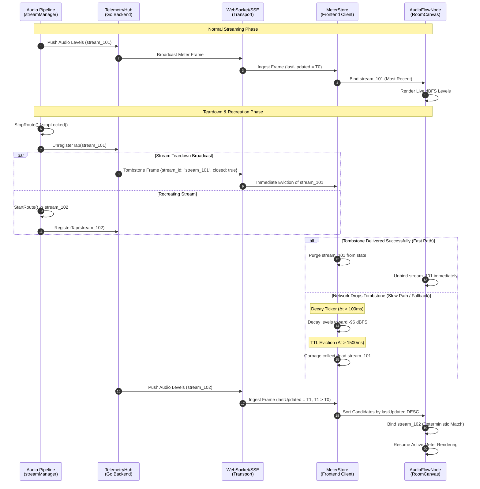

# ADR-0026: Telemetry Stream Lifecycle Synchronization, Client Decay, and Deterministic Meter Binding

## Status
**Accepted**

## Context
In `audio-router-p2p`, real-time audio telemetry (RMS, peak, clipping indicators) is sampled from active audio processing routes and broadcast across WebSocket and Server-Sent Events (SSE) connections to the Svelte frontend. Two systemic defects compromised visualization reliability:

1. **Frozen / Ghost Meters on Stream Teardown (`MeterRack.svelte`):**
   When routes stopped (`streamManager.StopRoute` / `stopLocked`), the audio tap was detached, but the backend `TelemetryHub` simply halted sending frames for that `streamID`. Because no termination signal was emitted, and because the client-side `meterStore` retained the last ingested frame indefinitely, UI meters remained frozen at their final audio level (e.g., -12 dBFS) instead of clearing or zeroing out.
2. **Meter Invalidation on Stream Recreation (`RoomCanvas.svelte`, Node Components):**
   When users disconnected and rewired canvas nodes or recreated room routes, new streams were instantiated with distinct `streamID`s. However, canvas nodes (`InputDeviceNode.svelte`, `OutputDeviceNode.svelte`) failed to reflect active levels because:
   - Stale stream instances persisted in the frontend dictionary.
   - Channel selector heuristics utilized non-deterministic dictionary key traversal (`Object.keys(meters)[0]`), picking stale or dead streams.
   - Unscoped fallback logic bound nodes to global channel meters (`activeChannelMeters`) even when unrelated devices were silent, bleeding audio signals across nodes.

A comprehensive solution requires end-to-end lifecycle guarantees spanning backend emission, transport, client-side caching, and UI node binding.

## Decision Drivers
* **State Accuracy & Operator Trust:** Meters must never display phantom sound levels when an audio pipeline has ceased transmission.
* **Low-Latency Binding on Recreation:** Reconnecting patch cables or restarting peer connections must restore real-time visual feedback within one animation frame (<16ms).
* **Fault Tolerance & Network Resilience:** Unclean disconnections, dropped WebSocket packets, or backend crashes must self-heal without manual page reloads.
* **Non-Blocking Telemetry Throughput:** Slow WebSockets or SSE clients must not introduce backpressure into the internal audio processing loops.
* **Strict Node Isolation:** Visual graph nodes must only display telemetry belonging to their specific attached endpoints.

## Considered Options

* **Option 1: In-Band Zero-Padding (Send 0 dBFS Frames Before Teardown)**
  Emit synthetic silent audio frames (`-96 dBFS`) from the audio pipeline right before tap deletion.
  * *Rejected:* Unreliable during abrupt pipeline crashes, context cancellations, or panic recoveries. Does not prune the stream key from client memory, causing memory leaks over long session durations.

* **Option 2: Passive Client-Side Timeouts (Leases / TTL Only)**
  Rely exclusively on frontend heartbeats where streams without frames for >1500ms are purged.
  * *Rejected:* Introduces an unacceptable 1.5-second UI freeze/lag window where stopped meters linger. Furthermore, during rapid stream recreation (<500ms), the obsolete stream continues to conflict with the new stream.

* **Option 3: Hybrid Architecture: Explicit Backend Tombstones + Dual-Stage Client TTL/Decay Engine + Monotonic Node Binding (Selected)**
  Implement explicit stream unregistration events, backed by a client-side continuous exponential decay ticker and strict timestamp-based node-to-stream resolution.

## Decision Outcome
We have adopted **Option 3**. The architecture is structured across three layers:

### 1. Backend Lifecycle Signaling (`TelemetryHub`)
* **Explicit Tombstone Frames:** When `streamManager` unregisters a tap via `TelemetryHub.UnregisterTap(streamID)`, the Hub immediately generates an explicit tombstone frame:
  ```json
  {
    "stream_id": "str_12345678",
    "closed": true,
    "timestamp": 1775260800000
  }
  ```
* **Non-Blocking Fanout:** Tombstone frames are broadcast across all active SSE and WebSocket subscriber rings using non-blocking channel selects (`select { case ch <- frame: default: drop }`). Slow network consumers are never permitted to block tap unregistration or audio processing threads.

### 2. Frontend Telemetry Store (`MeterStore.svelte.ts`)
* **Monotonic Ingestion:** Every ingested frame is assigned a high-resolution monotonic timestamp (`performance.now()`).
* **Immediate Tombstone Purging:** Receipt of a frame with `closed: true` immediately deletes the stream key from the reactive dictionary, bypassing grace periods.
* **Client-Side Ballistics & TTL Decay Engine:** A continuous ticker runs client-side:
  - If a stream receives no frames for $\Delta t > 100\text{ ms}$, its peak and RMS values decay toward the noise floor ($-96\text{ dBFS}$) at $-24\text{ dB/s}$, simulating analog meter ballistics.
  - If a stream remains silent for $\Delta t > 1500\text{ ms}$, the decay engine purges it via TTL eviction to reclaim memory.
* **Deterministic Active Stream Selection:** `recomputeActiveChannels()` selects the stream with the highest `lastUpdated` timestamp that is not marked stale, eliminating arbitrary dictionary key ordering bugs.

### 3. Audio Flow Node-to-Stream Binding (`RoomCanvas.svelte`)
* **Structured Endpoint Matching:** Device nodes match candidates using a strict compound key: `(DeviceID, URN, RoomRoute)`.
* **Monotonic Recency Sorting:** Candidates are filtered for active streams and sorted descending by `lastUpdated` timestamp:
  $$\text{SelectedStream} = \operatorname{argmax}_{s \in \text{Candidates}}(\text{lastUpdated})$$
  This guarantees that newly recreated streams take visual precedence over closing predecessors.
* **Zero-Leak Isolation:** Nodes without a valid matched active stream render inactive silence (all LEDs off, $-96\text{ dBFS}$) and are strictly prohibited from falling back to arbitrary global channel indexes.

---

## Consequences

### Positive
* **Zero Phantom Audio:** Meters instantly drop or snap to noise floor upon pipeline teardown; UI matches true network/audio state.
* **Seamless Reconnections:** Re-wiring nodes or bouncing WebRTC/P2P peer connections binds the new telemetry pipeline immediately without user intervention.
* **Self-Healing Connectivity:** Even if a tombstone frame is dropped over an unreliable network, the client-side decay engine blanks the meter in 100ms and cleans up state after 1500ms.
* **Clean State Lifecycle:** Frontend memory footprint is bounded; disconnected stream entries do not leak across weeks of continuous browser uptime.

### Negative & Trade-offs (Explicit Costs)
* **Client CPU Utilization (Decay Ticker):** Running a persistent decay ticker via `requestAnimationFrame` or `setInterval` adds small client CPU overhead.
* **Tombstone Frame Network Overhead:** Emitting explicit tombstone JSON payloads increases message volume across WebSocket and SSE transports during rapid churn.
* **Buffer Allocation Overhead in Hub:** The Go backend must allocate small tombstone message structs and buffer them across active subscriber queues.
* **Rendering Complexity in Node Canvas:** Real-time candidate evaluation and timestamp sorting adds computational overhead on high-density node graphs.

---

## Visual Architecture


