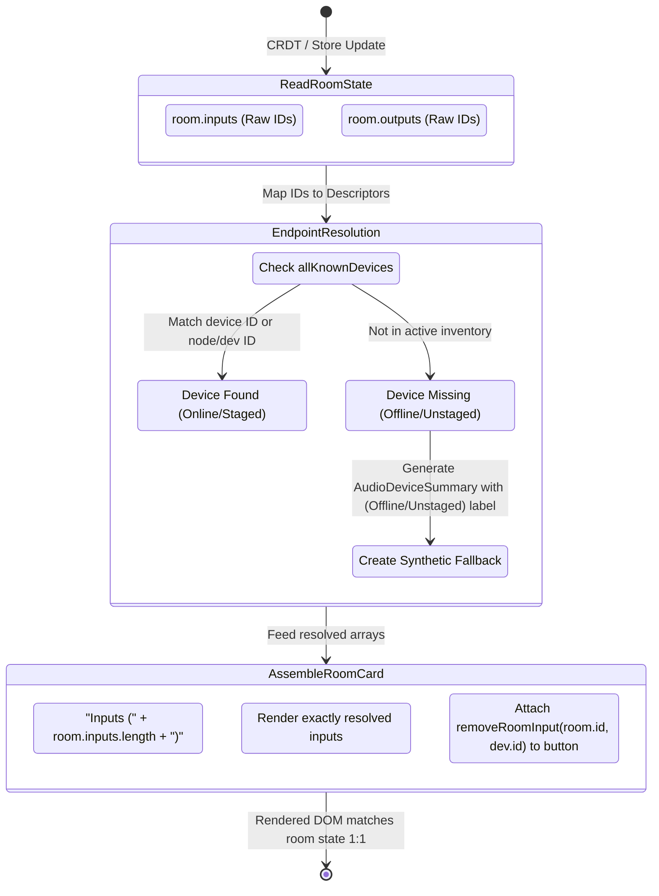

# ADR 0027: Directional Endpoint Staging and Room Acoustic Decoupling

* **Status:** Accepted
* **Deciders:** Core Systems Architecture Team, Distributed Systems & Network Engineering, Frontend Web UI Engineering, Real-Time Audio Infrastructure
* **Date:** 2026-10-04

---

## Context and Problem Statement

`audio-router-p2p` provides a real-time, low-latency audio routing bus and matrix crossbar spanning local soundcards, loopbacks, and distributed peer nodes. Users manage routing topologies via the SvelteFlow-based Audio Flow Canvas (`web/src/lib/components/rooms/RoomCanvas.svelte`), where audio devices, rooms, and patch connections are interactively manipulated.

Physical soundcards, USB audio interfaces, and virtual loopback sinks are frequently **duplex**—possessing both capture (input/ADC) and playback (output/DAC) capabilities within a single physical hardware device and URN (ADR 0013, ADR 0018). In the Audio Flow Canvas, these duplex interfaces are visually projected as two separate directional nodes:
* An **Input Node** (`input-${canvasKey}`) on the left ingress column.
* An **Output Node** (`output-${canvasKey}`) on the right egress column.

A critical defect emerged in canvas state management and room bus presentation:

1. **Collateral Node Destruction on Directional Node Dismissal:**
   The presentation store (`FlowLayoutStore`, `web/src/lib/stores/flowLayout.svelte.ts`) tracked staged devices via a monolithic set of device IDs (`enabledDevices: Set<string>`). Because staging was tracked at the physical device level rather than the directional endpoint level, clicking "Dismiss" (unstage) on an unconnected output node of a duplex device invoked `flowLayoutStore.disableDevice(deviceId)`. This removed the entire device identifier from `enabledDevices`. Consequently, during the subsequent graph synchronization (`syncFlowGraph()`), the counterpart **input node was destroyed and vanished from the canvas**, even if that input node was actively streaming live audio into a room bus.

2. **Phantom Room Bindings and Visual Count Discrepancies:**
   In `RoomCanvas.svelte`, the room bus card displayed assigned inputs and outputs via two derived collections: `assignedInputs` and `assignedOutputs`. Crucially, these collections were computed by filtering `stagedDevs` (the devices currently present on the canvas). When an input or output device was assigned to a room in the backend/CRDT state (`room.inputs` or `room.outputs`) but the device was either:
   - Dismissed / unstaged from the canvas layout,
   - Assigned remotely by another cluster peer, or
   - Currently offline / disconnected,

   the room bus node card header rendered `Inputs (N)` based on `room.inputs.length`, but the rendered list below was derived from `assignedInputs` (which only contained staged devices). This caused an acute visual paradox: the card header displayed `Inputs (1)` or `Outputs (2)`, but the list was completely empty. Operators were presented with phantom audio streams that could neither be inspected, monitored, nor unassigned via the UI card unbind button (`X`).

3. **Indiscriminate Route Teardown:**
   Dismissing a node on the canvas executed defensive route removal. However, because hardware identity was conflated with directional endpoints, dismissing an unused output could trigger unbinding of active input routes, causing accidental audio dropouts during live production.

A comprehensive architectural solution is required to decouple hardware identity from directional audio routing endpoints, support independent directional staging with backward-compatible persistence, isolate directional node dismissal, and establish authoritative acoustic resolution in room cards.

---

## Decision Drivers

* **Directional Lifecycle Isolation:** Dismissing, staging, moving, or hiding one directional node of a duplex device must have zero impact on the counterpart directional node.
* **Acoustic Truth & Phantom Binding Elimination:** The visual device lists on Room cards must strictly reflect the authoritative room state (`room.inputs` and `room.outputs`). For every integer count $N$ reported in `Inputs (N)`, exactly $N$ interactive device entries must render in the DOM, regardless of canvas staging or online/offline status.
* **Defensive Unbinding Scoping:** Unbinding an endpoint upon dismissal must strictly unbind routes matching that specific direction (`input` vs `output`).
* **Backward Compatibility & Seamless Migration:** Existing persisted canvas layouts in browser `localStorage` (`audio_router_flow_layout_v1`) must migrate smoothly without user intervention, data corruption, or spatial coordinate loss.
* **Cluster & Offline Resilience:** Devices bound to rooms that are hosted on remote cluster nodes or temporarily disconnected must render explicit placeholder cards with active unbind controls.

---

## Considered Options

### Option 1: Canvas-Level Presentation Masking (CSS / DOM Toggle Only)
* **Description:** Retain monolithic device staging in `FlowLayoutStore`, but add client-side flags to hide specific DOM elements using CSS (`display: none` or conditional Svelte blocks).
* **Pros:**
  - Minimal changes to `FlowLayoutStore` schema.
* **Cons:**
  - SvelteFlow internal node registry still contains the hidden node, corrupting edge connection auto-layout, bounding box recomputation, and collision detection algorithms.
  - Does not resolve the phantom binding issue in room cards, as the device is still considered staged or unstaged as a monolithic entity.
  - High probability of state desynchronization between canvas edges and hidden nodes.

### Option 2: Backend-Level Hardware Splitting (Decompose HAL Devices into Unidirectional Virtual Entities)
* **Description:** Refactor the Go backend device enumeration (`pkg/audio/hal`) to split every duplex physical soundcard into two distinct virtual devices (e.g., `urn:audio:hw:alsa:c=CODEC:d=0:in` and `urn:audio:hw:alsa:c=CODEC:d=0:out`).
* **Pros:**
  - Forces complete decoupling across the entire stack down to ALSA/PulseAudio/CoreAudio abstractions.
* **Cons:**
  - Violates RFC 8141 canonical device URN specifications established in ADR 0013.
  - Massive breaking change across Go REST APIs, CRDT state schemas, ALSA handle management, and telemetry pipelines.
  - Substantially increases memory and telemetry broadcast overhead by doubling registered device structs for physical hardware.

### Option 3 (Selected): Directional Endpoint Staging, Authoritative Room Card Acoustic Resolution, and V1/V2 Storage Migration
* **Description:**
  1. **Directional Endpoint Qualification:** Explicitly identify directional staging keys as `in:<canvasKey>` and `out:<canvasKey>` (or `input-${canvasKey}` / `output-${canvasKey}`), separating directional presentation from physical hardware identity.
  2. **Refactored `FlowLayoutStore`:** Introduce directional staging APIs (`isEndpointStaged(canvasKey, direction)`, `stageEndpoint(canvasKey, direction, pos?)`, `unstageEndpoint(canvasKey, direction)`), while preserving legacy `isDeviceEnabled` / `enableDevice` as compatibility wrappers.
  3. **Automatic Schema Migration:** Transparently migrate V1 `stagedDeviceIds: string[]` in `localStorage` to support directional endpoints upon hydration.
  4. **Authoritative Room Card Resolution:** Decouple room card input/output listings from canvas `stagedDevs`. Resolve room inputs and outputs directly against `allKnownDevices` with synthetic fallback descriptors for unstaged or offline devices.
  5. **Directionally Isolated Defensive Unbinding:** Ensure node dismissal exclusively unbinds routes matching the dismissed direction.
* **Pros:**
  - Completely isolates input and output node lifecycles for duplex hardware.
  - Eliminates phantom room bindings; room card item counts always equal rendered DOM items.
  - Zero backend breaking changes; preserves canonical URNs (ADR 0013) and cluster endpoint qualification (ADR 0018).
  - Guarantees backward compatibility with existing user layouts.

---

## Decision Outcome

We have adopted **Option 3**. The architecture is implemented across the frontend state stores, canvas rendering pipelines, and room bus presentation components.

### 1. Directional Endpoint Data Model & Key Qualification

A canvas routing endpoint is formally decoupled from physical soundcard identity. While a physical audio interface is identified by its canonical node-qualified key:
$$\text{canvasKey} = \begin{cases} \text{nodeId}/\text{deviceId} & \text{if remote or node-qualified} \\ \text{deviceId} & \text{if local} \end{cases}$$

Its directional representation on the canvas is qualified by its signal flow direction $D \in \{\text{'input'}, \text{'output'}\}$:
$$\text{EndpointKey}(D, \text{canvasKey}) = \begin{cases} \text{"in:"} + \text{canvasKey} & \text{if } D = \text{'input'} \\ \text{"out:"} + \text{canvasKey} & \text{if } D = \text{'output'} \end{cases}$$

SvelteFlow DOM node identifiers remain deterministically mapped as:
$$\text{NodeID}(D, \text{canvasKey}) = \begin{cases} \text{"input-"} + \text{canvasKey} & \text{if } D = \text{'input'} \\ \text{"output-"} + \text{canvasKey} & \text{if } D = \text{'output'} \end{cases}$$

### 2. Refactored `FlowLayoutStore` API & Staging Lifecycle

`FlowLayoutStore` (`web/src/lib/stores/flowLayout.svelte.ts`) is enhanced with explicit directional staging primitives:

* `isEndpointStaged(canvasKey: string, direction: 'input' | 'output'): boolean`:
  Returns `true` if the specific directional endpoint is staged. It checks directional tags (`in:<key>`, `out:<key>`), SvelteFlow node IDs (`input-<key>`, `output-<key>`), and falls back to legacy bare device keys for backward compatibility.
* `stageEndpoint(canvasKey: string, direction: 'input' | 'output', pos?: { x: number; y: number })`:
  Stages only the specified directional endpoint by adding `in:<canvasKey>` or `out:<canvasKey>` to `enabledDevices` and optionally storing its canvas spatial coordinates under `input-${canvasKey}` or `output-${canvasKey}`.
* `unstageEndpoint(canvasKey: string, direction: 'input' | 'output')`:
  Removes only the specified directional endpoint from `enabledDevices` and deletes its spatial position in `positions`. If a legacy bare device key exists, it is migrated into the remaining counterpart directional key so that the un-dismissed endpoint remains visible.

### 3. V1 to V2 Schema Migration & Backward Compatibility

To prevent layout loss when operators reload updated clients, `FlowLayoutStore.hydrate()` executes an automatic in-memory schema upgrade:

```
+----------------------------------------------------------------+
| Legacy V1 Schema (audio_router_flow_layout_v1)                 |
| stagedDeviceIds: ["hw:0", "node2/hw:1"]                        |
+----------------------------------------------------------------+
                               |
                               v Automatic Hydration Migration
+----------------------------------------------------------------+
| Normalized Directional State (In-Memory / V2 Capable)          |
| enabledDevices: Set {                                          |
|   "in:hw:0", "out:hw:0",                                       |
|   "in:node2/hw:1", "out:node2/hw:1"                            |
| }                                                              |
| positions: Map {                                               |
|   "input-hw:0"       => { x: 80,  y: 120 },                    |
|   "output-hw:0"      => { x: 920, y: 120 },                    |
|   "input-node2/hw:1" => { x: 80,  y: 300 }                     |
| }                                                              |
+----------------------------------------------------------------+
```

If legacy bare device keys (e.g., `"hw:0"`) are encountered without directional prefixes:
1. If node positions exist for both `input-hw:0` and `output-hw:0`, or if device capabilities are unknown duplex, both `in:hw:0` and `out:hw:0` are staged.
2. If only one directional position exists, only that corresponding directional endpoint is preserved.
3. Subsequent writes serialize directional identifiers, preventing future ambiguities.

### 4. Authoritative Room Card Acoustic Resolution

The room bus card (`RoomBusNode.svelte`) and canvas synchronization (`RoomCanvas.svelte`) are decoupled from canvas staging:

* **Separation of Concerns:** Canvas `stagedDevs` dictates *only* what standalone device nodes appear on the canvas workspace. It does **not** dictate the acoustic membership of a room bus.
* **Direct CRDT/API Resolution:** For any room $R$, `assignedInputs` and `assignedOutputs` are derived directly from $R.\text{inputs}$ and $R.\text{outputs}$:
  $$\text{assignedInputs}(R) = \left\{ \operatorname{ResolveEndpoint}(id, \text{'input'}) \mid id \in R.\text{inputs} \right\}$$
  $$\text{assignedOutputs}(R) = \left\{ \operatorname{ResolveEndpoint}(id, \text{'output'}) \mid id \in R.\text{outputs} \right\}$$
* **Fallback Endpoint Synthesis:** If an assigned endpoint ID is not present in `allKnownDevices` (e.g., hardware unplugged, unstaged from canvas, or remote peer unreachable):
  - A synthetic `AudioDeviceSummary` is generated with:
    - `id`: Raw device ID.
    - `name`: `"${deviceName} (Offline / Unstaged)"`.
    - `node_id`: Inferred remote node ID or local host ID.
  - The synthetic device is injected into `assignedInputs` or `assignedOutputs`.
* **Invariant Guarantee:**
  $$|\text{renderedInputItems}| \equiv |R.\text{inputs}| \quad \land \quad |\text{renderedOutputItems}| \equiv |R.\text{outputs}|$$
  The count rendered in the header `Inputs (${room.inputs.length})` **always strictly equals** the number of device rows rendered inside the card, completely extinguishing phantom bindings. Every row includes an active unbind button (`X`) wired to `roomStore.removeRoomInput` or `roomStore.removeRoomOutput`.

### 5. Defensive Directional Unbinding

When an operator dismisses an endpoint from the canvas:
* If the user clicks dismiss on `output-${canvasKey}`:
  - `direction` is explicitly passed as `'output'`.
  - The unbinding loop iterates across `roomStore.rooms` and removes matches **exclusively from `room.outputs`**.
  - `room.inputs` is **never touched**.
  - `flowLayoutStore.unstageEndpoint(canvasKey, 'output')` removes only the output node.
  - The counterpart input node `input-${canvasKey}` remains staged, positioned, and actively rendering audio telemetry.

---

## Consequences

### Positive Consequences
* **No Collateral Node Destruction:** Operators can freely dismiss unused DAC outputs of duplex devices without unseating active microphones, patch cables, or telemetry monitors.
* **Elimination of Phantom Room Bindings:** Room cards always show 100% of their actual audio bindings. If an endpoint is offline or unstaged from the canvas, it remains visible and unbindable directly within the room card.
* **Surgical Audio Route Teardown:** Dismissing an output endpoint never tears down counterpart input audio routes, preventing accidental broadcast silence.
* **Backward Compatibility:** Existing client layouts in `localStorage` seamlessly upgrade on startup without losing custom coordinates.
* **Clean Distributed Operations:** Remote cluster devices bound to a room are visible inside the room card even if the operator has not explicitly staged those remote nodes on their personal canvas.

### Negative Consequences & Trade-offs (Explicit Costs)
* **Storage Key Namespace Complexity:** `FlowLayoutStore` now tracks both directional keys (`in:<key>`, `out:<key>`) and legacy bare keys during transition, increasing the branching complexity of lookup methods.
* **Independent Position State Tracking:** Duplex devices now require independent coordinate tracking for inputs and outputs. Auto-arrange algorithms must account for two separate node keys per duplex device.
* **Synthetic Fallback Allocation:** Constructing synthetic fallback descriptors for offline/unstaged devices introduces minor frontend object allocation during canvas graph re-synchronization.
* **Edge Connection Verification:** Canvas edges connecting to unstaged endpoints cannot be drawn across empty space; the system must gracefully omit canvas edges while retaining the device inside the room card list.

---

## Visual Architecture

### 1. Directional Node Dismissal Isolation Sequence

The following sequence illustrates dismissing an unused output node of a duplex device (`hw:0`) while keeping the connected input node alive and streaming.

```mermaid
sequenceDiagram
    autonumber
    actor Op as Operator (Web UI)
    participant CN as Canvas Node<br/>(output-hw:0)
    participant RC as RoomCanvas.svelte
    participant FLS as FlowLayoutStore
    participant RS as RoomStore (CRDT)
    participant IN as Canvas Node<br/>(input-hw:0)

    Note over Op,IN: Duplex device 'hw:0' has both input and output on canvas
    Note over IN: input-hw:0 is wired to Room-A (Active Audio)
    Note over CN: output-hw:0 is unconnected / unused

    Op->>CN: Click "Dismiss" (X)
    CN->>RC: handleDismissDevice("hw:0", "output")
    
    rect rgb(20, 30, 45)
        Note over RC,RS: Step 1: Direction-Scoped Defensive Unbinding
        RC->>RS: Inspect active rooms for "hw:0" in outputs ONLY
        Note over RC: room.inputs is NOT modified (input-hw:0 route preserved)
    end

    rect rgb(30, 45, 30)
        Note over RC,FLS: Step 2: Isolated Endpoint Staging Pruning
        RC->>FLS: unstageEndpoint("hw:0", "output")
        FLS->>FLS: Remove "out:hw:0" from enabledDevices
        FLS->>FLS: Delete position for "output-hw:0"
        Note over FLS: "in:hw:0" and "input-hw:0" position REMAIN INTACT
        FLS->>FLS: Persist to localStorage
    end

    RC->>RC: syncFlowGraph()
    Note over RC: output-hw:0 unmounted from DOM
    Note over IN: input-hw:0 remains mounted and active!
```



---

### 2. Room Card Acoustic Resolution State Flow

The following state machine depicts how room card acoustic resolution guarantees consistency between authoritative CRDT room state and rendered card items.



---

## Next Steps

1. **Test Permutation Coverage:** Update `web/src/tests/matrix_permutations.test.ts` and E2E specs to verify:
   - Dismissing an output node preserves the counterpart input node and its active wires.
   - Room card lists match count headers when devices are unmounted from the canvas.
2. **Persistence Schema Validation:** Verify in Vitest that V1 schema payloads stored in `localStorage` properly hydrate into directional endpoints without dropping saved coordinates.
3. **Palette UI Synchronization:** Ensure the Palette sidebar reflects the independent staged/unstaged state of input and output handles for duplex devices.
