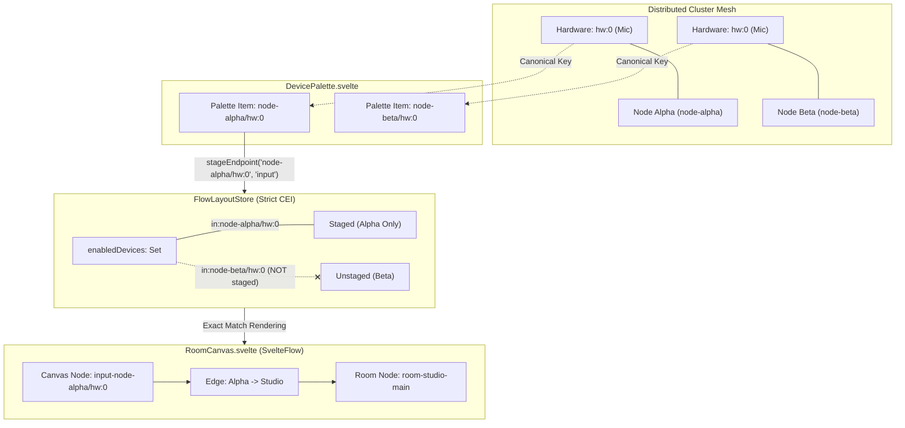

# ADR 0028: Canonical Endpoint Isolation and Multi-Node Staging

* **Status:** Accepted
* **Deciders:** Core Systems Architecture Team, Distributed Systems & Network Engineering, Frontend Web UI Engineering, Real-Time Audio Infrastructure
* **Date:** 2026-10-04

---

## Context and Problem Statement

`audio-router-p2p` orchestrates real-time, low-latency audio pipelines across local hardware soundcards, virtual loopbacks, and multi-node peer-to-peer mesh clusters. Routing topology is interactively defined and observed via the SvelteFlow-powered Audio Flow Canvas (`web/src/lib/components/rooms/RoomCanvas.svelte`), supported by layout persistence (`flowLayoutStore` in `web/src/lib/stores/flowLayout.svelte.ts`), device discovery (`DevicePalette.svelte`), and room crossbar controllers (`RoomBusNode.svelte`).

In multi-node audio clusters, audio interfaces frequently share identical hardware identifiers across nodes. For instance:
* Default soundcard interfaces on standard Linux ALSA distributions: `hw:0`, `default`, `sysdefault`.
* Off-the-shelf USB audio interfaces: `mic-1`, `usb-audio-codec`, `headset`.
* Standard system virtual sinks: `virt:loopback:monitor`, `default_input`.

ADR 0013 introduced RFC 8141 URNs, ADR 0018 established node-qualified endpoint keys (`<node_id>/<device_id>`), and ADR 0027 introduced directional endpoint tagging (`in:<key>`, `out:<key>`). Despite these specifications, the presentation, staging, and connection-linking layers in the Web UI retained legacy "loose suffix matching" heuristics. Specifically, stores and components routinely performed evaluations such as:
```typescript
// Problematic loose suffix matching examples in flowLayoutStore and RoomCanvas:
stripped.endsWith(`/${cleanKey}`) || cleanKey.endsWith(`/${stripped}`)
d.endsWith(`/${cleanKey}`) || cleanKey.endsWith(`/${d}`)
list.some((item) => item.endsWith(`/${devId}`))
targetRoom?.inputs?.find((i) => i === rawDevId || i.endsWith(`/${rawDevId}`))
inputDevId.endsWith(`/${d.id}`)
```

When an operator managed a multi-node cluster with identical hardware (e.g., `nodeA` having `nodeA/mic-1` and `nodeB` having `nodeB/mic-1`), stripping the node prefix to `cleanKey = "mic-1"` or testing `item.endsWith("/mic-1")` caused catastrophic cross-node namespace collisions:

1. **Staging Entanglement & Ghost Nodes:**
   Staging an input or output on `nodeA` (e.g., adding `nodeA/mic-1`) evaluated `nodeB/mic-1.endsWith("/mic-1")` as `true` in `flowLayoutStore.isEndpointStaged`. As a result, the `DevicePalette` falsely displayed `nodeB/mic-1` as already staged on the canvas. When staging operations occurred, counterpart devices across remote nodes were unintentionally forced onto the canvas.

2. **Collateral Unstaging & Node Disappearance:**
   Dismissing or unstaging `nodeA/mic-1` triggered pruning loops in `unstageEndpoint` and `disableDevice`. Because `nodeB/mic-1.endsWith("/mic-1")` evaluated to `true`, `nodeB/mic-1` was excised from `enabledDevices` and `positions`. An operator dismissing a local microphone inadvertently destroyed the canvas representation of remote studio microphones on peer nodes.

3. **Cross-Node Room Route Destruction:**
   In `handleDismissDevice` and `handleDelete`, canvas dismissal executed defensive unbinding by checking `room.inputs?.find(i => i === deviceId || i === clean || i.endsWith(`/${clean}`))`. Dismissing `nodeA/mic-1` wiped `nodeB/mic-1` from the room's CRDT binding set, tearing down live, remote audio routes mid-production.

4. **Component Boundary Degradation & Bare ID Propagation:**
   `DevicePalette.svelte` and `RoomBusNode.svelte` frequently emitted bare `dev.id` (such as `"mic-1"`) rather than canonical, node-qualified keys (`"${nodeId}/${dev.id}"`). When received by `RoomCanvas` or `roomStore`, handlers either guessed the node locality or defaulted to the local node, completely collapsing multi-node audio topology into single-node split-brain state.

A definitive architectural decision is required to enforce **Strict Canonical Endpoint Identity (CEI)** across all frontend layout stores, canvas rendering routines, device palettes, and room cards, eradicating loose suffix heuristics permanently.

---

## Decision Drivers

* **Absolute Cross-Node Isolation:** Interacting with an audio device on `nodeA` (staging, unstaging, dragging, unbinding) must have zero side-effects on identical hardware identifiers on `nodeB`.
* **Determinism in Multi-Node Meshes:** Canonical keys must remain immutable and unambiguous across UI component boundaries, eliminating non-deterministic suffix matching and bare-identifier fallback degradation.
* **Safe Backward Compatibility:** Single-node local deployments and legacy persisted client stores must continue functioning without data loss, while prohibiting unqualified keys from colliding in multi-node environments.
* **Acoustic and Visual Parity:** The devices shown on the canvas and listed within Room Bus cards must strictly match the exact physical and network routes managed by the distributed Go audio crossbar.
* **Surgical Route Lifecycle:** Deleting an edge or dismissing a node must unbind exclusively the specified directional endpoint on the specified node.

---

## Considered Options

### Option 1: Heuristic Prefix Weighting (Score-Based Matching)
* **Description:** Retain `endsWith` suffix checks but assign weighted scores based on string length, node proximity, or cluster peer status to pick the "best match" when a suffix collision occurs.
* **Pros:**
  - Preserves loose API signatures and legacy UI components without strict type enforcement.
* **Cons:**
  - Non-deterministic: heuristics fail as cluster topology dynamically scales.
  - Race conditions during peer joining or reconnecting.
  - Leaves the root cause (ambiguous identifier representation) unresolved.

### Option 2: Mandatory Global URN Overhaul in Web UI Stores
* **Description:** Force all frontend components and stores to exclusively use full RFC 8141 URN strings (e.g., `urn:audio:node:nodeA:dev:hw:0`) everywhere, rejecting any short identifiers.
* **Pros:**
  - Full adherence to RFC 8141 across all layers down to Svelte components.
* **Cons:**
  - Extremely verbose; breaks existing SvelteFlow DOM selector IDs (`input-urn:audio:...` requires complex CSS escaping for colons).
  - Incompatible with existing `audio_router_flow_layout_v1` serialized layouts in browser `localStorage`.
  - Massive boilerplate in template expressions and component events.

### Option 3 (Selected): Strict Canonical Endpoint Identity (CEI), Suffix Purge, and Exact Matching
* **Description:**
  1. Formalize Canonical Endpoint Identity (CEI) as `<node_id>/<device_id>` (and `in:<node_id>/<device_id>` / `out:<node_id>/<device_id>` for directional staging).
  2. Completely purge loose `endsWith` and bidirectional substring checks from `flowLayoutStore`, `RoomCanvas`, `DevicePalette`, and `RoomBusNode`.
  3. Enforce exact canonical matching: `nodeA/dev` and `nodeB/dev` never match under any circumstance. Unqualified keys (`dev`) match only when an endpoint is explicitly unqualified and no node ambiguity exists.
  4. Ensure `DevicePalette` and `RoomBusNode` strictly emit node-qualified canonical IDs for all callbacks (`onAddDevice`, `onFocusDevice`, `onAddInput`, `onRemoveInput`, `onAddOutput`, `onRemoveOutput`).
  5. Scope `handleDismissDevice` and defensive edge teardown strictly to the targeted canonical endpoint and direction.
* **Pros:**
  - Eliminates all cross-node ghost staging, collateral unstaging, and cross-node unbinding.
  - Simple, deterministic string equality comparison ($O(1)$ lookup complexity).
  - Safe compatibility: local devices without node qualifications continue working, while multi-node clusters remain strictly partitioned.
  - Works seamlessly with SvelteFlow DOM keys and ADR 0027 directional prefixes.

---

## Decision Outcome

We have adopted **Option 3**. The architecture mandates Strict Canonical Endpoint Identity across the entire frontend lifecycle.

### 1. Strict Canonical Endpoint Identity (CEI) Specification

Audio endpoints within the Web UI presentation and persistence tiers conform to the following formal grammar:

$$\text{EndpointKey} ::= [\text{DirectionPrefix}] \; [\text{NodeQualifier}] \; \text{DeviceID}$$

Where:
* $\text{DirectionPrefix} \in \{\text{"in:"}, \text{"out:"}\}$ (for directional staging in `flowLayoutStore`), or $\{\text{"input-"}, \text{"output-"}\}$ (for SvelteFlow DOM node IDs).
* $\text{NodeQualifier} ::= \text{NodeID} \; \text{"/"}$
* $\text{DeviceID} ::= \text{ALSA/Pulse/Virtual Device Identifier (e.g., "hw:0", "mic-1")}$

**Canonical Representation Rules:**
1. Whenever the parent node ID is known (from `device.node_id`, `node.id`, or cluster inventory), the key **must** be formatted as `${nodeId}/${deviceId}`.
2. In directional staging contexts, the key is prefixed as `in:${nodeId}/${deviceId}` or `out:${nodeId}/${deviceId}`.
3. Two endpoints $E_1 = N_1 / D_1$ and $E_2 = N_2 / D_2$ match **if and only if**:
   $$E_1 \equiv E_2 \iff (N_1 = N_2 \land D_1 = D_2)$$
   If $N_1 \neq N_2$, the keys are completely disjoint, even if $D_1 = D_2$.

### 2. Elimination of Loose Suffix Matching (`endsWith` Purge)

All loose suffix inspections across presentation stores and layout engines are replaced with exact matching or explicit node extraction:

```typescript
// BEFORE (Vulnerable to cross-node collisions):
if (stripped === cleanKey || stripped.endsWith(`/${cleanKey}`) || cleanKey.endsWith(`/${stripped}`)) {
  return true; // Accidental match between nodeA/mic-1 and nodeB/mic-1
}

// AFTER (Strict Canonical Endpoint Isolation):
function matchesEndpoint(candidate: string, targetKey: string): boolean {
  if (candidate === targetKey) return true;
  // If targetKey is qualified (contains '/'), DO NOT match another qualified key with a different node!
  if (targetKey.includes('/')) {
    return false;
  }
  // If targetKey is bare, match only if candidate is the exact same bare ID
  // or explicitly qualifies the local node
  return candidate === targetKey;
}
```

In `flowLayoutStore.svelte.ts`:
* `isEndpointStaged(canvasKey, direction)`: Strips the directional tag (`in:`, `out:`) and requires exact match against `canvasKey`.
* `unstageEndpoint(canvasKey, direction)`: Only removes entries where the stripped key equals `canvasKey`. Counterpart directional keys on remote nodes remain untouched.
* `disableDevice(deviceId, nodeId, direction)`: Builds the canonical key `${nodeId}/${deviceId}` and removes only that specific device.

In `RoomCanvas.svelte`:
* `isDevInList(list, devId, nodeId)`: Checks `list.includes(`${nodeId}/${devId}`)` or `list.includes(devId)`. Never uses `item.endsWith('/' + devId)` across differing nodes.
* Route Edge Synchronization: Edges from input devices to rooms and rooms to output devices match strictly against `${nodeId}/${d.id}`.

### 3. Component Boundary Canonical Qualification

All dispatching components are refactored to pass fully qualified canonical identifiers:

1. **`DevicePalette.svelte`**:
   * Evaluates staging via `flowLayoutStore.isEndpointStaged(canvasKey, direction)` where `canvasKey = node.id ? `${node.id}/${device.id}` : device.id`.
   * Dispatches `onAddDevice`, `onFocusDevice` with canonical keys:
     ```svelte
     onclick={() => onFocusDevice?.(canvasKey, 'input')}
     ```
   * Drag-and-drop payloads explicitly pack `nodeId` and `deviceId`.

2. **`RoomBusNode.svelte`**:
   * Renders input/output device badges using canonical endpoint identity.
   * `data.onRemoveInput(dev.id)` and `data.onRemoveOutput(dev.id)` transmit the full qualified ID stored in `room.inputs` / `room.outputs`.

3. **`RoomCanvas.svelte`**:
   * When handling device drops (`handleDeviceDrop`), the canonical key is constructed as `${nodeId}/${deviceId}` before staging or binding.
   * When handling element dismissal (`handleDismissDevice(deviceId, direction)`), unbinding searches the room inputs/outputs strictly for `deviceId` (and its exact canonical aliases), preventing route destruction on sibling nodes.

### 4. Surgical Dismissal and Defensive Route Teardown

Dismissing an endpoint from the canvas now follows a strict isolation protocol:
1. Extract canonical `canvasKey` and direction (`input` vs `output`).
2. Search active rooms for bindings matching **only** this canonical key.
3. Invoke `roomStore.removeRoomInput` or `roomStore.removeRoomOutput` exclusively for the exact matched key.
4. Unstage only the targeted directional endpoint from `flowLayoutStore`.

---

## Consequences

### Positive Consequences
* **Immunity to Multi-Node Name Collisions:** Staging or unbinding `nodeA/mic-1` has zero effect on `nodeB/mic-1`. Multi-microphone, multi-stage studio setups operate reliably.
* **Eradication of Ghost Palette Badges:** The Device Palette accurately indicates whether a device is staged on canvas for its specific host node.
* **Preservation of Active Remote Audio:** Dismissing an unused local endpoint never tears down live remote streams bound to the same audio room.
* **Deterministic Edge Graph Compilation:** SvelteFlow edges connect precisely to the intended node instance without jumping between duplicate hardware on different machines.
* **High-Performance Lookups:** Replacing linear substring/suffix array scans with exact string matches and Set/Map lookups improves graph layout render times.

### Negative Consequences & Trade-offs (Explicit Costs)
* **Strict Parameter Requirements:** UI component callbacks (`onFocusDevice`, `onAddDevice`, `onRemoveInput`) must be vigilant about passing node-qualified keys. Passing an unqualified string risks failing lookup in multi-node setups.
* **Transition Logic for Legacy Storage:** Persisted layouts that contain legacy bare device keys must be disambiguated against local or available cluster nodes during hydration.
* **Canvas Key Verbosity:** Key comparisons and debugging logs require longer string keys (`nodeA/hw:0` vs `hw:0`).

### Neutral / Operational Consequences
* **Logging Clarity:** Frontend and backend logs now display globally unambiguous endpoint references, dramatically simplifying cross-node troubleshooting and distributed tracing.
* **Zero Wire Protocol Impact:** REST API contracts and CRDT network schemas already support canonical keys (ADR 0018); this decision aligns frontend execution strictly with the existing protocol contract.

---

## Visual Architecture

### 1. Multi-Node Canvas Staging & Isolation Architecture

The following diagram illustrates how identical hardware (`hw:0`) across two distinct cluster nodes (`node-alpha` and `node-beta`) is isolated into separate canonical namespaces throughout the store and canvas hierarchy.



---

### 2. Isolated Endpoint Dismissal Sequence

The following sequence contrasts the legacy loose matching failure against the strict canonical isolation flow during endpoint dismissal.

```mermaid
sequenceDiagram
    autonumber
    actor Op as Operator (Web UI)
    participant CN as Canvas Node<br/>(input-node-alpha/mic-1)
    participant RC as RoomCanvas.svelte
    participant RS as RoomStore (CRDT)
    participant FLS as FlowLayoutStore
    participant Peer as Remote Node<br/>(node-beta/mic-1)

    Note over Op,Peer: Cluster has identical 'mic-1' on both node-alpha and node-beta.<br/>Both are actively routed into Room 101.

    Op->>CN: Click "Dismiss" on node-alpha/mic-1
    CN->>RC: handleDismissDevice("node-alpha/mic-1", "input")

    rect rgb(20, 35, 20)
        Note over RC,RS: Step 1: Strict Canonical Route Unbinding
        RC->>RS: Scan room.inputs for exact key "node-alpha/mic-1"
        RS->>RS: Remove "node-alpha/mic-1" from Room 101 inputs
        Note over RS,Peer: "node-beta/mic-1" DOES NOT MATCH!<br/>Remote audio stream remains actively running and unharmed!
    end

    rect rgb(20, 25, 40)
        Note over RC,FLS: Step 2: Strict Layout Staging Pruning
        RC->>FLS: unstageEndpoint("node-alpha/mic-1", "input")
        FLS->>FLS: Delete "in:node-alpha/mic-1" from enabledDevices
        Note over FLS: No loose endsWith checks!<br/>"in:node-beta/mic-1" remains untouched in store!
    end

    RC->>RC: syncFlowGraph()
    Note over RC: Canvas updates: node-alpha node unmounted.<br/>node-beta node remains active on canvas!
