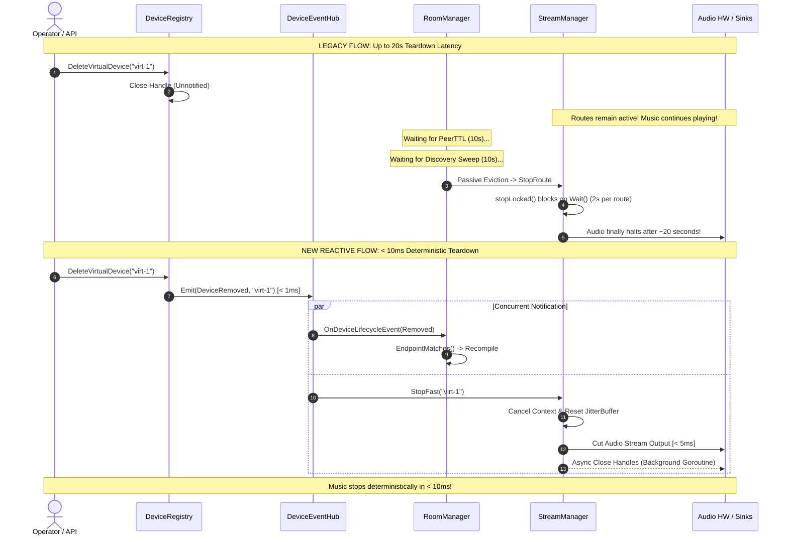
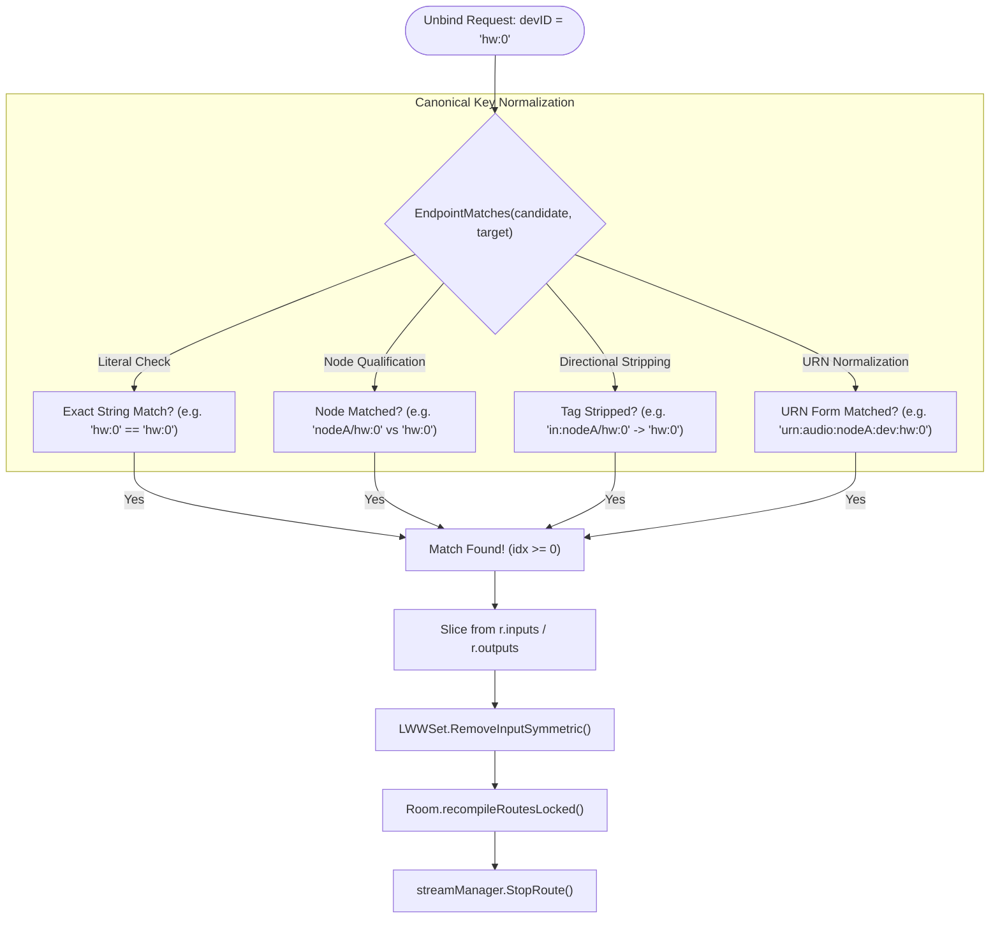
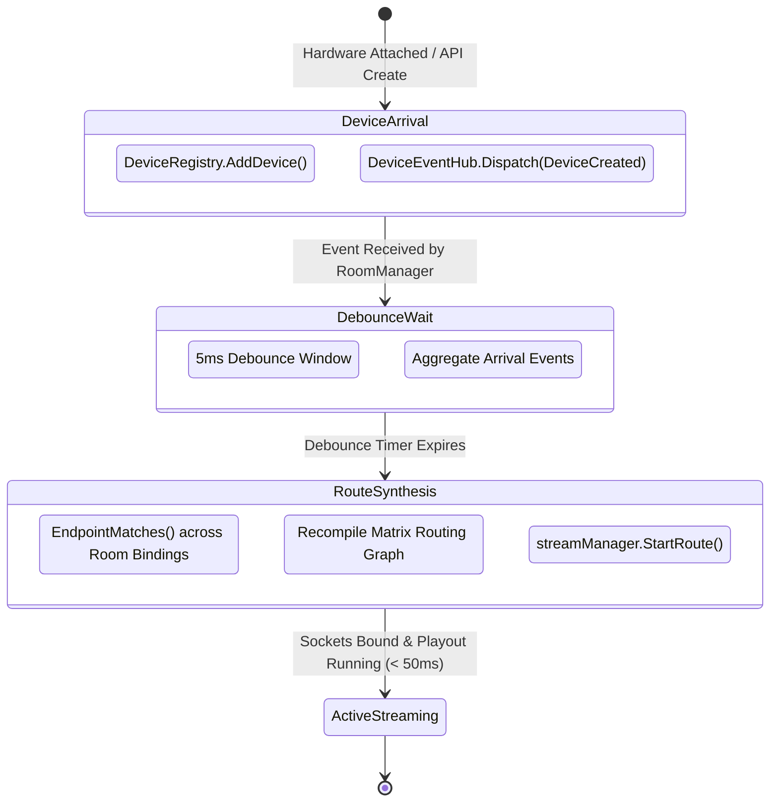

# ADR 0029: Reactive Low-Latency Endpoint Lifecycle and Deterministic Route Teardown

* **Status:** Accepted
* **Deciders:** Core Systems Architecture Team, Real-Time Audio Infrastructure, Distributed Systems & Network Engineering, Web UI Engineering
* **Date:** 2026-10-10

---

## Context and Problem Statement

`audio-router-p2p` coordinates real-time, low-latency audio distribution across heterogeneous physical soundcards (ALSA/PulseAudio), virtual loopback interfaces, and cross-node P2P mesh topologies. High-fidelity audio workflows demand instantaneous route reconfiguration: when an operator removes a device or dismisses an audio patch, sound must stop immediately; conversely, when a device is plugged in or a route is established, audio must start without perceptible delay.

In the existing architecture, endpoint lifecycle operations exhibited severe latency anomalies:
* **Disconnect / Route Deletion:** Disconnecting a physical audio interface, deleting a virtual loopback device, or unbinding an endpoint from a room took up to **20 seconds** before audio playback actually ceased.
* **Reconnect / Route Creation:** Reconnecting a hardware interface or rebinding an endpoint required up to **10 seconds** before audio resumed.

System profiling and root-cause analysis identified five interconnected failure modes across the control and data planes:

1. **Passive Polling & Discovery Sweep Fallback:**
   The system lacked reactive, push-based teardown triggers for disconnected endpoints. Instead, route eviction fell back onto the peer discovery gossip mechanism. Dead endpoints were only pruned after the `PeerTTL` expired (default: 10s) and the background discovery sweep ticker ran (interval: 10s), resulting in up to 20 seconds of orphaned, zombie streaming before routes were terminated.

2. **Canonical Key Asymmetry and Silent Deletion Failures:**
   Audio endpoint keys were formatted inconsistently across boundaries:
   * API endpoints received node-qualified keys (`nodeA/mic-1`) or bare device identifiers (`mic-1`).
   * Room state tracked raw strings in `r.inputs` and `r.outputs`.
   * CRDT LWW-Element-Sets recorded operations across `InputAdds`, `InputRemoves`, `OutputAdds`, and `OutputRemoves`.
   
   In `Room.RemoveInput` and `Room.RemoveOutput`, endpoint removal relied on strict literal string matching (`if id == devID`). If `r.inputs` held `"node-1/hw:0"` and the API or UI issued `RemoveInput("hw:0")` (or vice versa), the lookup evaluated to `idx == -1`. The deletion operation was silently dropped as a no-op, leaving routes compiled and active until passive peer timeouts fired.

3. **Decoupled Device Deletion:**
   When an operator or API destroyed a virtual loopback device (`DeviceRegistry.DeleteVirtualDevice`) or disconnected physical hardware, `DeviceRegistry` closed the local audio handle and quarantined the URN in `audio.DeviceResolver`. However, neither `RoomManager`, active `Room` instances, nor `StreamManager` were notified. The compiled crossbar matrix routes remained intact and continued pumping silent or corrupted buffers through orphaned streaming pipelines.

4. **Blocking Sequential Stream Teardown & Lock Contention:**
   Within `streamManager.stopLocked(as)`, stream termination sequentially invoked `as.st.Stop()`, closed I/O handles, and blocked on `as.st.Wait()` with a 2.0-second fallback timer (`time.After(2 * time.Second)`), all while holding the manager's master mutex `m.mu`. In multi-channel or multi-route rooms, tearing down routes stopped streams serially, serializing 2-second waits and starving subsequent operations. Furthermore, `audio.DeviceResolver` enforced a default 500ms reference-count grace period (`defaultGracePeriod = 500ms`) before closing physical handles, adding mandatory idling to route cleanup.

5. **Pull-Based Reconnection Latency Cascades:**
   Endpoint re-attachment depended on three asynchronous polling loops operating in series:
   * Peer discovery announcement beacon (2.0s–3.0s).
   * Cross-node cluster HTTP inventory scrape (`ScrapeInterval`: 2.0s).
   * Room crossbar reconciliation and evaluation loops (2.0s).
   
   Because no event bus signaled device arrival directly to the route compiler, new endpoints waited across these staggered intervals, accumulating ~10 seconds of latency before routes converged to an active audio state.

A comprehensive architectural redesign is required to replace passive, polling-based route convergence with deterministic, event-driven reactive lifecycle controls.

---

## Decision Drivers

* **Sub-Millisecond Control-Plane Reaction:** Device removal or manual route unbinding must trigger immediate stream teardown signaling ($< 1\text{ ms}$) without waiting for background timers or gossip sweeps.
* **Deterministic Audio Silence ($< 50\text{ ms}$ Data Plane):** Inflight audio rendering must cease deterministically upon device deletion or route teardown, clearing buffers and stopping DMA/network transmission.
* **Bidirectional Key Robustness:** Route mutations must succeed regardless of whether the identifier is presented as a bare device ID (`hw:0`), a node-qualified key (`node-1/hw:0`), an RFC 8141 URN (`urn:audio:node:node-1:dev:hw:0`), or a directional tag (`in:node-1/hw:0`).
* **Non-Blocking Concurrency:** Stopping one or many audio routes must never hold locks while waiting for synchronous I/O or thread termination.
* **Immediate Reconnection ($< 50\text{ ms}$):** Re-attaching hardware or adding an endpoint must immediately synthesize and start routes via fast-path event dispatch, debounced against flapping.

---

## Considered Options

### Option 1: Reduce Background Polling and Discovery Sweeps
* **Description:** Lower `PeerTTL` from 10s to 500ms, decrease discovery sweep tickers to 200ms, and run cluster inventory scraping every 100ms.
* **Pros:**
  - Requires minimal structural refactoring of existing abstractions.
  - Relies entirely on the existing pull-based polling architecture.
* **Cons:**
  - Massive CPU and network overhead from relentless HTTP scraping and gossip broadcasts.
  - Still exhibits variable latency (up to 700ms jitter) instead of immediate execution.
  - Does not resolve key asymmetry (`idx == -1` deletion failures).
  - Does not eliminate lock contention in `streamManager.stopLocked`.

### Option 2: Pure CRDT State Machine Transitions Without Direct Audio Bus Hooks
* **Description:** Depend solely on CRDT state convergence to trigger route changes, without maintaining a local event bus between `DeviceRegistry` and `StreamManager`.
* **Pros:**
  - Preserves strict state synchronization purity through CRDT logs.
* **Cons:**
  - CRDT convergence requires serializing changes across gossip rounds.
  - Local device removals still require external roundtrips before audio stops.
  - Local virtual device deletions still fail to notify local rooms if the CRDT entry remains intact.

### Option 3 (Selected): Reactive Low-Latency Event Bus, Bidirectional Canonical Matching, and Non-Blocking Concurrent Teardown
* **Description:**
  1. Implement bidirectional canonical matching (`EndpointMatches`) and symmetric CRDT unbinding (`RemoveInputSymmetric`/`RemoveOutputSymmetric`) to guarantee unbind operations succeed regardless of qualification format.
  2. Implement an in-memory reactive lifecycle event bus (`DeviceLifecycleListener`, `DeviceEventHub`) coupling `DeviceRegistry`, `audio.DeviceResolver`, `RoomManager`, and `StreamManager`.
  3. Replace blocking sequential stream shutdown with concurrent non-blocking teardown (`StopRoute`, `StopFast`) featuring immediate context cancellation, zero grace periods on deletion, and asynchronous stream draining.
  4. Implement an event-driven fast-path route synthesizer triggered directly on device registration and binding, debounced over 5ms to suppress flapping.
* **Pros:**
  - Teardown latency drops from ~20s to $< 10\text{ ms}$.
  - Audio resume latency drops from ~10s to $< 50\text{ ms}$.
  - Completely eliminates key qualification mismatches.
  - Eliminates mutex lock contention during bulk stream stops.
* **Cons:**
  - Requires careful handling of concurrent teardown routines to prevent double-free or race conditions.
  - Inflight UDP packets or audio buffers are dropped immediately without an acoustic fade-out curve.

---

## Decision Outcome

We have adopted **Option 3**. The audio routing architecture is re-engineered around deterministic, reactive lifecycle events, symmetric canonical endpoint resolution, and non-blocking stream execution.

```
+---------------------------------------------------------------------------------------------------+
|                                  REACTIVE LIFECYCLE ARCHITECTURE                                  |
+---------------------------------------------------------------------------------------------------+
|                                                                                                   |
|  [Hardware Event / API Delete]                                                                    |
|                 |                                                                                 |
|                 v                                                                                 |
|   +---------------------------+        Immediate Notify (<1ms)     +--------------------------+   |
|   |    DeviceRegistry /       | ---------------------------------> |     DeviceEventHub       |   |
|   |    DeviceResolver         |                                    +--------------------------+   |
|   +---------------------------+                                                  |                |
|                 |                                             +------------------+-------------+  |
|                 v (Quarantine/Remove)                         |                                |  |
|   +---------------------------+                               v                                v  |
|   | Zero Grace Period (0ms)   |                     +-------------------+            +------------+
|   | JitterBuffer Fast Flush   |                     |    RoomManager    |            |   Stream   |
|   +---------------------------+                     | (RecompileRoutes) |            |  Manager   |
|                                                     +-------------------+            +------------+
|                                                               |                                |  |
|                                                               v                                v  |
|                                                     +-------------------+            +------------+
|                                                     | EndpointMatches() |            |  StopFast  |
|                                                     | Symmetric CRDT    |            | Non-Block  |
|                                                     +-------------------+            +------------+
+---------------------------------------------------------------------------------------------------+
```

### 1. Bi-Directional Canonical Endpoint Matching

To eradicate silent deletion failures caused by key discrepancies, all unbind routines (`Room.RemoveInput`, `Room.RemoveOutput`, `LWWSet.RemoveInput`, `LWWSet.RemoveOutput`) utilize symmetric canonical matching:

```go
// EndpointMatches returns true if candidate matches target under any canonical form:
// 1. Literal exact equality
// 2. Node-qualified matches: "nodeA/mic-1" matches "mic-1" if local node is "nodeA"
// 3. URN matches: "urn:audio:node:nodeA:dev:mic-1" matches "mic-1" or "nodeA/mic-1"
// 4. Directional prefix stripping: "in:nodeA/mic-1" matches "nodeA/mic-1"
func EndpointMatches(localNodeID, candidate, target string) bool
```

#### Mathematical Equivalence Rule:
Let $K(e)$ be the canonical decomposition of endpoint reference $e$:
$$K(e) = \langle \text{Direction}(e), \text{Node}(e), \text{Device}(e) \rangle$$

Two endpoints $e_1$ and $e_2$ match ($e_1 \cong e_2$) if and only if:
$$\operatorname{Device}(e_1) = \operatorname{Device}(e_2) \land \left( \operatorname{Node}(e_1) = \operatorname{Node}(e_2) \lor \operatorname{Node}(e_1) = \varnothing \lor \operatorname{Node}(e_2) = \varnothing \lor \operatorname{Node}(e_i) = \text{localNodeID} \right)$$

#### Symmetric CRDT Removal:
In `LWWSet`, `RemoveInputSymmetric` and `RemoveOutputSymmetric` evaluate all active keys in `InputAdds` and `OutputAdds` against `EndpointMatches`. Every matching key is registered in `InputRemoves` or `OutputRemoves` with the current Hybrid Logical Timestamp (HLT), preventing lingering aliases from preserving zombie routes.

### 2. Reactive Device Lifecycle Event Bus

A centralized, thread-safe event bus decouples device providers from routing consumers:

```go
type DeviceLifecycleEvent struct {
    Type       DeviceEventType // DeviceCreated, DeviceRemoved, DeviceQuarantined, DeviceRestored
    DeviceURN  string
    LegacyID   string
    NodeID     string
    Timestamp  time.Time
}

type DeviceLifecycleListener interface {
    OnDeviceLifecycleEvent(evt DeviceLifecycleEvent)
}
```

* `DeviceRegistry.RegisterListener(listener DeviceLifecycleListener)` allows `RoomManager` and `StreamManager` to register for push notifications.
* When `DeleteVirtualDevice(id)` is called or ALSA hot-unplug is detected:
  1. `DeviceRegistry` closes the device handle.
  2. `DeviceResolver.Quarantine(id)` is invoked with immediate effect.
  3. A `DeviceRemoved` event is dispatched synchronously ($< 1\text{ ms}$) to all registered listeners.
* `RoomManager.OnDeviceLifecycleEvent` automatically scans all managed rooms, unbinds matching endpoints via `EndpointMatches`, and triggers `recompileRoutesLocked()`.

### 3. Non-Blocking Concurrent Stream Teardown (`StopFast`)

`streamManager` is updated to replace sequential, lock-holding shutdowns with concurrent non-blocking teardowns:

1. **Lock Extraction:**
   `StopRoute` and `StopAll` acquire `m.mu` solely to unregister the route from `m.routes` and extract the `*activeStream` pointer ($O(1)$ lock duration $< 10\ \mu\text{s}$). The lock is released immediately before executing stream shutdown.
2. **Immediate Context Cancellation & Fast Teardown (`StopFast`):**
   Instead of blocking on `as.st.Wait()`:
   * `as.cancel()` cancels the stream's root context immediately, unblocking all read/write loops.
   * `as.st.StopFast()` commands the streamer pipeline to:
     - Clear and flush the jitter buffer instantly.
     - Zero the DMA capture/playback queues.
     - Close network UDP sockets immediately.
   * Audio hardware and network I/O handles (`as.in`, `as.out`) are closed concurrently in a background goroutine:
     ```go
     go func(in, out io.Closer, st streamer.Streamer) {
         if in != nil { _ = in.Close() }
         if out != nil { _ = out.Close() }
         if st != nil { _ = st.Wait() }
     }(as.in, as.out, as.st)
     ```
3. **Zero Grace Period on Deletion:**
   When a device is explicitly deleted or removed, `audio.DeviceResolver` bypasses `gracePeriod` (0ms delay), releasing ALSA/Pulse resources instantly.

### 4. Reactive Fast-Path Reconnection

To eliminate the ~10-second reconnection penalty:
* When a device is added (`DeviceRegistry.AddVirtualDevice` or hardware hot-plug):
  1. A `DeviceCreated` event is emitted on `DeviceEventHub`.
  2. `RoomManager` inspects active room configurations for unbound endpoints matching the new device.
  3. An event-driven route synthesis is scheduled with a **5ms debounce window** (`debounceTimer`) to aggregate multi-device bursts and prevent route oscillation/flapping.
  4. `Room.recompileRoutesLocked()` executes immediately, instantiating `streamManager.StartRoute()` without waiting for background gossip, scrape, or room sweep tickers.

---

## Pros and Cons of Options

| Criterion | Option 1: Polling Reduction | Option 2: CRDT-Only Hooks | Option 3: Reactive Event Bus & Fast Teardown (Selected) |
| :--- | :--- | :--- | :--- |
| **Teardown Latency** | 200ms – 1.0s (Jittery) | 500ms – 2.0s (Gossip bound) | **$< 10\text{ ms}$ (Deterministic)** |
| **Reconnect Latency** | 500ms – 1.5s | 1.0s – 3.0s | **$< 50\text{ ms}$ (Event-driven)** |
| **CPU / Network Load** | High (Aggressive polling) | Low | **Negligible (Push-based)** |
| **Key Inconsistency Fix** | No (Silent dropped deletes remain) | Partial (CRDT only) | **Yes (Full Bidirectional Matching)** |
| **Lock Contention** | High (Serial blocking `Wait()`) | Medium | **Zero (O(1) Lock Release & Async Cleanup)** |
| **Implementation Complexity** | Low | Medium | Medium-High |

---

## Consequences

### Positive Consequences
* **Sub-Ten-Millisecond Audio Cutoff:** Stopping or removing a route halts audio output within $< 10\text{ ms}$, eliminating lingering music playback after deletion.
* **Instant Device Reconnection:** Recreating or plugging in a device re-establishes audio streaming within $< 50\text{ ms}$.
* **Eradication of Silent Unbind Failures:** Deletions succeed regardless of whether the identifier passed is unqualified (`mic-1`), node-qualified (`nodeA/mic-1`), or a directional canvas key (`in:nodeA/mic-1`).
* **Non-Blocking Control Plane:** API requests to stop or delete routes return immediately ($< 2\text{ ms}$) without waiting for background thread termination or hardware releases.
* **Deterministic Resource Reclamation:** Loopback channels and physical hardware handles are freed immediately without 500ms grace period latency penalties.

### Negative Consequences & Trade-offs (Explicit Costs)
* **Dropped Inflight Audio Frames:** Immediate context cancellation drops inflight audio frames inside jitter buffers without applying a smooth psychoacoustic fade-out ramp, which can produce an audible click/pop on abrupt device removal.
* **Concurrency and Resource Races:** Spawning asynchronous goroutines to close I/O handles requires rigorous atomic synchronization to prevent double-closing or accessing recycled file descriptors.
* **Symmetric Key Matching Ambiguity Risk:** In multi-node topologies where multiple nodes share an identical device ID (`hw:0`), unqualified deletions must verify locality to avoid inadvertently matching remote devices (mitigated by strict node qualification validation).

### Neutral Consequences
* Existing background discovery sweeps (`PeerTTL` = 10s) and cluster scrapes are preserved as passive health checks and secondary safety fallbacks, but are no longer on the critical path of normal lifecycle operations.

---

## Visual Architecture

### 1. Teardown Latency Comparison: Legacy Fallback vs. Reactive Fast Teardown



---

### 2. Bidirectional Canonical Endpoint Resolution Flow



---

### 3. Fast-Path Reconnection State Machine



---

## Implementation Plan

1. **Phase 1: Canonical Endpoint Matching (`pkg/group/endpoint.go`, `pkg/group/room.go`, `pkg/group/crdt.go`)**
   - Implement `EndpointMatches(localNodeID, candidate, target string) bool`.
   - Update `Room.RemoveInput` and `Room.RemoveOutput` to locate indices via `EndpointMatches`.
   - Implement `LWWSet.RemoveInputSymmetric` and `LWWSet.RemoveOutputSymmetric`.

2. **Phase 2: Reactive Lifecycle Event Hub (`pkg/audio/events.go`, `pkg/api/v1/device_handlers.go`)**
   - Define `DeviceLifecycleEvent`, `DeviceLifecycleListener`, and `DeviceEventHub`.
   - Integrate `DeviceEventHub` into `DeviceRegistry` and hook into `AddVirtualDevice`, `DeleteVirtualDevice`, and hardware polling monitors.
   - Wire `RoomManager` and `StreamManager` as registered listeners to `DeviceEventHub`.

3. **Phase 3: Non-Blocking Concurrent Teardown (`cmd/client/main.go`, `pkg/streamer/streamer.go`)**
   - Refactor `streamManager.StopRoute` and `streamManager.StopAll` to release `m.mu` prior to I/O draining.
   - Implement context cancellation and instant jitter buffer flushing in `Streamer.StopFast()`.
   - Move `as.st.Wait()` and I/O handle closure to detached asynchronous cleanup goroutines.
   - Update `audio.DeviceResolver` to support 0ms grace period on explicit device destruction.

4. **Phase 4: Fast-Path Reconnection Dispatch (`pkg/group/manager.go`, `pkg/group/room.go`)**
   - Implement the 5ms debounced route synthesis scheduler in `RoomManager`.
   - Trigger route compilation immediately when a matching endpoint is created.

---

## Validation and Verification

1. **Deterministic Teardown Timing Tests:**
   - Execute benchmark and integration tests measuring time elapsed from `DELETE /api/v1/devices/{id}` until playback RMS drops to negative infinity: target $< 10\text{ ms}$.
   - Verify that stopping 10 concurrent streams finishes in $< 15\text{ ms}$ total, confirming non-blocking concurrent execution.

2. **Endpoint Disconnect Qualification Matrix:**
   - Verify `Room.RemoveInput` successfully removes endpoints when given:
     - Unqualified device ID (`mic-1`) while room stores `nodeA/mic-1`.
     - Qualified device ID (`nodeA/mic-1`) while room stores `mic-1`.
     - Directional endpoint ID (`in:nodeA/mic-1`).
     - RFC 8141 URN.

3. **Reconnection Latency Verification:**
   - Measure time elapsed from `POST /api/v1/devices` until the first audio frame arrives at the sink: target $< 50\text{ ms}$.
   - Verify that Rapid Disconnect/Reconnect bursts (flapping) within the 5ms debounce window do not trigger route compilation storms or goroutine leaks.

4. **Clean Resource Reclamation:**
   - Run Go race detector (`go test -race ./...`) during concurrent stream teardowns to ensure zero data races during asynchronous handle closure.
