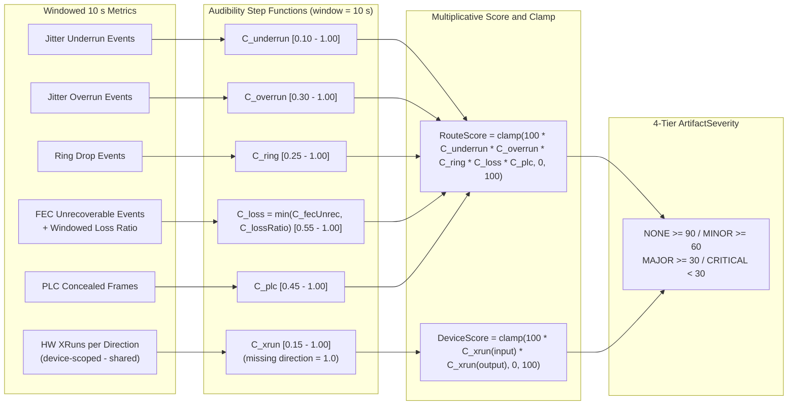

# ADR 0034: Per-Connection Audio Artifact Detection and Health

* **Status:** Accepted
* **Deciders:** Core Systems Architecture Team, Real-Time Audio Infrastructure Engineering, Distributed Systems & Network Engineering, Frontend Web UI Engineering
* **Date:** 2026-10-14

---

## Context and Problem Statement

The `audio-router-p2p` system routes real-time audio from capture hardware through a network transport to playout hardware: PortAudio capture → per-subscriber FIFO ring buffers → UDP/DTLS egress on one node, and UDP/DTLS ingress → adaptive jitter buffering with forward error correction (FEC), packet loss concealment (PLC), and asynchronous sample rate conversion (ASRC) → playback ring buffers → PortAudio playout on the other (ADR 0004, ADR 0015, ADR 0019, ADR 0030, ADR 0033). The WebUI already surfaces **signal presence** and **transport liveness**: level meters, clip lamps, DTX state, and the GHOST/quarantine badge (ADR 0014, ADR 0026).

What operators cannot see is **audio artifact quality**: whether the audio on a given input→output path is actually glitching right now, and *what is degrading it*.

### The Observability Gap (Verified)

Five specific gaps were verified against the codebase:

1. **Hardware XRuns are log-only**: In `pkg/audio/open.go`, `portaudioInput.Read()` detects `portaudio.InputOverflowed` and `portaudioOutput.Write()` detects `portaudio.OutputUnderflowed`, but both sites only emit a 1/s rate-limited log line. No counters exist and no API surface exposes them.
2. **Internal ring-buffer overruns are log-only or uncounted**: In `pkg/audio/resolver.go`, `inputSubscriber.dropCount` counts capture-ring dropped *bytes* but is consumed only by logs; `outputSubscriber` has **no drop counter at all**, so playback-ring overruns are silently dropped.
3. **Dead telemetry hook**: `Aggregator.RecordLocalHardwareUnderrun()` in `pkg/telemetry/aggregator.go` has zero callers, so `NetworkHealthSnapshot.local_underruns` is always 0 and the ADR 0010 node-level hardware penalty is inert.
4. **Network-side artifacts are counted but invisible**: Jitter underrun/overrun, late packets, FEC, and PLC *are* counted and partially exposed via `GET /api/v1/telemetry/stream-stats` (route-keyed) and `GET /api/v1/network/health` (opaque-hex-stream-id-keyed), but **no Svelte component renders any of these fields** — the fields exist in the API types and never reach a screen.
5. **No per-connection (per-route) health**: There is no single severity or score answering the operator's actual question: *"is this input→output audio path healthy, and what is degrading it?"*

### The XRun Observability Constraint

The PortAudio stream wrapper **swallows** XRun errors: both `Read()` and `Write()` catch `InputOverflowed` / `OutputUnderflowed`, emit the rate-limited log, and return a `nil` error together with the stale buffer so that the audio thread never observes a failure. A hardware XRun is therefore **only observable inside** the PA stream's own `Read()` / `Write()` call sites — any counting mechanism must be placed there, or on a hook invoked from there.

### The Attribution Constraint: Route-Scoped vs. Device-Scoped Artifacts

The router opens **one physical PortAudio stream per device**, reference-counted across every route that uses the device (`deviceStreamController`, ADR 0015 / ADR 0030). Artifact sources therefore split into two attribution classes:

| Attribution Class | Sources |
| :--- | :--- |
| **Per-route** (directly attributable to one input→output path) | Ring-buffer drops (per subscriber handle), jitter under/overruns, late packets, FEC events, PLC concealment, packet loss |
| **Per-physical-device** (shared, ref-counted) | Hardware XRuns — they live on the `deviceStreamController.physical` stream, shared across all routes on that device; **one XRun affects every route using the device** |

Any health model that naively fans a shared device XRun out into every route would inflate counts by a factor of $N$ (one device XRun counted $N$ times across $N$ routes) and would steer the operator toward "fix the route" when the fault is in the device. The design must therefore keep route-scoped scoring pure and surface device impact as an explicit overlay.

---

## Decision Drivers

* **Zero Audio-Path Contention**: Lock-free, allocation-free counting on all real-time audio threads — no mutexes, channel sends, or heap allocations inside `Read()` / `Write()` / ring writes (sub-5 ms per-frame budget, consistent with ADR 0010 / ADR 0014).
* **Exact, Per-Event XRun Counting**: Hardware XRuns must be counted once per occurrence via a push hook at the exact error site — no sampling approximation, no driver-state polling, no baseline subtraction.
* **Windowed/Recent Rates, Not Lifetime Totals**: The health indicator must reflect the **last 10 seconds** (windowed event counts plus per-second rates) and must *decay* when the artifact stops, so the score answers "healthy RIGHT NOW," not "ever."
* **Deterministic, Audibility-Based Severity**: A single bounded 0–100 score plus a discrete 4-tier grade per route (and per device), derived from documented audibility step functions, so "how bad" is the same answer for every consumer.
* **Additive, Backward-Compatible API**: New fields and endpoints must not break existing consumers. **No new WS/SSE push channel** for this feature — 2 s REST polling is the cadence that matches a 10 s window.

---

## Considered Options

* **Option 1: Expose-Only — Render Existing Lifetime Counters and Wire the Dead `RecordLocalHardwareUnderrun` Hook**
  * *Description*: Minimal-diff option. Wire the existing-but-dead `Aggregator.RecordLocalHardwareUnderrun()` into the PortAudio XRun log sites, expose the existing lifetime counters (`JitterStats.underruns` / `overruns`, FEC and PLC totals, stream-level late/early packets) in a new UI panel, and render them.
  * *Drawbacks*: Lifetime totals do not answer "is it healthy RIGHT NOW" — a single glitch an hour ago tints an otherwise-clean path with a permanently degraded score, and a storm that stopped 30 s ago still reads as worst-ever. Hardware XRuns (the operator's primary ask) would still be aggregated only at node level, never per device or per route. No output-ring counting (`outputSubscriber` drops remain silent). No per-route severity or score.

* **Option 2: High-Frequency Push Over the Existing WS/SSE `TelemetryHub`**
  * *Description*: Emit a new artifact frame type over the existing `TelemetryHub` SSE/WebSocket channels (analogous to the ADR 0010 `network_health` frames) and update the UI pills in real time without REST polling.
  * *Drawbacks*: A 10 s window sampled at 1 s contains **no sub-second information an operator can act on** — pushing faster than the window resolution is pure bandwidth cost. A new hub frame type plus cluster-relay fan-out plus WebSocket backpressure handling is disproportionate machinery for a *diagnostics* feature. The existing 2 s REST polling cadence already matches the window. Revisit only if artifact severity ever drives *control* decisions (auto-mute, auto-reroute).

* **Option 3: Local Atomic Counters, Exact Push-Hook XRuns, and a Dedicated 1 s / 10 s `ArtifactAggregator` [CHOSEN]**
  * *Description*:
    1. Instrument every artifact source with lock-free atomic counters placed at the exact event site (PA XRun error sites, ring-buffer write paths, jitter/FEC/PLC/loss paths).
    2. Count hardware XRuns **exactly, per event**, via a push hook (`xrunHook atomic.Pointer[func()]`) invoked at the existing, unchanged XRun error sites, accumulating into per-physical-device lifetime counters on the `deviceStreamController`.
    3. Introduce a dedicated `ArtifactAggregator` (own 1 s ticker, own `atomic.Pointer[ArtifactSnapshot]`) that computes 10 s windowed counts and per-second rates, and evaluates a deterministic audibility-based 0–100 severity per route and per device.
    4. Expose the result **additively**: optional `health` / `devices` fields on the existing route-keyed `GET /api/v1/telemetry/stream-stats`, a new URN-keyed `GET /api/v1/telemetry/device-artifacts` endpoint, and `late_packets` / `early_packets` additions to `JitterStats` / `StreamLinkStats`.
    5. Render the result in the WebUI as a flow-canvas `HealthPill` on device nodes plus a diagnostics "Audio Artifacts" panel, backed by pure, unit-testable Svelte utilities.
  * *Advantages*: Zero lock contention and zero per-event heap allocation on audio paths; exact (non-sampled) XRun accounting with correct device-lifetime semantics across stream swaps; live 10 s windowed rates that self-clear when the artifact stops; a single deterministic severity number per route and per device; a fully additive, byte-compatible API with no new push channel; and an explicit route-vs-device attribution model that prevents misdirected debugging.

---

## Decision Outcome

Chosen Option: **Option 3: Local Atomic Counters, Exact Push-Hook XRuns, and a Dedicated 1 s / 10 s `ArtifactAggregator`**.

### 1. Counter Instrumentation and Attribution Model

Every artifact source receives exactly one monotonic atomic counter at its event site. The write cost on the audio hot path is a single `atomic.Add` per event — the same cost class as today's counters — with no allocation, channel, or goroutine.

| Counter | Lives On |
| :--- | :--- |
| HW XRun hook (input/output) | `portaudioInput` / `portaudioOutput` (`pkg/audio/open.go`): new `xrunHook atomic.Pointer[func()]` + `SetXRunHook()`. Invoked at the **existing** XRun error site — once per XRun, under the stream's own `mu` — after the unchanged 1/s rate-limited log. |
| HW XRun device-lifetime | `deviceStreamController` (`pkg/audio/resolver.go`): new `hwXrunsIn` / `hwXrunsOut atomic.Uint64`, written **directly** by the hook closure. No per-instance counter, no sampling, no baseline. |
| Input ring drop | `inputSubscriber`: existing `dropCount` (bytes) + new `dropEvents atomic.Uint64`. Exact dropped bytes come from the new `ringBuf.write` return value. |
| Output ring drop (NEW) | `outputSubscriber`: new `dropBytes` / `dropEvents atomic.Uint64` + a rate-limited log line in the `writeOutput` multi-writer path (previously silent drops). |
| Jitter late (lock-free) | `JitterBuffer` (`pkg/streamer/jitter.go`): new `atomicLatePackets`; `AtomicLinkStats()` extended with late/early returns. (`earlyPackets` is a **dead counter** — no increment site exists; the field is kept for backward compatibility and receives no windowing or scoring weight.) |

#### A. Exact XRun Push Hook

The PortAudio wrapper swallows the XRun error by design (the audio thread must not observe it), so the hook is installed *on the stream* and fired from the unchanged error branch:

```go
// pkg/audio/open.go — at the existing InputOverflowed site (output side symmetric):
if errors.Is(err, portaudio.InputOverflowed) {
    p.logXRunRateLimited()          // unchanged 1/s log line
    if h := p.xrunHook.Load(); h != nil {
        h()                         // once per XRun, under the stream's own mu
    }
    return p.staleBuffer(), nil     // unchanged: error swallowed, stale buffer
}
```

* The hook is an `atomic.Pointer[func()]`, **loaded only in the rare XRun branch**, so the happy path pays nothing and correctness does not depend on publication-ordering invariants surviving future refactors.
* `deviceStreamController` is **single-direction per `StreamKey`**. `installXRunHook(phys)` sets the hook to a closure that increments the direction-appropriate lifetime counter (`hwXrunsIn` or `hwXrunsOut`). It is called in the constructor (before the controller is published) and in `swapPhysicalStream` (under `c.mu`).
* `resampledAudioStream` (the ASRC wrapper, ADR 0019) forwards `SetXRunHook` to its `underlying` stream. Non-implementers (ghost / emulator / virtual streams) are safely skipped via an optional-interface type assertion.

**Exactness across swaps**: the old physical instance's hook is intentionally **never cleared**. An XRun arriving in the teardown window still attributes to the owning controller — the correct device-lifetime semantic, since the XRun physically occurred on that device. Device-lifetime totals are therefore monotonic across stream re-opens and swaps.

#### B. Exact Ring-Drop Byte Accounting

`ringBuf.write` now returns the frame-aligned number of bytes it dropped, making every ring drop exactly quantifiable:

```go
// ringBuf.write now returns frame-aligned dropped bytes (0 when the write fits).
func (r *ringBuf) write(p []byte) int
```

Exhaustive call sites (verified by grep): `emulatorInput.produce` (ignores the return value), `inputSubscriber.push` (counts into `dropCount` + `dropEvents`), `writeOutput` (counts into `outputSubscriber` `dropBytes` + `dropEvents`).

#### C. Route Score vs. Device Overlay (Attribution Discipline)

* The **route score** uses ONLY route-scoped coefficients (jitter underrun/overrun, ring drops, loss, PLC). Device XRuns do **not** multiply the route score.
* `RouteHealth` carries a **`devices` impact overlay** (input/output `DeviceHealth`: score, severity, `xrun_window`, `xrun_total`, `ghost`) so that a route transiting a degraded device is never shown as falsely clean.
* The **device node pill** on the flow canvas evaluates as `max(severity(deviceScore), worst severity of the routes touching the device)` — this makes hardware XRuns visible even when every route's own counters are clean.
* The **per-route tooltip** lists the route's windowed breakdown **plus a distinct "shared device" line**, so an operator never mistakes a device event for a route defect.
* Rejected alternative: fanning shared XRuns into every route's score. The $N$-inflation plus misattribution actively steers operators to fix the *route* instead of the *device*.

### 2. Windowed Rate Computation: the `ArtifactAggregator`

* A new `ArtifactAggregator` lives in its own file with its **own 1 s ticker** and its **own `atomic.Pointer[ArtifactSnapshot]`**. It is deliberately **not** the 250 ms network `Aggregator` from ADR 0010: the cadence and the keying differ (routes and device URNs vs. peers and hex stream IDs), and its state must not bloat `NetworkHealthSnapshot`, which has its own stable JSON contract. It reuses the package's existing `timestampedCount` / `pruneOldSamples` helpers and the immutable-snapshot + atomic-swap idiom ($O(1)$ lock-free reads).
* **Hot path**: one `atomic.Add` per artifact event (same cost as today). No per-event allocation, channel send, or goroutine.
* **Every 1 s tick**: the aggregator samples all live monotonic counters, appends each sample to per-entity window rings of **11 entries** (10 s window @ 1 s + 1 baseline), and computes the window delta (newest minus oldest).
* **Reset guard**: if `nowValue < oldestValue`, the counter was reset (route recreated, stream swapped) — the ring re-bases to the current value and the window for that tick is 0. Negative deltas are never produced.
* **Rate computation**: `rate = window / actualSpanSeconds`, where the span is the true elapsed time between the two ring endpoints — ramp-up safe (a route that has existed for 3 s is computed over 3 s, not 10 s).
* **1 s / 10 s rationale**: consistent with the existing 10 s window convention already established by `localHWHist` and `peerHistory.underrunSamples` in the ADR 0010 aggregator; and 2 s UI polling cannot render sub-second rates. A 10 s horizon is long enough to distinguish a single glitch from a sustained storm (the coefficient step functions span 0 → 30+ events).
* **Bounded memory**: routes × (13 route metrics + peers × 3) × 11 entries × 16 B ≈ **0.4 MB at 50 routes / 8 peers**. All maps are bounded by live entities and pruned each tick.

### 3. Audibility-Based Severity Model (Multiplicative, Over the 10 s Window)

The score starts at 100 and applies multiplicative audibility penalty coefficients — the same formulation family as the ADR 0010 peer health score, specialized to audio artifacts:

$$RouteScore = \mathrm{clamp}\left(100 \times C_{\text{underrun}} \times C_{\text{overrun}} \times C_{\text{ring}} \times C_{\text{loss}} \times C_{\text{plc}},\; 0,\; 100\right)$$

$$DeviceScore = \mathrm{clamp}\left(100 \times C_{\text{xrun}}(\text{input}) \times C_{\text{xrun}}(\text{output}),\; 0,\; 100\right)$$

A missing direction on a device contributes $C = 1.0$ (e.g., an input-only device has no output XRun term).

#### Coefficient Step Tables (window = 10 s)

**Jitter Underrun Coefficient ($C_{\text{underrun}}$)** — jitter buffer underrun events:

| Underrun Events (10 s) | 0 | 1–2 | 3–7 | 8–15 | 16–30 | > 30 |
| :--- | :--- | :--- | :--- | :--- | :--- | :--- |
| $C_{\text{underrun}}$ | 1.00 | 0.80 | 0.60 | 0.40 | 0.25 | 0.10 |

**Jitter Overrun Coefficient ($C_{\text{overrun}}$)** — jitter buffer overrun events:

| Overrun Events (10 s) | 0 | 1–2 | 3–7 | 8–15 | > 15 |
| :--- | :--- | :--- | :--- | :--- | :--- |
| $C_{\text{overrun}}$ | 1.00 | 0.90 | 0.75 | 0.55 | 0.30 |

**Ring Drop Coefficient ($C_{\text{ring}}$)** — capture/playback ring drop events:

| Ring Drop Events (10 s) | 0 | 1 | 2–4 | 5–9 | ≥ 10 |
| :--- | :--- | :--- | :--- | :--- | :--- |
| $C_{\text{ring}}$ | 1.00 | 0.85 | 0.65 | 0.45 | 0.25 |

**Hardware XRun Coefficient ($C_{\text{xrun}}$)** — HW XRuns per direction (device-scoped):

| HW XRuns (10 s, per direction) | 0 | 1 | 2–3 | 4–7 | ≥ 8 |
| :--- | :--- | :--- | :--- | :--- | :--- |
| $C_{\text{xrun}}$ | 1.00 | 0.70 | 0.50 | 0.30 | 0.15 |

**Loss Coefficient ($C_{\text{loss}}$)** — the weaker of FEC-unrecoverable and raw loss:

$C_{\text{loss}} = \min\left(C_{\text{fecUnrec}},\; C_{\text{lossRatio}}\right)$, where $C_{\text{lossRatio}}$ reuses the existing `telemetry.CalculateLossCoefficient` (ADR 0010) applied to the **windowed** loss ratio, and:

| FEC Unrecoverable Events (10 s) | 0 | 1–2 | 3–5 | ≥ 6 |
| :--- | :--- | :--- | :--- | :--- |
| $C_{\text{fecUnrec}}$ | 1.00 | 0.90 | 0.75 | 0.55 |

**PLC Concealment Coefficient ($C_{\text{plc}}$)** — PLC-concealed frames:

| PLC-Concealed Frames (10 s) | 0–9 | 10–49 | 50–249 | ≥ 250 |
| :--- | :--- | :--- | :--- | :--- |
| $C_{\text{plc}}$ | 1.00 | 0.85 | 0.65 | 0.45 |

#### Severity Mapping

A new 4-tier type `ArtifactSeverity` maps the score to a discrete grade. It is deliberately **distinct** from the existing 5-tier `NodeHealthGrade` (EXCELLENT / GOOD / FAIR / POOR / CRITICAL) — the two answer different questions (artifact audibility vs. link quality) and are not cross-mapped:

| Score | `ArtifactSeverity` |
| :--- | :--- |
| ≥ 90 | NONE |
| 60–89 | MINOR |
| 30–59 | MAJOR |
| < 30 | CRITICAL |

#### Sanity Checkpoints

| Scenario (10 s window) | Computation | Score / Severity |
| :--- | :--- | :--- |
| Clean path | all $C = 1.0$ | 100 / NONE |
| One 20 ms glitch (1 jitter underrun) | $100 \times 0.80$ | 80 / MINOR |
| 5 underruns + 200 ms PLC (10 concealed frames) | $100 \times 0.60 \times 0.85$ | 51 / MAJOR |
| Sustained underrun storm (> 30 events) | $100 \times 0.10 \times \dots$ | < 10 / CRITICAL |
| 8+ HW XRuns on both directions of a device | $100 \times 0.15 \times 0.15$ | 2 / CRITICAL |

#### Excluded from Scoring (Informational Only)

The following counters are exposed in the API but deliberately carry **no** scoring weight:

* **FEC recovered** — inaudible by construction; the number is *proof FEC is working*, not a defect.
* **Early packets** — dead counter (no increment site); retained for backward compatibility.
* **`playout_gaps`** (`RemotePeer.totalUnderruns`) — not a clean audibility signal: pre-roll inflates it, and the genuinely audible starvation case is already counted by `JitterBuffer.underruns`.
* **DTX silence** — intentional silence suppression, not an artifact.
* **ASRC drift / watermark** — corrective resampler behavior, not an artifact.

### 4. Additive API Contract (Backward-Compatible)

* **Source of truth: `GET /api/v1/telemetry/stream-stats`** — the response map is **keyed by route ID** (room routes are of the form `room-<roomId>-<inDev>-<outDev>`, so the key embeds the device identifiers the frontend already substring-matches for meters). The per-entry `stream_id` field remains the opaque **hex** derived stream ID (unchanged). `StreamStats` gains optional `health?: RouteHealth` and `devices?: RouteDeviceImpact`; `JitterStats` gains `late_packets` / `early_packets`.
* **New: `GET /api/v1/telemetry/device-artifacts`** — returns `map[URN]DeviceHealth`, giving exact device binding (no urn/checksum tail matching) for the flow-canvas device pills.
* **`GET /api/v1/network/health`**: **no** mirror of `RouteHealth` / `DeviceHealth`. Its streams are keyed by opaque hex stream IDs that cannot carry route or device identity, and a second source of truth would drift from the route-keyed one. The only additions are additive `late_packets` / `early_packets` fields on `StreamLinkStats`.
* `health` / `devices` are pointer fields tagged `omitempty`: when the `ArtifactAggregator` is unwired (tests, partial startup), the response is **byte-compatible** with today's output. `late_packets` / `early_packets` are plain additive fields (zero when absent).

#### `GET /api/v1/telemetry/stream-stats` (keyed by route ID; new fields highlighted)

```json
{
  "room-<room-id>-<in-dev>-<out-dev>": {
    "stream_id": "9f2ab6c1e4d38a5b0c7d1f6e2a9b4c0d",
    "packets_sent": 145020,
    "packets_received": 145018,
    "underruns": 1,
    "overruns": 0,
    "dtx_state": "active",
    "rms_dbfs": -18.2,
    "peak_dbfs": -6.1,
    "fec": { "group_size_k": 2, "packets_recovered_total": 2, "unrecoverable_groups_total": 0 },
    "plc": { "concealed_frames_total": 0 },
    "asrc": { "nominal_rate_hz": 48000, "drift_ppm": 0.4, "resample_ratio": 1.0 },
    "peers": {
      "node-audio-02": {
        "current_depth_frames": 4,
        "target_depth_frames": 4,
        "underruns": 1,
        "overruns": 0,
        "jitter_ms": 2.4,
        "late_packets": 0,
        "early_packets": 0
      }
    },
    "health": {
      "score": 80,
      "severity": "MINOR",
      "window_s": 10,
      "underruns": 1,
      "overruns": 0,
      "ring_drops": 0,
      "plc_concealed": 0,
      "fec_unrecoverable": 0,
      "packets_lost": 0,
      "fec_recovered": 2,
      "playout_gaps": 0,
      "rates": {
        "underrun_per_s": 0.1,
        "overrun_per_s": 0.0,
        "xrun_per_s": 0.1,
        "ring_drop_per_s": 0.0
      },
      "ghost": false,
      "peers": {
        "node-audio-02": { "underruns": 1, "overruns": 0, "late_packets": 0 }
      }
    },
    "devices": {
      "input": {
        "urn": "alsa://hw:0,0",
        "ghost": false,
        "score": 100,
        "severity": "NONE",
        "input": { "xrun_window": 0, "xrun_total": 0 }
      },
      "output": {
        "urn": "alsa://hw:1,0",
        "ghost": false,
        "score": 70,
        "severity": "MINOR",
        "output": { "xrun_window": 1, "xrun_total": 12 }
      }
    }
  }
}
```

Notes on the shape above: the route itself reads 80 / MINOR from its own windowed counters ($100 \times C_{\text{underrun}} = 100 \times 0.80$), while the `devices` overlay reveals the output device's one in-window XRun ($100 \times 0.70$) — the route is not falsely clean, and the route score is not inflated by a shared device event. The input device omits the `output` direction object (missing direction ⇒ $C = 1.0$). `rates.xrun_per_s` inside `RouteHealth` is the device-shared figure that the tooltip renders on its distinct "shared device" line. `health.peers` carries the per-peer windowed triple (underruns / overruns / late_packets) used for the "worst peer" column.

#### `GET /api/v1/telemetry/device-artifacts` (NEW; URN-keyed)

```json
{
  "alsa://hw:0,0": {
    "urn": "alsa://hw:0,0",
    "ghost": false,
    "score": 100,
    "severity": "NONE",
    "input": { "xrun_window": 0, "xrun_total": 0 }
  },
  "alsa://hw:1,0": {
    "urn": "alsa://hw:1,0",
    "ghost": false,
    "score": 70,
    "severity": "MINOR",
    "output": { "xrun_window": 1, "xrun_total": 12 }
  }
}
```

#### `GET /api/v1/network/health` (additive fields only)

`StreamLinkStats` gains two fields; no `RouteHealth` / `DeviceHealth` mirror:

```json
{
  "stream_id": "9f2ab6c1",
  "packets_sent": 145020,
  "packets_received": 145018,
  "loss_ratio": 0.00001,
  "underruns": 1,
  "overruns": 0,
  "late_packets": 0,
  "early_packets": 0
}
```

The `api/openapi.yaml` contract and the embedded SPA build ship together with these changes.

### 5. Lifecycle and Failure Modes

| Scenario | Behavior |
| :--- | :--- |
| Audio thread starved | Artifact rates stop rising; the 10 s window decays the score back to 0 artifacts — self-clearing, no false positive. |
| Route added / removed | The sampler rebuilds from the live entity set each tick; stale windows are pruned within 1 s. No per-route goroutines, timers, or channels. |
| Device quarantined (GHOST) | XRun production stops; the device-lifetime counter is **not** reset (the window decays on its own). `ghost=true` → UI shows the GHOST chip plus "no live signal". Severity may read NONE, which is correct. |
| Physical stream re-opened / swapped | The new instance's hook is installed at swap time; device-lifetime totals stay monotonic; the aggregator's reset re-base guard is defense in depth. |
| Peer appears dynamically (≤ 64 per route) | A fresh window ring is allocated per peer on first sight. |
| Aggregator tick overrun | The ticker simply drops beats (no queueing); the snapshot is an atomic pointer swap, so API handlers never block. |
| Aggregator unwired (tests / partial startup) | `health` / `devices` are omitted via `omitempty` — byte-compatible responses. |
| Shutdown | Idempotent `Stop()` (ticker cancel + `wg.Wait`), wired next to the existing 250 ms aggregator in the daemon lifecycle. |
| Unbounded growth risk | Window rings are fixed at 11 entries; maps are bounded by live entities; the snapshot is immutable and replaced wholesale, never mutated in place. |

### 6. Frontend Rendering (Svelte 5)

* **Flow canvas** (`InputDeviceNode` / `OutputDeviceNode`): a compact `HealthPill` — severity dot + 3-letter label (e.g., `MIN`) — evaluates to `devicePillSeverity`, the **worst** of the device's own severity and the severities of all routes touching the device, so a device XRun is visible even when every route's own counters are clean. A hover popover lists the per-route windowed breakdown **plus a distinct "shared device" line** (device URN, per-direction XRun window/total, severity). Binding reuses the existing meter stream-matching predicate (URN / checksum / tail / legacy_id / room-id, 1500 ms staleness threshold).
* **Diagnostics** (`TelemetryDashboard`): a new `RouteHealthPanel` ("Audio Artifacts") mounted in the selected-node inspector area — a per-route table (pill, score, windowed counters rendered as chips with e/s rates, worst peer) plus device rows (URN, ghost flag, per-direction XRun window and total) sourced from the URN-keyed endpoint.
* **Shared pure utilities** in `web/src/lib/utils/artifacts.ts`: severity ordering, `worstSeverity`, `severityBadgeClass`, `formatRate`, `devicePillSeverity`, `breakdownLines` — all pure functions, unit-testable without the DOM.

---

## Consequences

### Positive Consequences

* **Audio artifacts become visible and attributable for the first time**: every hardware XRun, ring-buffer drop, jitter under/overrun, late packet, FEC-unrecoverable group, and PLC-concealed frame is counted per event and exposed per route and per physical device.
* **Live, not lifetime**: the 10 s windowed counts and per-second rates answer "is this path healthy *right now*," and the score self-clears within one window after the artifact stops.
* **Exact, push-based XRun accounting**: the hook fires once per XRun at the exact driver error site — no sampling, no polling, no baseline subtraction — and device-lifetime totals remain monotonic and correctly attributed across stream swaps.
* **Hard real-time guarantees preserved**: the hot path is a single `atomic.Add` per event; snapshot reads are $O(1)$ lock-free atomic pointer loads; the sub-5 ms audio budget is untouched.
* **Deterministic, audibility-based severity**: one bounded 0–100 score plus a 4-tier `ArtifactSeverity` per route and per device, derived from documented step tables, gives every consumer (UI pill, diagnostics panel, future automation) the same answer to "how bad."
* **Backward-compatible API surface**: additive optional fields, one new URN-keyed endpoint, no schema breaks, and byte-compatible responses when the aggregator is unwired; no new WS/SSE channel and no cluster-relay changes.
* **Correct attribution discipline**: the route-vs-device separation (pure route score, explicit `devices` overlay, device pill, "shared device" tooltip line) steers operators toward the actual faulty layer instead of the routes that merely transit it.

### Negative Consequences

* **Route score excludes device XRuns**: a route transiting a failing device can read NONE or MINOR from its own counters while its audio is genuinely glitching. This is mitigated by the `devices` overlay, the tooltip's "shared device" line, and the device node pill — but the **single route number under-states the audible reality** for an operator who reads only that number.
* **Polling latency**: with 2 s UI polling, a pill can lag real degradation by up to ~2 s, and a stopped artifact takes up to ~10 s to fully decay out of the window. An operator watching (and hearing) live audio perceives a freshness gap: the audio recovers before the pill does, and a fresh glitch appears up to ~2 s late.
* **Step-function coefficient sensitivity**: the thresholds in the coefficient tables are audibility heuristics, not measured psychoacoustic constants. They will need empirical tuning per environment and hardware class, and a mis-tuned step boundary can over-alarm (operator fatigue) or under-alarm (missed degradation).
* **Second aggregator = duplicated scaffolding**: the `ArtifactAggregator` duplicates ~100 lines of aggregator scaffolding (ticker, ring bookkeeping, snapshot swap) and runs a second 1 s background goroutine — a minor CPU/GC cost and one more component to lifecycle-manage (startup, shutdown, unwired fallback).
* **More API surface and frontend state**: a new endpoint, new optional fields on existing responses, and new store fields enlarge the change to review and create a coordination point with the embedded SPA build (OpenAPI schema, `web/src/lib/api/types.ts`, and the built assets must ship together).
* **XRun count is per-physical-device, not per-route**: the design deliberately does **not** attribute shared XRuns to individual routes, so any per-route "XRuns" figure surfaced in tooltips is a device-shared number. Operators must read the distinct "shared device" line to avoid misattributing a device fault to a single route — a real cognitive cost if the UI wording is unclear.

### Neutral Consequences

* **Schema coordination**: the `api/openapi.yaml` contract, the frontend API types, and the embedded SPA build must be updated in lockstep with the new endpoint and optional fields (the same coordination pattern established by ADR 0010 and ADR 0005).
* **Two severity vocabularies coexist**: the new 4-tier `ArtifactSeverity` (NONE / MINOR / MAJOR / CRITICAL) is distinct from the existing 5-tier `NodeHealthGrade` (EXCELLENT / GOOD / FAIR / POOR / CRITICAL); UI badge styling must map each to its own vocabulary with no cross-mapping, and dashboards must not conflate the two.
* **Dead counters are preserved, not removed**: `earlyPackets` (no increment site) and the unwired ADR 0010 `RecordLocalHardwareUnderrun` path remain in the code and API types for backward compatibility, explicitly excluded from windowing and scoring.

---

## Visual Architecture

### 1. Artifact Detection and Aggregation Data Flow

```mermaid
graph TB
    subgraph DeviceLayer ["Physical Device Layer (shared - ref-counted per deviceStreamController)"]
        PA["PortAudio Stream (pkg/audio/open.go)\nRead detects InputOverflowed\nWrite detects OutputUnderflowed\nerror swallowed - stale buffer returned"]
        XHOOK["xrunHook atomic.Pointer[func()]\ninstalled on construct and on swap\nforwarded through resampledAudioStream"]
        LIFE["deviceStreamController\nhwXrunsIn / hwXrunsOut atomic.Uint64\ndevice-lifetime - monotonic across swaps"]
        RINGIN["inputSubscriber (per route handle)\ndropCount bytes + dropEvents (NEW)\nexact bytes from ringBuf.write return"]
        RINGOUT["outputSubscriber (per route handle - NEW counters)\ndropBytes + dropEvents\nrate-limited log in writeOutput"]

        PA -->|once per XRun under stream mu| XHOOK
        XHOOK -->|closure Add(1)| LIFE
    end

    subgraph RouteLayer ["Route Layer (per input-to-output audio path)"]
        JB["JitterBuffer atomics\nunderruns / overruns\natomicLatePackets (NEW)"]
        FEC["FEC atomics\nrecovered / unrecoverable groups"]
        PLC["PLC atomics\nconcealed frames"]
        LOSS["Loss atomics\nsequence gaps / packets lost"]

        JB --> ROUTE["Per-Route Artifact Counters\n(one atomic.Add per event - no allocation)"]
        FEC --> ROUTE
        PLC --> ROUTE
        LOSS --> ROUTE
    end

    subgraph Agg ["ArtifactAggregator (pkg/telemetry - NEW)"]
        TICK["Dedicated 1 s Ticker\nown goroutine - no per-route timers"]
        WIN["Window Rings (11 entries)\n10 s at 1 s + 1 baseline\nreset re-base guard\nrate = window / actualSpanSeconds"]
        SCORE["Audibility Score Engine\nRouteScore / DeviceScore (0-100)\nArtifactSeverity: NONE / MINOR / MAJOR / CRITICAL"]
        SNAP["atomic.Pointer[ArtifactSnapshot]\nimmutable snapshot - O(1) lock-free read"]

        TICK --> WIN
        WIN --> SCORE
        SCORE -->|atomic pointer swap| SNAP
    end

    LIFE -.->|1 s sample| TICK
    RINGIN -.->|1 s sample| TICK
    RINGOUT -.->|1 s sample| TICK
    ROUTE -.->|1 s sample| TICK

    subgraph API ["Additive REST API (2 s UI polling)"]
        STATS["GET /api/v1/telemetry/stream-stats (route-keyed)\n+ health - + devices\n+ late_packets / early_packets on JitterStats"]
        DEVICES["GET /api/v1/telemetry/device-artifacts (NEW)\nURN-keyed map of DeviceHealth"]

        SNAP ==>|Load snapshot O(1)| STATS
        SNAP ==>|Load snapshot O(1)| DEVICES
    end

    subgraph UI ["Svelte 5 Surfaces"]
        PILL["Flow Canvas HealthPill\nInputDeviceNode / OutputDeviceNode\nseverity dot + 3-letter label\nworst of device and touching routes\nhover: per-route breakdown + shared-device line"]
        PANEL["Diagnostics RouteHealthPanel (Audio Artifacts)\nper-route table: pill - score - e/s chips - worst peer\ndevice rows: URN - ghost - XRun window/total"]

        STATS --> PILL
        STATS --> PANEL
        DEVICES --> PILL
        DEVICES --> PANEL
    end
```

### 2. Audibility Severity Score Evaluation Pipeline


